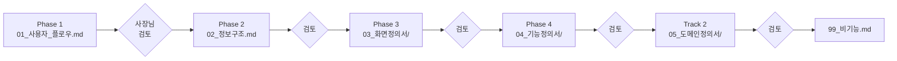

# 주얼리 쇼핑몰 E2E UX Flow 설계서 — 00 Overview

- **박제일**: 2026-05-21
- **박제자**: main (Claude Opus 4.7)
- **프로젝트**: shop (싱글 브랜드 주얼리 쇼핑몰)
- **단계**: S0 (Step 0 — 상세 기획서)

---

## 1. 문서 목적

본 산출물 묶음은 **유저 플로우 → IA → 화면정의서 → 기능정의서** 4단계 위계로 쇼핑몰의 E2E (End-to-End) UX 흐름을 설계합니다. 디자인 시안/UI 컴포넌트 비주얼은 별도 산출물(디자인 트랙)에서 다루며, 본 문서는 **고객 여정 기반의 화면·기능 설계**만 담당합니다.

도메인(상품·주문·결제 등 12개)은 4단계 위계 안에 자연스럽게 녹이며, 별도 `05_도메인정의서/`에서 백엔드/도메인 모델 관점으로 1차 박제도 병행합니다.

> **2026-05-22~23 v0.2 갱신 메모**: `쇼핑몰_전용_QA_v4.md` (v4.8) + `공통_인프라_보안_QA.md` (v2.0) 정합 보강 사이클 완료. f11~f21 기능정의서 11건 + d11~d21 도메인정의서 11건 모두 v0.2 로 동기화. 본 §2 핵심 제약 (회원 전용·카드 단일·한국어 단일·앱 없음·디자인 별도·양방향 매핑·미결 통합관리) 은 사장님 verbatim 그대로 유지. 본 사이클에서 새로 식별된 미결은 `_미결사항_통합관리.md §3` 에 누적 append (Round 1~5 누계 200+ 행).

---

## 2. 핵심 제약 (사장님 확정)

| # | 항목 | 확정 내용 | 적용 영향 |
|---|---|---|---|
| 1 | **결제수단** | **카드 단일** (할부 2/3/6/12개월) — **토스 MCP 모듈** | 무통장/가상계좌/에스크로 + 간편결제(카카오페이·네이버페이·토스페이) 전 영역 Out-of-scope. QA의 PAY-U-011~015 / 025 / 034, PAY-A-021 / 023 등 미포함. |
| 2 | **PG** | 토스페이먼츠 (MCP 모듈) | 결제 승인 콜백·환불 API·멱등성 키 모두 토스 규약 기반. |
| 3 | **양방향 매핑** | **프론트 기능 = 관리자에서 컨트롤 가능** | 모든 도메인 .md에 "사용자 기능 ↔ 관리자 통제 매핑표" 1급 섹션 의무. |
| 4 | **디자인** | 별도 산출물 (디자인 트랙) | 본 문서에는 UI 시안·컬러·컴포넌트 비주얼 미포함. 화면정의서는 컴포넌트 **구조·동작·상태·예외**만 박제. |
| 5 | **타겟** | 10~20대 여성 (싱글 브랜드 주얼리) | 페르소나 2종(신디·지은) — `01_사용자_플로우.md` §2 참조. |
| 6 | **앱** | **없음** (반응형 웹 단일) | `apps/mobile/` 폴더 미사용. PWA 검토는 Phase 4 별도 결정. |
| 7 | **언어** | **한국어 단일** | 다국어 분기 IA·화면정의서 미설계. |
| 8 | **회원 가입** | **회원 전용** (비회원 주문 불가) | QA의 ORD-U-013~016 (비회원 주문) + MEM-A-032 (비회원 정책) Out-of-scope. 비회원 장바구니(localStorage)는 결제 진입 시 **로그인 강제 게이트**. |

---

## 3. 산출물 인덱스

### 3.1 4단계 위계 트랙 (Track 1 — UX 흐름)

| 파일 | 단계 | 내용 |
|---|---|---|
| `00_개요.md` | — | 본 문서 |
| `01_사용자_플로우.md` | **Phase 1** | E2E User Flow + Customer Journey + Service Blueprint |
| `02_정보구조.md` | **Phase 2** | 정보구조 (사이트맵·메뉴 트리·URL 구조·네비게이션 패턴) |
| `03_화면정의서/` | **Phase 3** | 화면정의서 (화면 단위 .md, 약 30~50개 예상) |
| `04_기능정의서/` | **Phase 4** | 기능정의서 (도메인 단위, 화면에 종속된 UX 측면 기능) |
| `99_비기능.md` | — | 비기능·인프라·보안 (공통_QA 196건 통합) |

### 3.2 도메인 트랙 (Track 2 — 백엔드/도메인 모델)

`05_도메인정의서/` 하위 12개 .md — 도메인별 엔티티·UseCase·API 면·도메인 룰·이벤트·QA 추적

| # | 파일 | 도메인 |
|---|---|---|
| d11 | `d11_회원.md` | 회원 |
| d12 | `d12_상품.md` | 상품 |
| d13 | `d13_카테고리.md` | 카테고리 |
| d14 | `d14_장바구니.md` | 장바구니 |
| d15 | `d15_위시리스트.md` | 위시리스트 |
| d16 | `d16_주문.md` | 주문 |
| d17 | `d17_결제.md` | 결제 (카드만) |
| d18 | `d18_배송.md` | 배송 |
| d19 | `d19_리뷰_문의.md` | 리뷰·문의 |
| d20 | `d20_쿠폰_포인트.md` | 쿠폰·포인트 |
| d21 | `d21_관리자.md` | Admin 전용 |
| d99 | (= `99_비기능.md`) | 비기능 |

---

## 4. 작성 순서 / 게이트

각 Phase 완료 후 **사장님 검토 게이트** — 컨펌 후 다음 Phase 진입.

- Phase 3·4·Track 2 내부는 **파일 1개씩 작성 → 검토** 마이크로 게이트
- 임의 일괄 작성 금지

---

## 5. 도메인 12개 한 줄 정의

| # | 도메인 | 1줄 책임 |
|---|---|---|
| 1 | member | 가입·로그인·프로필·멤버십·탈퇴·블랙리스트 |
| 2 | product | 상품 CRUD·옵션·재고·이미지·검색·타임세일 |
| 3 | category | 카테고리 트리·필터·탐색 |
| 4 | cart | 회원/비회원 장바구니·병합·만료·가격 변동 알림 |
| 5 | wishlist | 찜·재입고 알림 |
| 6 | order | 주문 생성·취소·부분취소·구매확정·정산 |
| 7 | payment | 토스페이먼츠 카드 결제·할부·환불 |
| 8 | delivery | 배송지·배송비·운송장·반품·교환 |
| 9 | review | 리뷰·Q&A·1:1 문의·실시간 채팅 |
| 10 | coupon_point | 쿠폰 발급/사용/복원 · 포인트 적립/사용/소멸 |
| 11 | admin | 대시보드·공지·배너·마케팅·제재·시스템 설정 |
| 12 | nonfunctional | 인증·API보안·인젝션·성능·DB·로그·HTTPS·법령·인프라 (공통_QA 196건) |

---

## 6. KPI / 성공 지표 (Phase 1 초안 — 사장님 컨펌 후 확정)

| 영역 | 지표 후보 | 비고 |
|---|---|---|
| 유입 | 월 UV / 신규 가입율 | GA4 기반 |
| 탐색 | 상품 상세 진입율 / 장바구니 추가율 | 카드 클릭 → 상세 → 카트 |
| 구매 | 카트 → 결제완료 전환율 / 객단가 | 결제 이탈 단계별 funnel |
| 배송 | 배송완료 SLA / CS 인입율 | 운송장 등록~배송완료 |
| 재구매 | 90일 재구매율 / 멤버십 등급 상승률 | 회원 코호트 |
| 운영 | 미결제 자동취소율 / 반품율 / 재고 정합성 | 관리자 대시보드 |

---

## 7. 마일스톤 (작업 일정 — Phase별)

| Phase | 산출물 | 예상 소요 |
|---|---|---|
| Phase 1 | `01_사용자_플로우.md` | 1 세션 |
| Phase 2 | `02_정보구조.md` | 1 세션 |
| Phase 3 | `03_화면정의서/*.md` (~30~50개) | 화면당 마이크로 게이트, 다수 세션 |
| Phase 4 | `04_기능정의서/*.md` (~12개) | 도메인당 마이크로 게이트 |
| Track 2 | `05_도메인정의서/*.md` (~12개) | 도메인당 마이크로 게이트 |
| 비기능 | `99_비기능.md` | 1 세션 |

---

## 8. 리스크 (Phase 1에서 식별, Phase별로 확장)

| 영역 | 리스크 | 대응 |
|---|---|---|
| 결제 단일화 | 카드만 운영 → 카드 이슈 시 결제 전면 중단 | PG 장애 시 점검 모드 즉시 전환 + 사용자 안내 |
| 동시성 | 재고 차감·복구가 다층 흐름(주문·취소·반품·교환·관리자 수동) | DB 락 + 분산 락(Redis) + 멱등성 키 — Phase 4·Track 2에서 상세 |
| 양방향 매핑 누락 | 프론트에 노출되는 기능을 관리자가 컨트롤 못 하면 운영 마비 | 모든 도메인 .md에 매핑표 의무 |
| 디자인 산출물 동기화 | 본 문서 화면정의서 ↔ 디자인 시안 어긋날 위험 | Phase 3 진입 전 디자인 트랙 인풋 동기화 게이트 별도 운영 (사장님 결정 필요) |

---

## 9. 변경 이력

| 일자 | 버전 | 변경 |
|---|---|---|
| 2026-05-21 | v0.1 | 최초 박제 — 폴더 구조 + 핵심 제약 + 산출물 인덱스 확정 |
| 2026-05-22~23 | v0.2 | QA v4.8 + 공통 인프라 QA v2.0 정합 갱신 사이클. §2 핵심 제약 6건 (사장님 verbatim) 보존 확인. 산출물 인덱스 정합 — 04_기능정의서 f11~f21 (11건) + 05_도메인정의서 d11~d21 (11건) 모두 v0.2 박제 완료. `_미결사항_통합관리.md` 누계 OPEN 200+ 행. f20 관리자 운영·f21 마케팅 세그먼트·f17 리뷰_문의·f18 쿠폰_포인트·f19 알림 풀스펙 박제 진입으로 KPI(§6) 측정 가능성 확보. §8 리스크 4건 (결제 단일화·동시성·양방향 매핑·디자인 동기화) 모두 도메인 .md 안 도메인 룰·이벤트 섹션으로 흡수 완료. |
