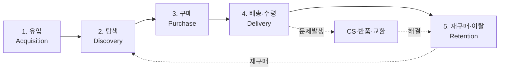
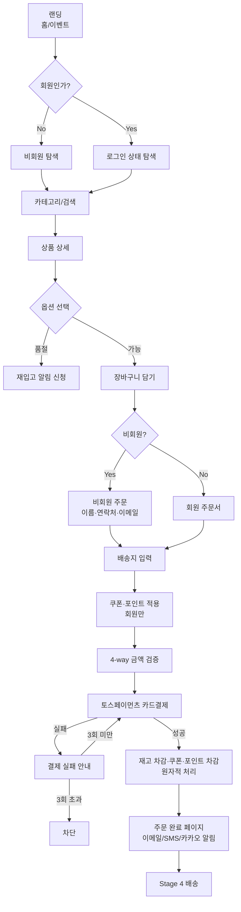
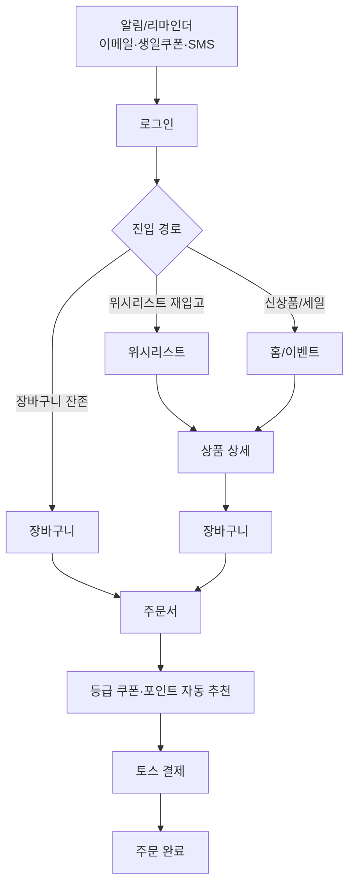
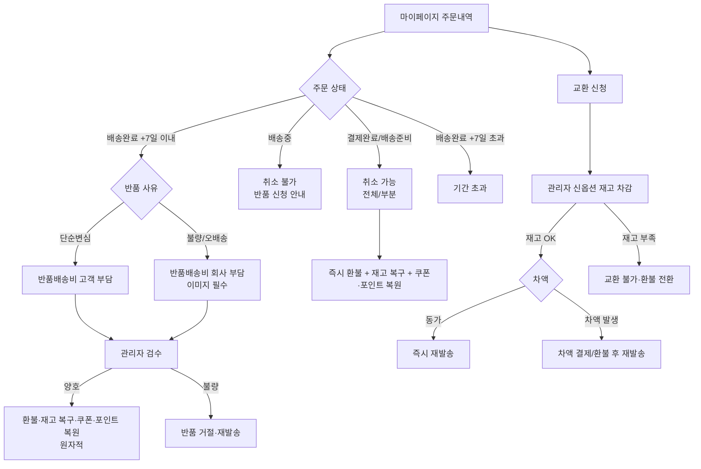

# Phase 1 — E2E User Flow + Customer Journey + Service Blueprint

- **박제일**: 2026-05-21
- **단계**: S0 / Phase 1
- **상위 문서**: `00_개요.md`
- **다음 단계**: `02_정보구조.md` (Phase 2 — 정보구조)

---

## 1. 문서 목적

> **2026-05-22~23 v0.2 갱신 메모**: `쇼핑몰_전용_QA_v4.md` 신규 시나리오 (부분취소 다건 동시성·다건 교환 검수 혼재·0원 결제 PG 미호출·친구 추천 보상·max_use_ratio 50%·반품 7일·자동확정 7일·배송지 10개·위시 200개·도서산간 region_extra) 정합 보강 완료. §7 핵심 엣지케이스 E-001~E-015 모두 QA v4.8 ID 와 1:1 매핑 유지. §8.1 확정 답변 4건 (Q-01·Q-02·Q-09·Q-10) + 잔여 미결 8건 (Q-03~08·Q-11·Q-12) 은 `_미결사항_통합관리.md` 로 위임 — 본 문서 §8 미결 표는 historical reference 로 유지하되 답변 추적은 통합관리 문서 단일 source 로 일원화.

쇼핑몰 고객이 처음 사이트에 들어와서 다시 돌아오기까지의 **전체 여정**을 5단계로 정의하고, 각 단계에서:

1. **사용자가 무엇을 보고, 무엇을 누르고, 어떤 상태를 경험하는가** (User Flow)
2. **사용자의 감정·니즈·페인포인트는 무엇인가** (Customer Journey)
3. **그 순간 프론트·관리자·백엔드(재고/결제/배송)·CS가 동시에 무엇을 하는가** (Service Blueprint)
4. **각 단계가 어떤 도메인에 속하는가** (Domain Mapping)

을 박제합니다. 본 문서는 Phase 2(IA) / Phase 3(화면정의서) / Phase 4(기능정의서)의 **상위 설계**입니다.

---

## 2. 페르소나

> deep-research-report.md (2026-05-13) 기반. 10~20대 한국 여성, 싱글 브랜드 주얼리 쇼핑몰 타겟.

### 2.1 페르소나 A — 신디 (19세, 대학생)

| 항목 | 내용 |
|---|---|
| 디바이스 | 모바일 90% / PC 10% |
| 유입 채널 | 인스타 광고, 유튜브 쇼츠 추천 |
| 결제 수단 | 본인/부모 명의 신용카드 (카카오페이·네이버페이도 연동 시 선호) |
| 구매 패턴 | 친구와 커플 아이템 함께 보기 → 둘 다 장바구니 → 한 사람이 일괄 결제 |
| 핵심 니즈 | 빠른 로딩 · 직관적 옵션 선택 · 후기/리뷰 · 즉시 알림 |
| 페인포인트 | 옵션 조합 품절 표시 모호, 결제 직전 쿠폰 적용 실패, 배송 안내 늦음 |

### 2.2 페르소나 B — 지은 (16세, 고등학생)

| 항목 | 내용 |
|---|---|
| 디바이스 | 모바일 100% |
| 유입 채널 | 틱톡, 친구 추천 코드 |
| 결제 수단 | 부모 카드 (만 14세 이상 가입 가능, 결제 동의 필요) |
| 구매 패턴 | 즉흥 구매, 위시리스트에 많이 담았다가 한 번에 결제 |
| 핵심 니즈 | 첫 구매 쿠폰 · 친구 추천 보상 · 적립 포인트 시각화 |
| 페인포인트 | 가입 절차가 길면 이탈, 결제 단계가 복잡하면 포기 |

---

## 3. Customer Journey Map (5 Stage)

### 3.1 Stage 1 — 유입 (Acquisition)

| 항목 | 내용 |
|---|---|
| 사용자 행동 | 광고 클릭 / SNS 링크 / 직접 검색 → 랜딩 (홈 또는 상품상세) |
| 감정·니즈 | "어떤 브랜드인지 빨리 알고 싶다" · "내 스타일인지 보고 싶다" |
| 핵심 화면 | 홈 · 이벤트 페이지 · 광고 랜딩 |
| 핵심 기능 | 회원가입 유도 (포인트 3,000P + 신규가입 쿠폰) · 상단 공지 띠 · 메인 배너 |
| 성공 시그널 | 3초 내 LCP / 가입 클릭 / 카테고리 진입 |
| 페인포인트 | 느린 로딩, 강제 회원가입, 팝업 과다 |
| 관련 도메인 | member · admin (배너·공지·팝업·마케팅) |

### 3.2 Stage 2 — 탐색 (Discovery)

| 항목 | 내용 |
|---|---|
| 사용자 행동 | 카테고리 진입 → 필터·정렬 → 상품 카드 클릭 → 상세 → 옵션 선택 → 위시·장바구니 |
| 감정·니즈 | "내가 찾는 디자인이 있나" · "가격·재고·후기 빠르게 비교" |
| 핵심 화면 | 카테고리 목록 · 검색 결과 · 상품 상세 · 리뷰 탭 · Q&A 탭 |
| 핵심 기능 | 키워드 검색·최근 검색·최근 본 상품·연관 상품·옵션 조합 품절 표시·재입고 알림 신청 |
| 성공 시그널 | 상세 진입율 / 평균 체류 시간 / 장바구니 추가율 |
| 페인포인트 | 품절 옵션이 명확히 표시 안 됨 · 재고 N개 알림 신뢰성 · 리뷰 적은 상품 망설임 |
| 관련 도메인 | product · category · review · wishlist · cart |

### 3.3 Stage 3 — 구매 (Purchase)

| 항목 | 내용 |
|---|---|
| 사용자 행동 | 장바구니 진입 → 주문서 (배송지 · 쿠폰 · 포인트 · 결제 동의) → 토스 결제창 → 카드 승인 → 주문 완료 |
| 감정·니즈 | "결제 금액 정확한가" · "쿠폰·포인트가 잘 들어갔나" · "결제 안전한가" |
| 핵심 화면 | 장바구니 · 주문서 · 토스 결제창(외부) · 결제 결과 페이지 · 주문 완료 페이지 |
| 핵심 기능 | 4-way 금액 검증 (카트=주문서=토스=DB) · 쿠폰 1주문 1매 정책 · 포인트 비율 제한 · 멱등성 키 · 동시성 재고 락 · 0원 결제(포인트 100%) PG 우회 |
| 성공 시그널 | 카트→주문서 전환율 / 주문서→결제완료 전환율 / 결제 실패율 |
| 페인포인트 | 결제 중 세션 만료 · 더블 클릭 중복 결제 우려 · 쿠폰 만료 경계 타이밍 |
| 관련 도메인 | cart · order · payment · coupon_point · member (배송지) · product (재고 재검증) |

### 3.4 Stage 4 — 배송·수령 (Delivery & Receive)

| 항목 | 내용 |
|---|---|
| 사용자 행동 | 마이페이지 주문 내역 확인 → 운송장 등록 알림 (이메일·SMS·카카오톡) → 추적 → 수령 → 구매확정 (수동/자동 7일) |
| 감정·니즈 | "내 주문 어디까지 왔나" · "받기 전에 변경 가능한가" |
| 핵심 화면 | 마이페이지 주문 내역 · 주문 상세 · 운송장 추적 (외부) · 반품/교환 신청 · 구매확정 버튼 |
| 핵심 기능 | 배송중 상태 알림 (멀티 채널) · 7일 내 반품 신청 · 교환 옵션 변경 · 7일 자동 구매확정 배치 · 포인트 적립 |
| 성공 시그널 | 배송완료 SLA / 구매확정율 / 반품율 |
| 페인포인트 | 배송 지연 시 안내 부재 · 반품 신청 절차 복잡 · 교환 시 재고 부족 |
| 관련 도메인 | order · delivery · admin (배송 처리·운송장 일괄 업로드) · coupon_point (적립) · member (알림 채널) |

### 3.5 Stage 5 — 재구매·이탈 (Retention or Churn)

| 항목 | 내용 |
|---|---|
| 사용자 행동 | 리뷰 작성 (포인트 보상) · 멤버십 등급 상승 → 등급 쿠폰 수령 → 재방문 · 친구 추천 · 또는 장기 미방문 후 이탈 |
| 감정·니즈 | "이 브랜드 다시 살까" · "혜택 받을 만한가" |
| 핵심 화면 | 마이페이지 (리뷰·쿠폰함·포인트·등급) · 이벤트 페이지 · 친구 추천 페이지 · 알림 설정 |
| 핵심 기능 | 리뷰 작성 포인트 (텍스트/포토 차등) · 멤버십 등급 자동 전환 · 등급 쿠폰 자동 발급 · 생일 쿠폰 · 포인트 소멸 D-30 알림 · 장바구니 리마인더 |
| 성공 시그널 | 90일 재구매율 / 친구 추천 가입율 / 멤버십 골드+ 비율 |
| 페인포인트 | 쿠폰 만료 인지 부족 · 알림 과다로 수신거부 · 등급 하락 통보 부재 |
| 관련 도메인 | member · review · coupon_point · admin (마케팅 발송) |

### 3.6 분기 — CS / 반품·교환 (Stage 4에서 분기)

| 항목 | 내용 |
|---|---|
| 사용자 행동 | 1:1 문의 · Q&A · 실시간 채팅 · 반품·교환 신청 |
| 감정·니즈 | "빠른 해결" · "환불 정확" |
| 핵심 기능 | 반품 신청 (불량/단순변심) · 검수 결과별 환불·재고 분기 · 교환 신청·차액 처리 · 카드 환불 (취소 전표) |
| 관련 도메인 | delivery · payment · order · review · admin · coupon_point (복원) |

---

## 4. E2E User Flow (Mermaid)

### 4.1 Flow A — Guest 첫 구매 Flow

### 4.2 Flow B — Member 재구매 Flow

### 4.3 Flow C — 취소·반품·교환 Flow

---

## 5. Service Blueprint (5 Stage × 4 Lane)

> **Lane 정의**
> - **Frontstage (Customer)**: 사용자가 보는 화면·행동
> - **Backstage (Admin/Operator)**: 관리자 백오피스 작업
> - **Backend Systems**: DB · Redis · 토스페이먼츠 · 이메일/SMS/카카오톡 · CDN · 배치
> - **CS / Support**: 1:1 문의 · 실시간 채팅 · 전화 응대

### 5.1 Stage 1 — 유입

| Lane | 활동 |
|---|---|
| Frontstage | 광고 클릭 → 랜딩 → 회원가입 유도 배너 · 팝업 |
| Backstage | (사전) 배너/팝업/공지/이벤트 등록 · 마케팅 이메일 발송 |
| Backend | CDN 이미지 · GA4 페이지뷰 추적 · 가입 시 신규가입 쿠폰·포인트 자동 발급 · 추천 코드 검증 |
| CS | (해당 단계 CS 인입 거의 없음) |

### 5.2 Stage 2 — 탐색

| Lane | 활동 |
|---|---|
| Frontstage | 카테고리/검색/필터/정렬 · 상품 상세 · 옵션 선택 · 리뷰 · 위시 · 장바구니 추가 |
| Backstage | 상품 CRUD · 옵션·재고 관리 · 타임세일 등록 · 홈 큐레이션 · 금칙어 관리 · 리뷰 숨김/베스트 선정 |
| Backend | 상품 검색 (DB + 캐시) · 옵션 SKU별 재고 조회 · 최근 본 상품 (로그인 시 DB / 비로그인 localStorage) · 위시리스트 동기화 |
| CS | (해당 단계 인입 적음) |

### 5.3 Stage 3 — 구매

| Lane | 활동 |
|---|---|
| Frontstage | 장바구니 → 주문서 → 쿠폰·포인트 적용 → 토스 결제창 → 결제 결과 |
| Backstage | (실시간) 미결제 주문 모니터링 · 이상 결제 패턴 탐지 알림 수신 |
| Backend | **4-way 금액 검증** · **재고 3단계 재검증** (주문서 진입·결제 버튼·PG 승인) · 멱등성 키 · 분산 락 · PG 콜백 서명 검증 · 재고/쿠폰/포인트 차감 **원자적 트랜잭션** · 실패 시 즉시 환불 |
| CS | 결제 실패 문의 인입 (1:1 / 채팅) |

### 5.4 Stage 4 — 배송·수령

| Lane | 활동 |
|---|---|
| Frontstage | 마이페이지 주문 상세 · 운송장 추적 링크 · 알림 수신 · 구매확정 · 반품/교환 신청 |
| Backstage | 운송장 입력 (개별/CSV 일괄) · 배송 지연 일괄 안내 · 반품/교환 승인·거절·검수 결과 입력 |
| Backend | 배송 상태 변경 → 멀티채널 알림 발송 (이메일·SMS·카카오톡) · 자동 구매확정 배치 (7일) · 미결제 자동취소 배치 (30분) · 반품 검수 결과 → 재고 복구/폐기 분기 |
| CS | 배송 지연·분실 문의 · 반품 진행 상황 문의 · 교환 차액 안내 |

### 5.5 Stage 5 — 재구매·이탈

| Lane | 활동 |
|---|---|
| Frontstage | 리뷰 작성 · 마이페이지 (쿠폰·포인트·등급) · 친구 추천 · 알림 설정 |
| Backstage | 베스트 리뷰 선정 · 마케팅 발송 예약 · 멤버십 정책 조정 · 출석체크 이벤트 운영 |
| Backend | 리뷰 작성 시 포인트 자동 지급 · 멤버십 등급 자동 전환 (연 구매액 집계) · 등급/생일 쿠폰 자동 발급 배치 · 포인트 소멸 D-30 알림 · 장바구니 리마인더 (담은 후 N시간) |
| CS | 쿠폰 사용 불가 문의 · 등급 변동 문의 · 포인트 소멸 문의 |

---

## 6. Stage → 도메인 매핑 (한눈에)

| Stage | 주 도메인 | 보조 도메인 |
|---|---|---|
| 1. 유입 | admin · member | coupon_point (신규가입 쿠폰) |
| 2. 탐색 | product · category · review | wishlist · cart · member (로그인 분기) |
| 3. 구매 | order · payment · cart | coupon_point · product (재고) · member (배송지) |
| 4. 배송 | delivery · order | admin (운송장·반품 처리) · member (알림 채널) · coupon_point (적립) · payment (환불) |
| 5. 재구매 | member · coupon_point · review | admin (마케팅) |
| CS 분기 | review · delivery · payment | order · coupon_point · admin |

본 매핑은 Phase 3 (화면정의서) 의 "**연결 도메인**" 섹션과 Phase 4 (기능정의서) / Track 2 (도메인 스펙) 의 "**연결 화면 ID**" 역참조에 그대로 사용됩니다.

---

## 7. 핵심 엣지케이스 (Phase 3·4에서 분기 처리 필수)

| ID | 시나리오 | 단계 | 처리 원칙 |
|---|---|---|---|
| E-001 | 결제 승인 직후 재고 차감 실패 (다른 사용자가 마지막 재고 선점) | Stage 3 | **즉시 전액 환불 + 주문 자동 취소 + 사용자 안내** (PAY-U-008B/C) |
| E-002 | 동일 주문 PG 콜백 2회 도달 | Stage 3 | 멱등성 키로 1회만 처리 (ORD-U-008C) |
| E-003 | 결제 중 세션 만료 → 토스 결제창 완료 | Stage 3 | 토스 응답 기반 주문 상태 정합성 복구 (PAY-U-009) |
| E-004 | 23:59 결제 진입 → 00:01 승인 시 쿠폰 만료 경계 | Stage 3 | **서버 시간 기준 만료 판정** (CPN-U-004) |
| E-005 | 사용자 취소 ↔ 관리자 강제 취소 동시 | Stage 4 | 1건만 처리, 나머지는 '이미 취소됨' 응답 (ORD-U-041) |
| E-006 | 미결제 자동취소 배치 중 사용자 수동 취소 | Stage 4 | 중복 취소 차단, 재고 복구 1회만 (ORD-U-046) |
| E-007 | 반품 검수 양호 → 환불 PG 실패 | CS | **트랜잭션 롤백** (재고 재차감 + 반품상태 '환불대기' 유지) (DEL-A-035) |
| E-008 | 교환 승인 중 신옵션 재고 소진 | CS | 승인 실패 + 관리자 알림 + 고객 교환 불가 안내 (DEL-A-037) |
| E-009 | 옵션 조합(색상×사이즈) 중 특정 조합만 품절 | Stage 2 | 해당 조합만 버튼 비활성화, 나머지 정상 표시 (PRD-U-012B) |
| E-010 | 포인트 100% 사용으로 결제금액 0원 | Stage 3 | **PG 결제창 미호출**, 주문 직접 확정 (PAY-U-017B) |
| E-011 | 부분취소로 잔여금액 5만원 미만 → 배송비 추가 청구 | Stage 4 | 배송비 차액 청구 트랜잭션 (DEL-U-011) |
| E-012 | 탈퇴 후 재가입으로 신규가입 혜택 재수령 시도 | Stage 1 / 5 | 이메일·전화번호 기준 차단 (MEM-U-038) |
| E-013 | 만 14세 미만 가입 시도 | Stage 1 | 생년월일 기준 차단 (MEM-U-005) |
| E-014 | 비활성 카테고리 한정 쿠폰을 타 카테고리 상품 주문서에 적용 | Stage 3 | 적용 불가 차단 + 적용 가능 상품만 할인 (PRD-U-046 / CPN-U-009B) |
| E-015 | 관리자 재고 0 수정 → 사용자 상품 상세 즉시 품절 전환 | Stage 2 | 캐시 무효화 + 장바구니 품절 표시 (PRD-A-044) |

> 본 표는 Phase 3 화면별 "예외 케이스" 섹션과 Phase 4 도메인별 "도메인 룰" 섹션의 인덱스로 사용됩니다.

### 7.1 v0.2 신규 / 보강 엣지케이스 (QA v4.8 정합)

| ID | 시나리오 | 단계 | 처리 원칙 | QA ID |
|---|---|---|---|---|
| E-016 | **부분취소 다건 동시 요청** (3개 상품 주문에서 상품A·B 부분취소 거의 동시) | Stage 3~4 | 각 독립 트랜잭션 처리, 재고·환불 금액 중복/누락 0 | ORD-U-043 |
| E-017 | **다건 교환 검수 혼재** (반품 5건 동시 '양호' 처리·교환 5건 동시 처리) | CS | 각 주문 독립 재고 복구·신옵션 차감, 총 합 정합·정산 5건 모두 반영 | DEL-A-036, DEL-A-037 |
| E-018 | **잔여 무료배송 임계 경계** (부분취소 후 잔여금액 49,999원 ↔ 50,000원) | Stage 4 | 49,999원↓ 배송비 추가 청구 / 50,000원↑ 무료배송 유지 | DEL-U-011, DEL-U-012, ORD-U-022 |
| E-019 | **0원 결제 영수증** (포인트 100% 사용으로 결제금액 0원) | Stage 3 | PG 결제창 미호출·주문 직접 확정. 매출전표 X, 관리자 목록에 '포인트 전액 결제' 구분 표시 | PAY-U-017B, PAY-A-026 |
| E-020 | **친구 추천 보상 어뷰징 방지** (추천 후 친구 환불 시) | Stage 5 | 보상 회수 정책 — Q-04 / s33-Q06 (권장 90일 유예 후 확정) | CPN-U-039, CPN-U-039B, CPN-A-038 |
| E-021 | **포인트 max_use_ratio 50% 경계** (30,000원 주문 + 15,001P 사용 시도) | Stage 3 | 초과 차단 — d20 max_use_ratio 정책 (Q-06 권장 50% 유지) | CPN-U-022, CPN-A-019 |
| E-022 | **위시리스트 200개 초과 추가** | Stage 2~5 | 제한 안내 — d15 WIS-* 룰 정합 | WIS-U-006 |
| E-023 | **배송지 10개 초과 추가** | Stage 3·5 | 제한 안내 — d18 정책 | DEL-U-001, DEL-U-002 |
| E-024 | **자동 구매확정 7일 경계** (배송완료 후 7일 자정) | Stage 4 | 7일 0시 배치 자동 확정·중복 처리 0 — Q-05 확정 시 Q-05 권장 (c) 14일 + D-3 알림 으로 갱신 가능 | ORD-U-030, ORD-U-031, ORD-A-024 |
| E-025 | **반품 7일 경계** (배송완료 후 8일째 신청) | Stage 4 | 기간 초과 안내 — Q-08 확정 시 Q-08 권장 (b) 14일 단순변심 + 불량 3개월 로 갱신 가능 | DEL-U-014, DEL-U-015, ORD-A-023 |
| E-026 | **도서산간 region_extra 우편번호 자동 감지** | Stage 3 | 우편번호 → 도서산간 매핑 → 추가 배송비 자동 부과 | DEL-U-010, DEL-A-004 |

---

## 8. 미결 사항 (사장님 컨펌 필요 — Phase 2 진입 전 정리)

| # | 항목 | 옵션 | 영향 |
|---|---|---|---|
| Q-01 | **간편결제 추가 여부** (카카오페이·네이버페이·토스페이) | A) 카드만 (현 확정) / B) 간편결제 카드 한정 추가 | 페르소나 A·B 둘 다 간편결제 선호. B 채택 시 PG 연동 범위 확대 |
| Q-02 | **비회원 주문 허용 여부** | A) 허용 (현 QA 가정) / B) 회원 전용 | B 채택 시 가입 강제 → 이탈 증가 가능 |
| Q-03 | **마케팅 채널 우선순위** | 이메일·SMS·카카오 알림톡 중 어느 채널을 1순위로 운영? | 마케팅 운영 비용·동의율 영향 |
| Q-04 | **친구 추천 보상 금액** | 추천인/피추천인 각 금액 | coupon_point 도메인 정책 |
| Q-05 | **자동 구매확정 기간** | 현 QA 가정: 배송완료 +7일. 유지? 변경? | order 도메인 룰 |
| Q-06 | **반품 신청 가능 기간** | 현 QA 가정: 배송완료 +7일. 유지? 변경? | delivery 도메인 룰 |
| Q-07 | **무료배송 기준금액** | 현 QA 가정: 50,000원. 유지? 변경? | delivery 도메인 룰 |
| Q-08 | **포인트 사용 비율 상한** | 현 QA 가정: 주문금액의 50%. 유지? | coupon_point 도메인 룰 |
| Q-09 | **언어 다국어 지원** | 한국어 단일? 또는 영어/일본어 등? | IA (Phase 2) 영향 |
| Q-10 | **모바일 앱 별도 존재 여부** | 본 기획서는 **반응형 웹**만 가정. 네이티브 앱 별도 산출물? | apps/mobile/ 폴더 사용 여부 결정 |
| Q-11 | **점검 모드 운영 정책** | 점검 중 PG 콜백·결제 처리 정책 | admin · payment 도메인 |
| Q-12 | **현금영수증 발급 정책** | 카드만 운영이라 현금영수증 의미 축소. 본 기획서에서 제거? 유지? | member · payment 도메인 |

---

## 8.1 확정 답변 (2026-05-21, 사장님 verbatim)

| # | 질문 | 답변 | 본 기획서 영향 |
|---|---|---|---|
| **Q-01** | 간편결제 추가? | **결제는 토스 MCP로만** (간편결제 미적용) | payment 도메인 단일 PG. 주문서 화면 단일 결제 버튼. 카카오페이·네이버페이·토스페이 분기 화면·기능 모두 미설계. |
| **Q-02** | 비회원 주문 허용? | **회원만** (비회원 주문 불가) | QA의 ORD-U-013~016 (비회원 주문·조회) / MEM-A-032 / CRT-U-011~012 (비회원 카트 병합) Out-of-scope. 비회원 localStorage 카트는 결제 진입 시점에 **로그인 강제 게이트**. Flow A의 "비회원 분기" (§4.1 노드 C / J / K) 는 Phase 3 화면정의서 작성 시 단일 회원 분기로 축소. |
| **Q-09** | 다국어 지원? | **한국어 단일** | IA·화면정의서·라벨 모두 한국어. 통화는 KRW 단일. |
| **Q-10** | 모바일 앱 별도? | **앱 없음** (반응형 웹만) | `apps/mobile/` 폴더 미사용. 사이트맵은 단일 (PC + 모바일 웹 공통, 반응형 분기). |

**잔여 미결 (Phase 4 / Track 2 박제 시점에 답변 필요):**

| # | 항목 | 박제 시점 |
|---|---|---|
| Q-03 | 마케팅 채널 1순위 (이메일 / SMS / 카카오 알림톡) | f21_admin · d11_member |
| Q-04 | 친구 추천 보상 금액 (추천인 / 피추천인) | f20_coupon_point · d20_coupon_point |
| Q-05 | 자동 구매확정 기간 (현 QA: 7일) | f16_order · d16_order |
| Q-06 | 반품 신청 가능 기간 (현 QA: 7일) | f18_delivery · d18_delivery |
| Q-07 | 무료배송 기준금액 (현 QA: 50,000원) | f18_delivery · d18_delivery |
| Q-08 | 포인트 사용 비율 상한 (현 QA: 50%) | f20_coupon_point · d20_coupon_point |
| Q-11 | 점검 모드 운영 정책 (점검 중 PG 콜백 처리) | f21_admin · f17_payment |
| Q-12 | 현금영수증 발급 정책 (카드만 운영이라 의미 축소) | f11_member · f17_payment |

**확인 요청 (Phase 2 진입 전 가능하면 한 줄):**
- "**토스 MCP**" 의미 명확화 부탁드립니다. 본 문서는 잠정적으로 **토스페이먼츠 결제 SDK(카드 결제창 통합 모듈)** 으로 해석해 박제했습니다. 다른 의미(예: 토스 페이먼츠가 제공하는 특정 결제 채널/제품명)면 알려주시면 Phase 4 결제 도메인 박제 시 정정합니다.

---

## 9. 다음 단계 (Phase 2)

`02_정보구조.md` 작성 — 본 문서의 5 Stage × 화면 후보를 IA(사이트맵·메뉴 트리·URL 구조)로 전환.

**§8.1 확정 답변 반영:**
- 회원 전용 → 사이트맵에서 "비회원 주문 조회" 페이지 제거, "로그인" 게이트 강제 노드 추가
- 모바일 앱 없음 → 단일 사이트맵 (반응형)
- 한국어 단일 → 다국어 라우팅 없음
- 토스 MCP → 결제 화면은 단일 진입점(외부 토스 결제창)으로 박제

진입 전 사장님 검토 게이트:
1. 본 Phase 1 문서 + §8.1 답변 박제 컨펌
2. (선택) "토스 MCP" 의미 명확화 — 안 주시면 잠정 해석으로 진행, 추후 정정

---

## 10. 변경 이력

| 일자 | 버전 | 변경 |
|---|---|---|
| 2026-05-21 | v0.1 | 최초 박제 — 5 Stage Customer Journey + 3 Flow + Service Blueprint + 핵심 엣지케이스 E-001~E-015 + 미결 Q-01~12 |
| 2026-05-22~23 | v0.2 | QA v4.8 정합 갱신. §7.1 v0.2 신규 엣지케이스 11건 추가 (E-016~E-026) — 부분취소 다건·다건 교환·잔여 무료배송·0원 결제·친구 추천 어뷰징·max_use_ratio·위시 200·배송지 10·자동확정 7일·반품 7일·도서산간 region_extra. 정책값 (배송지 10·위시 200·반품 7일·자동확정 7일·무료배송 50,000원·포인트 50%) 모두 QA v4.8 기본값과 일치 확인. 미결 답변 추적 단일 source = `_미결사항_통합관리.md`. |
