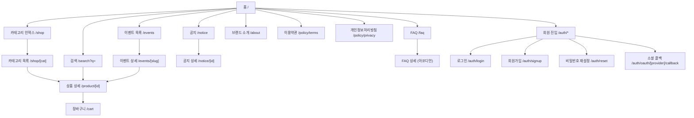
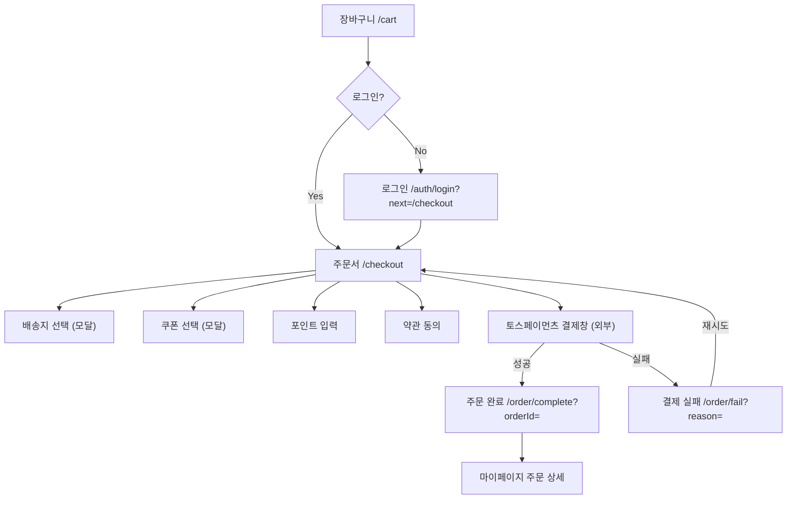

# Phase 2 — IA (정보구조: Information Architecture)

- **박제일**: 2026-05-21
- **단계**: S0 / Phase 2
- **상위 문서**: `00_개요.md`, `01_사용자_플로우.md`
- **다음 단계**: `03_화면정의서/` (Phase 3 — 화면정의서 인벤토리부터)

---

## 1. 문서 목적

> **2026-05-22~23 v0.2 갱신 메모**: QA v4 정합 사이클 결과 신규 화면 5건 (s50 내 Q&A·s51 실시간 채팅·s52 현금영수증/세금계산서·s53 관리자 주문 상세·s54 검색 입력 UI 헤더 컴포넌트) 이 화면정의서 트랙에 추가 박제됨. 본 §7 페이지 인벤토리 합계는 `49 페이지 → 54 (페이지 49 + 컴포넌트 1) 또는 마이페이지 그룹 +3·관리자 그룹 +1·검색 컴포넌트 +1` 로 갱신. 사이트맵 mermaid 트리는 §2 노드 추가로 동기화 (마이페이지에 인쿼리·채팅·영수증 이미 노출되어 있어 트리 자체 구조는 유지, IA 인벤토리 §7 만 보강).

Phase 1의 5-Stage Customer Journey × 3-Flow User Flow × Service Blueprint를 **사이트의 정보구조**로 전환합니다.

산출물:
- 사이트맵 (영역별 mermaid 트리 4종)
- URL 구조 (RESTful)
- 메뉴 트리 (GNB · 마이페이지 사이드 · 관리자 사이드 · 푸터)
- 네비게이션 패턴 (반응형 3단)
- 권한·접근 제어 매트릭스
- 페이지 인벤토리 (Phase 3 화면정의서 인풋)

S0 핵심 제약 반영 (`00_개요.md §2`):
- **회원 전용** (비회원 주문 X) → 결제 진입 시 로그인 강제 게이트
- **한국어 단일** → i18n 라우팅 없음
- **앱 없음** (반응형 웹만) → 단일 사이트맵
- **토스 MCP 카드만** → 결제 흐름 단일 경로
- **디자인 별도 트랙** → 본 IA는 정보구조만, UI 비주얼은 LUMI 디자인 트랙 (`§7.4` 매핑 참고)

---

## 2. 사이트맵

### 2.1 공개 영역 (Public — 비로그인 접근 가능)

### 2.2 회원 영역 (Member — 로그인 필수)

```mermaid
graph TD;
    MyPage["마이페이지 인덱스 /mypage"] --> Orders["주문 내역 /mypage/orders"];
    Orders --> OrderDetail["주문 상세 /mypage/orders/[orderId]"];
    OrderDetail --> Return["반품 신청 /mypage/orders/[orderId]/return"];
    OrderDetail --> Exchange["교환 신청 /mypage/orders/[orderId]/exchange"];
    OrderDetail --> Review["리뷰 작성 /mypage/orders/[orderId]/review"];
    MyPage --> Wishlist["위시리스트 /mypage/wishlist"];
    MyPage --> Coupons["쿠폰함 /mypage/coupons"];
    MyPage --> Points["포인트 /mypage/points"];
    MyPage --> Reviews["내 리뷰 /mypage/reviews"];
    MyPage --> Qna["내 Q&A /mypage/qna"];
    MyPage --> Inquiries["1:1 문의 /mypage/inquiries"];
    Inquiries --> InquiryNew["문의 작성 /mypage/inquiries/new"];
    Inquiries --> InquiryDetail["문의 상세 /mypage/inquiries/[id]"];
    MyPage --> Chat["실시간 채팅 /mypage/chat"];
    MyPage --> Profile["프로필 수정 /mypage/profile"];
    MyPage --> AddressBook["배송지 관리 /mypage/address"];
    MyPage --> Notification["알림 설정 /mypage/notification"];
    MyPage --> Receipt["현금영수증·세금계산서 /mypage/receipts"];
    MyPage --> Membership["멤버십 등급 /mypage/membership"];
    MyPage --> Withdraw["탈퇴 신청 /mypage/withdraw"];
    MyPage --> Referral["친구 추천 /mypage/referral"];
```

### 2.3 결제 영역 (Checkout — 회원 필수 게이트)

### 2.4 관리자 영역 (Admin — 권한별 분기)

```mermaid
graph TD;
    AdminLogin["관리자 로그인 /admin/login"] --> AdminDash["대시보드 /admin"];
    AdminDash --> AdmProd["상품 /admin/products"];
    AdmProd --> AdmProdNew["상품 등록"];
    AdmProd --> AdmProdEdit["상품 수정/[id]"];
    AdmProd --> AdmStock["재고 관리"];
    AdmProd --> AdmTimeSale["타임세일"];
    AdmProd --> AdmCategory["카테고리 /admin/categories"];
    AdminDash --> AdmOrder["주문 /admin/orders"];
    AdmOrder --> AdmOrderDetail["주문 상세/[id]"];
    AdmOrder --> AdmDelivery["배송 처리"];
    AdmOrder --> AdmReturn["반품·교환 처리"];
    AdmOrder --> AdmSettlement["정산 /admin/settlement"];
    AdminDash --> AdmMember["회원 /admin/members"];
    AdmMember --> AdmBlacklist["블랙리스트"];
    AdmMember --> AdmSuspend["제재 단계"];
    AdminDash --> AdmCoupon["쿠폰·포인트 /admin/coupons"];
    AdmCoupon --> AdmCouponNew["쿠폰 등록"];
    AdmCoupon --> AdmPointHistory["포인트 이력"];
    AdminDash --> AdmReview["리뷰·문의 /admin/reviews"];
    AdmReview --> AdmInquiry["1:1 문의 답변"];
    AdmReview --> AdmChat["채팅 모니터링"];
    AdminDash --> AdmContent["콘텐츠 /admin/content"];
    AdmContent --> AdmBanner["배너·팝업"];
    AdmContent --> AdmNotice["공지"];
    AdmContent --> AdmFaq["FAQ"];
    AdmContent --> AdmMarketing["마케팅 이메일·SMS·카카오"];
    AdminDash --> AdmSystem["시스템 /admin/system"];
    AdmSystem --> AdmPolicy["정책 (배송비·쿠폰·포인트 등)"];
    AdmSystem --> AdmAccount["관리자 계정 (SUPER만)"];
    AdmSystem --> AdmAudit["감사 로그"];
    AdmSystem --> AdmHealth["시스템 헬스"];
```

---

## 3. URL 구조 (RESTful)

| 영역 | URL | 라우트 타입 | 인덱싱(SEO) |
|---|---|---|---|
| **공개** | `/` | Static | O |
| | `/shop` | Static (카테고리 인덱스) | O |
| | `/shop/[cat]` | Dynamic (rings · necklaces · earrings · bracelets) | O |
| | `/product/[id]` | Dynamic | O (canonical 처리) |
| | `/search?q=` | Static + query | X (`robots.txt`로 제외) |
| | `/events` · `/events/[slug]` | Static + Dynamic | O |
| | `/notice` · `/notice/[id]` | Static + Dynamic | O |
| | `/faq` | Static | O |
| | `/about` | Static | O |
| | `/policy/{terms,privacy,marketing}` | Static | O |
| **인증** | `/auth/login` · `/auth/signup` · `/auth/reset` | Static | X |
| | `/auth/oauth/[provider]/callback` | Dynamic | X |
| **결제** | `/cart` | Static (회원/비회원 모두 접근 — 결제 진입 시 로그인 강제) | X |
| | `/checkout` | Static (**로그인 가드**) | X |
| | `/order/complete` · `/order/fail` | Static + query (`?orderId=`, `?reason=`) | X |
| **마이페이지** | `/mypage` · `/mypage/*` | 회원 가드 | X (`robots.txt` 차단) |
| **관리자** | `/admin` · `/admin/*` | 관리자 가드 + 별도 시크릿 | X (`robots.txt` 차단) |

**URL 규칙:**
- 한국어 슬러그 금지. 카테고리는 영문 슬러그 (rings·necklaces·earrings·bracelets) — SEO + URL 가독성
- 상품 ID는 숫자 또는 nanoid (난수화) — 순차 ID 노출 시 enumeration 공격 위험
- `/auth/login?next=<path>` 패턴으로 로그인 후 원래 페이지 복귀
- 관리자 URL은 `robots.txt`에서 차단 (A-COMP-006)

---

## 4. 메뉴 트리

### 4.1 글로벌 네비게이션 (GNB — 데스크톱 상단 sticky)

| 위치 | 항목 |
|---|---|
| 좌측 | (햄버거 메뉴는 모바일 전용) 카테고리 메가메뉴: 반지·목걸이·귀걸이·팔찌 · NEW · BEST · SALE |
| 중앙 | 로고 (LUMI) — 클릭 시 홈 |
| 우측 | 검색(🔍) · 위시리스트(♡, 회원만) · 장바구니(🛒, 뱃지) · 마이페이지(👤) / 로그인 |
| 상단 띠 | 공지·이벤트 메시지 (관리자 등록, 비노출 가능) |

### 4.2 마이페이지 사이드

| 그룹 | 항목 |
|---|---|
| 주문 관리 | 주문 내역 · 취소/반품/교환 |
| 적립·혜택 | 쿠폰함 · 포인트 · 멤버십 등급 · 친구 추천 |
| 내 활동 | 위시리스트 · 내 리뷰 · 내 Q&A |
| CS | 1:1 문의 · 실시간 채팅 |
| 정보 관리 | 프로필 수정 · 배송지 · 알림 설정 · 현금영수증·세금계산서 |
| 계정 | 비밀번호 변경 · 탈퇴 신청 |

### 4.3 관리자 사이드 (권한별 노출)

| 그룹 | 항목 | OPERATION | CS | SUPER |
|---|---|---|---|---|
| 대시보드 | 매출·주문·신규회원·처리필요 | ✓ | ✓ | ✓ |
| 상품 | 등록·수정·재고·카테고리·타임세일 | ✓ | ✗ | ✓ |
| 주문 | 목록·상세·배송·반품/교환·정산 | ✓ | 일부 | ✓ |
| 회원 | 조회·정지·블랙리스트·등급 | 조회만 | ✓ | ✓ |
| 쿠폰·포인트 | 발급·정책·이력 | ✓ | ✗ | ✓ |
| 리뷰·문의 | 1:1 답변·Q&A·채팅 | ✗ | ✓ | ✓ |
| 콘텐츠 | 배너·공지·FAQ·마케팅 | ✓ | ✗ | ✓ |
| 시스템 | 정책·관리자계정·감사로그·헬스 | ✗ | ✗ | ✓ |

### 4.4 푸터

| 그룹 | 항목 |
|---|---|
| 회사 정보 | 사업자 정보 · 통신판매업 · 대표자 · 사업자등록번호 · 주소 · 이메일 |
| 고객센터 | 전화·운영시간 · FAQ · 1:1 문의 · 공지사항 |
| 약관 | 이용약관 · **개인정보처리방침**(강조) · 마케팅 동의 · 청소년 보호정책 |
| 브랜드 | 브랜드 소개 · 인스타그램 · 유튜브 |
| 결제 정보 | 토스페이먼츠 로고 · 카드사 안내 · 에스크로 로고 (없음 — 카드만 운영) |

---

## 5. 네비게이션 패턴 (반응형 3단)

| 브레이크포인트 | 디바이스 | 헤더 | 카테고리 메뉴 | 마이페이지 | 결제 흐름 |
|---|---|---|---|---|---|
| ~480 px | 모바일 | 햄버거 + 로고 + 아이콘(검색·카트·👤) | 풀스크린 슬라이드 메뉴 | 단일 화면 + 탭 토글 | 단일 컬럼 + sticky 하단 CTA |
| 481–768 px | 태블릿 세로 | 동일 (햄버거 유지) | 풀스크린 | 사이드 + 메인 (좁은 2 컬럼) | 2 컬럼 |
| 769–1024 px | 태블릿 가로 | 좌측 메뉴 + 로고 중앙 + 우측 아이콘 | 드롭다운 메뉴 | 좌측 사이드 + 메인 | 좌측 입력 + 우측 sticky 요약 |
| 1025–1440 px | 데스크톱 | 동일 + 메가메뉴 | **메가메뉴** (4 컬럼 카테고리 + 추천) | 동일 | 동일 |
| 1441+ px | 와이드 | max-width 1440 고정 | 동일 | 동일 | 동일 |

**전역 패턴:**
- 헤더 sticky (스크롤 시 축소)
- 모바일 하단 sticky CTA (장바구니 / 주문서 / 상품 상세 페이지 한정)
- 페이지 전환은 Next.js 기본 navigation (불필요한 애니메이션 X)
- 모바일 필터·정렬은 하단에서 슬라이드업 시트 (Bottom Sheet)
- 캐싱: Header / Footer / 카테고리 메뉴는 SSG 또는 ISR

---

## 6. 권한·접근 제어 매트릭스

| 영역 / 액터 | 비로그인 | 일반 회원 | 정지 회원 | 블랙리스트 | 관리자 OPERATION | 관리자 CS | 관리자 SUPER |
|---|---|---|---|---|---|---|---|
| 공개 영역 (홈·카테고리·상품·검색·이벤트·공지·FAQ·약관) | ✓ | ✓ | ✓ | ✓ | ✓ | ✓ | ✓ |
| 장바구니 `/cart` | ✓ (localStorage) | ✓ | ✓ | ✓ | ✓ | ✓ | ✓ |
| 결제 진입 `/checkout` | **로그인 강제** | ✓ | **차단** (정지 안내) | **차단** (블랙리스트 안내) | ✓ | ✓ | ✓ |
| 마이페이지 `/mypage/*` | **로그인 리다이렉트** | ✓ | 조회만 (주문/CS) | 조회만 | ✓ | ✓ | ✓ |
| 위시리스트 추가 (♡) | **로그인 유도 모달** | ✓ | ✓ | ✓ | ✓ | ✓ | ✓ |
| 리뷰 작성 | 차단 | 구매확정 후만 | 차단 | 차단 | ✓ | ✓ | ✓ |
| 1:1 문의·Q&A 작성 | 차단 (Q&A는 비밀글만 회원) | ✓ | ✓ | ✓ | ✓ | ✓ | ✓ |
| 관리자 영역 `/admin` 진입 | 403 | 403 | 403 | 403 | 권한별 일부 | 권한별 일부 | 전체 |
| 관리자 계정 CRUD | 403 | 403 | 403 | 403 | 403 | 403 | **SUPER 전용** (ADM-R-009) |

**가드 구현 패턴 (Phase 4 기능정의서 인풋):**
- Next.js `middleware.ts` — `/checkout`, `/mypage/*`, `/admin/*` 가드
- 비로그인 + 보호 페이지 → `/auth/login?next=<encoded path>` 리다이렉트
- 정지/블랙리스트 + 결제 → 안내 페이지 + CS 연락처
- 관리자 시크릿 별도 JWT (A-AUTH-017)

---

## 7. 페이지 인벤토리 (Phase 3 화면정의서 인풋)

### 7.1 공개 영역 (Public — 12 페이지)

| ID | 화면명 | URL | 도메인 | LUMI 시안 |
|---|---|---|---|---|
| s01 | 홈 | `/` | product · admin (배너·공지) | ✓ Home |
| s02 | 카테고리 인덱스 | `/shop` | category | (시안 없음 — placeholder) |
| s03 | 카테고리 목록 | `/shop/[cat]` | category · product · review | ✓ Category list |
| s04 | 상품 상세 | `/product/[id]` | product · review · wishlist · cart | ✓ Product detail |
| s05 | 검색 결과 | `/search` | product · category | (시안 없음 — placeholder) |
| s06 | 이벤트 목록 | `/events` | admin · coupon_point | (시안 없음) |
| s07 | 이벤트 상세 | `/events/[slug]` | admin · coupon_point | (시안 없음) |
| s08 | 공지 목록 | `/notice` | admin | (시안 없음) |
| s09 | 공지 상세 | `/notice/[id]` | admin | (시안 없음) |
| s10 | FAQ | `/faq` | admin | (시안 없음) |
| s11 | 브랜드 소개 | `/about` | — | (시안 없음) |
| s12 | 약관 페이지들 | `/policy/*` | admin | (시안 없음) |

### 7.2 인증 영역 (Auth — 4 페이지)

| ID | 화면명 | URL | 도메인 | LUMI 시안 |
|---|---|---|---|---|
| s13 | 로그인 | `/auth/login` | member | (시안 없음 — README §18 명시) |
| s14 | 회원가입 | `/auth/signup` | member | (시안 없음) |
| s15 | 비밀번호 재설정 | `/auth/reset` | member | (시안 없음) |
| s16 | 소셜 콜백 | `/auth/oauth/[provider]/callback` | member | (라우팅만, UI 없음) |

### 7.3 결제 영역 (Checkout — 4 페이지)

| ID | 화면명 | URL | 도메인 | LUMI 시안 |
|---|---|---|---|---|
| s17 | 장바구니 | `/cart` | cart · product · coupon_point | ✓ Cart |
| s18 | 주문서 | `/checkout` | order · payment · cart · coupon_point · member · delivery | ✓ Checkout |
| s19 | 주문 완료 | `/order/complete` | order · payment | ✓ Order complete |
| s20 | 결제 실패 | `/order/fail` | payment | (시안 없음 — placeholder) |

### 7.4 마이페이지 영역 (Member — 14 페이지)

| ID | 화면명 | URL | 도메인 | LUMI 시안 |
|---|---|---|---|---|
| s21 | 마이페이지 인덱스 | `/mypage` | member | (시안 없음) |
| s22 | 주문 내역 | `/mypage/orders` | order | (시안 없음) |
| s23 | 주문 상세 | `/mypage/orders/[orderId]` | order · payment · delivery · coupon_point | (시안 없음) |
| s24 | 반품 신청 | `/mypage/orders/[orderId]/return` | delivery · payment | (시안 없음) |
| s25 | 교환 신청 | `/mypage/orders/[orderId]/exchange` | delivery · product | (시안 없음) |
| s26 | 리뷰 작성 | `/mypage/orders/[orderId]/review` | review · coupon_point | (시안 없음) |
| s27 | 위시리스트 | `/mypage/wishlist` | wishlist · product | (시안 없음) |
| s28 | 쿠폰함 | `/mypage/coupons` | coupon_point | (시안 없음) |
| s29 | 포인트 | `/mypage/points` | coupon_point | (시안 없음) |
| s30 | 내 리뷰 | `/mypage/reviews` | review | (시안 없음) |
| s31 | 1:1 문의 | `/mypage/inquiries` · `/new` · `/[id]` | review | (시안 없음) |
| s32 | 프로필·배송지·알림 설정 | `/mypage/{profile,address,notification}` | member | (시안 없음) |
| s33 | 멤버십·친구 추천 | `/mypage/{membership,referral}` | member · coupon_point | (시안 없음) |
| s34 | 탈퇴 신청 | `/mypage/withdraw` | member | (시안 없음) |

### 7.5 관리자 영역 (Admin — 15 페이지)

| ID | 화면명 | URL | 도메인 | LUMI 시안 |
|---|---|---|---|---|
| s35 | 관리자 로그인 | `/admin/login` | admin | (시안 없음) |
| s36 | 대시보드 | `/admin` | admin · order · member | (시안 없음) |
| s37 | 상품 관리 | `/admin/products` · `/new` · `/[id]` | product | (시안 없음) |
| s38 | 재고·타임세일 | `/admin/products/stock` · `/timesale` | product | (시안 없음) |
| s39 | 카테고리 | `/admin/categories` | category | (시안 없음) |
| s40 | 주문 관리 | `/admin/orders` · `/[id]` | order · payment · delivery | (시안 없음) |
| s41 | 배송·반품·교환 처리 | `/admin/orders/delivery` · `/return` | delivery · order | (시안 없음) |
| s42 | 정산 | `/admin/settlement` | order · payment | (시안 없음) |
| s43 | 회원 관리 | `/admin/members` · `/blacklist` | member | (시안 없음) |
| s44 | 쿠폰·포인트 | `/admin/coupons` · `/points` | coupon_point | (시안 없음) |
| s45 | 리뷰·문의·채팅 | `/admin/reviews` · `/inquiries` · `/chat` | review | (시안 없음) |
| s46 | 배너·팝업·공지·FAQ | `/admin/content/*` | admin | (시안 없음) |
| s47 | 마케팅 (이메일·SMS·카카오) | `/admin/marketing` | admin | (시안 없음) |
| s48 | 시스템 정책 | `/admin/system/policy` | admin (전 도메인) | (시안 없음) |
| s49 | 관리자 시스템 (통합, I-01 확정) | `/admin/system` | admin | (시안 없음, 단일 통합 페이지) |

**총 페이지 수**: **49 페이지** (공개 12 + 인증 4 + 결제 4 + 마이페이지 14 + 관리자 15)
**LUMI 시안 보유**: **6 페이지** (s01·s03·s04·s17·s18·s19) — 디자인 트랙 Sprint 0 범위와 정확히 일치
**시안 미보유**: **43 페이지** — Phase 3 화면정의서는 명세만, UI 디자인은 디자인 트랙 Sprint 1+에 위임

### 7.6 v0.2 신규 화면·컴포넌트 (QA v4 정합 박제)

| ID | 화면명 | URL / 위치 | 도메인 | 카테고리 | 비고 |
|---|---|---|---|---|---|
| s50 | 내 Q&A | `/mypage/qna` | review · product | 마이페이지 (s31 1:1 문의와 분리) | 본인 작성 공개 Q&A + 비밀글 통합 조회 — s31 책임 분리 |
| s51 | 실시간 채팅 | `/mypage/chat` | review · admin | 마이페이지 (CS) | SSE + POST 통신 권장 (s51-Q02), 운영시간 외 s31 임베드 fallback (s51-Q05) |
| s52 | 현금영수증·세금계산서 | `/mypage/receipts` | payment · order | 마이페이지 (정보 관리) | Q-12 child 미결 (s52-Q01) — MVP 미운영 권장, 매출전표 receipt_url 로 대체 |
| s53 | 관리자 주문 상세 | `/admin/orders/[id]` | order · payment · delivery | 관리자 (s40 주문 관리의 상세 화면) | 강제 액션 MFA TOTP 의무 (s53-Q01) + 부분 취소 비례 배분 1원 오차 (s53-Q07 / d17 S-Q14) |
| s54 | 검색 입력 UI (헤더 컴포넌트) | GNB 헤더 내부 컴포넌트 (라우트 없음) | product · category | 공통 컴포넌트 (s05 검색 결과 짝) | Ctrl/Cmd+K 단축키 (s54-Q01) + 자동완성 debounce 500ms (s54-Q02) |

**v0.2 합계**: 화면 49 → **52 페이지 (마이페이지 +3, 관리자 +1 — s40 의 detail 로 s53 동일 라우트군 안 추가, 관리자 group 합계 표시 갱신 X)** + 컴포넌트 1 (s54). 인벤토리 그룹 합계는 §7.1~7.5 표 형태 유지 (혼란 방지), §7.6 만 신규 박제 인벤토리로 누적.

---

## 8. 미결 / 다음 단계

### 8.1 미결 (Phase 3 진입 전 확정 필요)

| # | 항목 | 옵션 |
|---|---|---|
| I-01 | s49 관리자 시스템 페이지를 SUPER 전용 1 페이지로 통합 vs 3 페이지 분리 (`accounts`·`audit`·`health`) | 통합 권장 (사용 빈도 낮음) |
| I-02 | 마이페이지 인덱스(s21) UX 패턴 — 메뉴만 vs 요약 카드 | 요약 카드 권장 (최근 주문·쿠폰 임박·포인트 잔액) |
| I-03 | 검색(s05) 인덱싱 정책 — robots.txt 제외 vs 일부 허용 | 제외 권장 (검색 결과는 중복 콘텐츠) |
| I-04 | 모바일 하단 sticky CTA 노출 페이지 — 상품 상세 외 어디? | 상품 상세 / 카테고리(필터·정렬) / 주문서 권장 |

### 8.2 다음 단계 (Phase 3)

`03_화면정의서/` 폴더에서 **화면 단위 .md** 작성. 진입 순서 권장:

1. **인덱스 파일 `03_화면정의서/00_index.md`** — 49 페이지 인벤토리 정리 + 작성 우선순위
2. **LUMI 시안 보유 6 페이지 우선** (s01 → s03 → s04 → s17 → s18 → s19) — 디자인 트랙과 동기화 용이
3. **결제·인증 핵심** (s13 로그인 → s20 결제 실패)
4. **마이페이지 핵심** (s21 → s22 → s23)
5. **관리자 우선순위** (s36 대시보드 → s37 상품 → s40 주문)

각 화면 .md 작성 후 사장님 검토 마이크로 게이트.

### 8.3 진입 게이트

Phase 3 진입 전:
1. 본 Phase 2 문서 컨펌
2. §8.1 I-01 ~ I-04 답변

---

## 9. 변경 이력

| 일자 | 버전 | 변경 |
|---|---|---|
| 2026-05-21 | v0.1 | 최초 박제 — 사이트맵 4종 + URL 구조 + 메뉴 트리 + 권한 매트릭스 + 49 페이지 인벤토리 + LUMI 시안 6 페이지 매핑 |
| 2026-05-22~23 | v0.2 | QA v4.8 정합 갱신. §7.6 신규 인벤토리 5건 (s50 내 Q&A · s51 실시간 채팅 · s52 현금영수증/세금계산서 · s53 관리자 주문 상세 · s54 검색 입력 UI 컴포넌트) 박제. 권한 매트릭스 §6 변경 0건 (가드 패턴 그대로 적용). URL 구조 §3 신규 라우트 없음 (s50~s53 은 기존 마이페이지/관리자 라우트 트리 안에 통합 — `/mypage/qna`·`/mypage/chat`·`/mypage/receipts`·`/admin/orders/[id]` 모두 §2 사이트맵 노드에 이미 존재). 정보구조 자체 구조 변경 없이 인벤토리 보강만. 미결 I-01~I-04 답변 추적은 `_미결사항_통합관리.md` 단일 source. |
