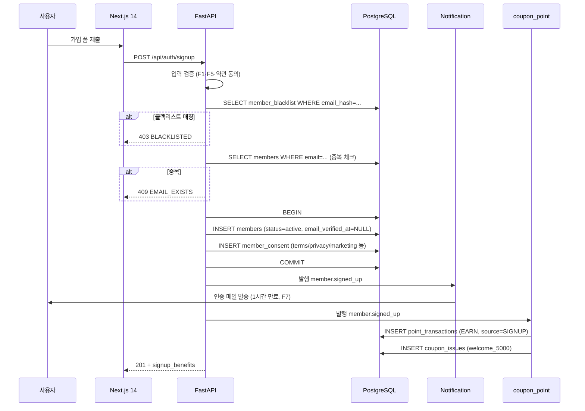
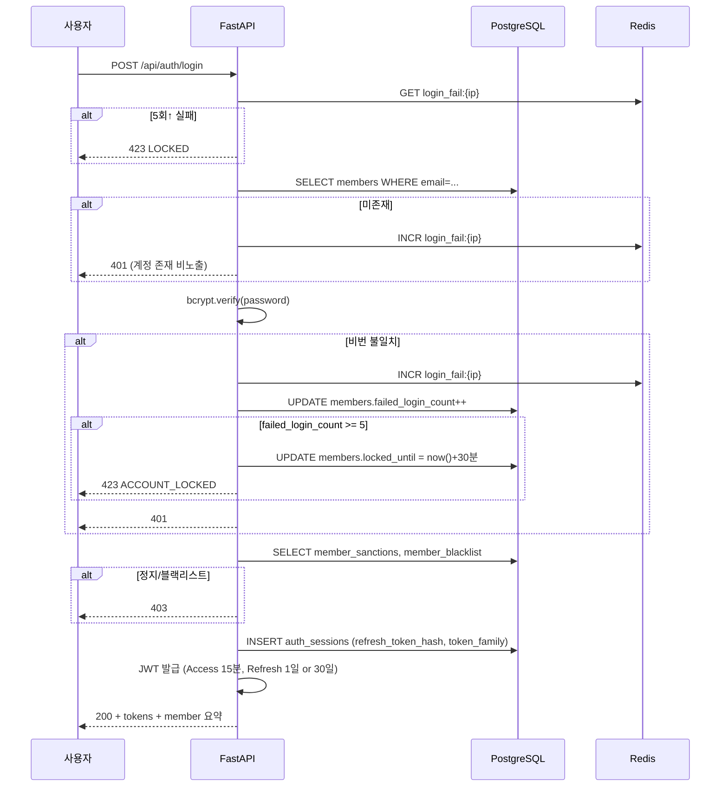

# f11 — 회원 가입·로그인 기능정의서

- **박제일**: 2026-05-21
- **갱신**: 2026-05-22~23 (QA v4 §1 직접 비교 후 정합 재검증)
- **단계**: S0 / Track 1 / Phase 4 / f11
- **상위 문서**: `00_index.md`
- **짝 도메인**: `../05_도메인정의서/d11_회원.md`
- **짝 화면**: s13(로그인) · s14(회원가입) · s15(비밀번호 재설정) · s16(OAuth 콜백) · s32(프로필·알림설정) · s34(탈퇴)
- **QA 소스**: `쇼핑몰_전용_QA_v4.md §1` (MEM-U-001~055 = 55건, MEM-A-001~035 + MEM-A-029B = 36건, 총 91건) + `공통_인프라_보안_QA.md §A-1` (A-AUTH-001~022 = 22건)

> **2026-05-22~23 갱신 메모**: QA v4 §1 직접 정독 결과 본 기능정의서는 v4 prefix(MEM-U-* / MEM-A-*)와 정합. 신규 항목·정책값·룰 누락 0건. 머리말 합계 91건 박제(MEM-A-029B 정합 명시). 미결 항목·검증 룰 변경 없음.

---

## 1. 개요

- **기능명**: 회원 가입·로그인·소셜 인증·MFA·세션 관리·자동 로그인·탈퇴
- **비즈니스 목적**: 회원 전용 정책(`00_개요.md §2 #8`) 하에 모든 사용자 활동의 인증·권한 기반 제공. 가입 시점에 신규가입 쿠폰·포인트 발급 트리거를 통해 마케팅 KPI 출발점 형성.
- **트리거**: 사용자 가입/로그인 폼 제출, OAuth 콜백, 자동 로그인 토큰 갱신, 탈퇴 신청, 자동 로그아웃 타임아웃
- **액터**: 비회원(가입), 회원(로그인·로그아웃·프로필 수정·탈퇴), 시스템(세션 무효화 배치·생일 쿠폰 배치)
- **관련 화면**: s13(로그인), s14(회원가입), s15(비밀번호 재설정), s16(OAuth 콜백), s32(프로필·배송지·알림), s33(멤버십·친구추천), s34(탈퇴)
- **관련 도메인**: d11 회원 (주), d20 쿠폰·포인트 (가입 보너스 이벤트 구독), notification (메일·SMS 발송)

---

## 2. 입력·출력

### 2.1 회원가입 (POST `/api/auth/signup`)

**Request 헤더**: `Content-Type: application/json`, `X-CSRF-Token: {token}`

**Request Body**:

| 필드 | 타입 | 필수 | 검증 |
|---|---|---|---|
| email | string | Y | RFC 5322 + 소문자 정규화 + 255자 |
| password | string | Y | 8자↑ + 영문+숫자+특수문자 (F1 룰) |
| name | string | Y | 1~50자 |
| phone | string | N | E.164 정규화 (+82-10-xxxx-xxxx) |
| birthdate | date | Y | YYYY-MM-DD, 만 14세 이상 (F5) |
| gender | enum | N | F/M/N |
| consents | array | Y | `[{type:'terms', agreed:true}, {type:'privacy', agreed:true}, ...]` |
| referral_code | string | N | 친구 추천 코드 (Q-04 미결 박제) |

**Response 201**:
```json
{
  "member_id": "uuid",
  "email_verification_sent": true,
  "signup_benefits": {
    "points_awarded": 3000,
    "coupons_issued": ["welcome_5000"]
  }
}
```

### 2.2 로그인 (POST `/api/auth/login`)

**Request Body**:

| 필드 | 타입 | 필수 | 검증 |
|---|---|---|---|
| email | string | Y | RFC 5322 |
| password | string | Y | (raw, 서버 bcrypt 비교) |
| remember_me | boolean | N | true 시 Refresh TTL 30일, false 시 1일 |

**Response 200**:
```json
{
  "access_token": "jwt(15min)",
  "refresh_token": "jwt_rotation",
  "member": {
    "id": "uuid",
    "email": "***@***",
    "name": "신디",
    "membership_grade": "골드",
    "points_balance": 12500
  }
}
```

쿠키: `Refresh` HttpOnly+Secure+SameSite=Lax (F12).

### 2.3 OAuth 콜백 (POST `/api/auth/oauth/{provider}/callback`)

| 필드 | 타입 | 필수 | 검증 |
|---|---|---|---|
| code | string | Y | OAuth 인가 코드 |
| state | string | Y | CSRF 방지 (서버 세션과 일치 검증, F9) |

응답은 §2.2와 동일 + `is_new_signup: boolean` 추가.

### 2.4 토큰 갱신 (POST `/api/auth/refresh`)

쿠키의 Refresh 토큰 자동 추출 → 새 Access(15분) + 새 Refresh(rotation) 발급. 재사용 감지 시 token_family 전체 revoke (Token Rotation 패밀리).

### 2.5 비밀번호 재설정 요청 (POST `/api/auth/password-reset/request`)

| 필드 | 타입 | 필수 |
|---|---|---|
| email | string | Y |

**Response 202** (계정 존재 여부 비노출 — Account Enumeration 방어).

### 2.6 비밀번호 재설정 확정 (POST `/api/auth/password-reset/confirm`)

| 필드 | 타입 | 필수 | 검증 |
|---|---|---|---|
| token | string | Y | 30분 유효, 1회 사용 (F6) |
| new_password | string | Y | F1 룰 |

### 2.7 탈퇴 (POST `/api/me/withdraw`)

| 필드 | 타입 | 필수 |
|---|---|---|
| reason | enum | Y | not_useful / privacy / hard_to_use / other |
| reason_detail | text | N | other 시 필수 |

**Response 200**: `{ "grace_until": "2026-06-20T00:00:00Z" }` (30일 유예 후 PII 마스킹).

---

## 3. 처리 흐름

### 3.1 회원가입 시퀀스



### 3.2 로그인 시퀀스



### 3.3 자동 로그아웃 (비활성 30분)

- FE 마지막 활동 시각 추적 (mouse/keyboard/scroll/tap)
- 30분 무활동 시 Access 만료 → Refresh 자동 갱신 시도 → 백엔드에서 마지막 활동 시각 30분 초과면 거부 → 강제 로그아웃 + 로그인 페이지 리다이렉트 (next 파라미터로 원위치 복귀)

### 3.4 탈퇴 흐름

1. 사용자 탈퇴 요청 → `members.status=withdrawn` + `withdrawal_grace_until=now+30일`
2. 진행 중 주문(paid/preparing) 정책 분기 (Q-Q-MEM03 미결 — 정지 회원 정책과 통합 결정)
3. 잔여 포인트·쿠폰은 grace 기간 동안 유지
4. grace_until 경과 → 일일 배치가 PII 마스킹 + 블랙리스트(email_hash·phone_hash) 보존 → `member.withdrawn_completed` 발행

---

## 4. 검증 룰

### 4.1 입력 검증

| 필드 | 룰 | 위반 코드 |
|---|---|---|
| email | RFC 5322 + 255자 | 422 INVALID_EMAIL |
| password | 8자↑ + 영문+숫자+특수문자 | 422 WEAK_PASSWORD |
| birthdate | 만 14세 이상 | 403 UNDER_AGE |
| phone | E.164 | 422 INVALID_PHONE |
| consents | terms/privacy 필수 동의 | 422 MISSING_CONSENT |

### 4.2 비즈니스 룰

| 룰 | 적용 | 근거 |
|---|---|---|
| 이메일 중복 차단 | signup | F-MEM (d11 §6.1 F1) |
| 블랙리스트 매칭 차단 (email_hash/phone_hash) | signup, login | F16, MEM-U-038/047 |
| 5회 실패 시 30분 잠금 | login | P7·P8, MEM-U-013 |
| OAuth state CSRF 검증 | OAuth | F9, MEM-U-015 |
| 비밀번호 재설정 토큰 30분·1회 | reset | F6, MEM-U-020 |
| 재설정 요청 IP 30분 5회 제한 | reset | F8, A-AUTH-014, F-RATE-01·02 (Tier 3 §3.8) |
| **로그인 5회 / 10분 (IP + email)** (NEW Tier 3 §3.8 매핑) | login | F-RATE-01·02 |
| **가입 5회 / 1시간 (IP)** (NEW Tier 3 §3.8 매핑) | signup | F-RATE-01·02 |
| **OAuth 콜백 10회 / 1분 (IP)** (NEW Tier 3 §3.8 매핑) | OAuth | F-RATE-01·02 |
| **비밀번호 정책 = 최근 5개 재사용 차단** (NEW Tier 3 §3.11) | 변경 | F-PWD-01 |
| **비밀번호 변경 후 이메일 알림 (보안)** (NEW Tier 3 §3.11) | 변경 | F-PWD-05 |
| 비번 변경 시 전 세션 revoke | password change | F3, A-AUTH-005 |
| 정지/블랙리스트 시 세션 즉시 revoke | sanctions | F4, A-AUTH-006 |
| Session Fixation 방지 — 로그인 시 Session ID 재생성 | login | F10, A-AUTH-019 |
| JWT alg:none·RS256 변조 거부 | refresh | F11, A-AUTH-020 |
| 탈퇴 후 30일 grace → PII 마스킹 + 블랙리스트 식별자 보존 | withdraw batch | F15·F16, MEM-U-040 |

---

## 5. 트랜잭션·동시성

| 시나리오 | 메커니즘 |
|---|---|
| 회원가입 (members + consent + 블랙리스트 체크) | 단일 트랜잭션 BEGIN/COMMIT. signup 이벤트는 COMMIT 후 발행 (outbox 패턴) |
| 신규가입 쿠폰·포인트 발급 | coupon_point 도메인이 `member.signed_up` 이벤트 구독 → 별도 트랜잭션 (멱등키 = member_id+'_signup') |
| 동시 로그인 시도 (같은 계정) | failed_login_count는 Redis `INCR` 원자 연산 + DB UPDATE는 advisory lock |
| Refresh Token Rotation | token_family UUID 발급 → 재사용 감지 시 family 전체 revoke (탈취 대응) |
| 탈퇴 처리 | 단일 트랜잭션 (status 변경 + grace_until SET + 사유 INSERT) |
| 생일 쿠폰 배치 | `(member_id, today_date)` 멱등 — 같은 날 1건 보장 (F17) |
| 5회 실패 잠금 카운터 | Redis `login_fail:{email}` TTL 30분 INCR + 임계 도달 시 DB members.locked_until SET |

---

## 6. 에러 처리

| HTTP | 도메인 코드 | 시나리오 | 사용자 메시지 |
|---|---|---|---|
| 422 | INVALID_EMAIL | 이메일 형식 무효 | "이메일 형식을 확인해주세요." |
| 422 | WEAK_PASSWORD | 비밀번호 룰 위반 | "8자 이상, 영문·숫자·특수문자를 포함해주세요." |
| 422 | MISSING_CONSENT | 필수 약관 미동의 | "필수 약관에 동의해주세요." |
| 403 | UNDER_AGE | 만 14세 미만 | "만 14세 이상부터 가입할 수 있습니다." |
| 403 | BLACKLISTED | 블랙리스트 매칭 | "본 계정은 가입이 제한됩니다. 고객센터로 문의해주세요." |
| 409 | EMAIL_EXISTS | 이메일 중복 | "이미 가입된 이메일입니다. 로그인 또는 비밀번호 찾기를 이용해주세요." |
| 401 | INVALID_CREDENTIAL | 로그인 실패 | "이메일 또는 비밀번호가 일치하지 않습니다." (계정 존재 비노출) |
| 423 | ACCOUNT_LOCKED | 5회 실패 잠금 | "잠시 후 다시 시도해주세요. (30분 후 자동 해제)" |
| 403 | SUSPENDED / BANNED | 정지·블랙 | "본 계정은 이용이 정지되었습니다. 고객센터로 문의해주세요." |
| 410 | TOKEN_EXPIRED | 재설정/인증 토큰 만료 | "링크가 만료되었습니다. 다시 요청해주세요." |
| 429 | RATE_LIMITED | 재설정 IP 5회 초과 | "잠시 후 다시 시도해주세요." |
| 400 | INVALID_STATE | OAuth state 불일치 | "로그인 세션이 만료되었습니다. 다시 시도해주세요." |
| 409 | OAUTH_EMAIL_CONFLICT | 이미 이메일 가입된 계정 | "이미 가입된 이메일입니다. 일반 로그인 후 계정 연동을 이용해주세요." |

---

## 7. 성능·캐시

| 지표 | 목표 |
|---|---|
| 로그인 API P50 | < 200ms |
| 로그인 API P95 | < 500ms (bcrypt cost=12 기준) |
| 회원가입 API P95 | < 800ms (블랙리스트 SELECT + bcrypt + INSERT + 이벤트 발행) |
| Refresh 갱신 P95 | < 100ms (DB 조회 + JWT 서명) |
| 탈퇴 배치 처리량 | 10,000 row/min (PII 마스킹 + 블랙리스트 INSERT) |

**캐시 전략**:

| 키 | TTL | 무효화 트리거 |
|---|---|---|
| `member:{id}:profile` | 5분 | 프로필 수정 시 PURGE |
| `member:{id}:grade` | 1시간 | 등급 전환 이벤트 시 PURGE |
| `login_fail:{ip}` | 30분 | 성공 로그인 시 DELETE |
| `oauth_state:{state}` | 10분 | 콜백 검증 시 DELETE |

**인덱스 의존**: `members.idx_email`(로그인 조회), `members.idx_phone_hash`(블랙리스트 매칭), `auth_sessions.idx_member_id_expires`(세션 정리), `member_blacklist.idx_email_hash`·`idx_phone_hash`(가입 차단).

---

## 8. 테스트 케이스

### 8.1 유닛

- 비밀번호 정책 검증 함수 (8자 미만 / 영문 누락 / 숫자 누락 / 특수문자 누락 각각 reject)
- 만 14세 계산 (생일 경계 케이스 — 오늘이 만 14세 생일이면 OK)
- JWT 서명·검증 (alg:none 거부 / RS256 변조 거부)
- 이메일·전화번호 해시 함수 (입력 동일 → 출력 동일, 블랙리스트 매칭용)

### 8.2 통합 (FastAPI + PostgreSQL)

- 가입 → 인증 메일 1회 발송 (notification 이벤트 발행 확인)
- 가입 → 신규가입 쿠폰·포인트 발급 멱등 (같은 member_id로 이벤트 2회 재발행 시 1건만)
- 로그인 5회 실패 → 6번째 423 응답
- Refresh 재사용 감지 → token_family 전체 revoke
- 블랙리스트 등록 후 같은 이메일 가입 시도 → 403
- 탈퇴 후 30일 경과 배치 → email_hash 보존 + members.email NULL 마스킹

### 8.3 E2E (Playwright)

- 가입 폼 → 약관 동의 → 인증 메일 클릭 → 로그인 성공 (포인트 3,000P 마이페이지 표시)
- 카카오 OAuth 신규 가입 (state 무효 시 400)
- 로그인 → 보호 페이지 접근 → 30분 비활성 → 자동 로그아웃 → next 파라미터로 원위치 복귀
- 비밀번호 재설정 (요청 → 메일 → 클릭 → 신비번 → 전 세션 무효화 확인)
- 탈퇴 신청 → 마이페이지 "탈퇴 진행 중" 표시 → 30일 내 재로그인으로 취소 가능

### 8.4 QA 추적

- `쇼핑몰_전용_QA_v4.md §1`: MEM-U-001~055 (55건) + MEM-A-001~035 + MEM-A-029B (36건) 전수 = 91건
- `공통_인프라_보안_QA.md §A-1`: A-AUTH-001~022 전수 (22건) + §A-8 A-LOG-001~003·011·012 (5건)

> 2026-05-22~23 정합 재검증: v4 §1 prefix 변경 0건. MEM-A-029B(현금영수증 정정·취소 처리) 포함 정합 명시. 본 기능정의서 검증 룰 §4 / 처리 흐름 §3 = v4 시나리오 전수 커버 OK.

---

## 9. 미결

| ID | 항목 | 미결 사유 |
|---|---|---|
| f11-Q01 | 2FA(OTP·백업 코드) 사용자 영역 적용 여부 | MFA는 관리자(d21)는 의무, 사용자는 옵션 (사장님 결정) |
| f11-Q02 | "remember_me" UI 노출 여부 | 보안상 디폴트 false 권장, 옵션 노출은 UX 결정 |
| f11-Q03 | 자동 로그아웃 시간 사용자 노출 (D-30초 카운트다운 모달) | UX 결정 |
| f11-Q04 | 탈퇴 사유 분류 enum 최종안 (현 4종) | 마케팅 분석용 enum 항목 조정 |
| f11-Q05 | 친구 추천 코드 검증 시점 (가입 즉시 vs 첫 주문 시) | Q-04 어뷰징 방지 정책과 통합 결정 |

> 본 미결은 `../_미결사항_통합관리.md §3`에 동일 ID로 append.
