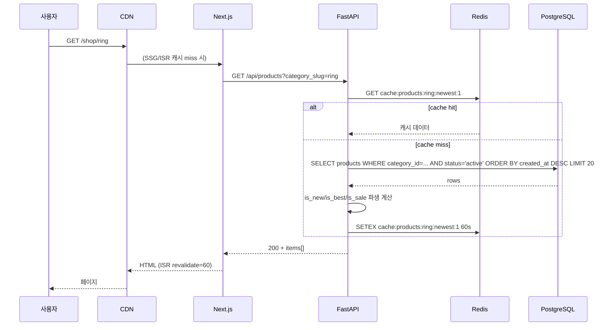

# f12 — 상품 조회·검색 기능정의서

- **박제일**: 2026-05-21
- **갱신일**: 2026-05-22 ~ 2026-05-23 (QA v4 §2/§3 정합 재검토 — PRD §2 합계 120건 / CAT §3 합계 22건 정정)
- **단계**: S0 / Track 1 / Phase 4 / f12
- **상위 문서**: `00_index.md`
- **짝 도메인**: `../05_도메인정의서/d12_상품.md` · `d13_카테고리.md`
- **짝 화면**: s01(홈) · s02(카테고리 인덱스) · s03(카테고리 목록) · s04(상품 상세) · s05(검색 결과)
- **QA 소스**: `쇼핑몰_전용_QA_v4.md §2 §3` (PRD-U-* / PRD-A-* / CAT-U-* / CAT-A-* — v4 통합 prefix) + `공통_인프라_보안_QA.md §A-4 / §A-5 / §A-6 / §B-2`

---

## 1. 개요

- **기능명**: 상품 목록·상세·검색·필터·정렬·페이지네이션·옵션별 재고 표시·연관 상품·최근 본 상품·재입고 알림 신청
- **비즈니스 목적**: Stage 2 탐색의 핵심 — LCP 3초·옵션 조합 품절 표시 정확도가 카트 추가율·구매 전환율의 직결 KPI. 트래픽이 가장 집중되는 영역으로 캐시 친화 설계가 비용 통제의 핵심.
- **트리거**: 사용자 페이지 진입(SSG/ISR), 검색어 입력, 필터·정렬 변경, 옵션 선택, 페이지네이션 클릭, 재입고 알림 신청
- **액터**: 비회원(목록·상세 조회), 회원(최근 본·재입고 알림 신청·찜), 시스템(캐시 무효화·재고 차감·sales_count 갱신)
- **관련 화면**: s01·s02·s03·s04·s05
- **관련 도메인**: d12 상품 (주), d13 카테고리, d15 위시리스트 (재입고 알림 트리거), d19 리뷰 (평균 별점)

---

## 2. 입력·출력

### 2.1 상품 목록 (GET `/api/products`)

**Query**:

| 파라미터 | 타입 | 필수 | 설명 |
|---|---|---|---|
| category_slug | string | N | `ring` / `necklace` 등 |
| price_min | integer | N | 최소 가격 |
| price_max | integer | N | 최대 가격 |
| sort | enum | N | newest(기본) / sales_desc / price_asc / price_desc |
| page | integer | N | 기본 1 |
| limit | integer | N | 기본 20, 최대 100 |
| is_sale | boolean | N | 타임세일 진행 중만 |

**Response 200**:
```json
{
  "items": [{
    "id": "p_xxxx",
    "name": "라운드 반지",
    "slug": "round-ring",
    "price": 39000,
    "sale_price": 29000,
    "thumbnail_url": "https://cdn/...",
    "is_new": true,
    "is_best": false,
    "is_sale": true,
    "is_sold_out": false,
    "review_count": 124,
    "avg_rating": 4.6
  }],
  "pagination": { "page": 1, "limit": 20, "total": 187, "total_pages": 10 }
}
```

### 2.2 상품 상세 (GET `/api/products/{slug}`)

**Response 200**: 위 필드 + `description`, `images[]`, `options[]`, `skus[]{sku_id, option_combo, stock, additional_price}`, `related_products[]`, `purchase_limit_per_member`, `time_sale{sale_price, end_at, stock_limit, current_sold}` (active 시).

### 2.3 SKU별 실시간 재고 (GET `/api/products/{id}/skus`)

**캐시 X**. 옵션 선택 시 호출되어 실시간 재고·가격 반환.

```json
{
  "skus": [
    {"sku_id":"uuid", "option_combo":{"color":"블랙","size":"M"}, "stock":3, "additional_price":0, "is_purchasable":true},
    {"sku_id":"uuid", "option_combo":{"color":"블랙","size":"L"}, "stock":0, "additional_price":0, "is_purchasable":false}
  ]
}
```

### 2.4 검색 (GET `/api/search`)

| 파라미터 | 타입 | 필수 | 설명 |
|---|---|---|---|
| q | string | Y | 키워드 (1~100자) |
| category_slug | string | N | 카테고리 한정 |
| sort | enum | N | relevance(기본) / sales / newest |
| page | integer | N | |
| limit | integer | N | |

**Response 200**: 상품 목록 + `keyword: "..."`. robots noindex (I-03).

### 2.5 재입고 알림 신청 (POST `/api/products/{id}/restock-alert`)

회원 전용. Body: `{sku_id?: "uuid"}`. sku_id NULL 시 상품 전체 재입고.

### 2.6 최근 본 상품 (GET `/api/me/recently-viewed`)

회원=DB / 비회원=localStorage 기반. 최대 N건 (정책).

---

## 3. 처리 흐름

### 3.1 상품 목록 조회



### 3.2 상품 상세 + SKU 재고

1. 페이지 진입 → SSG/ISR(`revalidate=60`) HTML 응답
2. 옵션 선택 이벤트 → `GET /api/products/{id}/skus` 실시간 호출 (no cache)
3. 선택된 SKU `is_purchasable=false` 시 버튼 비활성 + "품절" 배지
4. SKU 조합 부분 품절 (E-009) — 색상 블랙×사이즈 L만 0인 경우, 다른 조합은 정상 활성

### 3.3 재고 차감 (시스템 트리거)

`payment.approved` 이벤트 수신 → product_skus.stock 차감 → `CHECK stock >= 0` 위반 시 트랜잭션 롤백 + 결제 환불 트리거 (E-001).

```sql
UPDATE product_skus
SET stock = stock - :qty
WHERE sku_id = :sku_id AND stock >= :qty
RETURNING stock;
-- affected_rows = 0 시 재고 부족 (음수 방지)
```

차감 후 stock=0 → products.status='sold_out' 전환 + `product.sold_out` 이벤트 발행 (cart·wishlist 구독).

---

## 4. 검증 룰

### 4.1 입력 검증

| 필드 | 룰 | 위반 코드 |
|---|---|---|
| q (검색어) | 1~100자, 금칙어 매칭 시 빈 결과 | 422 INVALID_QUERY (길이) |
| price_min/max | 양의 정수, min ≤ max | 422 INVALID_RANGE |
| page | ≥ 1 | 422 |
| limit | 1 ≤ limit ≤ 100 | 422 |
| sort | enum 검증 | 422 |
| sku_id | UUID 형식 + 해당 상품 소속 | 404 |

### 4.2 비즈니스 룰

| 룰 | 적용 | 근거 |
|---|---|---|
| 비활성/단종/숨김 상품 404 | 상세 | PRD-A-005/037, PRD-U-017 |
| 비활성 카테고리 직접 URL 404 | 카테고리 | CAT-U-009 |
| 옵션 조합 미존재 SKU 비활성 표시 | 상세 | PRD-U-012/012B |
| 1인당 구매 수량 제한 검증 (카트+기존 주문 합산) | 카트 담기 시 (cart 도메인 위임) | PRD-U-047 |
| 재입고 알림 회원 전용·중복 신청 차단 | restock-alert | PRD-U-020 |
| 금칙어 매칭 검색어는 search_keywords 미기록 + 빈 결과 | 검색 | PRD-U-035, PRD-A-030 |
| 재고 음수 DB CHECK 차단 | 재고 차감 | PRD-A-052, B-ORD-001 |
| 타임세일 active 기간만 sale_price 반영 | 상세 | PRD-U-023 |
| 카테고리 비활성 시 필터에서 자동 제외 | 목록 필터 | CAT-A-003 |
| **상품 목록 조회 = 600회 / 1분 (IP)** (NEW Tier 3 §3.8) | 조회 | F-RATE-01·03 |
| **SKU 재고 조회 = 100회 / 1분 (IP)** (NEW Tier 3 §3.8) | 옵션 선택 | F-RATE-01·03 |
| **검색 = 60회 / 1분 (IP)** (NEW Tier 3 §3.8) | 검색 | F-RATE-01·03 |

---

## 5. 트랜잭션·동시성

| 시나리오 | 메커니즘 |
|---|---|
| 재고 차감 (결제 승인 후) | `UPDATE ... WHERE stock >= :qty RETURNING` 원자 연산. affected_rows=0 시 결제 환불 트리거 (F-PAY-07) |
| 동시 주문 = 마지막 재고 1개 경쟁 | DB row-level 락 + CHECK 제약으로 1건만 성공, 나머지 409 OUT_OF_STOCK |
| 타임세일 stock_limit 도달 | time_sales.current_sold 낙관락 (`UPDATE WHERE current_sold + :qty <= stock_limit RETURNING`) |
| sales_count 갱신 (BEST 산정 캐시) | 구매확정 이벤트 시 비동기 배치 (정확한 실시간 불필요) |
| view_count 갱신 | 상세 페이지 진입 시 Redis INCR + 1분 단위 DB flush 배치 |
| 재고 변동 이력 | product_stock_history INSERT only (UPDATE 금지) — change_type별 합산 = 현재 재고 역산 일치 (PRD-A-056) |
| 캐시 무효화 | 관리자가 상품 수정 시 `cache:products:{category}:*` 일괄 PURGE + ISR revalidate 트리거 |

---

## 6. 에러 처리

| HTTP | 도메인 코드 | 시나리오 | 사용자 메시지 |
|---|---|---|---|
| 404 | PRODUCT_NOT_FOUND | 슬러그 미존재/비활성/단종/숨김 | "상품을 찾을 수 없습니다." + 인기 상품 노출 |
| 404 | CATEGORY_NOT_FOUND | 카테고리 비활성/미존재 | 인기 카테고리 링크 |
| 422 | INVALID_QUERY | 검색어 길이 위반 | "검색어를 1~100자 사이로 입력해주세요." |
| 409 | OUT_OF_STOCK | 재고 차감 시 부족 | "재고가 부족합니다." (결제 자동 환불 트리거) |
| 409 | TIMESALE_STOCK_EXHAUSTED | 타임세일 한도 초과 | "타임세일 재고가 모두 소진되었습니다." |
| 401 | UNAUTHORIZED | 재입고 알림·찜 비로그인 | 로그인 모달 |
| 409 | DUPLICATE_RESTOCK_ALERT | 재입고 알림 중복 | "이미 알림 신청된 상품입니다." |
| 403 | PURCHASE_LIMIT_EXCEEDED | 1인당 수량 초과 | "본 상품은 1인 N개까지 구매 가능합니다." (실제 차단은 cart) |

---

## 7. 성능·캐시

| 지표 | 목표 |
|---|---|
| 홈 LCP | < 2.5s (모바일 4G) |
| 카테고리 목록 P95 | < 300ms (캐시 hit) / < 800ms (miss) |
| 상품 상세 SSG TTFB | < 200ms (CDN edge) |
| SKU 재고 조회 P95 | < 100ms (DB index) |
| 검색 P95 | < 500ms (q 길이 1~50자 기준) |

**캐시 전략**:

| 키 | TTL | 무효화 |
|---|---|---|
| `cache:products:{cat}:{sort}:{page}` | 60s | 상품 CRUD / 카테고리 변경 시 PURGE |
| `cache:product:{slug}` | 300s | 상품 수정 / 재고 0 전환 시 PURGE |
| `cache:product:skus:{id}` | **캐시 안 함** | 실시간 |
| `cache:category:tree` | 600s | 카테고리 CRUD 시 PURGE |
| `view_count:{product_id}` | 60s INCR | 1분마다 DB flush |

**ISR**: Next.js 14 SSG + `revalidate=60`. 상품 수정 시 `revalidatePath` 호출.

**인덱스**: `products.idx_category_status`, `idx_status_created_at`, `idx_sales_count`, `product_skus.idx_product_id` + `UNIQUE(product_id, option_combo)`, `search_keywords.idx_keyword_created`, `categories.idx_parent_active_order`.

---

## 8. 테스트 케이스

### 8.1 유닛

- `is_new` 파생 함수 (P-NEW 30일 기본, 경계값 정확)
- `is_best` 산정 (sales_count 상위 N% 포함)
- 검색어 금칙어 매칭 (blocked_keywords)
- SKU `is_purchasable` 판정 (stock>0 AND status=active AND 1인 수량 제한)

### 8.2 통합

- 상품 목록 캐시 hit/miss → 결과 동일 + miss 후 캐시 set 확인
- 옵션 조합 (블랙×M, 블랙×L) 중 L만 stock=0 → 응답에 L만 is_purchasable=false
- 동시 결제 2건 (마지막 재고 1개) → 1건 성공, 1건 409 OUT_OF_STOCK (B-ORD-001)
- 타임세일 stock_limit 도달 → 자동 close + status=closed + auto_close_reason='stock_exhausted'
- 재입고 알림 신청 → product.restocked 이벤트 시 notified_at SET (멱등)
- 관리자 카테고리 비활성 → 사용자 목록 필터에서 즉시 제외 (캐시 PURGE 확인)

### 8.3 E2E

- 홈 진입 → 카테고리 카드 클릭 → 목록 → 필터(가격대) → 상품 클릭 → 옵션 선택 → 재고 표시 → 카트 담기
- 검색어 입력 → 결과 → 정렬 변경 (newest → sales) → 페이지네이션 → robots meta noindex 확인
- 옵션 부분 품절 케이스 (블랙×L만 0) → 다른 조합은 정상 구매 가능
- 비회원이 재입고 알림 → 로그인 모달 → 로그인 후 신청 성공
- 관리자가 재고 0 수정 → 사용자 상품 상세 즉시 품절 전환 (E-015)

### 8.4 QA 추적

- `쇼핑몰_전용_QA_v4.md §2`: PRD-U-001~062 (012B 포함 63건) + PRD-A-001~057 (57건) = **120건**
- `쇼핑몰_전용_QA_v4.md §3`: CAT-U-001~010 (10건) + CAT-A-001~012 (12건) = **22건**
- `공통_인프라_보안_QA.md §A-4 / §A-5 / §A-6 / §B-2`: 캐시·CDN·DB·재고 동시성 = 18건
- **f12 합계** = 120 + 22 + 18 = **160건** QA 추적 (d12 138 + d13 22)

> **QA v4 정합 메모 (2026-05-22~23 갱신)**
> - prefix 변경 없음 (v3 ↔ v4 모두 `PRD-*` / `CAT-*` 통합 prefix).
> - v4 §2 신규 시나리오 = (1) 재고 동시성 14건 (PRD-U-049~062) + (2) 관리자 재고 동시성·정합성 8건 (PRD-A-050~057) + (3) 재고/카테고리 한정 쿠폰/1인당 수량 제한 11건 (PRD-A-043~049) → §4.2 비즈니스 룰·§5 트랜잭션·동시성·§6 에러 처리에 모두 반영.
> - v4 §3 신규 항목 없음.

---

## 9. 미결

| ID | 항목 | 미결 사유 |
|---|---|---|
| f12-Q01 | 검색 엔진 선정 (PostgreSQL FTS vs Elasticsearch/Meilisearch) | 트래픽 규모·운영 비용 분석 후 결정 |
| f12-Q02 | 최근 본 상품 사용자당 최대 N건 | UX 결정 (제안 20건) |
| f12-Q03 | NEW 노출 기간 (P-NEW) 기본값 | 운영 정책 (제안 30일) |
| f12-Q04 | BEST 산정 기준 (sales_count 상위 N% 또는 절대 임계) | 운영 분석 후 결정 |
| f12-Q05 | 1인당 구매 수량 제한 위반 시 사용자 메시지 톤 | UX 결정 |

> 본 미결은 `../_미결사항_통합관리.md §3`에 append.
