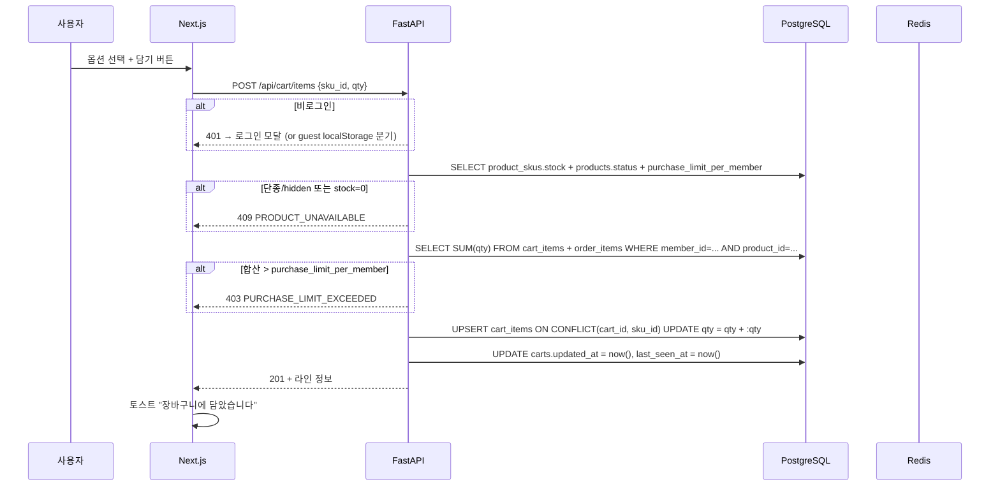
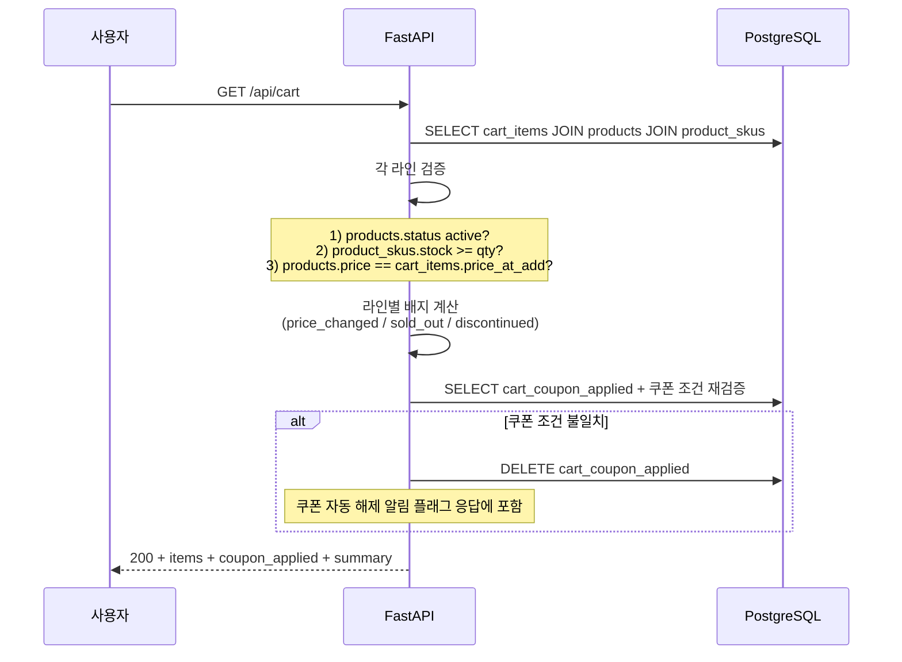

# f13 — 장바구니 기능정의서

- **박제일**: 2026-05-21
- **갱신일**: 2026-05-23 (QA v4 §4 신규 항목 CRT-U-016~020 / CRT-A-006 정합)
- **단계**: S0 / Track 1 / Phase 4 / f13
- **상위 문서**: `00_index.md`
- **짝 도메인**: `../05_도메인정의서/d14_장바구니.md`
- **짝 화면**: s17(장바구니)
- **QA 소스**: `쇼핑몰_전용_QA_v4.md §4` (CRT-U-001 ~ CRT-U-020, CRT-A-001 ~ CRT-A-006 전수) + `공통_인프라_보안_QA.md §B-2` (재고 동시성 일부)

> **2026-05-23 정합 메모**: 합계 금액 실시간 계산(CRT-U-017), 비회원 카트 브라우저 재접속 유지(CRT-U-018), 가격 인하 알림(CRT-U-019), 직전 배송지 자동 선택(CRT-U-020), 관리자 카트 만료 기간 설정(CRT-A-006)을 본 기능정의서 §4 / §8 에 반영합니다. 짝 위시리스트 prefix는 v4 기준 `WIS-*` 사용(d15 v0.2 동기).

---

## 1. 개요

- **기능명**: 장바구니 담기·조회·수량 변경·옵션 변경·삭제·쿠폰 미리 적용·실시간 재검증·비회원→회원 카트 병합·주문서 진입 게이트
- **비즈니스 목적**: Stage 2 탐색 → Stage 3 구매 전환의 핵심 버퍼. 카트 추가율 / 카트→주문서 전환율 / 7일 미결제 리마인드 발송율이 주요 KPI.
- **트리거**: 담기 버튼 클릭, 카트 페이지 진입, 수량 ±, 옵션 변경, 삭제, 쿠폰 적용, 비회원 로그인(병합), 결제 진입 버튼
- **액터**: 회원(전체), 비회원(localStorage 카트 — 결제 시 로그인 강제), 시스템(품절·가격 변동 이벤트 구독, 7일 미결제 배치)
- **관련 화면**: s17 (s04 상품 상세에서 담기 트리거)
- **관련 도메인**: d14 장바구니 (주), d12 상품 (재고/가격 재검증), d20 쿠폰·포인트, d16 주문 (주문서 페이로드 전달)

---

## 2. 입력·출력

### 2.1 카트 조회 (GET `/api/cart`)

**Response 200**:
```json
{
  "items": [{
    "id": "uuid",
    "product_id": "p_xxx",
    "sku_id": "uuid",
    "name": "라운드 반지",
    "option_combo": {"color":"블랙","size":"M"},
    "qty": 2,
    "current_price": 29000,
    "price_at_add": 39000,
    "price_changed": true,
    "stock_available": 3,
    "is_purchasable": true,
    "selected": true,
    "thumbnail_url": "https://cdn/..."
  }],
  "coupon_applied": { "coupon_id":"uuid", "applied_amount":2000 },
  "summary": {
    "product_amount": 58000,
    "coupon_discount": 2000,
    "shipping_fee_preview": 0,
    "expected_payment": 56000
  }
}
```

### 2.2 담기 (POST `/api/cart/items`)

| 필드 | 타입 | 필수 |
|---|---|---|
| sku_id | uuid | Y |
| qty | integer | Y (1 ≤ qty ≤ min(stock, 99)) |

**Response 201**: 라인 정보 (기존 라인 발견 시 합산 결과).

### 2.3 수량 변경 (PATCH `/api/cart/items/{id}`)

Body: `{qty: integer, version: integer}`. version 비교 후 last-write-wins.

### 2.4 옵션 변경 (PATCH `/api/cart/items/{id}/option`)

Body: `{new_sku_id: uuid}`. 신 SKU 라인으로 전환 (기존 sku_id 라인 발견 시 수량 합산, 상한 검증).

### 2.5 삭제 (DELETE `/api/cart/items/{id}`, POST `/api/cart/items/bulk-delete`)

bulk: `{item_ids: ["uuid", ...]}`.

### 2.6 쿠폰 적용 (POST `/api/cart/coupon`)

Body: `{coupon_id: uuid}`. **Response 200**: `{applied_amount: 2000}`.

### 2.7 비회원 카트 병합 (POST `/api/cart/merge`)

로그인 직후 호출. Body: `{items: [{sku_id, qty}, ...]}` (localStorage 페이로드).

**Response 200**:
```json
{
  "merged": [{"sku_id":"uuid","qty":3}],
  "adjusted": [{"sku_id":"uuid","requested":5,"final":3,"reason":"stock_limit"}]
}
```

### 2.8 주문서 진입 페이로드 (POST `/api/cart/checkout-payload`)

Body: `{item_ids: ["uuid", ...]}` (선택 결제). **Response 200**: 주문서 페이로드 (실시간 단가·재고·쿠폰·배송비 예상 + 1단계 재검증 결과).

---

## 3. 처리 흐름

### 3.1 담기 흐름



### 3.2 카트 조회 (실시간 재검증)



### 3.3 결제 진입 게이트

1. 사용자 "결제하기" 버튼 클릭
2. FE → `POST /api/cart/checkout-payload {item_ids}` (선택 라인)
3. BE 실시간 재검증 (1차 재고 검증 — 3단계 중 1단계)
   - 모든 라인 품절/단종 → 409 ALL_UNAVAILABLE
   - 합계 < 최소 주문금액 (P1=10,000원) → 409 BELOW_MIN_ORDER_AMOUNT
4. 페이로드 응답 → FE가 `/checkout` 페이지(s18)로 라우팅 + 페이로드 sessionStorage 보관

### 3.4 비회원→회원 병합

1. 비회원이 localStorage(`shop_guest_cart_v1`)에 카트 보관
2. 결제 진입 → 로그인 강제 게이트(`00_개요.md §2 #8`)
3. 로그인 성공 직후 FE가 `POST /api/cart/merge {items}` 호출
4. BE는 각 sku_id별 서버 카트와 합산
   - `final_qty = min(server_qty + guest_qty, stock, 99)`
   - 초과 발생 시 `adjusted` 배열에 박제 → 사용자에게 안내
5. 병합 완료 → localStorage 초기화

---

## 4. 검증 룰

### 4.1 입력 검증

| 필드 | 룰 | 위반 코드 |
|---|---|---|
| sku_id | UUID + 해당 상품 활성 | 404 / 409 PRODUCT_UNAVAILABLE |
| qty | 1 ≤ qty ≤ min(stock, 99) | 409 OUT_OF_STOCK / 422 INVALID_QTY |
| coupon_id | 본인 보유 + 미사용 + 미만료 + min_order 충족 + target 일치 | 409 COUPON_INVALID |
| item_ids | 본인 카트 라인 ID | 403 / 404 |

### 4.2 비즈니스 룰

| 룰 | 적용 | 근거 |
|---|---|---|
| 회원당 카트 1건 (carts PK = member_id) | 전체 | F1 (d14 §6.1) |
| 동일 sku_id 중복 라인 금지 → UPSERT 합산 | 담기 | F2, CRT-U-001 |
| 카트 라인 최대 50 | 담기 | F5 |
| 1인당 수량 제한 = 카트 + 기존 주문 합산 검증 | 담기 | F4, PRD-U-047 |
| 카트 진입 시 실시간 재검증 (단가·재고·옵션 유효성·쿠폰) | 조회 | F6, CRT-U-004 |
| 가격/옵션/품절 변동 라인은 배지 표시 | 조회 | F7 |
| 동시 수량 변경 = last-write-wins (version 비교) | 수량 변경 | F8, CRT-U-009 |
| 카트 쿠폰 1건만 — 신규 적용 시 기존 자동 해제 | 쿠폰 적용 | F9, CRT-U-012 |
| 카트 변경 시 쿠폰 적용 조건 재검증 → 실패 시 자동 해제 | 담기/삭제/수량 | F10 |
| 비회원 카트 = localStorage 한정, 서버 미저장 | 비회원 | F12, `00_개요.md §2 #8` |
| 병합 시 합산 > min(stock, 99) → 가능 최대치 조정 + 안내 | 병합 | F13, CRT-U-015 |
| 세션 만료 시 회원 카트 보존 | 자동 | F14 |
| 단종/hidden 라인 = 카트 노출 + 결제 시 자동 제외 | 결제 | F15 |
| 주문서 진입 페이로드 = selected=TRUE 라인만 + 즉시 1단계 재검증 | 결제 진입 | F16 |
| 동일 회원 분할 담기(옵션 A 2 + 옵션 A 3) 주문 시 합산 검증 | 주문 (d16 위임) | F17, PRD-U-056 |
| **카트 담기 = 100회 / 1분 (member_id)** (NEW Tier 3 §3.8) | 담기 | F-RATE-01·06 |
| **카트 접근 = require_authenticated() (본인 카트 자동)** (NEW Tier 3 §3.4) | 권한 | F-IDOR-01·05 |
| 합계 금액 실시간 계산 = 상품 합계 + 쿠폰 차감 + 무료배송 기준(P5=50,000원, Q-07 권장안) 안내 | 조회/변경 | F18 (d14 §6.1), CRT-U-017 |
| 비회원 localStorage 카트 = 브라우저 종료 후 재접속 시 유지 (TTL 30일) | 비회원 | F19, CRT-U-018 |
| 가격 인하 라인 = "가격이 내렸어요" 배지 + 즉시 신단가 적용 (F7 분기) | 조회 | F20, CRT-U-019 |
| 주문서 진입 시 직전 사용 배송지(`addresses.last_used_at` 최신) 자동 선택 | 주문서 진입 | F21, CRT-U-020 |
| 카트 → 위시리스트 이동 = 선택 라인 wishlist_items UPSERT + cart_items DELETE | 라인 액션 | F22, CRT-U-015 |

---

## 5. 트랜잭션·동시성

| 시나리오 | 메커니즘 |
|---|---|
| 담기 UPSERT | `INSERT ... ON CONFLICT(cart_id, sku_id) DO UPDATE SET qty = cart_items.qty + EXCLUDED.qty` — 원자 합산 |
| 동시 수량 변경 (탭 2개) | `UPDATE cart_items SET qty=:new, version=version+1 WHERE id=:id AND version=:expected` — version mismatch 시 단순 덮어쓰기(last-write-wins) — 충돌 알림 X (F8) |
| 쿠폰 적용 자동 해제 | 카트 변경 트랜잭션 내에서 `cart_coupon_applied` 조건 재검증 → 실패 시 같은 트랜잭션에서 DELETE |
| 비회원 병합 | 단일 트랜잭션 (sku_id별 SELECT FOR UPDATE → UPSERT) |
| 7일 미결제 배치 | `abandoned_notified_at IS NULL AND updated_at < now() - 7일` → notification 이벤트 발행 → abandoned_notified_at SET (멱등) |
| 카트→주문 이관 (쿠폰 포함) | 주문 트랜잭션(d16) 내에서 `cart_coupon_applied` SELECT → orders.coupon_id 이관 → cart_coupon_applied DELETE |
| 90일 미갱신 카트 자동 삭제 | 야간 배치 (정책 P3) |

---

## 6. 에러 처리

| HTTP | 도메인 코드 | 시나리오 | 사용자 메시지 |
|---|---|---|---|
| 401 | UNAUTHORIZED | 비로그인 (회원 카트 API) | 로그인 모달 |
| 404 | SKU_NOT_FOUND | sku_id 무효 | "옵션을 찾을 수 없습니다." |
| 409 | PRODUCT_UNAVAILABLE | 단종/hidden 상품 담기 | "판매가 종료된 상품입니다." |
| 409 | OUT_OF_STOCK | qty > stock | "재고가 N개 남았습니다. 수량을 조정해주세요." |
| 403 | PURCHASE_LIMIT_EXCEEDED | 1인 N개 제한 초과 | "본 상품은 1인 N개까지 구매 가능합니다. (현재 카트+주문 합산 M개)" |
| 422 | INVALID_QTY | qty < 1 또는 > 99 | "수량은 1~99 사이로 입력해주세요." |
| 409 | COUPON_INVALID | 쿠폰 적용 조건 미달 | 사유별 분기 ("최소 주문금액 미달" / "사용 기간 만료" / "이미 사용" 등) |
| 409 | DUPLICATE_LINE_LIMIT | 카트 라인 50개 초과 | "장바구니는 최대 50개까지 담을 수 있습니다." |
| 409 | ALL_UNAVAILABLE | 결제 진입 시 모든 라인 품절 | "재고가 부족한 상품이 있습니다. 다시 확인해주세요." |
| 409 | BELOW_MIN_ORDER_AMOUNT | 합계 < 10,000원 | "최소 주문금액은 10,000원입니다." |
| 200 with adjusted[] | (병합) | 합산 상한 초과 | "일부 상품이 재고 한도로 조정되었습니다." |

---

## 7. 성능·캐시

| 지표 | 목표 |
|---|---|
| 카트 조회 P95 | < 300ms (라인 50 + 실시간 재검증) |
| 담기 P95 | < 200ms |
| 수량 변경 P95 | < 150ms |
| 결제 진입 페이로드 P95 | < 400ms (1단계 재검증 포함) |
| 병합 P95 | < 500ms (라인 50 가정) |

**캐시 전략**: 카트는 **무캐시 원칙** (실시간 정합 우선). 단, 카트 통계(관리자 대시보드)는 5분 캐시.

| 키 | TTL | 무효화 |
|---|---|---|
| `cart_stats:dashboard` | 5분 | 관리자 페이지 진입 시 갱신 |
| `abandoned_notify_lock:{cart_id}` | 1일 | 발송 시 SET (중복 발송 차단) |

**인덱스**: `cart_items.idx_cart_id`, `UNIQUE(cart_id, sku_id)`, `cart_items.idx_added_at`, `carts.idx_updated_at`(7일 배치), `carts.idx_abandoned_notified_at`.

---

## 8. 테스트 케이스

### 8.1 유닛

- UPSERT 합산 로직 (기존 qty=2 + 신규 qty=3 = 5, 상한 99 검증)
- 쿠폰 조건 재검증 (min_order / target_category / valid_to / per_user_limit)
- 병합 합산 함수 (server 5 + guest 3 / stock 6 → final 6, adjusted 2)
- last-write-wins version 비교

### 8.2 통합

- 담기 → 카트 조회 → 가격 변경(관리자) → 카트 재조회 시 price_changed=true 배지
- 쿠폰 적용 → 라인 삭제로 min_order 미달 → 카트 재조회 시 쿠폰 자동 해제 + 알림 플래그
- 동시 수량 변경 (탭 A 5 / 탭 B 3) → 최종 값은 더 최근 요청 (last-write-wins)
- 비회원 localStorage 5건 + 회원 카트 3건(중복 2건) → 병합 후 4건 (중복 합산)
- 7일 미결제 카트 → 배치 발송 → abandoned_notified_at SET → 다음 배치에서 재발송 안 함 (멱등)
- 결제 진입 시 1라인 품절 → 다른 라인 정상 → 페이로드는 정상 라인만 + 품절 라인 알림

### 8.3 E2E

- 비회원이 상품 담기 → localStorage 저장 → 로그인 → 자동 병합 → 카트 페이지 합쳐진 결과 표시 (CRT-U-011/012)
- 비회원 카트 보유 후 브라우저 종료 → 30일 이내 재접속 시 동일 카트 복원 (CRT-U-018)
- 카트에서 쿠폰 적용 → 결제 진입 → 주문서 페이지에 쿠폰 적용 상태 유지
- 카트 라인 50개 도달 → 51번째 담기 시 차단 안내
- 다른 탭에서 같은 상품 담기 → 새로고침 시 합산 결과 표시 (CRT-U-009 동시성 — 본 카트는 last-write-wins F8)
- 옵션 변경 (블랙×M → 블랙×L) → 신 SKU 라인으로 전환 (재고 검증)
- 라인 1건 가격 인하 발생(관리자 단가 변경) → 카트 재진입 시 "가격이 내렸어요" 배지 + 합계 즉시 재계산 (CRT-U-017/019)
- 무료배송 기준(P5=50,000원, Q-07 권장안) 미만 합계 → 카트 하단에 "X원 더 담으면 무료배송" 안내 표시 (CRT-U-017)
- 카트 → "결제하기" 클릭 시 직전 사용 배송지(`addresses.last_used_at` 최신) 자동 선택 + 사용자 변경 가능 (CRT-U-020)
- 카트 라인 선택 후 "위시로 이동" 클릭 → wishlist_items INSERT + cart_items DELETE + 위시 200건 초과 시 안내 (CRT-U-015, WIS-U-006)
- 관리자 카트 만료 기간(P3) 90일 → 30일로 변경 → 다음 야간 배치에서 30일 기준 적용 (CRT-A-006)

### 8.4 QA 추적

- `쇼핑몰_전용_QA_v4.md §4`: CRT-U-001 ~ CRT-U-020 (20건), CRT-A-001 ~ CRT-A-006 (6건) — 2026-05-23 v4 정합 후 전수 매핑
- `공통_인프라_보안_QA.md §B-2`: B-ORD-001/002 일부 (담기 시 재고 검증)
- 2026-05-23 신규 매핑: CRT-U-017(합계 계산) / CRT-U-018(비회원 카트 유지) / CRT-U-019(가격 인하 알림) / CRT-U-020(직전 배송지) / CRT-A-006(카트 만료 기간 설정)
- (Out-of-scope) CRT-U-011~012 비회원 카트 병합 일부 = 본 회원 전용 정책 하에 단순 로그인 게이트로 축소

---

## 9. 미결

| ID | 항목 | 미결 사유 |
|---|---|---|
| f13-Q01 | 카트 라인 최대 50 (F5) — 현 정책 유지/변경 | 사용자 경험 vs 운영 관점 균형 검토 |
| f13-Q02 | 7일 미결제 알림 발송 시간대 (오전 10시 권장) | 마케팅·CS 동선 결정 |
| f13-Q03 | 가격 변동 시 사용자 동의 강제 vs 단순 배지 | 전자상거래법 + UX 결정 (제안: 배지 + 결제 진입 시 변경 확인 모달) |
| f13-Q04 | 단종 라인 카트 노출 유지 기간 (즉시 제거 vs 7일 보존) | UX 결정 |
| f13-Q05 | 카트 통계 대시보드 캐시 TTL (5분 권장) | 운영 결정 |
| f13-Q06 | 무료배송 기준 금액(P5) Q-07 권장 50,000원 vs 70,000원 vs 100,000원 | 평균 객단가 분석 후 조정 (CRT-U-017) — 본 정의서 본문은 50,000원으로 정합 |
| f13-Q07 | 가격 인하 라인 처리 — 자동 신단가 vs 사용자 확인 후 적용 | 현 정책 = 자동 신단가, 변동 폭 큰 경우(예: 30% 이상) 확인 모달 도입 여부 (CRT-U-019) |
| f13-Q08 | 카트 만료 기간(P3, P6) 관리자 설정 범위 7~365일 적정성 | 무분별한 단축 방지 (CRT-A-006) |
| f13-Q09 | 카트 리마인더 발송 지연(P7) 24시간 적정성 | 마케팅 A/B 후 결정 (CRT-A-005) |

> 본 미결은 `../_미결사항_통합관리.md §3`에 append.

---

## 10. 변경 이력

| 일자 | 버전 | 변경 |
|---|---|---|
| 2026-05-21 | v0.1 | 최초 박제 — API 8개·검증 룰 18개·트랜잭션 6개·에러 10개·테스트 케이스 14개·미결 5건 |
| 2026-05-23 | v0.2 | QA v4 §4 정합 — 검증 룰 5건 추가(합계 계산·비회원 카트 유지·가격 인하 배지·직전 배송지·카트→위시), E2E 테스트 케이스 5건 추가(CRT-U-015/017~020, CRT-A-006), QA 추적 사용자 20·관리자 6 전수 매핑 갱신, 미결 4건 추가(f13-Q06~Q09). 짝 위시리스트 prefix는 v4 기준 `WIS-*` 사용(d15 v0.2 동기). |
