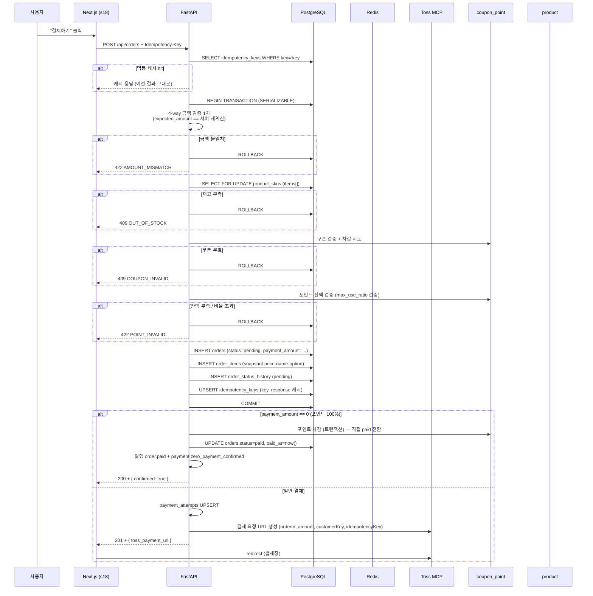
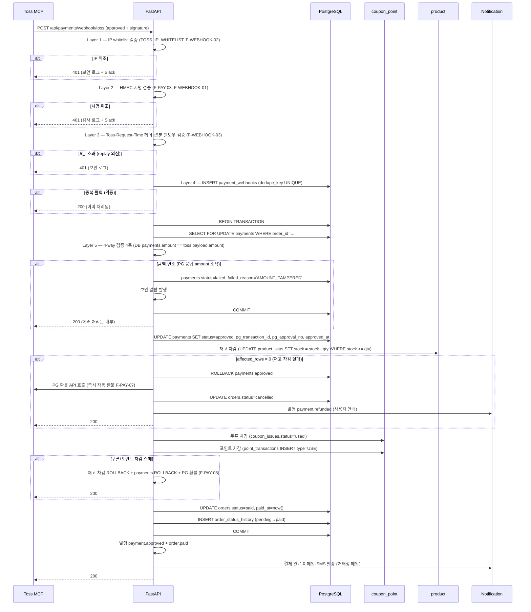

# f14 — 주문·결제 기능정의서 (★ 최고 위험 영역)

- **박제일**: 2026-05-21
- **단계**: S0 / Track 1 / Phase 4 / f14
- **상위 문서**: `00_index.md`
- **짝 도메인**: `../05_도메인정의서/d16_주문.md` · `d17_결제.md` · `d20_쿠폰_포인트.md` · `d18_배송.md`
- **짝 화면**: s18(주문서) · s19(주문 완료) · s20(결제 실패)
- **QA 소스**: `쇼핑몰_전용_QA_v4.md §6 §7 §9` (ORD-* / PAY-* / PNT-* / CPN-*) + `공통_인프라_보안_QA.md §B-1 / §B-2 / §A-2`

---

## 1. 개요

- **기능명**: 주문 생성·4-way 금액 검증·토스 MCP 결제 승인·멱등성 보장·재고/쿠폰/포인트 원자 차감·0원 결제(포인트 100%) PG 미호출·결제 실패 처리·webhook 콜백·미결제 자동취소
- **비즈니스 목적**: Stage 3 구매의 **트랜잭션 핵심**. 모든 위험(이중 결제·금액 변조·재고 음수·쿠폰 중복 사용·환불 누락·세션 만료) 차단의 책임 영역. 결제 전환율과 결제 실패율이 매출 KPI 직결.
- **트리거**: 주문서 진입(결제하기 버튼), 토스 결제창 결과, PG webhook 콜백, 포인트 100% 사용 0원 결제, 미결제 30분 경과 배치
- **액터**: 회원(주문 생성·결제 시도), 시스템(webhook 처리·재고 차감·환불 트리거·자동취소 배치)
- **관련 화면**: s17→s18→토스결제창→s19/s20
- **관련 도메인**: d16 주문(트랜잭션 경계), d17 결제(PG 호출), d20 쿠폰·포인트(차감), d12 상품(재고), d18 배송(배송지 snapshot)

---

## 2. 입력·출력

### 2.1 주문 생성 (POST `/api/orders`)

**Request 헤더**: `Authorization: Bearer ...`, `Idempotency-Key: {uuid}` (필수, F2)

**Request Body**:
```json
{
  "items": [{"sku_id":"uuid", "qty":2}],
  "address_id": "uuid",
  "coupon_id": "uuid",
  "point_used": 1000,
  "gift_option": null,
  "expected_amount": 56000
}
```

| 필드 | 타입 | 필수 | 검증 |
|---|---|---|---|
| items | array | Y | 최소 1건, 각 sku_id + qty>0 |
| address_id | uuid | Y | 본인 배송지 |
| coupon_id | uuid | N | 본인 보유 + 유효 |
| point_used | integer | N | 10P 단위, max_use_ratio 검증 |
| expected_amount | integer | Y | 클라이언트 표시 금액 (4-way 검증의 1축) |

**Response 201**:
```json
{
  "order_no": "ORD-20260521-000123",
  "order_id": "uuid",
  "payment_amount": 56000,
  "next_step": "TOSS_PAYMENT",
  "toss_payment_url": "https://js.tosspayments.com/...",
  "expires_at": "2026-05-21T15:30:00Z"
}
```

**Response 200 (0원 결제 — 포인트 100%)**:
```json
{
  "order_no": "ORD-20260521-000124",
  "order_id": "uuid",
  "payment_amount": 0,
  "next_step": "COMPLETED",
  "confirmed": true
}
```

### 2.2 결제 시작 (POST `/api/payments/initiate`)

`Idempotency-Key` 필수. Body: `{order_id, expected_amount, coupon_id?, point_used?, installment_months?}`.

**Response 201**: `{ payment_id, toss_payment_url }` 또는 0원 결제 시 `200 + { confirmed: true }`.

### 2.3 PG Webhook (POST `/api/payments/webhook/toss`)

PG에서 직접 호출. 헤더에 토스 서명 (`Toss-Signature: ...`). Body는 토스 spec 그대로.

**처리**:
1. 서명 검증 (F-PAY-03) — 실패 시 401
2. `dedupe_key = pg_transaction_id + event_type` UNIQUE 검증 (F-PAY-05) — 중복이면 200 OK 반환 (멱등)
3. event_type별 분기 (approved / cancelled / failed / refunded)
4. 트랜잭션 처리 (§3.2)

**Response 200**: 항상 200 반환 (PG 재시도 방지). 내부 에러는 큐 적재 후 재시도.

### 2.4 주문 결과 (GET `/api/payments/{order_id}/result`)

**Response 200**:
```json
{
  "order_no": "ORD-20260521-000123",
  "status": "paid",
  "amount": 56000,
  "approved_at": "2026-05-21T15:23:00Z",
  "receipt_url": "https://merchants.tosspayments.com/receipt/..."
}
```

### 2.5 주문 취소 (POST `/api/payments/{order_id}/cancel`)

(상세는 f16에서 다루며, 본 문서는 결제 완료 시점까지 다룸)

---

## 3. 처리 흐름

### 3.1 주문 생성 + 결제 진입 (메인 시퀀스)



### 3.2 PG Webhook 처리 (결제 승인 콜백)



### 3.3 결제 실패·세션 만료 처리

| 시나리오 | 처리 |
|---|---|
| Toss 결제창에서 카드 거절 | `payment.failed` 콜백 → payment_attempts.attempt_count++ → orders.status=pending 유지 |
| 3회 실패 후 4회째 | `blocked_until = now()+24h` SET → 4회째 initiate API 403 (F-PAY-14) |
| 결제 중 브라우저 강제 종료 | payments.status=pending 유지 → 30분 자동취소 배치 (F-PAY-09) → 자동 취소 + 재고/쿠폰/포인트 복원 |
| 결제 더블클릭 | 동일 Idempotency-Key → BE 캐시 응답 반환 (1건만 처리, F-PAY-24) |
| 컨테이너 재시작 시 webhook 유실 | payments.status=pending 유지 → 30분 후 자동취소 또는 Toss 정기 정합 조회로 복구 |
| 0원 결제 (포인트 100%) | PG 미호출 → 직접 paid 전환 (F-PAY-18) |

### 3.4 미결제 자동취소 배치

```python
# 매 1분 polling
SELECT order_id FROM orders 
WHERE status='pending' AND created_at < now() - interval '30 minutes';

for order_id in pending_orders:
    with transaction():
        # 멱등 — 이미 처리되었으면 skip
        if get_order_status(order_id) != 'pending': continue
        cancel_order(order_id)  # 재고/쿠폰/포인트 복구 (PG 미승인 상태면 PG 호출 없음)
        publish('order.auto_cancelled', order_id)
```

---

## 4. 검증 룰

### 4.1 입력 검증

| 필드 | 룰 | 위반 코드 |
|---|---|---|
| items | 최소 1건 | 422 |
| sku_id | UUID + 본인 카트 검증 | 404 |
| qty | 1 ≤ qty ≤ stock | 409 OUT_OF_STOCK |
| address_id | 본인 배송지 | 403 / 404 |
| coupon_id | 본인 보유 + 유효 + min_order + target 일치 | 409 COUPON_INVALID |
| point_used | 10P 단위 + ≤ balance + ≤ max_use_ratio × payment_amount | 422 POINT_INVALID |
| expected_amount | 서버 재계산 == expected | 422 AMOUNT_MISMATCH |
| Idempotency-Key | UUID, 24h 캐시 | 헤더 누락 시 400 |

### 4.2 비즈니스 룰 (F-PAY 룰 인용)

| 룰 | 적용 | 근거 |
|---|---|---|
| **4-way 금액 검증** (카트 = 주문서 = 토스 = DB) | 주문 생성 + webhook | F-PAY-01, PAY-U-005, B-PAY-001 |
| 결제 API 금액 변조 → 서버 재검증 | 주문 생성 | F-PAY-02, B-PAY-002 |
| **PG 콜백 5중 검증 (IP·서명·타임스탬프·dedupe·amount)** (NEW Tier 3 §3.6) | webhook | F-PAY-03, F-WEBHOOK-01~05, B-PAY-003 |
| **Idempotency-Key 필수** (주문·결제 시작·환불) | 모든 write API | F-PAY-04, F2(d16), A-API-011 |
| **dedupe_key 멱등** (pg_transaction_id + event_type) | webhook | F-PAY-05, B-PAY-004 |
| **카드번호·CVC 원문 절대 미저장·미로그** | 전체 | F-PAY-06, B-PAY-008 |
| **재고 차감 실패 → 즉시 자동 환불 + 주문 자동 취소** (원자) | webhook | F-PAY-07, ORD-U-037 |
| **쿠폰/포인트 차감 실패 → 결제 자동 롤백** (원자) | webhook | F-PAY-08, PAY-U-036 |
| pending 자동취소 30분 | 배치 | F-PAY-09, ORD-U-027 |
| 결제 실패 3회 → 4회째 차단 24h | initiate | F-PAY-14 |
| **포인트 100% 결제 → PG 결제창 미호출** | 주문 생성 | F-PAY-18, PAY-U-017B |
| 환불 금액 = 결제 시점 단가(snapshot) | 환불 (f16) | F-PAY-20 |
| 주문 상태 단방향 전이 | 상태 변경 | F3(d16) |
| 비회원 주문 불가 | 전체 | `00_개요.md §2 #8` |
| 카드 결제 단일 | 전체 | `00_개요.md §2 #1`, O-PAY-02 |
| 1 주문 1 결제 (분할 결제 없음) | 전체 | O-PAY-04 |
| **주문 생성·결제 승인·환불 = SERIALIZABLE 격리** (Tier 2 §3.3) | 트랜잭션 | F-ISO-01 |
| **재고·쿠폰·포인트 락 = SELECT FOR UPDATE (DB) + Redis 분산 락 보조** (Tier 2 §3.1) | 동시성 | F-LOCK-01~06 |
| **모든 이벤트 발행 = outbox 패턴 (in-transaction direct publish 금지)** (Tier 2 §3.6) | 이벤트 | F-OUTBOX-01~07 |
| **트랜잭션 commit 후 outbox 발행** (이벤트 at-least-once) | 이벤트 | F-TXN-02 |
| **외부 호출(PG) = 트랜잭션 외부** — 트랜잭션 시간 최소화 (≤ 2초) | 트랜잭션 | F-TXN-01·03 |
| **락 획득 순서 = 알파벳 정렬** (coupon_issues → points → product_skus) | 동시성 | F-DLOCK-01~04 |
| **webhook 타임스탬프 ±5분 윈도우 검증** (replay 차단) | webhook | F-WEBHOOK-03 |
| **webhook 응답 = 항상 200** (에러도 200, 내부 큐 적재 후 재시도) | webhook | F-WEBHOOK-04 |
| **AMOUNT_TAMPERED 등 webhook 검증 실패 = 보안 알람 (Slack #security)** | webhook | F-WEBHOOK-05 |
| **주문 생성·결제 시작 = 10회 / 1분 (member_id)** (NEW Tier 3 §3.8) | rate limit | F-RATE-01·02 |
| **Webhook = rate limit X (IP whitelist + 서명 검증으로 보호)** (NEW Tier 3 §3.8) | webhook | F-RATE-05 |
| **결제 API IDOR = require_resource_owner('order')** (NEW Tier 3 §3.4) | 권한 | F-IDOR-01·02 |

---

## 5. 트랜잭션·동시성

### 5.1 주문 생성 트랜잭션 (원자성)

```python
with transaction(isolation=SERIALIZABLE):
    # 멱등성 검증
    cached = idempotency_keys.get(key)
    if cached: return cached.response
    
    # 4-way 검증 1축 (서버 재계산)
    server_amount = recalculate(items, coupon_id, point_used)
    if server_amount != expected_amount:
        raise AmountMismatch()
    
    # 재고 SELECT FOR UPDATE (sku_id별)
    for item in items:
        sku = SELECT FOR UPDATE FROM product_skus WHERE sku_id=item.sku_id
        if sku.stock < item.qty: raise OutOfStock()
    
    # 쿠폰 검증 (coupon_issues.status='issued' AND 본인 소유 AND 유효)
    if coupon_id:
        coupon = SELECT FOR UPDATE FROM coupon_issues WHERE id=coupon_id
        if not coupon.is_usable_for(member, server_amount): raise CouponInvalid()
    
    # 포인트 검증 (잔액 + max_use_ratio)
    if point_used > 0:
        points = SELECT FOR UPDATE FROM points WHERE member_id=...
        if point_used > points.balance: raise PointInvalid()
        if point_used > server_amount * max_use_ratio: raise PointInvalid()
    
    # orders INSERT
    order = INSERT orders (status=pending, ...)
    INSERT order_items (price_snapshot, option_snapshot, ...)
    INSERT order_status_history (NULL→pending)
    INSERT idempotency_keys (key, response_cache, expires_at=now+24h)
    
    # COMMIT 후 이벤트 발행 (outbox)
    publish_outbox('order.created', order)
```

### 5.2 결제 승인 트랜잭션 (webhook)

```python
with transaction(isolation=SERIALIZABLE):
    # dedupe
    INSERT payment_webhooks (dedupe_key UNIQUE)  # 중복이면 즉시 return
    
    payment = SELECT FOR UPDATE FROM payments WHERE order_id=order_id AND version=version
    
    # 4-way 검증 4축
    if payment.amount != toss_payload.amount:
        payment.status = failed
        log_security_alert('AMOUNT_TAMPERED')
        return
    
    # payments approved
    payment.status = approved
    payment.pg_transaction_id = ...
    payment.pg_approval_no = ...
    payment.approved_at = now()
    payment.version += 1
    
    # 재고 차감 (원자)
    for item in order_items:
        affected = UPDATE product_skus SET stock = stock - item.qty 
                   WHERE sku_id = item.sku_id AND stock >= item.qty
        if affected == 0:
            # F-PAY-07: 즉시 환불
            raise StockDepletion()  # 트랜잭션 ROLLBACK + 별도 환불 트랜잭션
    
    # 쿠폰 차감
    UPDATE coupon_issues SET status='used', used_at=now(), used_order_id=...
    
    # 포인트 차감
    INSERT point_transactions (type=USE, amount=-point_used, ...)
    UPDATE points SET balance = balance - point_used, version+=1
    
    # orders paid
    UPDATE orders SET status=paid, paid_at=now(), version+=1
    INSERT order_status_history (pending→paid)
    
    # COMMIT 후 이벤트
    publish_outbox('payment.approved', payment)
    publish_outbox('order.paid', order)
```

### 5.3 동시성 시나리오

| 시나리오 | 메커니즘 |
|---|---|
| 마지막 재고 1개에 2명 동시 결제 | `UPDATE WHERE stock >= qty RETURNING` 원자 — 1명 성공, 1명 재고 차감 실패 → 자동 환불 (F-PAY-07) |
| 1회용 쿠폰 동시 2명 사용 | coupon_issues SELECT FOR UPDATE + status='issued' → status='used' UPDATE WHERE status='issued' → 1건만 성공 |
| 결제 더블클릭 | 동일 Idempotency-Key → 캐시 응답 |
| webhook 중복 콜백 | dedupe_key UNIQUE 제약 → 1건만 처리 |
| 사용자 취소 + PG webhook 거의 동시 도달 | orders.version 낙관락 + state machine 단방향 전이 → 1건만 처리, 다른 건 409 |
| 23:59 결제 진입 → 00:01 PG 승인 시 쿠폰 만료 | 승인 시점 서버 시간 기준 재검증 (E-004) — 422 + 자동 환불 |
| 컨테이너 재시작 | webhook 재처리 멱등 → 누락 webhook은 Toss 정기 조회 API로 복구 또는 30분 후 자동취소 |
| **이벤트 발행 보장** (Tier 2 §3.6·3.10) | outbox 테이블 INSERT (트랜잭션 일부) → 별도 worker가 polling + `FOR UPDATE SKIP LOCKED` → at-least-once 보장 + 소비자 멱등 (event_id UNIQUE) |
| **데드락 자동 재시도 1회** (PostgreSQL 40P01) | F-DLOCK-03 — victim 트랜잭션 자동 재시도 |
| **statement_timeout = 2초** (트랜잭션 시간 초과 자동 롤백) | F-TIMEOUT-01 |

### 5.4 멱등성 키 계층 표준 (Tier 2 §3.5)

| API | Level | 키 패턴 | DB 위치 | TTL |
|---|---|---|---|---|
| `POST /api/orders` | 1 | `{client_uuid}` | orders.idempotency_key UNIQUE | 24h |
| `POST /api/payments/initiate` | 1 | `{client_uuid}` | payments.idempotency_key UNIQUE | 24h |
| `POST /api/payments/webhook/toss` | dedupe | `{pg_transaction_id}:{event_type}` | payment_webhooks.dedupe_key UNIQUE | 영구 |
| `POST /api/orders/{id}/cancel` (전체) | 1 | `{client_uuid}` | idempotency_keys (scope=order_cancel) | 24h |
| `POST /api/orders/{id}/cancel-items` (부분) | 2 | `{order_id}:partial_cancel:{nonce}` | refunds.idempotency_sub_key UNIQUE | 24h |
| `POST /api/admin/payments/{id}/refund` | 2 | `{payment_id}:admin_refund:{nonce}` | refunds.idempotency_sub_key UNIQUE | 24h |

**룰** (Tier 2 §3.5 인용):

| # | 룰 | 적용 |
|---|---|---|
| F-IDEM-01 | 모든 write API = Idempotency-Key 헤더 필수 (없으면 400) | 결제·환불·취소 |
| F-IDEM-02 | Level 1 (주문·결제) = client UUID, Level 2 (부분 환불) = `{order_id}:{action}:{nonce}` | API 종류별 |
| F-IDEM-03 | webhook dedupe = `{pg_transaction_id}:{event_type}` UNIQUE | PG/택배사 webhook |
| F-IDEM-04 | 캐시 응답 = 24h TTL (`idempotency_keys.expires_at`) | Level 1 |
| F-IDEM-05 | 캐시 hit = 동일 응답 (status·body 모두) | 모든 멱등 API |
| F-IDEM-06 | 같은 key 다른 body = 409 DUPLICATE_IDEMPOTENCY_KEY (request_hash 비교) | 클라이언트 버그 차단 |

---

## 6. 에러 처리

| HTTP | 도메인 코드 | 시나리오 | 사용자 메시지 |
|---|---|---|---|
| 400 | MISSING_IDEMPOTENCY_KEY | 헤더 누락 | (개발자 메시지) |
| 401 | UNAUTHORIZED | 비로그인 | 로그인 모달 |
| 401 | INVALID_PG_SIGNATURE | webhook 서명 위조 | (보안 로그) |
| 403 | SUSPENDED / BLACKLISTED | 계정 정지·블랙 | "본 계정은 결제가 제한됩니다." |
| 403 | CARD_BLOCKED | 카드 차단 (해시 매칭) | "본 카드는 결제가 제한됩니다. 고객센터 문의" |
| 403 | PAYMENT_RETRY_BLOCKED | 4회째 결제 시도 | "잠시 후 다시 시도해주세요. (24시간 후 자동 해제)" |
| 409 | DUPLICATE_IDEMPOTENCY_KEY | 동일 키 다른 요청 body | 400 또는 409 |
| 409 | OUT_OF_STOCK | 재고 부족 | "재고가 부족합니다." |
| 409 | COUPON_INVALID | 쿠폰 사용 조건 미달 | 사유별 분기 |
| 422 | AMOUNT_MISMATCH | 4-way 검증 실패 | "주문 금액이 변경되었습니다. 다시 시도해주세요." |
| 422 | POINT_INVALID | 잔액 부족 / 비율 초과 | "사용 가능 포인트를 확인해주세요." |
| 422 | INSTALLMENT_INVALID | 최소 금액 미달 / 미허용 개월 | "할부 결제 조건을 확인해주세요." |
| 422 | PAYMENT_METHOD_DISABLED | 결제수단 OFF (카드 OFF는 운영 차단) | "현재 결제할 수 없습니다." |
| 409 | ORDER_ALREADY_PROCESSED | 멱등 키 캐시 hit (성공 응답 반환) | (정상 처리) |
| 500 | PG_TIMEOUT | Toss 타임아웃 | "결제 처리 중입니다. 마이페이지에서 확인해주세요." (실제는 큐 적재 후 재시도) |
| 200 | (webhook 항상) | webhook은 항상 200 (PG 재시도 방지) | — |

---

## 7. 성능·캐시

| 지표 | 목표 |
|---|---|
| 주문 생성 P95 | < 1.5s (재고 SELECT FOR UPDATE + 검증 + INSERT) |
| 주문 생성 P50 | < 800ms |
| webhook 처리 P95 | < 1s |
| 0원 결제 처리 P95 | < 500ms |
| Idempotency-Key 캐시 hit P95 | < 50ms |
| 자동취소 배치 처리량 | 1,000건/분 |
| 동시 결제 처리량 | 100 TPS (피크 — 타임세일) |

**캐시 전략**:

| 키 | TTL | 무효화 |
|---|---|---|
| `idempotency:{key}` | 24h | 자동 expire |
| `payment_lock:{order_id}` | 60s | 결제 완료/실패 시 DELETE |
| `card_block:{card_hash}` | 영구 (DB) | 차단 해제 시 |
| `payment_methods:active` | 5분 | 정책 변경 시 PURGE |

**인덱스**: `orders.idx_status_created_at`, `idx_member_id`, `payments.UNIQUE(order_id)`, `idx_pg_transaction_id`, `payment_webhooks.UNIQUE(dedupe_key)`, `idempotency_keys.PK(key)` + `idx_expires_at`.

---

## 8. 테스트 케이스

### 8.1 유닛

- 4-way 검증 함수 (서버 재계산 = client expected_amount)
- 0원 결제 분기 판정 (point_used == server_amount)
- Idempotency-Key UUID 검증
- PG 서명 HMAC 검증 (정상 / 위조 케이스)
- max_use_ratio 검증 (50% 기본, 경계값)

### 8.2 통합

- 주문 생성 → 멱등 키 캐시 → 같은 키 재요청 → 동일 응답 (B-PAY-004)
- 마지막 재고 1개 동시 결제 2건 → 1건 paid, 1건 OUT_OF_STOCK + 자동 환불 (E-001, B-ORD-001)
- 1회용 쿠폰 동시 2주문 → 1건만 쿠폰 적용, 2건째 COUPON_INVALID + 환불 (PAY-U-020)
- 포인트 100% 결제 → PG 미호출 + paid 즉시 전환 + 포인트 차감 멱등 (PAY-U-017B)
- webhook 중복 콜백 → dedupe_key UNIQUE로 1건만 처리, 2건째 200 OK 멱등 (B-PAY-004)
- 23:59 결제 진입 → 00:01 승인 시 쿠폰 만료 → 422 + 자동 환불 (PAY-U-018, E-004)
- 결제 더블클릭 (동일 Idempotency-Key) → 1건만 처리 (PAY-U-028)
- PG webhook 금액 변조 (payload.amount 조작) → AMOUNT_TAMPERED + 보안 로그 (B-PAY-001)
- 컨테이너 재시작 시 미처리 webhook → 재처리 멱등 + 30분 후 자동취소 백업 (PAY-U-010)
- 30분 경과 pending → 자동취소 + 재고/쿠폰/포인트 복원 (B-PAY-007)

### 8.3 E2E (Playwright)

- 카트 → 주문서 → 쿠폰·포인트 입력 → 실시간 금액 미리보기 → 결제 버튼 → 토스 결제창 → 카드 입력 → 승인 → 주문 완료 페이지 (s19)
- 결제 실패 → s20 결제 실패 페이지 → 재시도 안내
- 4회째 시도 → 24시간 차단 안내
- 0원 결제 (포인트 100%) → 토스 결제창 미표시 → 즉시 s19
- 결제 중 새창 닫기 → 30분 후 자동취소 → 마이페이지 "취소됨" 표시

### 8.4 QA 추적

- **2026-05-22 갱신**: v3 §9 PNT-* / CPN-* 폐기 → v4 §10 CPN-* 통합 prefix. v4 신규 결제·취소 8건 (008B/008C/036/041~046, A-035~039) 박제 매핑 확인.
- `쇼핑몰_전용_QA_v4.md §6 ORD-*`: ORD-U-001~046 + ORD-A-001~039 (약 81건, v4 신규 ORD-U-008B/008C/012B/013A/013B/017B/019B/027B/035~046, ORD-A-005B/012B/019B/027~031/035~039)
- `쇼핑몰_전용_QA_v4.md §7 PAY-*`: PAY-U-001~036 (Out-of-scope 무통장·가상계좌·에스크로 PAY-U-011~015/025/034 7건 제외), PAY-A-001~032 (Out-of-scope 6건 제외)
- `쇼핑몰_전용_QA_v4.md §10 CPN-*` (결제 시 쿠폰·포인트): CPN-U-007 (쿠폰 적용), CPN-U-019/021/022 (포인트 사용·잔액·비율), CPN-U-025 (동시 사용), CPN-U-028 (비회원 사용 불가), PAY-U-017B (포인트 100%)
- `공통_인프라_보안_QA.md §B-1`: B-PAY-001~014 (에스크로 제외)
- `공통_인프라_보안_QA.md §B-2`: B-ORD-001~013
- `공통_인프라_보안_QA.md §A-2`: A-API-002(IDOR), A-API-011(멱등성)

---

## 9. 미결

| ID | 항목 | 미결 사유 |
|---|---|---|
| f14-Q01 | 부분취소 비례 배분 반올림 정책 (절상/절사/은행원) | S-Q14, d16/d17 통합 결정 |
| f14-Q02 | 점검 모드 중 PG 콜백 처리 (큐잉/즉시/거부) | Q-11, S-Q11 결정 |
| f14-Q03 | 환불 처리 SLA 사용자 노출 (즉시/D+1/D+3) | S-Q17 결정 — 마이페이지 "환불 예정일" 기준 |
| f14-Q04 | 결제 실패 4회째 차단 24h — 차단 해제 자동 vs 관리자 수동 | 운영 정책 |
| f14-Q05 | webhook 유실 보완 — Toss 정기 정합 조회 주기 (1시간/30분/10분) | 운영 정책 + Toss API 사용 한도 |
| f14-Q06 | 0원 결제 영수증 (현금영수증) 발행 정책 | S-Q12 + Q-12 결정 |
| f14-Q07 | "토스 MCP" 명확화 (잠정: Toss SDK + 결제창) | S-Q15 — 사장님 verbatim 의존 |

> 본 미결은 `../_미결사항_통합관리.md §3`에 append.
