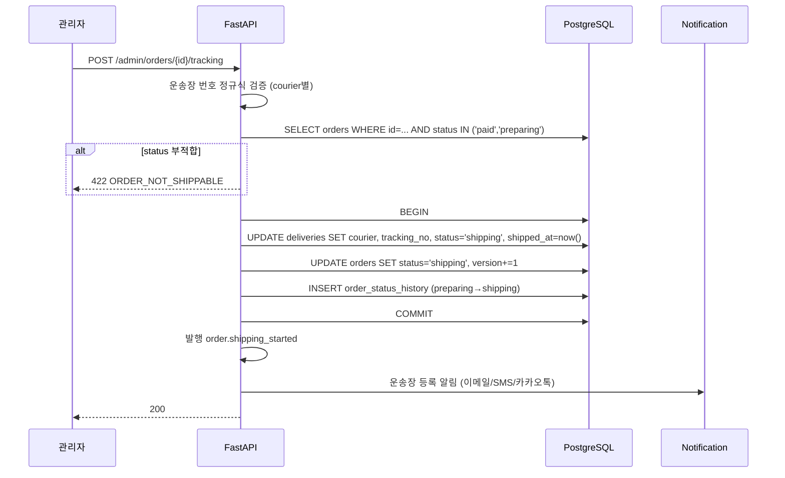
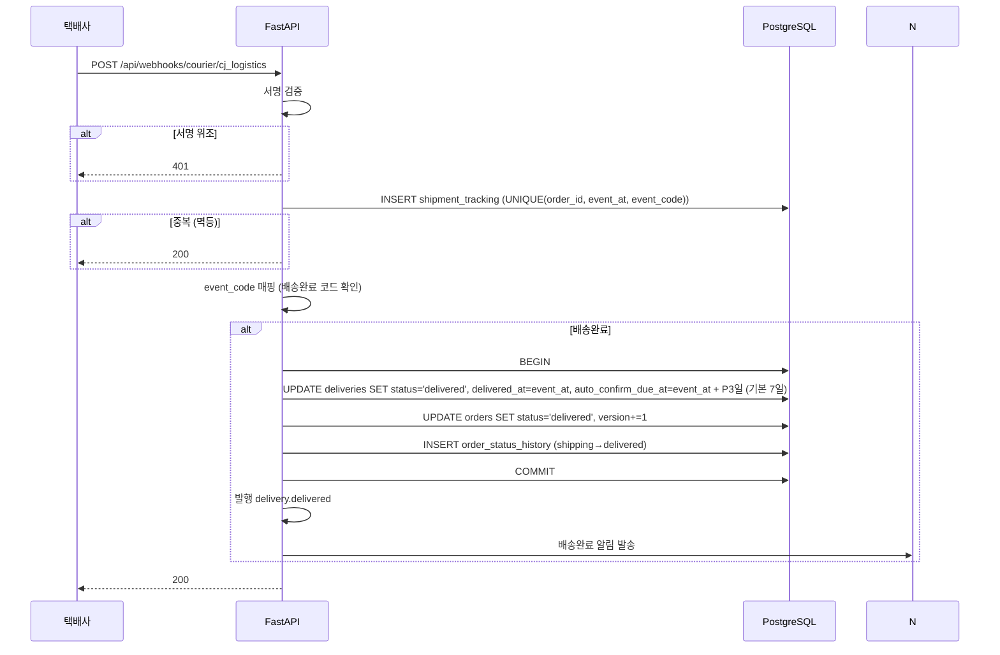
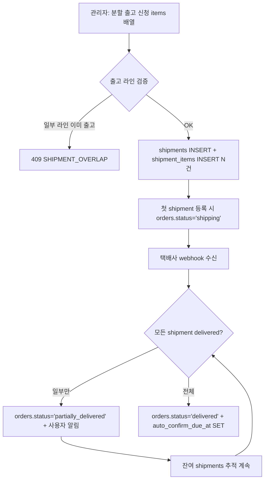

# f15 — 배송·추적 기능정의서

- **박제일**: 2026-05-21 (v0.1) · 2026-05-23 갱신 (v0.2 — QA v4 prefix 통합 + 멀티채널 알림 + 배송 지연·동시성 보강)
- **단계**: S0 / Track 1 / Phase 4 / f15
- **상위 문서**: `00_index.md`
- **짝 도메인**: `../05_도메인정의서/d18_배송.md`
- **짝 화면**: s22(주문 내역) · s23(주문 상세) · s32(배송지 관리) · s41(관리자 배송 처리)
- **QA 소스**: `쇼핑몰_전용_QA_v4.md §8` (DEL-U-001~032 / DEL-A-001~040 — v3의 SHP-* prefix는 v4에서 DEL-* 로 통합 폐기) + `공통_인프라_보안_QA.md §B-4 배송·반품·환불 무결성 / §A-2 API 보안·접근 제어 / §A-8 로그·모니터링·감사 / §B-1 결제·PG 보안 / §B-5 마케팅·대량 알림 발송 (지연 안내 일괄 발송)`

---

## 1. 개요

- **기능명**: 배송지 관리(CRUD)·운송장 단건/CSV 일괄 등록·배송 상태 5단계(preparing/shipping/delivered/confirmed/cancelled)·택배사 webhook 추적 이력·자동 구매확정·배송 지연 안내 일괄 발송
- **비즈니스 목적**: Stage 4 배송·수령의 만족도와 CS 인입율 좌우. 운송장 정확성·배송완료 SLA·자동 구매확정 멱등성이 KPI.
- **트리거**: 사용자 배송지 CRUD, 관리자 운송장 등록(개별/CSV), 택배사 webhook 콜백, 자동 구매확정 배치(P3=7일 기본, Q-05 미결), 배송 지연 일괄 발송
- **액터**: 회원(배송지·추적·구매확정), 관리자(운송장·상태 변경·일괄 발송), 시스템(webhook·자동 확정 배치·추적 보완 배치)
- **관련 화면**: s22·s23·s32·s41
- **관련 도메인**: d18 배송(주), d16 주문(상태 전이 짝), d20 쿠폰·포인트(구매확정 시 적립 트리거)

---

## 2. 입력·출력

### 2.1 배송지 목록 (GET `/api/me/addresses`)

**Response 200**: `[{id, recipient, phone, zipcode, addr1, addr2, region_type, is_default, label}]`. 최대 5건.

### 2.2 배송지 등록 (POST `/api/me/addresses`)

| 필드 | 타입 | 필수 |
|---|---|---|
| recipient | string | Y (1~50자) |
| phone | string | Y (E.164) |
| zipcode | string | Y (다음 우편번호 API 5자리) |
| addr1 | string | Y |
| addr2 | string | N |
| is_default | boolean | N |
| label | string | N |

**Response 201**: `{id, region_type}` (region_type은 zipcode 기반 자동 분류 — normal/jeju/mountainous).

### 2.3 배송지 수정 (PATCH `/api/me/addresses/{id}`)

진행 중 주문의 배송지 snapshot은 보존 (이후 변경 미반영).

### 2.4 운송장 등록 (관리자) — 단건 (POST `/api/admin/orders/{order_id}/tracking`)

> **단건 운송장 등록** (1주문 1운송장 — 일반 케이스). 분할 배송 (1주문 N운송장) 은 §2.4B 참조.

| 필드 | 타입 | 필수 | 검증 |
|---|---|---|---|
| courier | enum | Y | cj_logistics / hanjin / lotte / post_office / etc |
| tracking_no | string | Y | 택배사별 정규식 검증 |

**Response 200**: `{shipment_id, shipped_at}` + `order.shipping_started` 이벤트 발행.

### 2.4B 분할 배송 — 1주문 N운송장 (POST `/api/admin/orders/{order_id}/shipments`) — ★ NEW Tier 1 §3.F

**Request 헤더**: admin

**Body** (라인 단위 부분 출고):
```json
{
  "items": [
    {"order_item_id": "uuid1", "qty": 1},
    {"order_item_id": "uuid2", "qty": 1}
  ],
  "courier": "cj_logistics",
  "tracking_no": "12345678"
}
```

**Response 201**:
```json
{
  "shipment_id": "uuid",
  "shipped_at": "2026-05-22T10:00:00Z",
  "remaining_items": [{"order_item_id": "uuid3", "qty": 1}]
}
```

> **데이터 모델 보강** (d18): `shipments` 신규 테이블 (shipment_id, order_id, status, courier, tracking_no, shipped_at, delivered_at) + `shipment_items` (shipment_id, order_item_id, qty). 기존 `deliveries` = order 단위 status 집계 (하위 shipments 상태 종합). 상세 = `../기획보충/Tier1_다건처리_정합성.md §3.F`.

**상태 전이**:
- 첫 번째 shipment 등록 → `orders.status = 'shipping'` (잔여 라인 있어도)
- 모든 라인의 shipment 등록 + delivered → `orders.status = 'delivered'`
- 일부만 delivered → `orders.status = 'partially_delivered'` (NEW)

### 2.5 운송장 CSV 일괄 등록 (POST `/api/admin/orders/tracking/bulk`)

multipart/form-data + CSV 파일 (`order_no, courier, tracking_no`).

**Response 200**:
```json
{
  "success": [{"order_no":"ORD-...","tracking_no":"..."}],
  "failed": [{"order_no":"...","reason":"INVALID_TRACKING_NO"}]
}
```

각 라인 독립 트랜잭션 (1건 실패가 다른 건 영향 없음).

### 2.6 배송 추적 (GET `/api/orders/{id}/tracking`)

**Response 200**:
```json
{
  "courier": "cj_logistics",
  "tracking_no": "12345678",
  "status": "shipping",
  "shipped_at": "...",
  "delivered_at": null,
  "auto_confirm_due_at": null,
  "tracking_events": [
    {"event_at":"...","location":"서울집화","status_text":"집화 완료"},
    {"event_at":"...","location":"강남허브","status_text":"간선 상차"}
  ],
  "external_link": "https://www.cjlogistics.com/?invoice_no=12345678"
}
```

### 2.7 택배사 Webhook (POST `/api/webhooks/courier/{provider}`)

택배사별 spec. 서명 검증 후 `shipment_tracking` INSERT (UNIQUE 멱등) + delivered 도달 시 자동 전환.

### 2.8 수동 구매확정 (POST `/api/orders/{id}/confirm`)

배송완료 상태 → confirmed 전환 + 포인트 적립 트리거. 상세는 d16/f14 트랜잭션 참조.

---

## 3. 처리 흐름

### 3.1 운송장 등록 + 배송 시작



### 3.2 택배사 Webhook 수신



### 3.3 자동 구매확정 배치

```python
# 매 1시간 polling
while pending := SELECT order_id FROM deliveries 
                  WHERE status='delivered' 
                    AND auto_confirm_due_at <= now()
                    AND order_id NOT IN (SELECT order_id FROM orders WHERE status='confirmed'):
    with transaction():
        if orders.status != 'delivered': continue  # 이미 처리됨 (멱등)
        UPDATE orders SET status='confirmed', confirmed_at=now(), version+=1
        INSERT order_status_history (delivered→confirmed, changed_by='batch')
        publish('order.confirmed', {member_id, payment_amount})
        # → coupon_point가 적립 처리, member가 등급 집계 갱신
```

### 3.4 배송 지연 일괄 발송

1. 관리자 → "배송중 N일 초과 주문 조회" (필터)
2. 발송 대상 선택 → "지연 안내 발송" 클릭
3. BE → notification 이벤트 발행 (이메일·SMS) + 마이페이지 표시 플래그 SET
4. 발송 이력 audit log

### 3.5 분할 배송 라이프사이클 (★ NEW — Tier 1 §3.F)

1주문 다라인 → 창고 분리·예약 발송 등 N개 운송장 분할 출고 시:



**룰 보강**:
- 첫 번째 shipment 등록 → `orders.status = 'shipping'` (잔여 라인 있어도)
- 모든 shipment delivered 도달 → `orders.status = 'delivered'` (auto_confirm_due_at = 마지막 delivered + P3)
- 부분 출고 알림 = shipment별 N알림 (Tier 5 §3.2 예외 — 사용자 추적 편의)
- 회수 / 반품 / 교환 (f16) = shipment 단위 처리

---

## 4. 검증 룰

### 4.1 입력 검증

| 필드 | 룰 | 위반 코드 |
|---|---|---|
| recipient | 1~50자 | 422 |
| phone | E.164 정규화 | 422 INVALID_PHONE |
| zipcode | 5자리 숫자 + 다음 API 검증 | 422 INVALID_ZIPCODE |
| addr1, addr2 | 최대 200자 | 422 |
| courier | enum 검증 | 422 |
| tracking_no | 택배사별 정규식 (CJ 10자리 / 한진 11자리 등) | 422 INVALID_TRACKING_NO |

### 4.2 비즈니스 룰

| 룰 | 적용 | 근거 |
|---|---|---|
| 회원당 활성 배송지 최대 10건 (d11/d18 정책 정본 — v4 사장님 매뉴얼 정합) | 등록 | DEL-U-001/002 |
| 기본 배송지 1건 강제 (부분 UNIQUE) | 등록/수정 | DEL-U-003 |
| 배송지 수정 시 진행 중 주문 snapshot 보존 (미반영) | 수정 | DEL-U-004 |
| 배송지 삭제 차단 (활성 주문 진행 중) | 삭제 | DEL-U-004 |
| 다음 우편번호 API 정상 동작 검증 | 등록 | DEL-U-006 |
| zipcode 기반 region_type 자동 분류 → 배송비 정책 적용 | 등록/수정 | (delivery_fee_policy), DEL-U-009/010 |
| 운송장 등록 = orders.status IN (paid, preparing) | 등록 | DEL-A-007 |
| 운송장 번호 택배사별 정규식 검증 | 등록 | DEL-A-007 |
| CSV 일괄 등록 = 각 라인 독립 트랜잭션 (1건 실패 무영향) | 일괄 | DEL-A-008, B-DEL-003 |
| 배송 상태 단방향 전이 (preparing→shipping→delivered→confirmed) | 상태 변경 | F3(d16), B-ORD-006 |
| webhook 멱등 (UNIQUE(order_id, event_at, event_code)) | webhook | B-DEL-001 |
| **택배사 webhook = 5중 검증 (IP·서명·타임스탬프·dedupe·payload)** (NEW Tier 3 §3.6) | webhook | F-WEBHOOK-01~05, 99_비기능 §4.12 |
| 자동 구매확정 멱등 (이미 confirmed면 skip) | 배치 | F11(d16), B-ORD-008 |
| 자동 구매확정 기간 = P3 (기본 7일, Q-05 미결 — 사장님 권장 14일+D-3 알림) | 배치 | ORD-A-024 (정책) |
| 배송 지연 일괄 발송 = 발송 이력 audit log + 멀티채널(이메일·SMS) 동시 발송 | 발송 | DEL-A-031, A-LOG-002, A-MAIL-001~006 |
| 배송 지연(배송중 N일 초과) 주문 필터 조회 | 조회 | DEL-A-030 |
| 반품 수거 지연(요청 후 N일 미수거) 목록 조회 및 안내 발송 | 조회 | DEL-A-032 |
| **운송장 등록 시 멀티채널 알림 (이메일·SMS·카카오 알림톡)** = 사용자 알림 채널별 설정(MEM-U-027/055) 존중 + 채널 글로벌 ON/OFF(MEM-A-034) | 알림 | DEL-U-031, DEL-U-032, MEM-U-053/054, ADM-M-009~012 |
| **알림 채널별 독립 동의 검증** = 이메일 OFF + SMS ON 회원 → SMS만 발송 | 알림 | MEM-U-055, MEM-A-035, f19 §3.2 |
| **거래성 알림 (운송장·배송완료·반품 처리)** = 마케팅 수신 거부와 무관하게 발송 (정보통신망법 거래성 의무) | 알림 | A-MAIL-001, 99_비기능 §5.3 |
| **1주문 N운송장 (분할 배송) 지원** (NEW Tier 1 §3.F) | 출고 | shipments 1:N 테이블 |
| 분할 배송 시 합계 qty = order_items.qty 일치 검증 | 출고 | Tier 1 §3.F |
| 동일 order_item 중복 출고 차단 (UNIQUE shipment_items.order_item_id WHERE active) | 출고 | Tier 1 §3.F |
| **부분 출고 시 사용자 알림 = 각 운송장 발급 시 별도 발송 (shipment별 N알림)** | 알림 | Tier 1 §3.N / Tier 5 §3.2 (예외 — 추적 편의 T1-Q05) |
| **partially_delivered 상태 (일부 라인 배송완료, 잔여 shipping)** | 상태 | NEW (d16 §6 state machine 확장) |
| **동시 반품 신청 독립 처리** = 같은 상품 다수 사용자 동시 반품 → 각 주문 독립, 상태 충돌 없음 | 동시성 | DEL-A-033 |
| **반품 승인 ↔ 고객 취소 경합 처리** = 먼저 처리된 요청 우선 (낙관락 + audit) | 동시성 | DEL-A-034, B-DEL-001 |
| **반품 검수 → 환불 → 재고 복구 3단계 원자성** = PG 환불 실패 시 재고 복구 롤백, 상태 '환불대기' 유지 | 원자성 | DEL-A-027/035, B-DEL-002 |
| **다중 반품 동시 검수 정합** = 5건 동시 양호 처리 → 재고 독립 복구 + 정산 5건 모두 반영 | 동시성 | DEL-A-036 |
| **교환 승인 중 신옵션 재고 소진 처리** = 교환 승인 실패 + 재고 차감 취소 + 관리자/고객 알림 | 동시성 | DEL-A-037 |
| **교환 거절 시 신옵션 재고 복구 동시성** = 복구 완료 후 신규 주문 처리 | 동시성 | DEL-A-038 |
| **반품 일괄 처리 부분 실패** = 10건 중 3건 환불 실패 → 성공 7건 처리 + 실패 3건 재처리 큐 | 동시성 | DEL-A-039, B-DEL-002 |
| **반품 완료 후 정산 즉시 차감** = 5건 동시 완료 → 정산 대시보드 5건 모두 즉시 반영 | 정산 | DEL-A-040, B-DEL-010 |
| **부분 환불 비례 배분** = 쿠폰 할인액·포인트·배송비 1원 단위 정확 분배 | 환불 | B-DEL-012, DEL-U-021 |
| **전액 환불 원자성** = 사용 포인트 복원 + 적립 포인트 회수 + PG 환불 동시 처리 | 환불 | B-DEL-011, DEL-U-021 |
| **타인 반품 신청 ID API 직접 호출 차단** = 403 (IDOR 방어) | 보안 | DEL-U-007, B-DEL-007, A-API-002 |
| **반품 기간 경계** = 배송완료 정각 기준 7일 + 1초 → 반품 불가 | 경계 | B-DEL-004, DEL-U-015 |
| **부분취소 후 배송비 재계산** = 잔여금액 50,000원 미만 → 배송비 추가 청구 트랜잭션 | 정합성 | B-DEL-005, DEL-U-011 |
| **도서산간 우편번호 범위 업데이트 소급 미적용** = 기존 주문 배송비 변동 없음 | 정책 | B-DEL-006, DEL-A-004 |
| **환불 PG 금액 == DB 환불 기록 금액 검증** | 정합성 | B-DEL-009, DEL-U-021 |

---

## 5. 트랜잭션·동시성

| 시나리오 | 메커니즘 |
|---|---|
| 운송장 등록 트랜잭션 | deliveries UPDATE + orders UPDATE + order_status_history INSERT 단일 트랜잭션 |
| CSV 일괄 등록 | 각 라인별 별도 트랜잭션 (1건 실패가 다른 건 영향 X) |
| 택배사 webhook 중복 | `UNIQUE(order_id, event_at, event_code)` DB 제약으로 INSERT 충돌 시 200 OK 반환 |
| 동시 webhook + 사용자 수동 구매확정 | orders.version 낙관락 → 1건만 처리, 다른 건 409 |
| 자동 확정 배치 멱등 | 트랜잭션 진입 직후 orders.status 재확인 → 'delivered' 아니면 skip |
| 추적 누락 보완 배치 | 운송장 있고 마지막 추적 N시간 경과 시 택배사 API 폴링 → 재시도 큐 |

---

## 6. 에러 처리

| HTTP | 도메인 코드 | 시나리오 | 사용자 메시지 |
|---|---|---|---|
| 422 | INVALID_ZIPCODE | 우편번호 무효 | "우편번호를 확인해주세요." |
| 422 | INVALID_PHONE | 연락처 무효 | "연락처 형식을 확인해주세요." |
| 422 | INVALID_TRACKING_NO | 운송장 정규식 위반 | "운송장 번호 형식을 확인해주세요." |
| 409 | ADDRESS_LIMIT_EXCEEDED | 5개 초과 | "배송지는 최대 5개까지 등록할 수 있습니다." |
| 409 | ADDRESS_IN_USE | 활성 주문 있는 배송지 삭제 | "진행 중 주문이 있는 배송지는 삭제할 수 없습니다." |
| 422 | ORDER_NOT_SHIPPABLE | status 부적합 운송장 등록 | "결제완료/배송준비 상태에서만 운송장 등록이 가능합니다." |
| 409 | TRACKING_ALREADY_REGISTERED | 이미 운송장 발급 | "이미 운송장이 등록되었습니다." |
| 401 | INVALID_WEBHOOK_SIGNATURE | webhook 서명 위조 | (보안 로그) |
| 409 | ORDER_NOT_DELIVERED | 수동 확정 시 배송완료 아님 | "배송이 완료되어야 구매확정할 수 있습니다." |
| 409 | ALREADY_CONFIRMED | 이미 확정 | "이미 구매확정된 주문입니다." |

---

## 7. 성능·캐시

| 지표 | 목표 |
|---|---|
| 배송지 목록 P95 | < 100ms |
| 운송장 등록 P95 | < 300ms |
| CSV 일괄 등록 (1,000건) | < 30s |
| webhook 처리 P95 | < 500ms |
| 자동 구매확정 배치 처리량 | 10,000건/시간 |
| 추적 이력 조회 P95 | < 200ms |

**캐시 전략**:

| 키 | TTL | 무효화 |
|---|---|---|
| `delivery_fee_policy:active` | 5분 | 정책 변경 시 PURGE (카트 진입자 즉시 반영) |
| `addresses:member:{id}` | 5분 | 배송지 CRUD 시 PURGE |
| `tracking:{order_id}` | 5분 | webhook 수신 시 PURGE |

**인덱스**: `addresses.idx_member_id`, `idx_member_default`(부분), `deliveries.idx_tracking_no`(부분), `idx_status`, `idx_auto_confirm_due_at`(부분 status=delivered), `shipment_tracking.idx_order_event_at`, `UNIQUE(order_id, event_at, event_code)`.

---

## 8. 테스트 케이스

### 8.1 유닛

- 운송장 정규식 (CJ 10자리 / 한진 11자리 / 롯데 12자리 — 각 valid/invalid 케이스)
- zipcode → region_type 매핑 (제주 우편번호 / 도서산간 / 일반)
- E.164 phone 정규화
- 자동 확정 기간 계산 (delivered_at + P3일, 윤년·DST 경계)

### 8.2 통합

- 운송장 등록 → orders.status='shipping' + 알림 발송
- CSV 100건 (1건 무효 운송장) → 99건 success, 1건 failed → 다른 99건 영향 X
- 동일 webhook 2회 → 1건만 INSERT (UNIQUE 멱등)
- delivered webhook → auto_confirm_due_at = delivered_at + 7일 자동 설정
- 자동 확정 배치 → 7일 경과 주문 confirmed 전환 + 포인트 적립 이벤트 발행
- 사용자 수동 확정 + 자동 확정 배치 동시 → 1건만 처리 (낙관락)
- 배송지 삭제 시 활성 주문 있음 → 409
- 배송지 수정 → 진행 중 주문의 address_snapshot은 미변경

### 8.3 E2E

- 회원가입 → 배송지 등록 (다음 우편번호 API) → 기본 배송지 설정
- 주문서에서 배송지 선택 → 결제 → 운송장 등록(관리자) → 사용자 마이페이지 즉시 동기화
- 배송완료 webhook → 사용자 마이페이지 "배송 완료" 표시 + 7일 후 자동 확정
- 관리자 CSV 일괄 등록 → 결과 리포트 (성공/실패 다운로드)
- 배송 지연 안내 일괄 발송 → 사용자 마이페이지에 안내 노출

### 8.4 QA 추적 (v4 통합 prefix)

- `쇼핑몰_전용_QA_v4.md §8` 사용자: DEL-U-001~032 (배송지 CRUD + 배송비 + 추적·반품·교환 + 멀티채널 알림 DEL-U-031/032)
- `쇼핑몰_전용_QA_v4.md §8` 관리자: DEL-A-001~040 (배송비 정책 + 배송 처리 + 반품·교환 + 배송 지연 DEL-A-030~032 + 동시성 DEL-A-033~040)
- `쇼핑몰_전용_QA_v4.md §1`: MEM-U-027(채널별 알림 설정)·MEM-U-053~055(SMS·카카오·채널 ON/OFF)·MEM-A-034/035(글로벌 채널·회원별 채널 현황)
- `쇼핑몰_전용_QA_v4.md §6`: ORD-U-031(자동 구매확정), ORD-A-024(구매확정 기간 설정)
- `쇼핑몰_전용_QA_v4.md §11`: ADM-M-009~012(SMS·카카오 알림톡 발송 설정)
- `공통_인프라_보안_QA.md §B-4`: B-DEL-001~012 (반품 충돌·환불 자동 호출 실패·CSV 부분 실패·반품 기간 경계·부분취소 배송비 재계산·도서산간 소급·IDOR·환불 정합·정산·원자성·비례배분)
- `공통_인프라_보안_QA.md §B-1`: B-PAY-006(가상계좌 webhook 위변조)·B-PAY-011(환불 실패 알림·재시도 큐)
- `공통_인프라_보안_QA.md §B-2`: B-ORD-006(상태 역순 차단)·B-ORD-008(자동 구매확정 멱등)
- `공통_인프라_보안_QA.md §A-2`: A-API-002 (IDOR — 타인 주문/반품 ID 차단), A-API-011 (멱등성 키)
- `공통_인프라_보안_QA.md §A-7`: A-MAIL-001 (거래성 알림 = 마케팅 수신 거부와 무관 발송), A-MAIL-002(실패 재시도), A-MAIL-006(발송 큐)
- `공통_인프라_보안_QA.md §A-8`: A-LOG-002 (관리자 감사 — 운송장 등록·배송 지연 발송), A-LOG-011 (PII 마스킹)

> **v3 → v4 prefix 정정**: 본 문서 v0.1 의 `SHP-U-*` / `SHP-A-*` 인용은 v4 통합 후 `DEL-U-*` / `DEL-A-*` 로 대체되었습니다. v3 별도 SHP 카탈로그는 폐기.

---

## 9. 미결

| ID | 항목 | 미결 사유 |
|---|---|---|
| f15-Q01 | 자동 구매확정 기간 (P3) 기본값 — 7일 vs 14일 | Q-05 (사장님 verbatim 권장 = 14일 + D-3 알림) |
| f15-Q02 | 배송 지연 N일 임계 기본값 (현 미정) | ORD-A-033 정책 변경 가능 항목 추가 결정 |
| f15-Q03 | 도서산간/제주 추가 배송비 정책 (기본 3,000/5,000원 vs 가변) | 운영 결정 |
| f15-Q04 | 택배사 webhook 미수신 시 폴링 주기 (1h/30m/10m) | 택배사 API 사용 한도 + 운영 결정 |
| f15-Q05 | 운송장 등록 시 사용자 알림 채널 우선순위 | Q-03 (사장님 verbatim 권장 = 3채널 한정) |
| f15-Q06 | 다음 우편번호 API 외 카카오·네이버 우편번호 지원 여부 | 운영 결정 (현 다음 단일 가정) |

> 본 미결은 `../_미결사항_통합관리.md §3`에 append.

---

## 10. 변경 이력

| 버전 | 일자 | 변경 |
|---|---|---|
| v0.1 | 2026-05-21 | 최초 박제 (S0 / Phase 4) |
| v0.2 | 2026-05-23 | QA v4 통합 prefix 정정 (SHP-* 폐기 → DEL-* 통합) · 멀티채널 알림 (DEL-U-031/032) 신설 · 배송 지연 (DEL-A-030~032) · 동시성·원자성 (DEL-A-033~040) 신설 · B-DEL-001~012 / B-PAY-006/011 / B-ORD-006/008 / A-API-002/011 / A-MAIL-001 보강. v3 SHP-A-003~005 단일 인용을 v4 DEL-A-007/008 / B-ORD-006 / B-DEL-003 등 정확 매핑으로 교체 |
