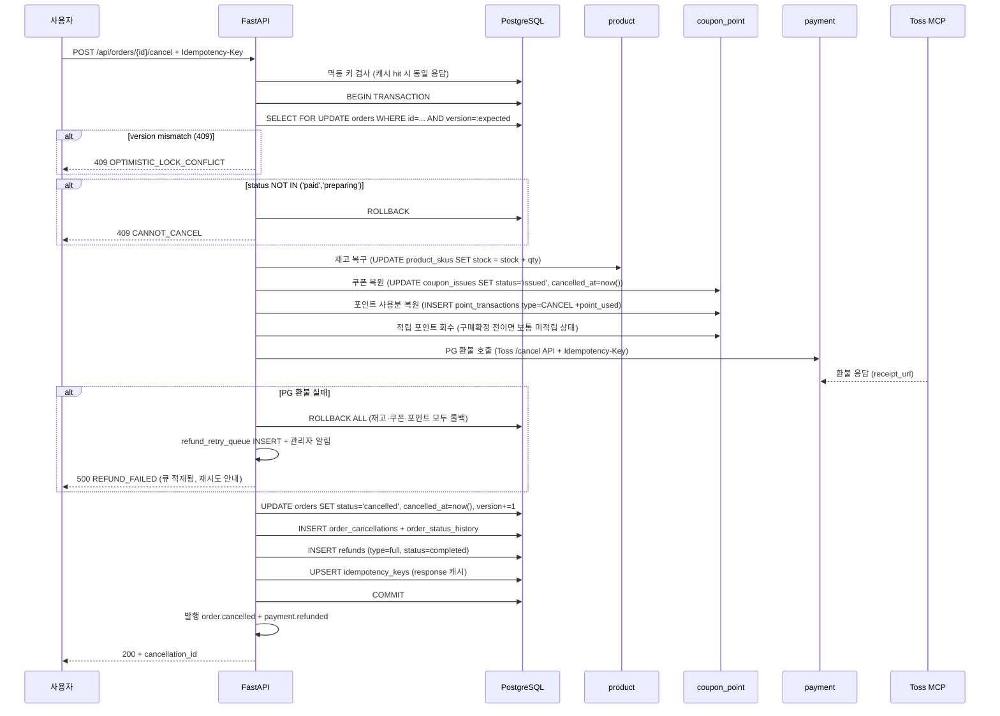
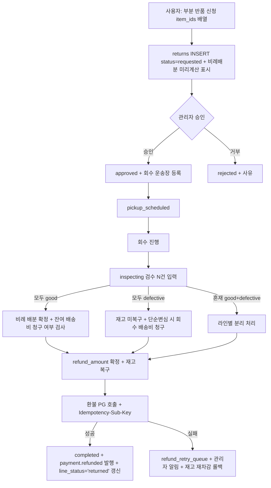
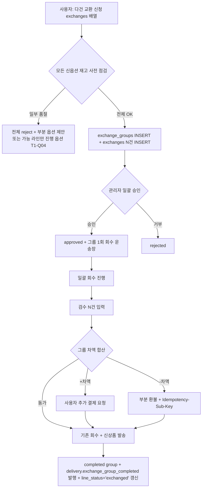

# f16 — 취소·반품·교환 기능정의서

- **박제일**: 2026-05-21
- **단계**: S0 / Track 1 / Phase 4 / f16
- **상위 문서**: `00_index.md`
- **짝 도메인**: `../05_도메인정의서/d16_주문.md` · `d17_결제.md` · `d18_배송.md`
- **짝 화면**: s23(주문 상세) · s24(반품 신청) · s25(교환 신청) · s41(관리자 반품·교환 처리)
- **QA 소스**: `쇼핑몰_전용_QA_v4.md §6 §7 §8` (ORD-* / PAY-* / DEL-*) + `공통_인프라_보안_QA.md §B-1 / §B-2 / §B-4`

---

## 1. 개요

- **기능명**: 사용자/관리자 전체 취소·부분 취소·반품 신청·교환 신청·반품 검수·교환 차액 결제/환불·환불 PG 호출·재고 복원·쿠폰·포인트 원자 복원
- **비즈니스 목적**: Stage 3~4 CS 분기의 트랜잭션 핵심. 환불 PG 실패 시 전체 롤백, 비례 배분(쿠폰·포인트·배송비) 1원 단위 정합성이 KPI. 사용자 신뢰의 마지막 방어선.
- **트리거**: 사용자 취소/반품/교환 요청, 관리자 강제 취소/검수, PG 환불 webhook, 환불 실패 재시도 큐
- **액터**: 회원(취소·반품·교환 신청), 관리자(강제 취소·검수·재시도), 시스템(트랜잭션·이벤트·PG 호출)
- **관련 화면**: s23·s24·s25·s41
- **관련 도메인**: d16 주문(상태 전이·트랜잭션 경계), d17 결제(환불 PG), d18 배송(반품/교환 라이프사이클), d20 쿠폰·포인트(복원), d12 상품(재고 복구)

---

## 2. 입력·출력

### 2.1 전체 취소 (POST `/api/orders/{id}/cancel`)

**Headers**: `Idempotency-Key: {uuid}` 필수.

**Body**:
```json
{"reason": "단순 변심", "version": 3}
```

**Response 200**:
```json
{
  "cancellation_id": "uuid",
  "refund_amount": 56000,
  "restored_points": 1000,
  "restored_coupon": true,
  "expected_refund_completed_at": "2026-05-22T15:23:00Z"
}
```

### 2.2 부분 취소 (POST `/api/orders/{id}/cancel-items`)

**Body**:
```json
{
  "item_ids": ["uuid1", "uuid2"],
  "reason": "사이즈 변경",
  "version": 3
}
```

**Response 200**:
```json
{
  "cancellation_id": "uuid",
  "refund_amount": 28000,
  "shipping_fee_adjustment": 3000,
  "restored_points_proportional": 500,
  "restored_coupon_proportional": 1000
}
```

### 2.3 반품 신청 (POST `/api/orders/{id}/return`)

**Body**:
```json
{
  "item_ids": ["uuid1"],
  "reason": "size_mismatch",
  "reason_detail": "...",
  "attachments": ["https://cdn/img1.jpg"],
  "pickup_address_id": "uuid"
}
```

**Response 201**: `{return_id, status:'requested'}`.

### 2.4 교환 신청 (POST `/api/orders/{id}/exchange`) — ★ 다건 지원 (Tier 1 §3.A)

**Headers**: `Idempotency-Key: {uuid}` 필수 + `Idempotency-Sub-Key: {order_id}:exchange_group:{nonce}` (Tier 1 §3.I).

**Body** (다건 교환 지원):
```json
{
  "exchanges": [
    {"item_id": "uuid1", "new_sku_id": "uuid_new1", "reason": "size_mismatch", "reason_detail": "..."},
    {"item_id": "uuid2", "new_sku_id": "uuid_new2", "reason": "color_change", "reason_detail": "..."}
  ],
  "pickup_address_id": "uuid",
  "attachments": ["https://cdn/..."],
  "version": 3
}
```

**Response 201**:
```json
{
  "exchange_group_id": "uuid",
  "exchanges": [
    {"exchange_id": "uuid", "item_id": "uuid1", "status": "requested", "price_diff": 3000},
    {"exchange_id": "uuid", "item_id": "uuid2", "status": "requested", "price_diff": -1000}
  ],
  "total_price_diff": 2000,
  "diff_action": "ADDITIONAL_CHARGE",
  "additional_payment_required": 2000,
  "pickup_fee_total": 3000
}
```

> **다건 교환 = `exchange_groups` 신규 테이블** (group_id, order_id, status, total_price_diff, requested_at) + `exchanges.group_id` FK 추가. 회수 배송비 = 그룹 1회 청구 (라인 N건 묶어). 단건 교환 시도 시 `exchanges: [...]` 배열에 1건만 포함하여 호출. 상세 = `../기획보충/Tier1_다건처리_정합성.md §3.A`.

### 2.5 관리자 반품 검수 (POST `/api/admin/returns/{id}/inspect`)

| 필드 | 타입 | 필수 |
|---|---|---|
| inspection_result | enum | Y (good / defective) |
| refund_amount | integer | Y |
| reason_detail | text | N |

**Response 200**: `{return_status:'completed', refund_amount}` + `return.completed` 이벤트 발행 (환불 트리거).

### 2.6 관리자 강제 취소 (POST `/api/admin/orders/{id}/force-cancel`)

**Body**: `{reason: text, type: 'full' | 'partial', item_ids?: [], version: int}`.

---

## 3. 처리 흐름

### 3.1 사용자 전체 취소 (배송 전)



### 3.2 부분 취소 (비례 배분)

```python
# 비례 배분 계산
cancelled_subtotal = sum(item.subtotal for item in cancelled_items)
total_subtotal = order.product_amount

# 쿠폰 할인 비례 배분
cancelled_coupon_discount = round_policy(order.coupon_discount * cancelled_subtotal / total_subtotal)
# 포인트 사용 비례 배분
cancelled_point_used = round_policy(order.point_used * cancelled_subtotal / total_subtotal)
# 1원 단위 오차 처리: 마지막 라인에서 round 보정 (반올림 정책 미결 S-Q14)

# 환불 금액
refund_amount = cancelled_subtotal - cancelled_coupon_discount - cancelled_point_used

# 잔여가 무료배송 임계 미만이면 배송비 추가 청구
remaining_subtotal = total_subtotal - cancelled_subtotal
if remaining_subtotal < free_shipping_threshold and order.shipping_fee == 0:
    # 배송비 청구 트랜잭션 (포인트 차감 또는 사용자 추가 결제 안내)
    additional_charge = base_shipping_fee
    refund_amount -= additional_charge
```

### 3.3 반품 라이프사이클 (★ 다건 부분 반품 + 비례 배분 통합 — Tier 1 §3.B)



> **비례 배분 + 잔여 배송비**: `§3.6` 부분 반품 비례 배분 코드 참조. **검수 혼재 처리**: 라인별 분리 처리 (good 라인만 재고 복구 + 환불 / defective 라인 별도 처리). 상세 = `../기획보충/Tier1_다건처리_정합성.md §3.B·C`.

### 3.4 교환 라이프사이클 (★ 다건 교환 그룹 + 차액 합산 — Tier 1 §3.A)



> **다건 교환 = `exchange_groups` 그룹 단위**. 회수 배송비 = 그룹 1회 청구. 신옵션 일부 품절 시 = 그룹 전체 reject 기본 / 부분 환불 전환 또는 가능 라인만 진행 = T1-Q04 사장님 결정 영역. 상세 = `../기획보충/Tier1_다건처리_정합성.md §3.A`.

### 3.5 환불 실패 재시도

매 10분 polling. `refunds.status='failed' AND retry_count < 5` → PG 재호출 (동일 idempotency_key) → 성공 시 status=completed + 재고/쿠폰/포인트 복구 트랜잭션. 5회 초과 시 관리자 수동 처리.

### 3.6 부분 반품 비례 배분 (★ NEW — Tier 1 §3.B 통합)

부분 취소 §3.2와 동일한 비례 배분 패턴을 부분 반품·교환에도 적용. 코드 재사용:

```python
def calculate_partial_return_refund(order, returned_items, inspection_result, reason_type):
    """부분 반품 비례 배분 환불 금액 산출 (Tier 1 §3.B)"""
    returned_subtotal = sum(item.subtotal for item in returned_items)
    total_subtotal = order.product_amount

    # 비례 배분 (부분취소 §3.2와 동일 함수 재사용)
    returned_coupon_discount = round_policy(
        order.coupon_discount * returned_subtotal / total_subtotal
    )
    returned_point_used = round_policy(
        order.point_used * returned_subtotal / total_subtotal
    )

    # 기본 환불 금액
    refund_amount = returned_subtotal - returned_coupon_discount - returned_point_used

    # 회수 배송비 (단순변심 = 고객 부담 / 불량 = 회사 부담)
    pickup_fee = 0
    if inspection_result == 'good' and reason_type == 'change_of_mind':
        pickup_fee = base_pickup_fee  # 일반 3,000원
        refund_amount -= pickup_fee

    # 잔여 < 무료배송 임계 → 잔여 라인에 배송비 추가 청구 (NEW — Tier 1 §3.C)
    remaining_subtotal = total_subtotal - returned_subtotal
    cancelled_subtotal_already = sum_already_cancelled(order)
    effective_remaining = remaining_subtotal - cancelled_subtotal_already

    additional_shipping_charge = 0
    if effective_remaining > 0 and effective_remaining < free_shipping_threshold \
       and order.shipping_fee == 0:
        # 잔여 라인이 무료배송 임계 미만 → 추가 배송비 청구 (부분취소 §3.2와 동일 룰)
        additional_shipping_charge = base_shipping_fee
        refund_amount -= additional_shipping_charge

    return {
        'refund_amount': refund_amount,
        'returned_coupon_discount': returned_coupon_discount,
        'returned_point_used': returned_point_used,
        'pickup_fee_charged': pickup_fee,
        'additional_shipping_charge': additional_shipping_charge,
    }
```

### 3.7 0원 결제 부분 환불 (★ NEW — Tier 1 §3.H)

포인트 100% 결제(payment_amount=0)의 부분 환불 = PG 미호출 + 포인트만 비례 회수:

```python
def cancel_partial_zero_payment(order, cancelled_items, sub_key):
    """0원 결제 부분 환불 = PG 미호출 + 포인트만 회수 (Tier 1 §3.H)"""
    cancelled_subtotal = sum(item.subtotal for item in cancelled_items)
    total_subtotal = order.product_amount

    points_to_restore = round_policy(
        order.point_used * cancelled_subtotal / total_subtotal
    )

    with transaction(isolation=SERIALIZABLE):
        # Idempotency-Sub-Key 검증 (Tier 1 §3.I)
        if idempotency_already_processed(sub_key): return cached_response

        # 재고 복구
        for item in cancelled_items:
            UPDATE product_skus SET stock = stock + item.qty WHERE sku_id = item.sku_id

        # 포인트 복원 (PG 미호출)
        INSERT point_transactions (type='CANCEL', amount=+points_to_restore, ...)
        UPDATE points SET balance = balance + points_to_restore, version+=1

        # 환불 기록 (PG transaction_id = null, refund_method='POINT_ONLY')
        INSERT refunds (payment_id=null, refund_method='POINT_ONLY',
                        amount=0, point_restored=points_to_restore, status='completed',
                        idempotency_sub_key=sub_key)

        # line_status 갱신
        UPDATE order_items SET line_status='cancelled', cancelled_at=now() 
        WHERE id IN cancelled_items

        # partially_cancelled 상태 (Tier 1 §3.M — T1-Q06 사장님 결정 영역)
        if all_lines_cancelled(order):
            UPDATE orders SET status='cancelled'
        else:
            UPDATE orders SET status='partially_cancelled'  # NEW state

        publish_outbox('order.partially_cancelled', order)
```

---

## 4. 검증 룰

### 4.1 입력 검증

| 필드 | 룰 | 위반 코드 |
|---|---|---|
| reason | 1~500자 | 422 |
| item_ids | 본인 주문의 active 라인 | 403 / 422 |
| version | orders.version과 일치 | 409 OPTIMISTIC_LOCK_CONFLICT |
| new_sku_id (교환) | 활성 + 동일 product_id | 422 |
| attachments | 최대 5장, 5MB, jpg/png | 422 |

### 4.2 비즈니스 룰

| 룰 | 적용 | 근거 |
|---|---|---|
| 취소 가능 status = paid / preparing | 사용자 취소 | F3(d16) |
| 배송 시작 후 = 취소 불가 → 반품 안내 | 사용자 취소 | ORD-U-018 |
| 반품 가능 기간 = 배송완료 + P3(기본 7일) | 반품 | ORD-A-023 (Q-08 미결, 권장 14일) |
| 단순변심 = 회수 배송비 고객 부담 | 반품 | DEL-U-008 |
| 불량/오배송 = 회수 배송비 회사 부담 + 이미지 필수 | 반품 | DEL-U-008 |
| 교환 = 신옵션 재고 사전 점검 → 품절 시 reject | 교환 | DEL-U-009 |
| 부분취소 비례 배분 1원 단위 (쿠폰·포인트·배송비) | 부분취소 | F6(d16), B-DEL-012 |
| 부분취소 후 잔여 < 무료배송 임계 → 배송비 추가 청구 | 부분취소 | F7(d16), DEL-U-011 |
| **환불 트랜잭션 = 재고+쿠폰+포인트+PG 원자성** | 환불 | F-PAY-10 |
| **PG 환불 실패 → 전체 롤백** | 환불 | F-PAY-13, ORD-A-038 |
| 환불 금액 = 결제 시점 단가(snapshot) | 환불 | F-PAY-20, ORD-U-026 |
| **환불 금액 ≤ 원결제 금액** (DB CHECK) | 환불 | F-PAY-11, B-PAY-012 |
| 이중 환불 방지 = PG 멱등키 + DB 낙관락 | 환불 | F-PAY-12, PAY-A-029 |
| 사용자/관리자 동시 취소 = orders.version 낙관락 1건만 | 동시성 | F4(d16), ORD-U-041 |
| 자동취소 배치 + 사용자 수동 취소 동시 | 배치 | F10(d16), ORD-U-046 |
| 강제 취소·반품 거부·일괄 환불 = 사유 필수 + audit log | 관리자 | F19(d16), A-LOG-002 |
| 일괄 강제취소 = 각 주문 독립 트랜잭션 | 관리자 일괄 | F13(d16), ORD-A-039 |
| 포인트 세탁 방지 (구매확정→적립→사용→반품→회수) | 환불 | F-PAY-26, PAY-U-026 |
| **부분반품·교환 환불 = 비례 배분 (쿠폰·포인트·배송비)** (NEW) | 반품·교환 | Tier 1 §3.B / 부분취소 §3.2와 동일 |
| **부분반품·교환 후 잔여 < 무료배송 임계 → 배송비 추가 청구** (NEW) | 반품·교환 | Tier 1 §3.C / d18 |
| **검수 혼재 (good+defective) → 라인별 분리 처리** (NEW) | 반품 | Tier 1 §3.B / T1-Q02 |
| **다건 교환 = exchange_groups + 그룹 1회 회수 배송비** (NEW) | 교환 | Tier 1 §3.A / T1-Q01 |
| **0원 결제 부분 환불 = PG 미호출 + 포인트만 비례 회수** (NEW) | 부분취소·반품 | Tier 1 §3.H / F-PAY-18 보강 |
| **부분 환불 = Idempotency-Sub-Key 의무 (Level 2)** (NEW) | 부분취소·반품·교환 | Tier 1 §3.I / T1-Q07 |
| **N회 부분 환불 누적 ≤ 원결제 (SELECT FOR UPDATE)** (NEW) | 부분취소·반품·교환 | Tier 1 §3.K |
| **동일 라인 반품·교환 중복 차단 (라인 분산 락 + DB UNIQUE)** (NEW) | 라인 | Tier 1 §3.D #1 / Tier 2 §3.1 |
| **취소·환불·반품·교환 트랜잭션 = SERIALIZABLE 격리** (NEW Tier 2 §3.3) | 트랜잭션 | F-ISO-01 |
| **분산 락 = DB SELECT FOR UPDATE + Redis 분산 락 (라인 단위 line_action_lock)** (NEW Tier 2 §3.1) | 동시성 | F-LOCK-01~06 |
| **이벤트 발행 = outbox 패턴 (publish_outbox 호출 = outbox INSERT)** (NEW Tier 2 §3.6) | 이벤트 | F-OUTBOX-01~07 |
| **PG 환불 호출 = 트랜잭션 외부 (트랜잭션 시간 ≤ 2초)** (NEW Tier 2 §3.4·3.8) | 트랜잭션 | F-TXN-01·03, F-TIMEOUT-01 |
| **락 획득 순서 = 알파벳 정렬 (orders → payments → product_skus → refunds)** (NEW Tier 2 §3.7) | 데드락 방지 | F-DLOCK-01·02 |
| **관리자 강제 취소·환불 = 사유 NOT NULL (10자+) + admin_audit_logs 박제** (NEW Tier 4 §3.1) | 관리자 | F-ADMIN-01·04 |
| **강제 환불 5만원+ / 일괄 처리 = 이중 확인 (X-Confirm-Token 의무)** (NEW Tier 4 §3.2) | 관리자 | F-ADMIN-02, F-CONFIRM-01~04 |
| **본인 정지·강등·삭제 차단** (강제 조치 권한 안전망) | 관리자 | F-ADMIN-06 |
| **강제 조치 = 사용자 통보 의무 (이메일 + 채널 정책)** (NEW Tier 4 §3.1) | 관리자 | F-ADMIN-03 |

---

## 5. 트랜잭션·동시성

### 5.1 사용자 취소 트랜잭션 (원자성)

```python
with transaction(isolation=SERIALIZABLE):
    order = SELECT FOR UPDATE FROM orders WHERE id=... AND version=:expected
    if order.status NOT IN ('paid', 'preparing'): raise CannotCancel()
    
    # 재고 복구
    for item in order_items:
        UPDATE product_skus SET stock = stock + item.qty WHERE sku_id=...
        INSERT product_stock_history (change_type='cancel', qty=+, ...)
    
    # 쿠폰 복원 (만료 전만)
    if order.coupon_id:
        UPDATE coupon_issues SET status='issued', cancelled_at=now() 
        WHERE id=order.coupon_id AND expires_at > now()
    
    # 포인트 사용분 복원
    if order.point_used > 0:
        INSERT point_transactions (type='CANCEL', amount=+order.point_used)
        UPDATE points SET balance = balance + order.point_used, version+=1
    
    # 적립 포인트 회수 (구매확정 후라면)
    if order.status == 'confirmed':
        earned = SELECT amount FROM point_transactions WHERE related_order_id=order.id AND type='EARN'
        # 잔액 부족 시 가능한 만큼만 회수 (F-PAY-26)
        recoverable = min(earned, points.balance)
        INSERT point_transactions (type='CANCEL', amount=-recoverable)
    
    # PG 환불 호출 (트랜잭션 외부 — 외부 호출은 짧게)
    pg_result = call_toss_cancel(payment_id, refund_amount, idempotency_key)
    if pg_result.failed:
        raise PGRefundFailed()  # 전체 트랜잭션 롤백 → 재시도 큐
    
    # 상태 전이
    UPDATE orders SET status='cancelled', cancelled_at=now(), version+=1
    INSERT order_status_history + order_cancellations + refunds (completed)
    
    publish_outbox('order.cancelled', order)
    publish_outbox('payment.refunded', payment)
```

### 5.2 동시성 시나리오

| 시나리오 | 메커니즘 |
|---|---|
| 사용자 취소 ↔ 관리자 강제취소 동시 | orders.version 낙관락 → 1건만 처리, 다른 건 409 (E-005, ORD-U-041) |
| **취소 중 결제 webhook 중복 도달** | dedupe_key UNIQUE + state machine 단방향 전이 → 취소 상태 주문에 결제완료 덮어쓰기 방지 (ORD-U-042) |
| 미결제 자동취소 배치 + 사용자 수동 취소 | 트랜잭션 진입 시 status 재확인 → 'cancelled' 이미 처리되었으면 skip (멱등, ORD-U-046) |
| **대량 자동취소 배치 동시성** (100건 이상) | 각 주문 독립 트랜잭션 + 재고 복구 총합 = 취소 건수×수량 일치 검증 (ORD-A-035) |
| **자동취소 배치 일부 실패 재처리** | 실패 건 재시도 큐 등록 + 성공/실패 목록 관리자 보고 (ORD-A-036) |
| 동시 환불 (수동 + 자동 webhook) | PG 멱등키 + DB 낙관락 → 1건만 PG 호출 (F-PAY-12, PAY-A-029) |
| 부분취소 동시 2회 | item_ids 교집합 검증 → 이미 cancelled 라인은 차단 (409, ORD-U-024/043) |
| **동시 강제취소 + 상태변경 충돌** (관리자A 취소 ↔ 관리자B 배송준비) | 취소 우선 처리 또는 상태 충돌 오류, 최종 상태 일관성 (ORD-A-037) |
| **취소-재고복구-재주문 연속 일관성** | 사용자A 취소 → 재고 복구 → 사용자B 재주문 (복구 전 차단, 복구 후 허용) (ORD-U-045) |
| **취소 후 재고/품절 즉시 반영** | 재고 복구 시 캐시 무효화 → 상세 페이지 즉시 증가 + 품절 해제 (ORD-U-044) |
| 반품 검수 양호 → 환불 PG 실패 | 트랜잭션 롤백 (재고 재차감) + 반품 상태 '환불대기' 유지 + 관리자 알림 (E-007, DEL-A-035) |
| 교환 승인 중 신옵션 재고 소진 | 신상품 발송 트랜잭션에서 SKU SELECT FOR UPDATE → 0 시 reject + 환불 옵션 제안 (E-008) |
| **동일 라인에 반품 + 교환 동시 신청** (NEW Tier 1 §3.D #1) | 라인 단위 분산 락 `line_action_lock:{order_item_id}` + DB 제약 `UNIQUE(order_item_id, action_type) WHERE status IN (requested, approved, processing)` → 1건만 성공, 다른 건 409 `LINE_ALREADY_IN_PROCESS` |
| 부분반품 진행 중 다른 라인 부분교환 신청 | 라인 ID 분리 → 둘 다 허용, 단 동일 라인 차단 |
| **다건 교환 그룹의 일부 라인 신옵션 재고 소진** | 검수 완료 시점 SELECT FOR UPDATE → 0이면 그룹 partial_reject + 사용자 안내 (해당 라인 환불 전환 옵션 제안, T1-Q04) |
| **부분 환불 진행 중 webhook 환불 콜백 동시 도달** | `refunds.idempotency_sub_key` UNIQUE + payments.version 낙관락 → 1건만 처리 |
| 동일 주문 사용자 부분취소 + 관리자 강제 부분취소 동시 | orders.version + 라인 단위 `UNIQUE(order_item_id, cancelled_at)` → 1건만 처리 |
| 다건 부분반품 검수 중 일부 라인 사용자 추가 반품 | 같은 라인 차단 (라인 락), 신규 라인은 허용 |
| 부분교환 신청 후 잔여 라인 사용자 전체 취소 시도 | 잔여 라인만 취소 허용 (교환 진행 중 라인 제외) → `partial_cancel` 모드 자동 활성 |
| **N회 부분 환불 동시 도달 (race)** | refunds.payment_id SELECT FOR UPDATE + 누적 합산 ≤ 원결제 검증 (Tier 1 §3.K) |

---

## 6. 에러 처리

| HTTP | 도메인 코드 | 시나리오 | 사용자 메시지 |
|---|---|---|---|
| 409 | OPTIMISTIC_LOCK_CONFLICT | version mismatch | "다른 사용자/관리자가 처리 중입니다. 새로고침 후 다시 시도해주세요." |
| 409 | CANNOT_CANCEL | status 부적합 | "현재 상태에서는 취소할 수 없습니다." (배송중일 경우 반품 안내) |
| 409 | ALREADY_CANCELLED | 이미 취소됨 | "이미 취소된 주문입니다." |
| 409 | RETURN_PERIOD_EXPIRED | 반품 기간 초과 | "반품 신청 기간이 종료되었습니다. (배송완료 후 N일)" |
| 409 | RETURN_ALREADY_REQUESTED | 같은 라인 중복 신청 | "이미 반품 신청된 상품입니다." |
| 409 | EXCHANGE_OUT_OF_STOCK | 신옵션 품절 | "교환할 옵션의 재고가 없습니다. 환불로 진행해주세요." |
| 422 | INVALID_PARTIAL_CANCEL | item_ids 빈 배열/무효 | "취소할 상품을 선택해주세요." |
| 422 | REFUND_AMOUNT_EXCEEDED | 환불 금액 > 원결제 (DB CHECK) | "환불 금액이 결제 금액을 초과할 수 없습니다." |
| 500 | REFUND_FAILED | PG 환불 실패 | "환불 처리 중 오류가 발생했습니다. 자동 재시도되며, 24시간 내 처리됩니다." (재시도 큐) |
| 403 | NOT_OWNER | 타인 주문 취소 시도 | (404 응답 또는 403) |
| 409 | **LINE_ALREADY_IN_PROCESS** (NEW Tier 1) | 동일 라인 반품·교환 중복 신청 | "이 상품은 이미 다른 처리(반품/교환)가 진행 중입니다." |
| 409 | **EXCHANGE_GROUP_PARTIAL_REJECT** (NEW Tier 1) | 다건 교환 그룹의 일부 신옵션 품절 | "교환 신청한 상품 중 일부가 품절되었습니다. 환불로 진행할까요?" |
| 422 | **EXCHANGE_GROUP_EMPTY** (NEW Tier 1) | 교환 라인 배열 빈 값 | "교환할 상품을 1개 이상 선택해주세요." |
| 409 | **REFUND_AMOUNT_RACE** (NEW Tier 1) | N회 부분 환불 동시 도달 (누적 검증 race) | 자동 재시도 (사용자 노출 X) |
| 400 | **MISSING_IDEMPOTENCY_SUB_KEY** (NEW Tier 1) | 부분 환불 sub_key 헤더 누락 | (개발자 메시지) |

---

## 7. 성능·캐시

| 지표 | 목표 |
|---|---|
| 전체 취소 P95 | < 2s (PG 호출 포함) |
| 부분 취소 P95 | < 2.5s (비례 배분 계산 + PG 호출) |
| 반품 신청 P95 | < 500ms |
| 교환 신청 P95 | < 500ms (재고 사전 점검 포함) |
| 환불 재시도 배치 처리량 | 1,000건/시간 |
| 반품 검수 처리 P95 | < 1s |

**캐시**: 취소·환불은 모두 트랜잭션 중심. 캐시 거의 미사용. 단, `refund_retry_queue:size` Redis 카운터로 운영 모니터링.

**인덱스**: `orders.idx_status_created_at`, `order_cancellations.idx_order_id`, `refunds.idx_payment_id`, `idx_status_requested_at`, `returns.idx_order_id`, `idx_status`, `exchanges.idx_order_id`, `idx_new_sku_id`.

---

## 8. 테스트 케이스

### 8.1 유닛

- 비례 배분 함수 (총 56,000 / 쿠폰 2,000 / 포인트 1,000, 부분 28,000 → 쿠폰 1,000 / 포인트 500 정확)
- 1원 단위 반올림 (반올림 정책 함수, 마지막 라인 보정)
- 반품 기간 검증 (delivered_at + P3 vs now)
- 교환 차액 계산 (신옵션 39,000 - 원옵션 29,000 = +10,000 추가 청구)
- 환불 금액 ≤ 원결제 검증 (DB CHECK 시뮬레이션)

### 8.2 통합

- 사용자 전체 취소 → 재고 복구 + 쿠폰 복원 + 포인트 복원 + PG 환불 (단일 트랜잭션 원자성)
- 부분 취소 → 비례 배분 + 잔여 < 50,000원 → 배송비 추가 청구 (DEL-U-011)
- 동시 취소 (사용자 + 관리자) → 1건만 성공, 다른 건 409 (E-005)
- PG 환불 실패 → 전체 롤백 (재고 재차감) + 재시도 큐 INSERT + 관리자 알림 (E-007)
- 반품 검수 양호 → 환불 + 재고 복구
- 반품 검수 불량 → 재고 미복구 + 회수 배송비 청구
- 교환 신청 → 신옵션 재고 0 → 422 EXCHANGE_OUT_OF_STOCK + 환불 옵션 제안 (E-008)
- 교환 차액 (+5,000원) → 사용자 추가 결제 → 신상품 발송
- 환불 후 적립 포인트 회수 (이미 사용된 경우 잔액 부족 → 가능한 만큼만, F-PAY-26)
- 자동취소 배치 중 사용자 수동 취소 → 중복 차단, 재고 복구 1회만 (E-006)
- 일괄 강제취소 100건 (1건 PG 실패) → 99건 성공, 1건 재시도 큐 (F13, ORD-A-039)

### 8.3 E2E (Playwright)

- 주문 상세 → 전체 취소 → 마이페이지 "취소됨" + 환불 예정일 표시
- 부분 취소 → 잔여 라인 표시 + 환불 내역 확인
- 반품 신청 (이미지 첨부) → 회수 → 검수 → 환불 완료 알림
- 교환 신청 → 신옵션 선택 → 차액 결제 → 신상품 운송장 → 마이페이지 동기화
- 관리자 강제취소 (사유 입력) → 사용자 마이페이지 즉시 반영 + 환불 알림
- 23:59 결제 후 00:01 PG 승인 + 쿠폰 만료 → 자동 환불 (E-004 결제 시점 검증)

### 8.4 QA 추적

- **2026-05-22 갱신**: v3 SHP-A-* / DEL-U-007~011 폐기 → v4 통합 prefix 정렬. v4 신규 항목 (반품·교환 동시성 8건 / 부분취소 신규 6건) 추가 매핑.
- `쇼핑몰_전용_QA_v4.md §6 주문`: ORD-U-017~028 (전체 취소·부분취소), ORD-U-035~046 (옵션 SKU 복구·동시 경합·웹훅·재고-복구-재주문 일관성), ORD-A-005~012 (관리자 강제 취소·일괄), ORD-A-027~031 (재고 변동·통합 조회·자동취소 결과), ORD-A-035~039 (대량 배치·실패 재처리·동시 충돌·롤백·일괄 격리)
- `쇼핑몰_전용_QA_v4.md §7 결제`: PAY-U-021~036 (환불·세탁 방지·복원·롤백), PAY-A-003~005 (수동 환불·일괄), PAY-A-022~032 (이중 환불·재고 복구·환불 금액 정합)
- `쇼핑몰_전용_QA_v4.md §8 배송 (반품·교환)`: DEL-U-014~018 (반품·교환 기간·이미지·옵션), DEL-U-019/020 (교환 차액 ±), DEL-U-021~030 (반품 완료·검수·거절·교환 거절·차액 결제 링크), DEL-A-012~018 (반품 승인·거절·검수·교환 처리), DEL-A-019~022 (3단계 원자·차액·목록 필터), DEL-A-026~029 (수거 완료·재발송·재고 복구·정산 즉시), DEL-A-033~040 (v4 신규 8건 — 동시 반품·승인 중 취소·검수→환불→재고 원자성·다중 검수·교환 재고 소진·교환 거절 복구·일괄 개별 실패·정산 즉시 반영)
- `쇼핑몰_전용_QA_v4.md §10 쿠폰·포인트`: CPN-U-011/012/024/037/038 (쿠폰·포인트 복원 정책)
- `공통_인프라_보안_QA.md §B-1`: B-PAY-011/012 (환불 무결성·초과 방지)
- `공통_인프라_보안_QA.md §B-2`: B-ORD-003~005 (취소·낙관락)
- `공통_인프라_보안_QA.md §B-4`: B-DEL-005/012 (배송비·비례 배분)

---

## 9. 미결

| ID | 항목 | 미결 사유 |
|---|---|---|
| f16-Q01 | 부분취소 비례 배분 반올림 정책 (절상/절사/은행원) | S-Q14, d16/d17 통합 — 권장 = 은행원 반올림(half-even) |
| f16-Q02 | 반품 가능 기간 (P3) — 7일 vs 14일 vs 30일 | Q-08 (사장님 verbatim 권장 = 14일 단순변심 + 3개월 불량) |
| f16-Q03 | 적립 포인트 회수 시 잔액 부족 처리 (가능한 만큼 vs 부채 기록) | F-PAY-26 적용 방식 확정 |
| f16-Q04 | 환불 재시도 5회 초과 후 처리 (자동 알림 vs 운영 수동) | 운영 정책 |
| f16-Q05 | 교환 거부 시 자동 환불 전환 vs 사용자 별도 신청 | UX 결정 |
| f16-Q06 | 반품 신청 첨부 파일 형식·용량 (jpg/png 5MB 권장) | 운영 결정 |
| f16-Q07 | 부분취소 후 배송비 추가 청구 결제 수단 (포인트 차감 vs 추가 카드 결제) | UX + 결제 정책 |
| f16-Q08 | **다건 교환 그룹 일부 신옵션 품절 시 처리** (T1-Q04 연계) | (a) 그룹 전체 reject (b) 부분 환불 전환 옵션 (c) 가능 라인만 진행 — 권장 (b) |
| f16-Q09 | **검수 혼재 (good+defective) 처리** (T1-Q02 연계) | (a) 라인별 분리 처리 (권장) (b) 전체 reject |
| f16-Q10 | **부분반품 후 잔여 < 무료배송 임계 배송비 정책** (T1-Q03 연계) | (a) 부분취소와 동일 적용 (권장) (b) 면제 |
| f16-Q11 | **0원 결제 부분 환불 영수증 발행 (현금영수증)** (T1-Q10 연계) | (a) 발행 (b) 미발행 — 권장 (a) 회계 정합 |

> 본 미결은 `../_미결사항_통합관리.md §3`에 append.
> **Tier 1 §3.A·B·C·D·H 보충 patch 적용일**: 2026-05-22 (기획보충 Tier 1 박제 직후 / main 직접)
> **상세**: `../기획보충/Tier1_다건처리_정합성.md`
