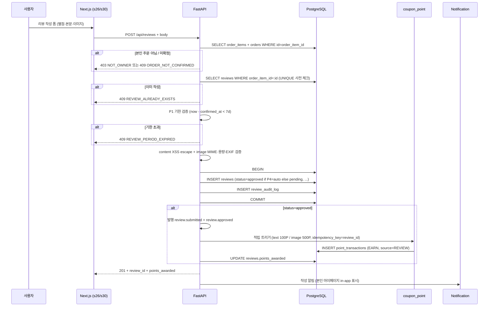
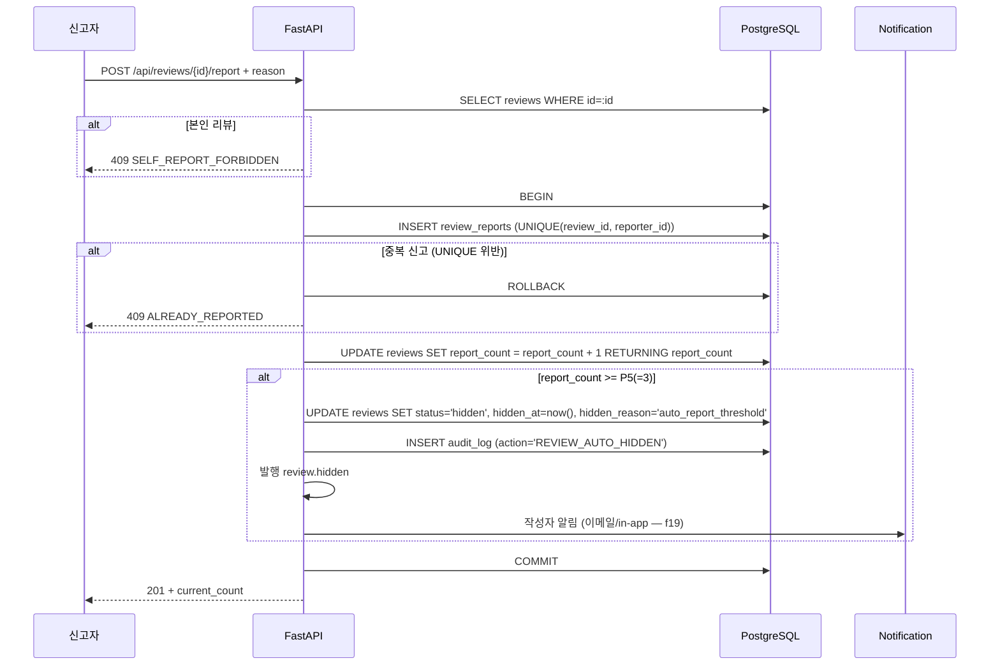
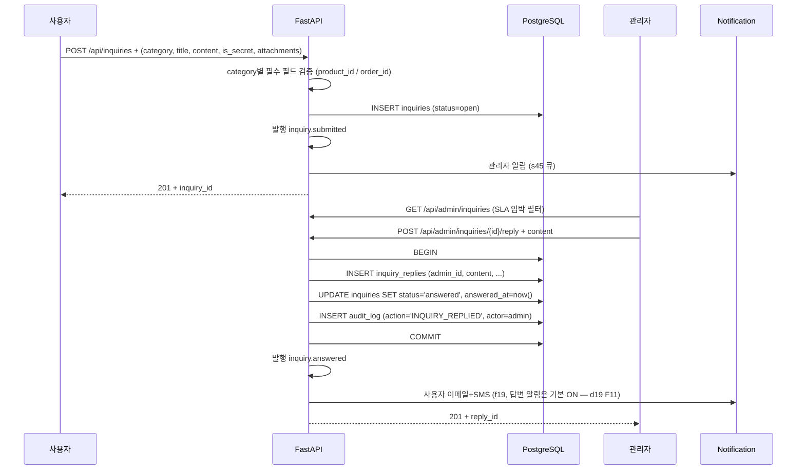
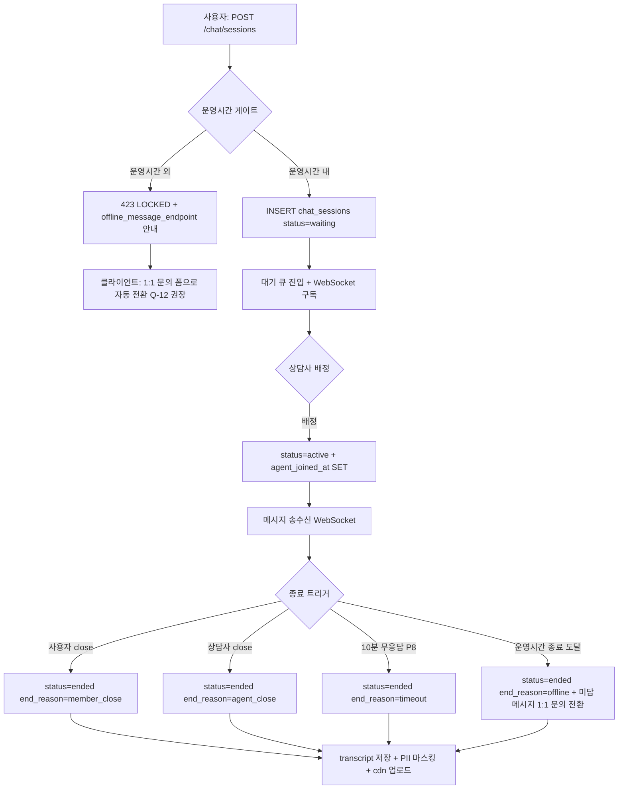

# f17 — 리뷰·문의 기능정의서

- **박제일**: 2026-05-22 (v0.1) → **2026-05-23 (v0.2 갱신)**
- **단계**: S0 / Track 1 / Phase 4 / f17
- **상위 문서**: `00_index.md`
- **짝 도메인**: `../05_도메인정의서/d19_리뷰_문의.md` · `d20_쿠폰_포인트.md` · `d16_주문.md` · `d11_회원.md`
- **짝 화면**: s26(상품 상세 리뷰 탭) · s30(내 리뷰) · s31(1:1 문의) · s45(관리자 리뷰·문의·채팅 통합)
- **QA 소스**: `쇼핑몰_전용_QA_v4.md §10` (**v4 통합 prefix = REV-U-* / REV-A-*** — v3 시절 INQ-*·CHT-* 별도 prefix 는 모두 REV-* 로 흡수됨) + `공통_인프라_보안_QA.md §A-3 / §A-7 / §A-8 / §B-9`

> **v0.2 갱신 메모 (2026-05-23)**: v3 prefix(INQ-*·CHT-*) 표기를 v4 통합 REV-* 로 정정. v4 신규 시나리오 박제 — REV-U-010B/010C (리뷰 작성 시 텍스트/포토 적립 포인트), REV-U-017/018 (실시간 채팅 운영시간 내/외), REV-A-005/006 (베스트 리뷰 추가 포인트 지급·회수), REV-A-011 (AI 답변 초안), REV-A-012 (스팸 Q&A 탐지), REV-A-013~016 (채팅 운영·자동 응답), REV-A-017 (1:1 문의 카테고리 관리), REV-A-018/019 (리뷰 작성 포인트 금액 설정). §4 룰표·§8 QA 추적 v4 정합 재계산.

---

## 1. 개요

- **기능명**: 리뷰 작성·수정·삭제·신고·좋아요·관리자 블라인드 + 1:1 문의(상품/주문/일반 카테고리)·비밀글·첨부 5장·관리자 답변·자동 매크로·SLA 추적 + 실시간 채팅 세션(운영시간 게이트·오프라인 메시지 전환)
- **비즈니스 목적**: Stage 5 재구매 신뢰의 핵심. 리뷰 평점·신고·블라인드 정합성이 상품 신뢰도와 직결되며, 1:1 문의 SLA 24h 와 채팅 운영시간 정책 (Q-12 박제) 이 CS 만족도 KPI. 비밀글·신고 누적 자동 블라인드 등 어뷰징 방어가 컨텐츠 무결성을 보장합니다.
- **트리거**: 사용자 리뷰 작성/수정/삭제/좋아요/신고, 사용자 문의 작성/수정/삭제, 관리자 답변·블라인드·매크로 CRUD, 사용자 채팅 세션 시작/메시지/종료, 자동 블라인드 배치, 채팅 비활성 타임아웃 배치
- **액터**: 회원(리뷰·문의·채팅 작성·신고·좋아요), 관리자/상담사(승인·블라인드·답변·채팅 응대), 시스템(자동 블라인드·SLA 알람·채팅 타임아웃·운영시간 게이트)
- **관련 화면**: s26·s30·s31·s45
- **관련 도메인**: d19 리뷰·문의(주), d20 쿠폰·포인트(리뷰 보너스 적립/회수 이벤트), d16 주문(리뷰 작성 전제 = confirmed), d11 회원(작성자·정지·탈퇴 마스킹)

---

## 2. 입력·출력

### 2.1 리뷰 작성 (POST `/api/reviews`)

**Request 헤더**: `Authorization: Bearer ...`, `Idempotency-Key: {uuid}` 권장 (중복 작성 방지)

**Request Body**:
```json
{
  "order_item_id": "uuid",
  "rating": 5,
  "content": "사이즈도 잘 맞고 색상도 좋아요.",
  "images": ["https://cdn/img1.jpg", "https://cdn/img2.jpg"]
}
```

| 필드 | 타입 | 필수 | 검증 |
|---|---|---|---|
| order_item_id | uuid | Y | 본인 주문 + 주문 status='confirmed' + UNIQUE(order_item_id) |
| rating | integer | Y | 1 ≤ rating ≤ 5 |
| content | string | Y | 10 ≤ length ≤ 2000자, XSS escape |
| images | array | N | 최대 5장 / 각 ≤ 5MB / jpg·png·webp / EXIF 제거 |

**Response 201**:
```json
{
  "review_id": "uuid",
  "status": "approved",
  "points_awarded": 500,
  "created_at": "2026-05-22T10:23:00Z"
}
```

자동 승인(P4=auto) 시 status=approved + 리뷰 보너스 포인트 적립 이벤트 발행 (d20 PNT-U-002). 검수 정책 시 status=pending → 관리자 승인 후 적립.

### 2.2 리뷰 수정 (PATCH `/api/reviews/{id}`)

**Body**: `{rating?, content?, images?}` (부분 수정 허용).

**Response 200**: `{review_id, updated_at}`.

**룰**: 작성 후 P2(기본 7일) 내 1회만 가능. 본인만.

### 2.3 리뷰 삭제 (DELETE `/api/reviews/{id}`)

**Response 204**. 본인만. soft delete (status=hidden + hidden_reason='user_delete') + 적립 포인트 회수 이벤트 발행 (d20 PNT-U-007).

### 2.4 리뷰 좋아요 (POST `/api/reviews/{id}/like` / DELETE 동일 경로)

**Response 200**: `{like_count: 12}`. 본인 리뷰 차단(409). 멱등(같은 회원 중복 호출 시 200 + 현재 카운트).

### 2.5 리뷰 신고 (POST `/api/reviews/{id}/report`)

**Body**:
```json
{
  "reason": "spam",
  "memo": "광고성 컨텐츠 같습니다."
}
```

| 필드 | 타입 | 필수 |
|---|---|---|
| reason | enum | Y (spam / abuse / off_topic / fake / other) |
| memo | text | N (≤ 500자) |

**Response 201**: `{report_id, current_count: 2}`.

**룰**: 같은 회원 × 같은 리뷰 1회만(idx_review_id_reporter_id UNIQUE). 본인 리뷰 신고 차단(409). 누적 3회(P5) 도달 시 reviews.status='hidden' 자동 전환 + 작성자 알림(f19) + AuditLog.

### 2.6 1:1 문의 작성 (POST `/api/inquiries`)

**Request 헤더**: `Authorization: Bearer ...`

**Request Body**:
```json
{
  "category": "order",
  "product_id": null,
  "order_id": "uuid",
  "title": "배송 일정 문의",
  "content": "어제 결제했는데 운송장이 안 보입니다.",
  "is_secret": true,
  "attachments": ["https://cdn/f1.jpg"]
}
```

| 필드 | 타입 | 필수 | 검증 |
|---|---|---|---|
| category | enum | Y | product / order / general |
| product_id | uuid | 조건부 Y | category=product 시 필수 |
| order_id | uuid | 조건부 Y | category=order 시 필수 + 본인 주문 |
| title | string | Y | 1~200자, XSS escape |
| content | text | Y | 1~5000자, XSS escape |
| is_secret | boolean | N | default false |
| attachments | array | N | 최대 5장 / 각 ≤ 5MB / jpg·png·pdf |

**Response 201**:
```json
{
  "inquiry_id": "uuid",
  "status": "open",
  "created_at": "2026-05-22T10:23:00Z"
}
```

`inquiry.submitted` 이벤트 → 관리자 알림(f19).

### 2.7 1:1 문의 수정·삭제 (PATCH/DELETE `/api/inquiries/{id}`)

답변 등록 전(status=open)만 가능. 답변 후 차단(409 INQUIRY_ALREADY_ANSWERED).

### 2.8 비밀글 조회 (GET `/api/inquiries/{id}` / GET `/api/products/{id}/qna`)

본인 + 관리자만 본문 평문. 타인은 목록에 제목·작성일만 표시 + 본문은 "비밀글입니다." 마스킹 응답.

### 2.9 관리자 답변 (POST `/api/admin/inquiries/{id}/reply`)

**Request 헤더**: `Authorization: Bearer admin_token`

**Body**:
```json
{
  "content": "운송장은 오늘 18시까지 등록됩니다.",
  "attachments": []
}
```

**Response 201**: `{reply_id, replied_at}`. inquiries.status='answered' + answered_at SET + `inquiry.answered` 이벤트 → 사용자 알림(f19 이메일+SMS).

### 2.10 채팅 운영시간 조회 (GET `/api/chat/operation-hours`)

**Response 200**:
```json
{
  "weekdays": [
    {"weekday":1,"channel":"chat","open":"10:00","close":"19:00"},
    {"weekday":6,"channel":"chat","open":"10:00","close":"14:00"}
  ],
  "is_open_now": true,
  "next_open_at": null
}
```

**Q-12 박제** (사장님 verbatim 권장 = 평일 10~19 + 토 10~14, 일·공휴일 휴무).

### 2.11 채팅 세션 시작 (POST `/api/chat/sessions`)

**Body**: `{channel: "cs" | "consultation"}`.

**Response 201 (운영시간 내)**:
```json
{
  "session_id": "uuid",
  "status": "waiting",
  "queue_position": 3,
  "estimated_wait_sec": 90
}
```

**Response 423 (운영시간 외 — LOCKED)**:
```json
{
  "code": "OUT_OF_OPERATION_HOURS",
  "next_open_at": "2026-05-23T10:00:00Z",
  "offline_message_endpoint": "/api/inquiries"
}
```

운영시간 외 진입 시 클라이언트는 자동으로 1:1 문의 작성 폼으로 전환(Q-12 권장안 — 오프라인 메시지 1:1 문의 자동 전환).

### 2.12 채팅 메시지 전송 (POST `/api/chat/sessions/{id}/messages`)

**Body**: `{content, message_type:"text"|"image", attachments?:[]}`.

**Response 201**: `{message_id, created_at}`. WebSocket으로 상담사에게 즉시 push.

### 2.13 채팅 세션 종료 (POST `/api/chat/sessions/{id}/end`)

**Body**: `{reason: "member_close"}` (선택).

**Response 200**: `{session_id, ended_at, transcript_url}`.

---

## 3. 처리 흐름

### 3.1 리뷰 작성 + 보너스 적립 (메인 시퀀스)



### 3.2 리뷰 신고 + 자동 블라인드



### 3.3 1:1 문의 → 관리자 답변 → 사용자 알림



### 3.4 채팅 세션 라이프사이클



### 3.5 채팅 타임아웃 배치

```python
# 매 1분 polling
while sessions := SELECT id FROM chat_sessions
                   WHERE status='active'
                     AND (now() - last_message_at) > interval '10 minutes':
    with transaction():
        if chat_sessions.status != 'active': continue  # 멱등
        UPDATE chat_sessions SET status='ended', end_reason='timeout', ended_at=now()
        INSERT chat_messages (sender_type='system', content='10분간 응답이 없어 세션이 종료됩니다.')
        publish('chat.session.ended', {session_id, end_reason:'timeout'})
        # transcript 저장 작업은 별도 큐에 적재 (외부 작업)
```

### 3.6 운영시간 종료 도달 시 활성 세션 처리

운영시간 종료 5분 전 시스템 메시지 push → 종료 시각 도달 시 활성 세션 일괄 ended (end_reason='offline') + 진행 중이던 미답 메시지가 있을 경우 1:1 문의 자동 변환 옵션(Q-12 정책 — 사장님 결정 박제).

### 3.7 채팅 SLA·큐·상담사 운영 표준 (★ NEW — Tier 5 §3.3)

```text
1:1 채팅 운영시간 (T5-Q07·T5-Q08·T5-Q09 권장)

기본 운영시간:
- 월~금 10:00-18:00 KST (점심 시간 12~13 휴식)
- 주말·공휴일 = 휴무
- 명절 = 사전 공지 (1주일 전)

운영시간 외 처리 (Q-12 권장):
- 사용자가 chat.start 시도 → status=offline 응답
- 오프라인 메시지 작성 UI 노출 (1:1 문의 자동 전환)
- 답변 SLA = 다음 영업일 4시간 내

채팅 SLA (운영시간 내):
- 첫 응답 시한 = 평균 30초 / 최대 5분
- 세션 평균 시간 = 5~15분
- CSAT 목표 = 평균 4.5 (5점 만점)
- 비활성 타임아웃 = 10분 (사용자 미응답)

큐 운영:
- 대기 큐 표시 (사용자 측 "현재 대기 N명")
- 평균 대기 시간 표시
- 5분 초과 대기 = 자동 안내 ("잠시만 기다려주세요")
- 10분 초과 = 1:1 문의 전환 옵션 제공
- 30분 초과 = 자동 1:1 문의 전환

상담사 운영:
- 상담사 1명당 동시 채팅 최대 3건
- 응답 시한 = 30초 (초과 시 큐 재배정)
- 종료 후 CSAT 발송 (24시간 내 응답)
```

---

## 4. 검증 룰

### 4.1 입력 검증

| 필드 | 룰 | 위반 코드 |
|---|---|---|
| rating | 1~5 | 422 |
| content (리뷰) | 10~2000자 + XSS escape | 422 |
| content (문의) | 1~5000자 + XSS escape | 422 |
| images / attachments | 최대 5장 / 5MB / jpg·png·webp(리뷰) · jpg·png·pdf(문의) | 413 / 422 |
| reason (신고) | enum 5종 | 422 |
| order_item_id | 본인 주문 + status=confirmed | 403 / 409 |
| category=product/order | 매칭 ID 필수 | 422 |
| message_type | text / image | 422 |

### 4.2 비즈니스 룰 (d19 v0.2 F1~F23 인용, v4 prefix)

| 룰 | 적용 | 근거 (v4) |
|---|---|---|
| **리뷰 작성 전제 = 주문 status=confirmed** | 리뷰 작성 | d19 F1, REV-U-001, REV-U-002 |
| **1 주문상품당 1리뷰** (UNIQUE(order_item_id)) | 리뷰 작성 | d19 F2, REV-U-007 |
| 리뷰 본문 = 20자↑ 필수 | 리뷰 작성 | d19 F3, REV-U-001, REV-U-004 |
| 리뷰 작성 가능 기한 = 구매확정 후 P1(기본 7일) | 리뷰 작성 | d19 P1, REV-U-001 |
| 리뷰 수정 = 작성 후 P2(기본 7일) 내 1회 / 본인만 | 리뷰 수정 | d19 P2, REV-U-008 |
| 리뷰 이미지 = 최대 5장 / 5MB / jpg·png·webp / EXIF 제거 / MIME 검증 | 리뷰 작성·수정 | d19 F4, REV-U-003, REV-U-005, REV-U-006, A-FILE-001~010 |
| **리뷰 신고 누적 P6(기본 3회) → status=hidden 자동 전환 + 알림** | 신고 | d19 F5, REV-U-010, REV-A-002, REV-A-003 |
| 1회원 1리뷰 좋아요 (복합 PK) | 좋아요 | d19 F6 (시스템 고정) |
| 1회원 1리뷰 신고 (복합 인덱스) | 신고 | d19 F7, REV-U-010 |
| 본인 리뷰 좋아요·신고 차단 | 좋아요·신고 | d19 F9 |
| 타인 리뷰·Q&A 수정/삭제 API 직접 호출 차단 (403) | 권한 | d19 F10, REV-U-009, REV-U-020 |
| **리뷰 삭제 시 적립 포인트 회수** (PointTransaction CANCEL — 잔액 부족 시 Q1 정책) | 리뷰 삭제 | d19 F8, d20 PNT-U-007 |
| **텍스트 리뷰 적립 포인트 = P3(기본 100P) — REV-A-018 관리 가능 (NEW v4)** | 리뷰 승인 | d19 P3, **REV-U-010B, REV-A-018**, d20 P2 |
| **포토 리뷰 추가 포인트 = P4(기본 400P → 합계 500P) — REV-A-019 관리 가능 (NEW v4)** | 리뷰 승인 | d19 P4, **REV-U-010C, REV-A-019**, d20 P2 |
| **베스트 리뷰 선정 = 추가 포인트(P12, 기본 1,000P) 지급 + 멱등 (NEW v4)** | 관리자 운영 | **d19 F20, REV-A-005** |
| **베스트 리뷰 선정 취소 = 추가 포인트 회수 (잔액 부족 시 Q1 분기) (NEW v4)** | 관리자 운영 | **d19 F21, REV-A-006** |
| 리뷰 자동 승인 vs 검수 후 승인 = P5 정책 | 리뷰 작성 | d19 P5 |
| **비밀글 = 본인 + 관리자만 본문 평문** (타인은 마스킹) | 문의 조회 | d19 F11, REV-U-012 |
| 비회원 = 리뷰·Q&A·1:1 문의·채팅 작성 차단 | 전체 | d19 F12, REV-U-013, REV-U-015 |
| 문의 답변 완료 시 사용자 수정·삭제 차단 | 문의 수정/삭제 | d19 F13 |
| **답변 등록 시 이메일 알림 즉시 발송** (마케팅 동의와 무관, 답변 알림은 기본 ON) | 답변 등록 | d19 F14, REV-U-016, REV-A-009, REV-A-010 |
| **1:1 문의 카테고리 목록 = P8 (기본: 상품/주문/일반) — REV-A-017 관리 가능 (NEW v4)** | 문의 작성 | **d19 P8, REV-A-017** |
| **AI 답변 초안 = 관리자 검수 후 발송 의무 (자동 발송 금지) (NEW v4)** | 답변 | **d19 F23, REV-A-011** |
| **스팸 Q&A 자동 탐지 = 1시간 내 동일 본문 10건 → 자동 숨김 + 알림 (NEW v4)** | 모더레이션 | **d19 F22, REV-A-012** |
| 채팅 운영시간 외 진입 → 423 LOCKED + 오프라인 메시지 전환(Q-12 권장안 = 자동 전환) | 채팅 세션 시작 | d19 F15, **REV-U-017, REV-U-018** |
| **채팅 운영시간 = P9 (기본 월~금 10:00-18:00) — REV-A-015 관리 가능 (NEW v4)** | 운영 | **d19 P9, REV-A-015** |
| **비운영시간 자동 응답 메시지 = P11 — REV-A-016 관리 가능 (NEW v4 — Q-12 후속)** | 운영 | **d19 P11, REV-A-016** |
| 채팅 transcript = 보관 기간 후 자동 삭제 (Q-12 권장 = 3년) | 채팅 종료 | d19 F16, A-LOG-003 |
| 채팅 첨부 = 최대 3장 / 5MB / 형식 검증 | 메시지 전송 | d19 F17 |
| 본문 = XSS 필터링 (HTML 이스케이프) | 전체 | d19 F18, A-XSS-001 |
| 신고/삭제/블라인드/답변/매크로/베스트선정/포인트지급 = AuditLog 박제 | 관리자/시스템 | d19 F19, A-LOG-002 |
| 채팅 자동 종료 비활성 타임아웃 = P10(기본 10분) | 배치 | d19 P10 |
| 1:1 문의 SLA = P7(기본 24h) — SLA 임박 알람 | 운영 | d19 P7 |
| **채팅 운영시간 외 = 오프라인 + 1:1 문의 자동 전환** (NEW Tier 5 §3.3, T5-Q07 권장) | 영업시간 | F-CHAT-01 |
| **채팅 첫 응답 SLA = 30초~5분** (NEW Tier 5 §3.3) | 응답 | F-CHAT-02 |
| **채팅 비활성 타임아웃 = 10분** (= d19 P10) | 종료 | F-CHAT-03 |
| **상담사 동시 채팅 최대 3건** (NEW Tier 5 §3.3) | 부하 | F-CHAT-04 |
| **30분 초과 대기 = 자동 1:1 문의 전환** (NEW Tier 5 §3.3) | UX | F-CHAT-05 |
| **종료 후 CSAT 발송 (24h 내)** (NEW Tier 5 §3.3) | 만족도 | F-CHAT-06 |
| **리뷰 작성 = 20회 / 1분 (member_id)** (NEW Tier 3 §3.8) | 리뷰 | F-RATE-01·06 |
| **문의 작성 = 10회 / 1시간 (member_id)** (NEW Tier 3 §3.8) | 문의 | F-RATE-01·06 |
| **리뷰·문의 접근 = require_resource_owner('review' / 'inquiry')** (NEW Tier 3 §3.4) | 권한 | F-IDOR-01·02 (404 위장) |
| **리뷰 본문·문의 본문·채팅 메시지 = DOMPurify sanitize + React 자동 escape** (NEW Tier 3 §3.5) | XSS | F-XSS-01·02 |

---

## 5. 트랜잭션·동시성

### 5.1 리뷰 작성 트랜잭션 (멱등 + 적립)

```python
with transaction(isolation=READ_COMMITTED):
    # 본인 주문 + confirmed 검증
    order_item = SELECT oi.*, o.status, o.confirmed_at, o.member_id
                  FROM order_items oi JOIN orders o ON oi.order_id = o.id
                  WHERE oi.id=:order_item_id
    if order_item.member_id != current_member: raise NotOwner()
    if order_item.status != 'confirmed': raise OrderNotConfirmed()
    if now() - order_item.confirmed_at > 7d: raise ReviewPeriodExpired()

    # UNIQUE 사전 체크 (DB 제약과 이중)
    if SELECT 1 FROM reviews WHERE order_item_id=:id: raise ReviewAlreadyExists()

    # XSS escape + image 검증
    content = escape_html(body.content)
    validate_images(body.images)  # MIME / size / EXIF strip

    # INSERT (P4=auto 시 approved, 검수 시 pending)
    review = INSERT reviews (status=auto_or_pending, ...)
    INSERT audit_log (action='REVIEW_CREATED')

    if review.status == 'approved':
        # 적립 이벤트 (d20 멱등 키 = review_id)
        bonus = 500 if images else 100
        publish_outbox('review.approved', {review_id, member_id, bonus, idempotency_key=review_id})
        UPDATE reviews SET points_awarded=bonus WHERE id=review_id
```

### 5.2 신고 + 자동 블라인드 트랜잭션 (원자)

```python
with transaction(isolation=READ_COMMITTED):
    # UNIQUE(review_id, reporter_id) 제약으로 중복 차단
    try:
        INSERT review_reports (review_id, reporter_id, reason, memo)
    except UniqueViolation:
        raise AlreadyReported()

    # 카운트 증가 (RETURNING으로 새 카운트 획득 — 원자)
    new_count = UPDATE reviews SET report_count = report_count + 1
                WHERE id=:review_id RETURNING report_count

    if new_count >= P5(=3) and review.status != 'hidden':
        UPDATE reviews SET status='hidden', hidden_at=now(),
               hidden_reason='auto_report_threshold' WHERE id=:review_id
        INSERT audit_log (action='REVIEW_AUTO_HIDDEN')
        publish_outbox('review.hidden', {review_id, hidden_by='system'})
```

### 5.3 1:1 문의 답변 트랜잭션

```python
with transaction(isolation=READ_COMMITTED):
    inquiry = SELECT FOR UPDATE FROM inquiries WHERE id=:inquiry_id
    if inquiry.status == 'answered': raise AlreadyAnswered()  # 멱등 가드

    INSERT inquiry_replies (inquiry_id, admin_id, content, attachments, replied_at)
    UPDATE inquiries SET status='answered', answered_at=now()
    INSERT audit_log (action='INQUIRY_REPLIED', actor=admin_id)

    publish_outbox('inquiry.answered', {inquiry_id, member_id})
    # → notification 도메인이 이메일+SMS 발송 (f19)
```

### 5.4 채팅 세션 동시성

| 시나리오 | 메커니즘 |
|---|---|
| 사용자 중복 클릭(세션 시작 더블 탭) | 회원당 동시 1 active/waiting 세션 제약 — 중복 요청 시 기존 session_id 반환 (멱등) |
| 동일 세션 동시 종료(사용자 close + 상담사 close) | chat_sessions SELECT FOR UPDATE + status='active' 확인 → 1건만 ended 전환, 다른 건 409 |
| 운영시간 종료 도달 + 사용자가 메시지 전송 시도 동시 | 메시지 INSERT 전 chat_sessions.status 재확인 → 'ended'면 409 SESSION_ENDED |
| 같은 좋아요 동시 2회 | UNIQUE(review_id, member_id) 제약 → 중복 INSERT 차단, 멱등 200 반환 |
| 자동 블라인드 임계 동시 도달 | UPDATE ... RETURNING 원자 + status='hidden' 변경 시 변경 직전 status 체크 → 중복 hidden 처리 방지 |

### 5.5 멱등성 키

| 작업 | 키 | TTL |
|---|---|---|
| 리뷰 작성 | `Idempotency-Key` 헤더 또는 `(member_id, order_item_id)` UNIQUE | DB 영구 |
| 리뷰 보너스 적립 | `point_transactions.idempotency_key = review_id` | 영구 |
| 좋아요 | `(review_id, member_id)` 복합 PK | 영구 |
| 신고 | `(review_id, reporter_id)` UNIQUE | 영구 |
| 문의 답변 | `inquiry_replies` INSERT 후 inquiries.status='answered' 재진입 차단 | 영구 |
| 채팅 메시지 | client_message_id (선택) 또는 (session_id, sender_id, sent_at) UNIQUE | 영구 |

---

## 6. 에러 처리

| HTTP | 도메인 코드 | 시나리오 | 사용자 메시지 |
|---|---|---|---|
| 401 | UNAUTHORIZED | 비로그인 (회원 전용) | 로그인 모달 |
| 403 | NOT_OWNER | 타인 주문 리뷰 / 타인 문의 조회 | (404로 응답 또는 403) |
| 403 | SELF_REPORT_FORBIDDEN | 본인 리뷰 신고 | "본인 리뷰는 신고할 수 없습니다." |
| 403 | SELF_LIKE_FORBIDDEN | 본인 리뷰 좋아요 | "본인 리뷰는 좋아요할 수 없습니다." |
| 409 | REVIEW_ALREADY_EXISTS | UNIQUE(order_item_id) 위반 | "이미 작성된 리뷰가 있습니다." |
| 409 | REVIEW_PERIOD_EXPIRED | 구매확정 7일 경과 | "리뷰 작성 기간(7일)이 종료되었습니다." |
| 409 | REVIEW_EDIT_LIMIT_EXCEEDED | 수정 1회 사용 후 재시도 | "리뷰 수정은 1회만 가능합니다." |
| 409 | ORDER_NOT_CONFIRMED | 미확정 주문 리뷰 시도 | "구매확정 후 리뷰를 작성할 수 있습니다." |
| 409 | ALREADY_REPORTED | 같은 리뷰 중복 신고 | "이미 신고한 리뷰입니다." |
| 409 | INQUIRY_ALREADY_ANSWERED | 답변 후 수정/삭제 시도 | "답변이 등록된 문의는 수정·삭제할 수 없습니다." |
| 409 | SESSION_ENDED | 종료된 채팅에 메시지 전송 | "세션이 종료되었습니다. 새 세션을 시작해주세요." |
| 409 | SESSION_ALREADY_ACTIVE | 회원당 동시 세션 1개 초과 | (기존 session_id 반환 멱등) |
| 413 | FILE_TOO_LARGE | 5MB 초과 | "파일 크기는 5MB 이하만 가능합니다." |
| 422 | INVALID_RATING | 1~5 범위 외 | "별점을 선택해주세요." |
| 422 | INVALID_CONTENT_LENGTH | 본문 길이 위반 | "본문은 10자 이상 작성해주세요." |
| 422 | INVALID_FILE_TYPE | MIME 불일치 | "지원하지 않는 파일 형식입니다." |
| 422 | INVALID_CATEGORY_FIELD | category=order인데 order_id 누락 | "주문 문의는 주문을 선택해주세요." |
| 423 | OUT_OF_OPERATION_HOURS | 채팅 운영시간 외 진입 | "운영시간 외입니다. 1:1 문의로 남겨주세요." + 자동 전환 |
| 451 | LEGAL_HOLD | 분쟁 중인 리뷰 수정/삭제 차단 (관리자 보류) | "처리 중인 문의가 있어 수정/삭제할 수 없습니다." |

---

## 7. 성능·캐시

| 지표 | 목표 |
|---|---|
| 리뷰 목록 조회 P95 | < 200ms |
| 리뷰 작성 P95 | < 500ms (이미지 검증 포함) |
| 리뷰 신고 + 자동 블라인드 P95 | < 300ms |
| 1:1 문의 작성 P95 | < 300ms |
| 문의 답변 P95 | < 400ms (알림 발송은 비동기) |
| 채팅 메시지 전송 P95 | < 100ms (WebSocket) |
| 채팅 세션 시작 P95 | < 200ms |
| 자동 블라인드 임계 도달 알림 SLA | < 5s |

**캐시 전략**:

| 키 | TTL | 무효화 |
|---|---|---|
| `reviews:product:{id}:page:{n}:sort:{s}` | 5분 | 신규 리뷰 작성·승인·블라인드 시 PURGE |
| `reviews:product:{id}:rating_summary` (평균·개수) | 10분 | 리뷰 작성·블라인드 시 비동기 재계산 |
| `inquiries:member:{id}:recent` | 1분 | 답변 등록 시 PURGE |
| `chat:operation_hours` | 1시간 | 관리자 운영시간 변경 시 PURGE |
| `chat:queue:size` (Redis counter) | 실시간 | 세션 시작/배정 시 INCR/DECR |

**인덱스**: `reviews.idx_product_id_status`, `idx_member_id`, `idx_status_created_at`, `UNIQUE(order_item_id)`, `review_reports.UNIQUE(review_id, reporter_id)`, `review_likes.PK(review_id, member_id)`, `inquiries.idx_member_id_created_at`, `idx_status_created_at`(SLA), `chat_sessions.idx_status_started_at`, `chat_messages.idx_session_id_created_at`.

---

## 8. 테스트 케이스

### 8.1 유닛

- 리뷰 별점 1~5 범위 검증 (경계값 0, 6 차단)
- content XSS escape (`<script>` → `&lt;script&gt;`)
- 이미지 EXIF 제거 검증 (GPS 좌표 strip)
- MIME 위조 차단 (`.jpg` 확장자 + PDF magic byte → 거부)
- 자동 블라인드 임계 계산 (P5=3 기본, 정책 변경 시 동작)
- 운영시간 게이트 함수 (요일×시각 매핑, 휴일 처리)
- 비밀글 마스킹 함수 (타인 조회 시 content="비밀글입니다.")

### 8.2 통합

- 구매확정 → 리뷰 작성 → 자동 승인 → 포인트 적립 멱등(중복 호출 시 1건만 적립) (PNT-U-002)
- 미확정 주문 리뷰 시도 → 409 ORDER_NOT_CONFIRMED
- 같은 order_item_id 2회 작성 시도 → 409 REVIEW_ALREADY_EXISTS (UNIQUE)
- 신고 3회 누적 → 자동 블라인드 + 작성자 알림 + AuditLog (REV-U-008)
- 같은 회원 같은 리뷰 중복 신고 → 409 ALREADY_REPORTED (UNIQUE)
- 본인 리뷰 좋아요/신고 → 409 SELF_*
- 리뷰 삭제 → 포인트 회수 이벤트 → coupon_point CANCEL row INSERT (PNT-U-007)
- 1:1 문의 작성 (비밀글) → 타인이 목록 조회 시 본문 마스킹
- 답변 등록 → 사용자 이메일+SMS 발송 + inquiries.status=answered (INQ-U-007~008)
- 답변 후 사용자 수정 시도 → 409 INQUIRY_ALREADY_ANSWERED
- 채팅 운영시간 외 진입 → 423 + offline_message_endpoint 응답 (Q-12, CHT-U-001/007)
- 채팅 10분 무응답 → timeout 종료 + 시스템 메시지
- 동시 좋아요 2회 호출 → 1건만 INSERT (UNIQUE 멱등)
- SLA 24h 초과 문의 → INQ-A-005 알람 큐 진입

### 8.3 E2E (Playwright)

- 주문 완료 → 7일 내 마이페이지 → 리뷰 작성 (별점·본문·이미지 3장) → 적립 알림
- 다른 회원이 리뷰 좋아요 → 카운트 증가 → 새로고침 시 동기화
- 다른 회원이 리뷰 신고 3회 → 자동 블라인드 → 작성자 알림 수신
- 상품 상세 → Q&A 탭 → 비밀글 작성 → 본인 외 계정 로그인 → 본문 마스킹 확인
- 1:1 문의 (상품 카테고리) 작성 → 관리자 답변 → 사용자 이메일/SMS 수신
- 채팅 운영시간 내(평일 10~19) 시작 → 상담사 응대 → 종료 → transcript 저장
- 채팅 운영시간 외(예: 토 15시) 시작 → 1:1 문의 폼 자동 전환
- 리뷰 작성 7일 경과 후 작성 시도 → 작성 버튼 비활성 + 안내 메시지

### 8.4 QA 추적 (v4 통합 prefix = REV-U-* / REV-A-*)

- `쇼핑몰_전용_QA_v4.md §10` (사용자, 22건):
  - 리뷰: REV-U-001 ~ REV-U-010 (10건) + **REV-U-010B (텍스트 리뷰 적립 포인트, NEW v4)** + **REV-U-010C (포토 리뷰 추가 포인트, NEW v4)**
  - Q&A·문의: REV-U-011 ~ REV-U-016, REV-U-019, REV-U-020 (8건)
  - 채팅: **REV-U-017 (운영시간 내 WebSocket, NEW v4)** + **REV-U-018 (비운영시간 오프라인 안내, NEW v4)**
- `쇼핑몰_전용_QA_v4.md §10` (관리자, 19건):
  - 리뷰: REV-A-001 ~ REV-A-004, REV-A-007 (5건) + **REV-A-005 (베스트 리뷰 추가 포인트 지급, NEW v4)** + **REV-A-006 (베스트 리뷰 선정 취소·회수, NEW v4)**
  - 문의·Q&A: REV-A-008, REV-A-009, REV-A-010 (3건) + **REV-A-011 (AI 답변 초안, NEW v4)** + **REV-A-012 (스팸 Q&A 탐지·숨김, NEW v4)** + **REV-A-017 (1:1 문의 카테고리 관리, NEW v4)**
  - 채팅: **REV-A-013 ~ REV-A-016 (채팅 모니터링·답변·종료·운영시간·자동응답, NEW v4 × 4건)**
  - 포인트: **REV-A-018 (텍스트 리뷰 포인트 금액 설정, NEW v4)** + **REV-A-019 (포토 리뷰 추가 포인트 금액 설정, NEW v4)**
- `공통_인프라_보안_QA.md §A-3`: A-XSS-001, A-INJ-002 (본문 XSS/SQLi)
- `공통_인프라_보안_QA.md §A-7`: A-FILE-001~010 (이미지·첨부 검증 10건)
- `공통_인프라_보안_QA.md §A-8`: A-LOG-002 (관리자 액션), A-LOG-003 (transcript 보관), A-LOG-011 (비밀글 PII 마스킹)

**QA 합계 (v4 정합)** = 사용자 22 + 관리자 19 + 비기능 13 = **54건**.

---

## 9. 미결

| ID | 항목 | 미결 사유 |
|---|---|---|
| f17-Q01 | 리뷰 자동 승인 vs 검수 후 승인 (P4 기본값) | d19 Q5 — 자동 승인 권장(MVP) vs 신뢰도 확보 위해 검수 |
| f17-Q02 | 신고 누적 자동 블라인드 후 작성자 이의신청 흐름 (UI/UX) | d19 Q3 — MVP 범위 결정 |
| f17-Q03 | 리뷰 삭제 시 적립 포인트 회수 — 잔액 부족 처리 (음수 차단 vs 가능한 만큼) | d19 Q1, d20 Q2 통합 결정 |
| f17-Q04 | 채팅 운영시간 외 정책 (Q-12) — 오프라인 메시지 → 1:1 문의 자동 전환 여부 | 사장님 결정 — 권장안 = 자동 전환 (`_미결사항_통합관리.md` Q-12 권장 = 평일 10~19 + 토 10~14) |
| f17-Q05 | 채팅 transcript 보관 기간 | d19 Q4 — 3년(개인정보보호법) vs 1년(마케팅 활용) |
| f17-Q06 | 1:1 문의 첨부 파일 형식·용량 (jpg/png/pdf 5MB 권장) | d19 + 운영 결정 |
| f17-Q07 | 채팅 첨부 파일 형식 (이미지만 vs 일반 파일 포함) | 운영 결정 — 권장 = 이미지·pdf 한정 |
| f17-Q08 | 운영시간 종료 도달 시 활성 세션 처리 — 강제 종료 vs grace 5분 vs 다음 영업일 이관 | UX 결정 — 권장 = grace 5분 + 종료 |
| **f17-Q09** | **베스트 리뷰 선정 = 자동(점수 기준) vs 수동 운영 (REV-A-005)** — MVP 권장 = 수동 |
| **f17-Q10** | **베스트 리뷰 선정 취소 시 회수 — 이미 사용된 추가 1,000P 처리 (음수 허용 vs 가능한 만큼 차감) (REV-A-006, d20 Q2 통합)** |
| **f17-Q11** | **AI 답변 초안 모델·프롬프트 표준 (REV-A-011) — 외부 LLM (OpenAI/Anthropic) 선정·계약 필요** |
| **f17-Q12** | **스팸 Q&A 탐지 임계값 정밀 튜닝 (REV-A-012, 기본 1시간/10건) — false positive 측정 필요** |
| **f17-Q13** | **1:1 문의 카테고리 관리(REV-A-017) — 카테고리 삭제 시 기존 문의의 category 처리 (orphan / 기본 '일반' 마이그) — 권장 = 삭제 차단 + 비활성 토글** |

> 본 미결은 `../_미결사항_통합관리.md §3`에 append.

---

## 10. 변경 이력

| 일자 | 버전 | 변경 |
|---|---|---|
| 2026-05-22 | v0.1 | 최초 박제 — 입출력 13개 API / 처리흐름 7개 / 룰 32개 / 트랜잭션 5개 / 에러 18개 / 테스트 30+ / 미결 8건 |
| **2026-05-23** | **v0.2** | **v4 통합 prefix(REV-U-*/REV-A-*) 정정 — INQ-*·CHT-* 흡수. v4 신규 시나리오 박제 (REV-U-010B/010C 리뷰 포인트 적립, REV-U-017/018 실시간 채팅, REV-A-005/006 베스트 리뷰 추가 포인트 지급·회수, REV-A-011 AI 답변 초안, REV-A-012 스팸 Q&A 탐지, REV-A-013~016 채팅 운영·자동 응답, REV-A-017 1:1 문의 카테고리 관리, REV-A-018/019 리뷰 포인트 금액 설정). §4.2 룰표 v4 prefix 정합 + 신규 룰 9개 추가 (텍스트/포토 포인트, 베스트 리뷰, AI 답변, 스팸 탐지, 카테고리 관리, 운영시간 설정, 자동 응답). §8.4 QA 추적 v4 prefix 재계산 = 사용자 22 + 관리자 19 + 비기능 13 = 합계 54건. §9 미결 5건 추가 (f17-Q09~Q13).** |
