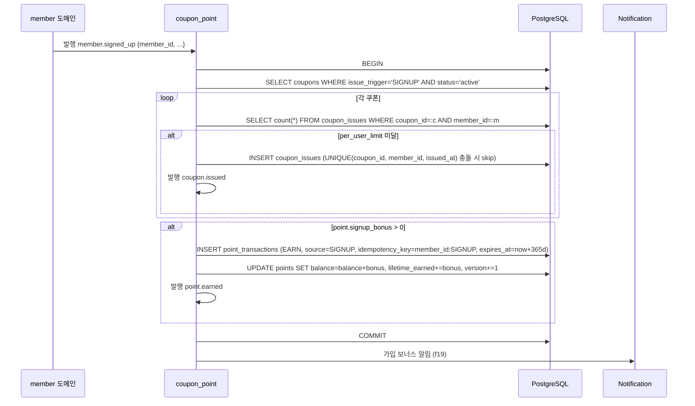
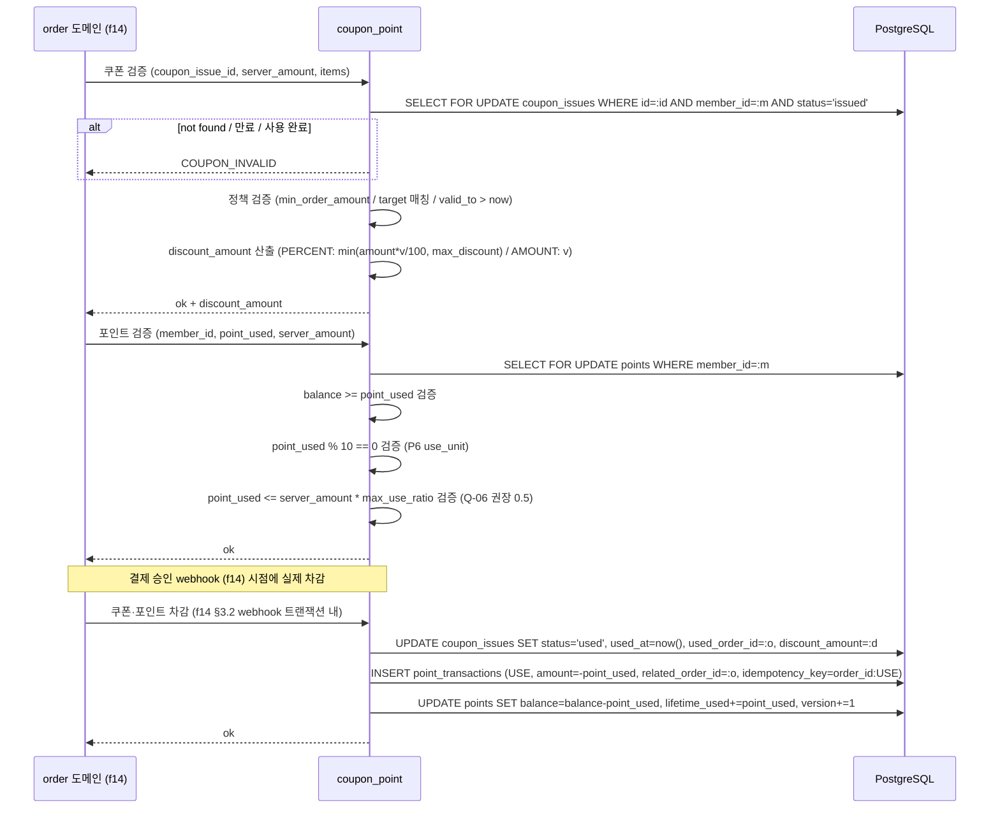

# f18 — 쿠폰·포인트 기능정의서

- **박제일**: 2026-05-22
- **단계**: S0 / Track 1 / Phase 4 / f18
- **상위 문서**: `00_index.md`
- **짝 도메인**: `../05_도메인정의서/d20_쿠폰_포인트.md` · `d11_회원.md` · `d16_주문.md` · `d17_결제.md` · `d19_리뷰_문의.md`
- **짝 화면**: s28(쿠폰함) · s29(포인트 이력) · s18(주문서 쿠폰·포인트 적용) · s44(관리자 쿠폰·포인트 운영)
- **QA 소스**: `쇼핑몰_전용_QA_v4.md §10` (CPN-* v4 통합 prefix) + `공통_인프라_보안_QA.md §B-1 / §B-2 / §A-2 / §A-8`
- **2026-05-22 갱신**: v3 PNT-U-* / PNT-A-* prefix 폐기 → v4 통합 CPN-U-001~040 / CPN-A-001~031 정렬. v4 신규 항목 (CPN-U-009B/009C/011~017/035~039, CPN-A-007~031) §4.2 룰·§8.2 통합·§8.4 QA 추적 매핑 반영.

---

## 1. 개요

- **기능명**: 쿠폰 정책 마스터·발급(신규가입/생일/등급/이벤트 코드/관리자 일괄)·적용(결제)·복원(주문 취소)·만료 배치·강제 회수 + 포인트 적립(구매확정/리뷰/가입/생일)·사용(결제 10P 단위·max_use_ratio 상한)·소멸(1년 FIFO)·관리자 수동 지급/차감·잔액 정합성 감사
- **비즈니스 목적**: 재구매 견인의 핵심 인센티브 도메인. **회계 원장(INSERT-only)** + **잔액 음수 금지 DB CHECK** + **멱등성 보장**의 3중 방어로 자산성 데이터 무결성을 보장. 포인트 100% 결제 시 PG 미호출(PAY-U-017B) 룰이 결제 도메인과 결합되어 비용·UX 모두 영향.
- **트리거**: 회원 가입·생일·등급 전환 이벤트 / 사용자 이벤트 코드 입력 / 주문서 쿠폰·포인트 적용 / 결제 완료(적립) / 주문 취소·반품(복원) / 리뷰 작성/삭제 / 매일 새벽 만료·소멸 배치 / 매일 새벽 정합성 감사 배치 / 관리자 수동 지급·차감·일괄·강제 회수
- **액터**: 회원(이벤트 코드 입력·쿠폰 적용·포인트 사용·이력 조회), 시스템(이벤트 구독 자동 적립·복원·만료·소멸·정합성 감사 배치), 관리자(정책 CRUD·일괄 발급·수동 지급·강제 회수)
- **관련 화면**: s28·s29·s18·s44
- **관련 도메인**: d20 쿠폰·포인트(주), d11 회원(트리거 이벤트), d16 주문(적용·복원), d17 결제(100% 사용 PG 미호출), d19 리뷰(리뷰 보너스), d21 관리자(권한·감사)

---

## 2. 입력·출력

### 2.1 쿠폰함 조회 (GET `/api/coupons`)

**Request 헤더**: `Authorization: Bearer ...`

**Query**: `tab=issued|used|expired&page=1`

**Response 200**:
```json
{
  "items": [
    {
      "issue_id": "uuid",
      "coupon_id": "uuid",
      "name": "신규가입 10% 할인",
      "type": "PERCENT",
      "value": 10,
      "max_discount": 5000,
      "min_order_amount": 30000,
      "expires_at": "2026-06-21T23:59:59Z",
      "status": "issued",
      "expiring_soon": true,
      "target": "ALL"
    }
  ],
  "total": 12,
  "page": 1
}
```

### 2.2 이벤트 코드 입력 (POST `/api/coupons/redeem`)

**Request 헤더**: `Authorization: Bearer ...`, `Idempotency-Key: {uuid}` 권장

**Body**: `{"code": "WELCOME2026"}`

**Response 201**:
```json
{
  "issue_id": "uuid",
  "coupon_id": "uuid",
  "name": "환영 5,000원 할인",
  "expires_at": "2026-05-29T23:59:59Z"
}
```

**Response 410 (만료)**: `{code: "COUPON_CODE_EXPIRED"}`
**Response 409 (한도)**: `{code: "PER_USER_LIMIT_EXCEEDED"}` 또는 `{code: "USAGE_LIMIT_EXCEEDED"}`

### 2.3 결제 적용 가능 쿠폰 조회 (GET `/api/coupons/applicable`)

**Query**: `order_amount=56000&items=sku1,sku2,...`

**Response 200**:
```json
{
  "items": [
    {"issue_id":"u1", "name":"...", "expected_discount": 5600, "stackable": false}
  ]
}
```

서버 산출 expected_discount = min(`(amount * value / 100)` if PERCENT else `value`, `max_discount`). UI 표시용.

### 2.4 포인트 잔액 조회 (GET `/api/points`)

**Response 200**:
```json
{
  "balance": 12340,
  "lifetime_earned": 50000,
  "lifetime_used": 37660,
  "next_expiry_at": "2026-08-15T00:00:00Z",
  "next_expiry_amount": 1500,
  "max_use_ratio": 0.5,
  "use_unit": 10
}
```

### 2.5 포인트 이력 조회 (GET `/api/points/transactions`)

**Query**: `type=EARN|USE|EXPIRE|CANCEL|ADMIN_ADJUST&page=1&from=...&to=...`

**Response 200**:
```json
{
  "items": [
    {"id":"t1","type":"EARN","amount":1500,"source":"PURCHASE","related_order_id":"o1","balance_after":12340,"created_at":"...","expires_at":"..."},
    {"id":"t2","type":"USE","amount":-500,"source":"PURCHASE","related_order_id":"o2","balance_after":10840,"created_at":"..."}
  ],
  "total": 88,
  "page": 1
}
```

### 2.6 소멸 예정 포인트 조회 (GET `/api/points/expiring-soon?days=30`)

**Response 200**: `[{amount, expires_at, source}]`. 30일 내 EARN row만.

### 2.7 관리자 쿠폰 정책 생성 (POST `/api/admin/coupons`)

**Request 헤더**: admin

**Body**:
```json
{
  "name": "여름맞이 15% 할인",
  "type": "PERCENT",
  "value": 15,
  "min_order_amount": 30000,
  "max_discount": 10000,
  "valid_from": "2026-06-01T00:00:00Z",
  "valid_to": "2026-08-31T23:59:59Z",
  "usage_limit": 1000,
  "per_user_limit": 1,
  "target": "CATEGORY",
  "target_ids": ["category_uuid"],
  "stackable": false,
  "issue_trigger": "EVENT_CODE"
}
```

**Response 201**: `{coupon_id, code:"AB12CD34EF56GH78"}` (16자 영문대문자+숫자 랜덤).

### 2.8 관리자 일괄 발급 (POST `/api/admin/coupons/{id}/issue-bulk`)

**Body**:
```json
{
  "member_filter": {"grade": "VIP"},
  "or_member_ids": ["uuid1", "uuid2"],
  "expires_at": "2026-06-30T23:59:59Z",
  "reason": "VIP 감사 이벤트"
}
```

**Response 200**:
```json
{
  "issued_count": 134,
  "skipped_count": 6,
  "skipped_reasons": {"per_user_limit_exceeded": 4, "withdrawn": 2}
}
```

SUPER 권한 + 이중 확인(d20 S2). 비동기 작업 → job_id 반환 가능.

### 2.9 관리자 강제 회수 (POST `/api/admin/coupons/issues/{id}/revoke`)

**Body**: `{reason: "정책 변경"}` (사유 필수).

**Response 200**. 사용 완료 쿠폰 차단(409 ALREADY_USED).

### 2.10 관리자 수동 지급/차감 (POST `/api/admin/points/adjust`)

**Body**:
```json
{
  "member_id": "uuid",
  "delta": 1000,
  "reason": "CS 보상"
}
```

**Response 200**: `{transaction_id, balance_after}`. 차감 시 잔액 부족 차단(409 INSUFFICIENT_BALANCE). 사유 필수 + AuditLog.

### 2.11 관리자 일괄 포인트 지급 (POST `/api/admin/points/bulk-grant`)

**Body**: `{member_filter, or_member_ids, delta, reason, expires_at?}`. SUPER 권한 + 이중 확인.

### 2.12 포인트 정합성 감사 (GET `/api/admin/points/audit`)

**Response 200**:
```json
{
  "checked_at": "2026-05-22T05:00:00Z",
  "mismatches": [
    {"member_id":"u1","cached_balance":12340,"calculated_balance":12350,"delta":-10}
  ],
  "auto_fixed": 1
}
```

---

## 3. 처리 흐름

### 3.1 신규가입 쿠폰·포인트 자동 발급 (이벤트 구독)



### 3.2 결제 시 쿠폰·포인트 적용 (f14 주문 생성 트랜잭션 일부)



### 3.3 0원 결제 (포인트 100% 사용 — PAY-U-017B)

f14 §3.1 분기. payment_amount = server_amount - coupon_discount - point_used = 0 이면:

```python
with transaction():
    # 쿠폰 차감 + 포인트 차감을 결제 진입 트랜잭션 내에서 즉시 수행
    UPDATE coupon_issues SET status='used' ...
    INSERT point_transactions (USE, ...)
    UPDATE points SET balance -= point_used
    UPDATE orders SET status='paid', paid_at=now()  # PG 미호출
    publish_outbox('payment.zero_payment_confirmed', {order_id})
    publish_outbox('order.paid', {order_id})
```

PG 호출이 없으므로 payments row는 amount=0, status='approved', pg_transaction_id=NULL (또는 'ZERO').

### 3.4 구매확정 → 포인트 적립

```mermaid
sequenceDiagram
    participant ORD as order
    participant CP as coupon_point
    participant DB as PostgreSQL
    participant N as Notification

    ORD->>CP: 발행 order.purchase_confirmed {order_id, member_id, payment_amount}
    CP->>DB: SELECT grade FROM members WHERE id=:m
    CP->>DB: SELECT value FROM point_policies WHERE key='point.earn_rate_by_grade'
    CP->>CP: earn_rate 매핑 (일반 0.01 / 실버 0.02 / 골드 0.03 / VIP 0.05) — P1
    CP->>CP: earn_amount = floor(payment_amount * earn_rate)
    CP->>DB: BEGIN
    CP->>DB: INSERT point_transactions (EARN, amount=+earn, source=PURCHASE,
              related_order_id=:o, idempotency_key=order_id:EARN, expires_at=now+P4(365d))
    alt UNIQUE 위반 (중복 적립 차단)
        CP->>DB: ROLLBACK + 200 멱등 응답
    end
    CP->>DB: UPDATE points SET balance=balance+earn, lifetime_earned+=earn, version+=1
    CP->>DB: COMMIT
    CP->>CP: 발행 point.earned
    CP->>N: 적립 알림 (f19, marketing 채널 동의 검증)
```

### 3.5 주문 취소 → 쿠폰·포인트 복원 (f16 트랜잭션 일부)

f16 §3.1 호출. CP 내부:

```python
# 트랜잭션 내 (f16 cancel_order에서 호출)
# 쿠폰 복원
if order.coupon_issue_id:
    issue = SELECT FOR UPDATE FROM coupon_issues WHERE id=:id
    if issue.expires_at > now():
        UPDATE coupon_issues SET status='issued', cancelled_at=now(), used_order_id=NULL
        publish_outbox('coupon.cancelled', {issue_id, order_id})
    # 만료된 쿠폰은 미복원 + 사용자 알림 사유 박제 (CPN-U-008)

# 사용 포인트 복원
if order.point_used > 0:
    INSERT point_transactions (CANCEL, amount=+point_used, related_order_id=:o, source=PURCHASE,
                                idempotency_key=order_id:CANCEL_USE)
    UPDATE points SET balance = balance + point_used, lifetime_used -= point_used, version+=1
    publish_outbox('point.cancelled', {member_id, amount, reason='order_cancelled'})

# 적립 포인트 회수 (구매확정 후 취소 시)
if order.status_was_confirmed:
    earned = SELECT amount FROM point_transactions
              WHERE related_order_id=:o AND type='EARN'
    # F-PAY-26 / F17: 잔액 부족 시 가능한 만큼만 회수 (사장님 결정 Q3 d20)
    recoverable = min(earned, points.balance)
    if recoverable > 0:
        INSERT point_transactions (CANCEL, amount=-recoverable, related_order_id=:o,
                                    idempotency_key=order_id:CANCEL_EARN)
        UPDATE points SET balance = balance - recoverable
```

### 3.6 만료·소멸 배치

```python
# 쿠폰 만료 배치 (매일 00:30 KST)
UPDATE coupon_issues SET status='expired'
WHERE status='issued' AND expires_at < now()
RETURNING id, member_id, coupon_id
# 각 row → publish('coupon.expired', ...) → notification

# 포인트 소멸 배치 (매일 00:30 KST, FIFO)
for member in members_with_expiring_points:
    with transaction():
        expiring_rows = SELECT id, amount FROM point_transactions
                         WHERE member_id=:m AND type='EARN' AND expires_at < now()
                         ORDER BY expires_at ASC
        for row in expiring_rows:
            # 이미 사용/소멸 처리된 EARN인지 검증 (남은 잔액 추적)
            remaining = calculate_remaining(row)  # EARN 후 USE/EXPIRE/CANCEL 차감 합산
            if remaining > 0:
                INSERT point_transactions (EXPIRE, amount=-remaining, source=SYSTEM,
                                            related_earn_id=row.id, idempotency_key=earn_id:EXPIRE)
                UPDATE points SET balance = balance - remaining
                publish_outbox('point.expired', {member_id, amount=remaining})
```

### 3.7 정합성 감사 배치 (PNT-A-006)

```python
# 매일 05:00 KST
for member in members:
    cached = SELECT balance FROM points WHERE member_id=:m
    calculated = SELECT SUM(amount) FROM point_transactions WHERE member_id=:m
    if cached != calculated:
        log_alert('POINT_MISMATCH', member_id, cached, calculated)
        if AUTO_FIX_ENABLED:
            UPDATE points SET balance=calculated, version+=1
            INSERT audit_log (action='POINT_AUTO_FIX', delta=calculated-cached)
```

---

## 4. 검증 룰

### 4.1 입력 검증

| 필드 | 룰 | 위반 코드 |
|---|---|---|
| code (redeem) | 1~32자, 영문대문자+숫자 | 422 |
| coupon_id 적용 | 본인 보유 + status='issued' + 미만료 + min_order 충족 + target 매칭 | 409 COUPON_INVALID |
| point_used | 0 ≤ amount ≤ balance | 422 |
| point_used | 10P 단위 (P6) | 422 |
| point_used / payment_amount | ≤ max_use_ratio (P5, Q-06 권장 0.5) | 422 |
| reason (관리자) | 1~500자 (사유 필수) | 403 |
| delta (관리자 차감) | balance + delta >= 0 | 409 INSUFFICIENT_BALANCE |
| valid_from < valid_to (쿠폰 생성) | 시작 < 종료 | 422 |
| per_user_limit | ≥ 1 | 422 |
| target_ids | target=CATEGORY/PRODUCT 시 필수 | 422 |

### 4.2 비즈니스 룰 (d20 F1~F20 인용)

| 룰 | 적용 | 근거 |
|---|---|---|
| **쿠폰 코드 = 16자 영문대문자+숫자 랜덤** (충돌 시 재생성) | 정책 생성 | d20 F1, CPN-A-001 |
| **1 발급 인스턴스 1 사용** (used_at 1회 SET) | 사용 | d20 F2, CPN-U-007 |
| **stackable=false 시 1주문 1쿠폰** | 적용 | d20 F3, CPN-U-009 |
| **주문 취소 시 쿠폰 자동 복원 (만료 전만)** → issued 환원 | 취소 | d20 F4, CPN-U-008 |
| 만료된 쿠폰 복원 불가 + 사용자 알림 | 취소 | d20 F5, CPN-U-008 |
| 쿠폰 만료 일 1회 배치 (00:30 KST) | 배치 | d20 F6, CPN-U-010 |
| per_user_limit 검증 = (coupon_id × member_id) count | 발급 | d20 F7 |
| usage_limit 검증 = coupons.usage_limit vs 누적 발급 수 (낙관락) | 발급 | d20 F8, CPN-A-001 |
| 생일 쿠폰 배치 멱등 (같은 날 재실행 시 1건) | 배치 | d20 F9, CPN-U-002 |
| **포인트 잔액 직접 UPDATE 금지** — point_transactions INSERT 트리거만 | 전체 | d20 F10 |
| **포인트 잔액 NEVER 음수** (DB CHECK balance >= 0) | 사용/회수 | d20 F11, PNT-U-005 |
| **포인트 적립 멱등** (구매확정 1회 1적립, idempotency_key UNIQUE) | 적립 | d20 F12, PNT-U-001 |
| **포인트 소멸 = FIFO** (가장 오래된 EARN 우선) | 배치 | d20 F13, PNT-U-008 |
| 포인트 사용 = USE row INSERT + balance 차감 단일 트랜잭션 (낙관락) | 사용 | d20 F14, B-PAY-009 |
| **포인트 100% 사용 결제 → PG 미호출** (orders.payment_amount=0, paid 즉시 전환) | 결제 | d20 F15, PAY-U-017B, f14 §3.1 |
| 주문 취소 시 사용 포인트 복원 (CANCEL row INSERT) | 취소 | d20 F16, PNT-U-006 |
| 리뷰 삭제 시 적립 포인트 회수 (잔액 부족 시 정책 분기, Q2 미결) | 리뷰 삭제 | d20 F17, PNT-U-007, d19 F7 |
| 포인트·쿠폰 변경 = AuditLog 박제 (관리자 수동) | 관리자 | d20 F18, A-LOG-002 |
| **사용·환불·취소·회수 원장 INSERT = 주문/결제 도메인과 단일 DB 트랜잭션** (분산 트랜잭션 X) | 전체 | d20 F19, B-PAY-001~002 |
| 적용 후 결제 금액 산출 순서: 상품금액 → 쿠폰 → 포인트 → 배송비 → 최종 | 주문 산출 | d20 F20 |
| 관리자 수동 지급/차감 = 사유 필수 + AuditLog | 관리자 | d20 S1, PNT-A-001, A-LOG-002 |
| 일괄 발급/지급 = SUPER 권한 + 이중 확인 + 처리 결과 박제 | 관리자 일괄 | d20 S2, CPN-A-003, PNT-A-004 |
| 포인트 정합성 감사 = 일 1회 배치 (balance vs SUM(transactions)) | 배치 | d20 S3, PNT-A-006 |
| 이벤트 코드 brute-force 차단 (IP 시도 횟수 제한) | redeem | d20 S4, A-AUTH-014 |
| 회원 전용 | 전체 | `00_개요.md §2 #8` |
| **포인트·쿠폰 트랜잭션 = SERIALIZABLE 격리 (결제 차감) / READ COMMITTED + SELECT FOR UPDATE (조회·적립)** (NEW Tier 2 §3.3) | 트랜잭션 | F-ISO-01·03 |
| **포인트·쿠폰 락 = points / coupon_issues SELECT FOR UPDATE (단일 트랜잭션 내 정합성)** (NEW Tier 2 §3.1) | 동시성 | F-LOCK-01 |
| **모든 이벤트 발행 = outbox 패턴 (publish_outbox = outbox INSERT)** (NEW Tier 2 §3.6) | 이벤트 | F-OUTBOX-01~07 |
| **포인트 적립 외 행위 = `idempotency_key` UNIQUE (멱등성 키 표준)** (NEW Tier 2 §3.5) | 멱등 | F-IDEM-01·02·05 |
| **포인트 audit = 매일 03:00 KST (balance == SUM(transactions))** (NEW Tier 2 §3.9) | 감사 | F-AUDIT-01·02 |
| **쿠폰 audit = 매일 03:30 KST (used 시 used_order_id NOT NULL)** (NEW Tier 2 §3.9) | 감사 | F-AUDIT-01·02 |
| **audit 불일치 = Slack 알람 + 관리자 검토 큐 (Class A 즉시·B 24h·C 주간)** (NEW Tier 4 §3.10) | 보정 | F-CORRECT-01~04, T2-Q06 권장 = 운영 검토 |
| **일괄 발급/지급 = SUPER + 이중 확인 (Tier 3 극강 = 텍스트 타이핑)** (NEW Tier 4 §3.2·3.3) | 일괄 처리 | F-CONFIRM-01·03, F-BULK-01~07 |
| **일괄 발급 = dry-run 의무 + 진행률 폴링 + 최대 10,000건** (NEW Tier 4 §3.3) | 일괄 처리 | F-BULK-01·02·05 |
| **카테고리·상품 한정 쿠폰 = 적용 가능 상품만 할인 + 비대상은 정가 유지** (NEW v4) | 결제 적용 | CPN-U-009B / CPN-A-011 |
| **첫 구매 전용 쿠폰 = 구매 이력 검증 (회원당 1회)** (NEW v4) | 결제 적용 | CPN-U-009C / CPN-A-010 |
| **부분취소 시 쿠폰 미복원** (전체취소만 복원) | 취소 | CPN-U-012 — F4 분기 룰 |
| **이벤트 쿠폰 중복 다운로드 차단** (per_user_limit=1) | 발급 | CPN-U-013 / CPN-A-012 |
| **탈퇴 후 재가입 신규가입 쿠폰 재수령 차단** (동일 이메일·전화번호 가입 이력 검증) (NEW v4) | 발급 | CPN-U-017 |
| **쿠폰 사용 후 반품 → 복원 정책** (전체반품 복원 / 부분반품 미복원) (NEW v4) | 반품 | CPN-U-037 — F4 결합 |
| **친구 추천 보상** (추천인·피추천인 포인트 즉시 지급) — v4 박제 (Out-of-scope 폐기) | 적립 | CPN-U-039/039B / CPN-A-024 |
| **출석체크 자정 경계 검증** (23:59:59 후 00:00:01 재출석 차단) | 적립 | CPN-U-033/034 / CPN-A-023 |
| **취소·반품으로 복원된 쿠폰 현황 조회** (관리자 운영) (NEW v4) | 관리자 | CPN-A-031 |
| **세금계산서 발행 신청·처리** (사업자번호·상호·이메일 입력 → 관리자 발행) (NEW v4, S-Q13 미결) | 운영 | CPN-U-040 |

---

## 5. 트랜잭션·동시성

### 5.1 결제 차감 트랜잭션 (f14 webhook 내 호출)

```python
# f14 §5.2 webhook 트랜잭션 내에서 호출 (SERIALIZABLE)
def apply_coupon_and_point(order, coupon_issue_id, point_used):
    # 쿠폰 차감 (낙관 — status='issued' 조건 WHERE)
    if coupon_issue_id:
        affected = UPDATE coupon_issues SET status='used', used_at=now(),
                          used_order_id=order.id, discount_amount=order.coupon_discount
                   WHERE id=:coupon_issue_id AND status='issued' AND member_id=order.member_id
        if affected == 0:
            raise CouponInvalid()  # f14 ROLLBACK + PG 환불 (F-PAY-08)

    # 포인트 차감 (낙관락 + 잔액 검증)
    if point_used > 0:
        points = SELECT FOR UPDATE FROM points WHERE member_id=order.member_id
        if points.balance < point_used:
            raise InsufficientPoints()
        try:
            INSERT point_transactions (USE, amount=-point_used, related_order_id=order.id,
                                        balance_after=points.balance - point_used,
                                        idempotency_key=f"{order.id}:USE")
        except UniqueViolation:  # 멱등
            return  # 이미 처리됨
        UPDATE points SET balance = balance - point_used, lifetime_used = lifetime_used + point_used,
                          version = version + 1 WHERE member_id=order.member_id

    publish_outbox('coupon.used', {issue_id, order_id}) if coupon_issue_id
    publish_outbox('point.used', {member_id, amount, order_id}) if point_used > 0
```

### 5.2 적립 트랜잭션 (구매확정 이벤트)

```python
with transaction(isolation=READ_COMMITTED):
    # 멱등 — 이미 적립되었으면 skip
    if SELECT 1 FROM point_transactions WHERE idempotency_key = f"{order_id}:EARN":
        return

    grade = SELECT grade FROM members WHERE id=:m
    earn_rate = P1[grade]  # 정책 미러
    earn_amount = floor(order.payment_amount * earn_rate)

    if earn_amount == 0: return

    points = SELECT FOR UPDATE FROM points WHERE member_id=:m
    new_balance = points.balance + earn_amount

    INSERT point_transactions (EARN, amount=+earn_amount, source=PURCHASE,
                                related_order_id=order_id, balance_after=new_balance,
                                expires_at=now() + interval '365 days',
                                idempotency_key=f"{order_id}:EARN")
    UPDATE points SET balance=new_balance, lifetime_earned += earn_amount, version += 1
    publish_outbox('point.earned', {member_id, amount, source, expires_at})
```

### 5.3 이벤트 코드 redeem 트랜잭션

```python
with transaction(isolation=SERIALIZABLE):
    code_row = SELECT FOR UPDATE FROM coupon_codes WHERE code=:code
    if not code_row: raise CodeNotFound()
    if code_row.expires_at < now(): raise CodeExpired()
    if code_row.max_uses and code_row.used_count >= code_row.max_uses:
        raise UsageLimitExceeded()

    coupon = SELECT FROM coupons WHERE id = code_row.coupon_id
    # per_user_limit 검증
    issued_count = SELECT count(*) FROM coupon_issues WHERE coupon_id=coupon.id AND member_id=:m
    if issued_count >= coupon.per_user_limit: raise PerUserLimitExceeded()

    INSERT coupon_issues (coupon_id, member_id, issued_at=now(), expires_at=coupon.valid_to,
                           issued_by='event_code')
    UPDATE coupon_codes SET used_count = used_count + 1 WHERE code=:code
    publish_outbox('coupon.issued', {issue_id, source='event_code'})
```

### 5.4 동시성 시나리오

| 시나리오 | 메커니즘 |
|---|---|
| 마지막 1회용 쿠폰 동시 적용 2주문 | coupon_issues SELECT FOR UPDATE + UPDATE WHERE status='issued' 원자 → 1건만 success, 다른 건 COUPON_INVALID + f14 PG 환불 (F-PAY-08) |
| 동시 결제 2건이 잔액 1000P 사용 시도 | points SELECT FOR UPDATE + balance >= point_used 검증 → 1건만 success, 다른 건 INSUFFICIENT_POINTS |
| 같은 order_id 적립 중복 호출 | idempotency_key UNIQUE 제약 → 1건만 INSERT, 중복 호출은 멱등 200 |
| 사용 + 환불 + 소멸 배치 동시 | 모두 points SELECT FOR UPDATE → 순차 처리, 마지막 balance = SUM(transactions) 일관성 보장 |
| 이벤트 코드 동시 입력 (한도 임박) | coupon_codes SELECT FOR UPDATE + used_count 갱신 원자 → 한도 초과 시 차단 |
| usage_limit 도달 시 동시 발급 | coupons SELECT FOR UPDATE + 누적 발급 count 재검증 |
| 리뷰 삭제 → 회수 + 같은 시점 결제 사용 | points SELECT FOR UPDATE 순차 처리, 잔액 부족 시 가능한 만큼만 회수 (Q2 정책) |

### 5.5 멱등성 키

| 작업 | 키 |
|---|---|
| 적립 (구매확정) | `f"{order_id}:EARN"` (UNIQUE point_transactions.idempotency_key) |
| 사용 (결제) | `f"{order_id}:USE"` |
| 취소 복원 (사용분) | `f"{order_id}:CANCEL_USE"` |
| 취소 회수 (적립분) | `f"{order_id}:CANCEL_EARN"` |
| 가입 보너스 | `f"{member_id}:SIGNUP"` |
| 생일 보너스 | `f"{member_id}:BIRTHDAY:{year}"` |
| 리뷰 보너스 | `f"review:{review_id}:EARN"` |
| 소멸 | `f"earn:{earn_row_id}:EXPIRE"` |
| 이벤트 코드 발급 | UNIQUE(coupon_id, member_id, issued_at) |

---

## 6. 에러 처리

| HTTP | 도메인 코드 | 시나리오 | 사용자 메시지 |
|---|---|---|---|
| 401 | UNAUTHORIZED | 비로그인 | 로그인 모달 |
| 403 | ADMIN_REASON_REQUIRED | 관리자 사유 미입력 | "사유를 입력해주세요." |
| 403 | SUPER_REQUIRED | 일괄 발급 SUPER 권한 없음 | "권한이 없습니다." |
| 404 | COUPON_CODE_NOT_FOUND | 코드 무효 | "쿠폰 코드를 확인해주세요." |
| 409 | COUPON_INVALID | 쿠폰 사용 조건 미달 (총칭) | 사유별 분기 |
| 409 | COUPON_ALREADY_USED | 이미 사용 | "이미 사용된 쿠폰입니다." |
| 409 | COUPON_CANCELLED | 취소된 쿠폰 | "사용할 수 없는 쿠폰입니다." |
| 409 | MIN_ORDER_NOT_MET | 최소 주문 금액 미달 | "최소 주문 금액 N원을 충족해주세요." |
| 409 | TARGET_NOT_MATCHED | target 카테고리/상품 미일치 | "본 쿠폰은 대상 상품에만 사용 가능합니다." |
| 409 | NOT_STACKABLE | stackable=false 중복 적용 | "다른 쿠폰과 중복 사용할 수 없습니다." |
| 409 | PER_USER_LIMIT_EXCEEDED | 회원당 발급 한도 초과 | "이미 발급받은 쿠폰입니다." |
| 409 | USAGE_LIMIT_EXCEEDED | 전체 발급 한도 초과 | "쿠폰 발급이 마감되었습니다." |
| 409 | INSUFFICIENT_BALANCE | 포인트 잔액 부족 (사용 / 관리자 차감) | "포인트 잔액이 부족합니다." |
| 409 | ALREADY_USED | 사용 완료 쿠폰 강제 회수 시도 | "이미 사용된 쿠폰은 회수할 수 없습니다." |
| 410 | COUPON_EXPIRED | 만료 | "유효기간이 만료된 쿠폰입니다." |
| 410 | COUPON_CODE_EXPIRED | 이벤트 코드 만료 | "쿠폰 코드 사용 기간이 종료되었습니다." |
| 422 | INVALID_POINT_UNIT | 10P 단위 위반 | "포인트는 10P 단위로 사용할 수 있습니다." |
| 422 | MAX_USE_RATIO_EXCEEDED | max_use_ratio 초과 | "결제 금액의 50%까지 사용 가능합니다." |
| 422 | INVALID_COUPON_POLICY | valid_from >= valid_to 등 | "쿠폰 정책을 확인해주세요." |
| 429 | TOO_MANY_REDEEM_ATTEMPTS | 이벤트 코드 brute-force 차단 | "잠시 후 다시 시도해주세요." |

---

## 7. 성능·캐시

| 지표 | 목표 |
|---|---|
| 쿠폰함 조회 P95 | < 200ms |
| 적용 가능 쿠폰 조회 P95 | < 300ms (산출 포함) |
| 포인트 잔액 조회 P95 | < 100ms (캐시 hit) |
| 포인트 이력 조회 P95 | < 300ms |
| 이벤트 코드 redeem P95 | < 300ms |
| 결제 차감 트랜잭션 P95 | < 200ms (f14 webhook 내 일부) |
| 적립 트랜잭션 P95 | < 200ms |
| 만료 배치 처리량 | 10,000건/분 |
| 소멸 배치 처리량 | 5,000건/분 (FIFO 계산 포함) |
| 정합성 감사 처리량 | 100,000회원/시간 |

**캐시 전략**:

| 키 | TTL | 무효화 |
|---|---|---|
| `points:balance:{member_id}` | 5분 | EARN/USE/EXPIRE/CANCEL/ADJUST 시 PURGE |
| `coupons:applicable:{member_id}:{amount}:{items_hash}` | 60s | 쿠폰 적용/취소/발급/만료 시 PURGE |
| `point_policy:active` | 5분 | 정책 변경 시 PURGE |
| `coupon_codes:{code}` | 1분 | redeem 시 used_count 갱신 |

**인덱스**: `coupons.idx_code`, `idx_status_valid_to`, `coupon_issues.idx_coupon_id_member_id`, `idx_member_id_status`, `idx_expires_at_status`, `UNIQUE(coupon_id, member_id, issued_at)`, `points.PK(member_id)`, `point_transactions.idx_member_id_created_at`, `idx_expires_at_type`(부분 type=EARN), `idx_related_order_id`, `UNIQUE(idempotency_key)`, `coupon_codes.PK(code)`.

---

## 8. 테스트 케이스

### 8.1 유닛

- 쿠폰 코드 랜덤 생성 (16자 영문대문자+숫자, 충돌 재시도)
- 할인액 산출 (PERCENT: amount=50000, value=10, max_discount=3000 → 3000 / AMOUNT: value=5000 → 5000)
- 최소 주문 금액 검증 (29,999 vs min=30,000 → 차단)
- target 매칭 (CATEGORY/PRODUCT/ALL)
- 등급별 적립률 매핑 (일반 1% / VIP 5%, 경계값)
- 10P 단위 검증 (1005 → 차단, 1010 → 허용)
- max_use_ratio 검증 (payment=10,000, point_used=5000, ratio=0.5 → 허용 / 6000 → 차단)
- 소멸 FIFO 계산 (3개 EARN row, 가장 오래된 것부터 차감)
- 정합성 감사 함수 (cached vs SUM(transactions))

### 8.2 통합

- 신규가입 → SIGNUP 쿠폰 자동 발급 + signup_bonus 적립 멱등 (member 이벤트 1회 1발급) (CPN-U-001, PNT-U-003)
- 생일 배치 2회 실행 → 1건만 발급 (멱등) (CPN-U-002)
- 이벤트 코드 동시 redeem (한도 1 남음) → 1건만 success (CPN-U-004)
- 결제 시 쿠폰 + 포인트 적용 → 단일 트랜잭션 차감 (f14 webhook 내) (CPN-U-007, PNT-U-005)
- **포인트 100% 결제** → PG 미호출 + orders.paid 즉시 전환 + 차감 정합성 (PAY-U-017B, PNT-U-010)
- 마지막 1회용 쿠폰 동시 2건 → 1건 success, 다른 건 COUPON_INVALID + 자동 환불 (f14 F-PAY-08)
- 동시 결제 2건이 잔액 1000P 사용 → 1건 success, 다른 건 INSUFFICIENT_BALANCE
- 같은 order_id 적립 2회 호출 → idempotency_key UNIQUE로 1건만 적립 (PNT-U-001)
- 주문 취소 → 쿠폰 복원 (status=issued) + 포인트 CANCEL row + 적립 회수 (CPN-U-008, PNT-U-006)
- 만료된 쿠폰의 주문 취소 → 쿠폰 미복원 + 사용자 알림 사유 (CPN-U-008)
- 리뷰 삭제 → 적립 포인트 회수 (잔액 부족 시 가능한 만큼) (PNT-U-007)
- 만료 배치 → 만료 쿠폰 일괄 expired (CPN-U-010)
- 소멸 배치 FIFO → 오래된 EARN row부터 차감 + EXPIRE row INSERT (PNT-U-008)
- 관리자 수동 지급/차감 → 사유 박제 + AuditLog (PNT-A-001)
- 관리자 일괄 지급 100만 회원 → 비동기 job + 처리 결과 박제 (PNT-A-004)
- 강제 회수 → 사용 완료 쿠폰 차단(409 ALREADY_USED) (CPN-A-006)
- 정합성 감사 → 불일치 감지 + 자동 보정 + AuditLog (PNT-A-006)
- 이벤트 코드 brute-force → 동일 IP 10회 초과 시 429 (A-AUTH-014)
- balance 음수 시도 (관리자 차감) → DB CHECK 위반 차단 (F11)
- **카테고리 한정 쿠폰** → 적용 가능 상품만 할인, 비대상 정가 유지 (NEW v4, CPN-U-009B)
- **첫 구매 전용 쿠폰** → 구매 이력 회원 사용 시도 차단 (NEW v4, CPN-U-009C)
- **부분취소 시 쿠폰 미복원** → status='used' 유지 확인 (NEW v4, CPN-U-012)
- **이벤트 쿠폰 중복 다운로드** → 1건만 발급, 2번째 시도 PER_USER_LIMIT_EXCEEDED (NEW v4, CPN-U-013)
- **탈퇴 후 재가입 신규쿠폰 재수령 시도** → 동일 이메일·전화번호 가입 이력 검증 → 차단 (NEW v4, CPN-U-017)
- **쿠폰 사용 후 전체반품** → 쿠폰 복원 / **부분반품** → 쿠폰 미복원 (NEW v4, CPN-U-037)
- **친구 추천 코드 입력 후 첫 주문 완료** → 추천인·피추천인 포인트 즉시 지급 + 관리자 이력 '추천보상' 기록 (NEW v4, CPN-U-039/039B)
- **출석체크 자정 경계** → 23:59:59 출석 후 00:00:01 재출석 차단 (NEW v4, CPN-U-034)
- **관리자 수동 포인트 지급** → 사용자 잔액 즉시 반영 (NEW v4, CPN-U-035)
- **관리자 수동 포인트 차감** → 잔액 즉시 반영 + 이력 조회 (NEW v4, CPN-U-036)

### 8.3 E2E (Playwright)

- 가입 → 쿠폰함 진입 → 가입 환영 쿠폰 노출 + 포인트 잔액 3,000P 확인
- 이벤트 코드 입력 → 쿠폰함에 즉시 추가
- 주문서 진입 → 적용 가능 쿠폰 선택 → 실시간 할인액 미리보기 → 포인트 입력 (10P 단위) → 결제
- 포인트 100% 결제 → 토스 결제창 미표시 → 즉시 주문 완료
- 주문 취소 → 쿠폰함 "사용 가능" 환원 + 포인트 이력 CANCEL 표시
- 만료 임박 쿠폰 → 쿠폰함에 "만료 임박" 강조 (Q6 미결 — 사장님 결정)
- 관리자 → 쿠폰 정책 생성 → 일괄 발급 → 발급 결과 리포트
- 관리자 → 회원 포인트 수동 지급 (사유 입력) → 회원 마이페이지 즉시 반영

### 8.4 QA 추적

- **v4 갱신**: v3 PNT-* prefix 폐기 → 통합 CPN-* prefix.
- `쇼핑몰_전용_QA_v4.md §10` (사용자, 약 40건):
  - 쿠폰: CPN-U-001~017 (17건, v4 신규 009B/009C/011/011B/012/013/017 7건 포함)
  - 포인트: CPN-U-018~028 (11건, v4 신규 023B/024B 2건 포함)
  - 이벤트·출석: CPN-U-029~034 (6건)
  - 관리자 액션 즉시 반영: CPN-U-035~040 (6건, v4 신규)
- `쇼핑몰_전용_QA_v4.md §10` (관리자, 약 31건):
  - 쿠폰 관리: CPN-A-001~006 (6건)
  - 자동 발급 쿠폰 정책: CPN-A-007~012 (6건, v4 신규)
  - 포인트 정책: CPN-A-013~027 (15건, v4 신규 019~027 9건)
  - 강제 회수·복원 현황: CPN-A-028~031 (4건, v4 신규)
- `공통_인프라_보안_QA.md §A-2`: A-AUTHZ-006 (권한 검증)
- `공통_인프라_보안_QA.md §A-8`: A-LOG-002 (관리자 액션 감사)
- `공통_인프라_보안_QA.md §B-1`: B-PAY-001/002/009/012 (트랜잭션·환불 멱등·초과 환불 방지)
- `공통_인프라_보안_QA.md §B-2`: B-ORD-001/002 (재고·주문 단일 트랜잭션)

---

## 9. 미결

| ID | 항목 | 미결 사유 |
|---|---|---|
| f18-Q01 | 포인트 최대 사용 비율 (max_use_ratio) | Q-06 미결 — 권장 50% (`_미결사항_통합관리.md` Q-06 권장안 = 50%, 단 100% 사용 시 PG 미호출 룰은 보존) |
| f18-Q02 | 리뷰 삭제 시 적립 포인트 회수 — 잔액 부족 처리 (음수 차단 vs 가능한 만큼) | d20 Q2 / d19 Q1 통합 결정 — 권장 = 가능한 만큼만 회수 (잔액 음수 금지) |
| f18-Q03 | 이미 소멸된 포인트의 환불 복원 정책 | d20 Q3 — 주문 취소 시 환불 대상 포인트가 이미 EXPIRE된 경우 복원 vs 미복원 |
| f18-Q04 | 쿠폰 발급 후 정책 수정 시 기 발급분 영향 범위 | d20 Q4 — 신규만 적용 vs 기존도 갱신 |
| f18-Q05 | 사용자 본인 쿠폰 폐기 가능 여부 (UI/UX) | d20 Q5 |
| f18-Q06 | 만료 임박 쿠폰·소멸 임박 포인트 알림 정책 (D-N일, 채널, 빈도) | d20 Q6 — f19 알림과 통합 결정 |
| f18-Q07 | 일괄 발급 시 비동기 job 진행률 UI 노출 방식 | UX 결정 |
| f18-Q08 | 정합성 감사 불일치 자동 보정 vs 관리자 수동 검토 | 운영 정책 — 권장 = 자동 보정 + 알람 |

> 본 미결은 `../_미결사항_통합관리.md §3`에 append.
