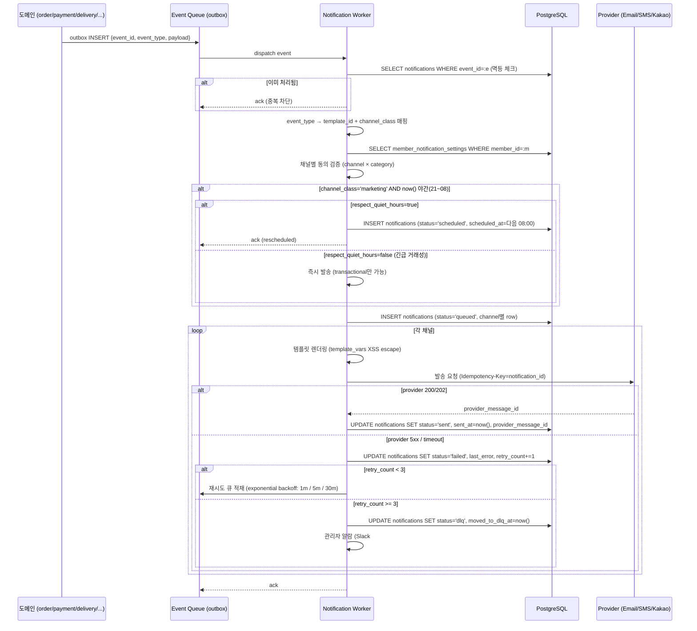
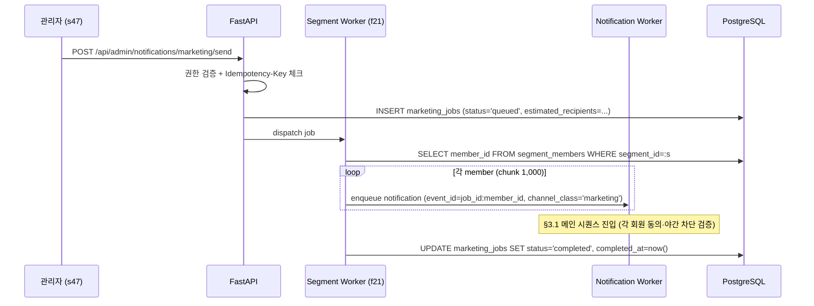

# f19 — 알림 기능정의서

- **박제일**: 2026-05-22 (v0.1) · 2026-05-23 갱신 (v0.2 — QA v4 prefix 통합 + 거래성/마케팅 분리 + 공통 보안 QA 매핑 보강)
- **단계**: S0 / Track 1 / Phase 4 / f19
- **상위 문서**: `00_index.md`
- **짝 도메인**: (전 도메인 횡단) `../05_도메인정의서/d11_회원.md` · `d16_주문.md` · `d18_배송.md` · `d19_리뷰_문의.md` · `d20_쿠폰_포인트.md`
- **짝 화면**: s32(알림 설정) · s47(마케팅·발송 이력)
- **QA 소스** (v4 통합 prefix — v3의 NOT-* 단독 카탈로그는 폐기, v4 에서 도메인별 분산 박제):
  - 회원 알림 설정: `쇼핑몰_전용_QA_v4.md §1` MEM-U-026~028 (마케팅 동의·알림 ON/OFF) · MEM-U-044 (쿠폰 만료 D-3 알림) · MEM-U-053~055 (SMS·카카오·채널별 ON/OFF) · MEM-A-028 (발송 이력) · MEM-A-034/035 (글로벌 채널·회원별 채널 현황)
  - 배송 알림: `쇼핑몰_전용_QA_v4.md §8` DEL-U-031 (주문완료 이메일+SMS) · DEL-U-032 (배송 시작 3채널) · DEL-A-031 (배송 지연 일괄 발송)
  - 마케팅 발송 (관리자): `쇼핑몰_전용_QA_v4.md §11` ADM-M-001~012 (마케팅 이메일·SMS·카카오 정책·발송 결과)
  - 쿠폰·포인트 알림: `쇼핑몰_전용_QA_v4.md §10` CPN-U-015 (쿠폰 만료 D-3) · CPN-U-027 (포인트 소멸 D-30)
  - 리뷰·문의 알림: `쇼핑몰_전용_QA_v4.md §9` REV-U-016 / REV-A-009/010 (1:1 문의 답변·Q&A 답변 알림)
  - 공통 보안: `공통_인프라_보안_QA.md §A-7` A-MAIL-001~010 (트랜잭션 이메일 — 거래성 발송 의무·재시도·SPF/DKIM·중복 발송 방지·큐·알림 설정 존중·푸시 토큰 만료·블랙리스트·이력) · `§B-5` B-MKTG-001~010 (마케팅 동의·야간 차단·[광고] prefix·List-Unsubscribe·수신거부·예약·재발송·통계·세그먼트) · `§A-8` A-LOG-002/003/011 (감사·민감정보·PII 마스킹) · `§A-9` A-NET-002 (HSTS)
  - 비기능: `99_비기능.md §5.3 §5.4` (표시광고법 / 정보통신망법 §50의5 야간 21~08 차단 / 전기통신사업법 만14세 미만 마케팅 차단)

---

## 1. 개요

- **기능명**: 채널 3종(이메일·SMS·카카오 알림톡) 발송 + 채널×카테고리 동의 검증 + 야간 마케팅 차단(21~08) + 트랜잭션 알림 vs 마케팅 알림 분리 + 멱등성(event_id) + 발송 실패 3회 재시도 + DLQ + 발송 이력 박제 + 관리자 발송 이력 조회·재발송
- **비즈니스 목적**: 거래 신뢰(주문·결제·배송 알림 SLA) + 마케팅 ROI(세그먼트 발송 + 수신거부) + 컴플라이언스(정보통신망법 야간 차단·동의 검증). 발송 실패율과 멱등성 정합성이 KPI. 거래성 알림 누락 = 즉시 CS 인입 폭증.
- **트리거**: 도메인 이벤트 (order.paid / order.shipped / delivery.delivered / inquiry.answered / coupon.issued / coupon.expired / point.earned / review.hidden / member.signed_up 등) · 마케팅 세그먼트 일괄 발송 (f21) · 재시도 배치 · DLQ 수동 재처리
- **액터**: 시스템(이벤트 구독·발송·재시도·이력 박제), 회원(알림 수신·수신거부), 관리자(마케팅 발송·이력 조회·재발송·정책 변경)
- **관련 화면**: s32 (사용자 알림 설정 — d11 member_notification_settings), s47 (관리자 마케팅 발송·이력)
- **관련 도메인**: (횡단) d11 회원(동의·설정), d16 주문(이벤트), d18 배송(이벤트), d19 리뷰·문의(이벤트), d20 쿠폰·포인트(이벤트), d21 관리자(권한·감사)

---

## 2. 입력·출력

### 2.1 내부 발송 API (POST `/internal/notifications/send`)

**참고**: 사용자 직접 호출 API 아님. 도메인 이벤트 구독 워커 또는 마케팅 모듈이 내부 호출. 인증 = 서비스 토큰.

**Request 헤더**: `X-Service-Token: ...`, `Idempotency-Key: {event_id}` 필수

**Request Body**:
```json
{
  "event_id": "evt_ord_paid_2026052200001",
  "event_type": "order.paid",
  "channel_class": "transactional",
  "member_id": "uuid",
  "channels": ["email", "sms", "kakao"],
  "template_id": "tpl_order_paid_v1",
  "template_vars": {
    "order_no": "ORD-20260522-000123",
    "amount": 56000,
    "items_count": 2
  },
  "scheduled_at": null
}
```

| 필드 | 타입 | 필수 | 검증 |
|---|---|---|---|
| event_id | string | Y | UNIQUE 멱등 키 (24h 캐시) |
| event_type | enum | Y | 도메인 이벤트 카탈로그 매칭 |
| channel_class | enum | Y | transactional / marketing (야간 차단·동의 검증 다름) |
| member_id | uuid | Y (개인) | 발송 대상 |
| channels | array | Y | ["email","sms","kakao"] 부분집합 |
| template_id | string | Y | templates 마스터 매칭 |
| template_vars | object | Y | 템플릿 변수 (XSS escape) |
| scheduled_at | datetime | N | 예약 발송 (NULL=즉시) |

**Response 202 (Accepted)**:
```json
{
  "notification_id": "uuid",
  "status": "queued",
  "channels_planned": ["email", "kakao"],
  "channels_skipped": [{"channel":"sms","reason":"consent_off"}]
}
```

### 2.2 마케팅 일괄 발송 (POST `/api/admin/notifications/marketing/send`)

**Request 헤더**: admin, `Idempotency-Key`

**Body**:
```json
{
  "campaign_id": "uuid",
  "segment_id": "uuid",
  "template_id": "tpl_marketing_summer_v1",
  "template_vars_per_member": false,
  "channels": ["email", "kakao"],
  "scheduled_at": "2026-06-01T10:00:00Z",
  "respect_quiet_hours": true
}
```

**Response 202**:
```json
{
  "job_id": "uuid",
  "estimated_recipients": 12345,
  "scheduled_at": "2026-06-01T10:00:00Z"
}
```

`respect_quiet_hours=true`(기본) 시 야간(21~08) 도달 발송은 다음 영업 시각(08:00)으로 자동 reschedule.

### 2.3 발송 이력 조회 (GET `/api/admin/notifications`)

**Query**: `member_id?, event_type?, channel?, status?, from?, to?, page=1`

**Response 200**:
```json
{
  "items": [
    {
      "notification_id": "uuid",
      "event_id": "...",
      "event_type": "order.paid",
      "member_id": "uuid",
      "channel": "kakao",
      "template_id": "tpl_order_paid_v1",
      "status": "sent",
      "sent_at": "...",
      "provider": "kakao_biz",
      "provider_message_id": "...",
      "retry_count": 0
    }
  ],
  "total": 1234,
  "page": 1
}
```

### 2.4 발송 재시도 (POST `/api/admin/notifications/{id}/retry`)

**Response 202**: `{notification_id, status: 'queued', retry_count: 1}`.

3회 실패 후 DLQ 진입 → 관리자 수동 재시도 가능. AuditLog 박제.

### 2.5 DLQ 조회 (GET `/api/admin/notifications/dlq`)

**Response 200**: `{items:[{notification_id, last_error, retry_count, moved_to_dlq_at}], total}`.

### 2.6 사용자 알림 설정 조회·갱신 (GET/PUT `/api/me/notification-settings`)

(d11 member_notification_settings 위임 — MEM-U-026~028, 053~055)

**Body (PUT)**:
```json
{
  "settings": [
    {"channel":"email","category":"marketing","enabled":false},
    {"channel":"sms","category":"order","enabled":true},
    {"channel":"kakao","category":"delivery","enabled":true}
  ]
}
```

**Response 200**: `{updated_count: 3}`.

### 2.7 수신거부 링크 (GET `/u/{token}/unsubscribe?category=marketing`)

이메일·SMS·알림톡 본문에 포함되는 1회용 토큰 링크. 클릭 시 즉시 마케팅 OFF + 회원 알림 설정 갱신 + AuditLog. 거래성 알림은 거부 불가(법정 의무).

---

## 3. 처리 흐름

### 3.1 도메인 이벤트 → 알림 발송 (메인 시퀀스)



### 3.2 채널별 동의 검증 로직

```python
def filter_channels(member_id, channels, category, channel_class):
    settings = SELECT * FROM member_notification_settings
                WHERE member_id=:m AND channel IN :channels AND category=:category

    result = []
    skipped = []
    for ch in channels:
        # 거래성 알림 (order, delivery, inquiry.answered 등) = 동의와 무관 발송
        if channel_class == 'transactional' and category in ['order', 'delivery']:
            result.append(ch)
            continue

        # 마케팅·혜택 = 동의 필수
        s = settings.get(ch)
        if s and s.enabled:
            result.append(ch)
        else:
            skipped.append({'channel': ch, 'reason': 'consent_off'})

    # 글로벌 채널 ON/OFF (관리자 정책 MEM-A-034) 추가 검증
    global_off = SELECT channels FROM global_policy WHERE off=TRUE
    result = [ch for ch in result if ch not in global_off]

    return result, skipped
```

### 3.3 야간(21~08) 마케팅 차단

```python
KST = timezone('Asia/Seoul')

def is_quiet_hours(now=None):
    now_kst = (now or datetime.now()).astimezone(KST)
    hour = now_kst.hour
    return hour >= 21 or hour < 8

def schedule_or_send(notification):
    if notification.channel_class != 'marketing':
        return send_now(notification)
    if is_quiet_hours():
        if notification.respect_quiet_hours:
            # 다음 08:00 KST로 reschedule
            next_dawn = compute_next_08(now_kst)
            UPDATE notifications SET status='scheduled', scheduled_at=next_dawn
        else:
            # 정책상 차단 (Q-NF05 권장 = 자동 차단)
            UPDATE notifications SET status='blocked', last_error='quiet_hours'
    else:
        send_now(notification)
```

### 3.4 마케팅 일괄 발송 (세그먼트)



### 3.5 재시도 배치 (exponential backoff)

```python
# 매 1분 polling
while pending := SELECT id, retry_count, last_failed_at FROM notifications
                  WHERE status='failed' AND retry_count < 3
                    AND last_failed_at + backoff(retry_count) <= now():
    for notif in pending:
        with transaction():
            if notifications.status != 'failed': continue  # 멱등
            UPDATE notifications SET status='queued'
            publish('notification.retry', notif.id)

def backoff(n):
    return {0: '1 minute', 1: '5 minutes', 2: '30 minutes'}[n]
```

### 3.6 수신거부 링크 처리

```mermaid
sequenceDiagram
    participant U as 사용자
    participant BE as FastAPI
    participant DB as PostgreSQL

    U->>BE: GET /u/{token}/unsubscribe?category=marketing
    BE->>DB: SELECT unsubscribe_tokens WHERE token=:t AND used_at IS NULL AND expires_at > now()
    alt 토큰 무효
        BE-->>U: 410 EXPIRED_LINK
    end
    BE->>DB: BEGIN
    BE->>DB: UPDATE member_notification_settings SET enabled=FALSE
              WHERE member_id=:m AND category='marketing' (전 채널)
    BE->>DB: UPDATE unsubscribe_tokens SET used_at=now()
    BE->>DB: INSERT audit_log (action='UNSUBSCRIBE', actor=member_id, category)
    BE->>DB: COMMIT
    BE-->>U: 200 + 수신거부 완료 페이지
```

### 3.7 트랜잭션 알림 vs 마케팅 알림 분류

| event_type | channel_class | category | 동의 검증 | 야간 차단 | 비고 |
|---|---|---|---|---|---|
| member.signed_up | transactional | order | X (회원 가입 환영) | X | 거래성 |
| order.paid | transactional | order | X (거래 의무) | X | 영수증 |
| order.shipping_started | transactional | delivery | X | X | 운송장 |
| delivery.delivered | transactional | delivery | X | X | 배송 완료 |
| order.cancelled / refunded | transactional | order | X | X | 환불 안내 |
| inquiry.answered | transactional | order | X (d19 F11 기본 ON) | X | CS 답변 |
| coupon.issued | transactional/marketing | benefit | △ (혜택 카테고리 동의) | △ (마케팅 분류 시 차단) | 가입·생일은 거래성 / 이벤트 발급은 마케팅 |
| coupon.expiring_soon | marketing | benefit | O | O | 마케팅 |
| point.earned | transactional | benefit | △ | △ | 적립 안내 (분류 보통 거래성) |
| point.expiring_soon | marketing | benefit | O | O | 소멸 임박 |
| review.hidden | transactional | order | X | X | 작성자 알림 (블라인드 사유) |
| marketing.* (세그먼트 발송) | marketing | marketing | O | O | f21 일괄 발송 |

### 3.8 알림 매트릭스 확장 — Tier 1 다건 처리 + 보안 이벤트 (★ NEW Tier 5 §3.1)

본 표는 §3.7 기본 분류를 Tier 1 (다건 처리) · Tier 3 (보안) · Tier 4 (운영) 이벤트로 확장한 통합 매트릭스입니다.

| 이벤트 | 발생 도메인 | 액터 | 채널 (default) | 분류 | 묶음 정책 | 야간 차단 | 비고 |
|---|---|---|---|---|---|---|---|
| **반품/교환 (Tier 1)** | | | | | | | |
| return.requested | d18 | 본인 + 관리자 | 이메일 | transactional | **1신청 1건** (라인 묶음) | X | Tier 1 §3.B |
| return.approved | d18 | 본인 | 이메일 + SMS | transactional | 1건 | X | 회수 운송장 |
| return.completed (환불) | d18 | 본인 | 이메일 | transactional | 1건 | X | 환불 완료 |
| exchange.requested | d18 | 본인 + 관리자 | 이메일 | transactional | **1그룹 1건** (Tier 1 §3.A) | X | 다건 교환 |
| exchange.approved | d18 | 본인 | 이메일 + SMS | transactional | 1건 | X | 차액 결제 안내 |
| exchange.completed | d18 | 본인 | 이메일 | transactional | 1건 | X | |
| **다건 처리 (Tier 1 §3.N)** | | | | | | | |
| order.partial_cancelled (부분) | d16 | 본인 | 이메일 | transactional | **1주문 1건** (라인별 묶음) | X | Tier 1 §3.N |
| order.shipping_started (shipment별) | d18 | 본인 | 이메일 + SMS + 카카오 | transactional | **shipment별 N알림** (예외 — 추적 편의) | X | Tier 1 §3.F |
| order.delivered (shipment별) | d18 | 본인 | 이메일 + 카카오 | transactional | shipment별 | X | Tier 1 §3.F |
| **보안/관리자 (Tier 3·4)** | | | | | | | |
| admin.logged_in_failed (5회) | d21 | SUPER + 대상 | 이메일 + Slack | (보안) | 1건 | X | 잠금 안내 |
| admin.role_changed | d21 | 대상 + SUPER | 이메일 + Slack | (보안) | 1건 | X | 권한 변경 |
| admin.mfa_reset | d21 | 대상 + SUPER | 이메일 + Slack | (보안) | 1건 | X | MFA 재발급 |
| policy.changed | d21 | SUPER 전원 | 이메일 + Slack | (보안) | **매일 1건 (다이제스트)** | X | Tier 4 §3.9 |
| system.health.alert (degraded/down) | d21 | 운영팀 + SUPER | Slack #ops | (운영) | 컴포넌트별 1건 | X | 즉시 (5분 이내) |
| maintenance.mode.changed | d21 | 사용자 (점검) + SUPER | 이메일 + 정적 페이지 | (운영) | 1건 | X | 점검 안내 |
| payment.anomaly_detected | d17 | SUPER | Slack #security | (보안) | 즉시 | X | 이상 거래 |
| payment.card_blocked | d17 | SUPER | Slack #security | (보안) | 즉시 | X | 카드 차단 |
| webhook.signature_invalid | d17·d18 | SUPER | Slack #security | (보안) | 즉시 | X | webhook 위조 (Tier 3 §3.6) |
| audit.inconsistency (Tier 2 §3.9) | (시스템) | SUPER | Slack #ops | (운영) | 1건 (분류별) | X | audit 불일치 |

### 3.9 다건 처리 알림 묶음 표준 (★ NEW — Tier 1 §3.N + Tier 5 §3.2)

```text
원칙: 1 액션 = 1 알림 (라인별 N건 알림 금지)

묶음 룰:
- 부분취소 N라인 = 1주문 1알림 (제목: "주문 ORD-... 일부 상품이 취소되었습니다")
- 부분반품 N라인 = 1신청 1알림
- 부분교환 N라인 (Tier 1 §3.A 다건 교환 그룹) = 1그룹 1알림
- 부분 배송 (Tier 1 §3.F 다건 출고) = shipment별 N알림 (★ 예외 — 추적 편의)

알림 본문 다건 표시 예:
"주문 ORD-20260522-000123 일부 상품이 취소되었습니다
- 라운드 반지 (블랙 M) × 1 (29,000원)
- 목걸이 (40cm) × 1 (42,000원)
환불 금액: 65,150원 (잔여 상품: 1건)
환불 예정일: 2026-05-25"

알림 묶음 메커니즘:
- 트리거 = order.partial_cancelled 단일 이벤트 (라인 N건 모두 포함)
- payload.items[] 배열에 라인별 상세 박제
- 템플릿에서 items 렌더링 (Mustache·Handlebars)
```

**룰** (Tier 5 §3.2):

| # | 룰 | 적용 |
|---|---|---|
| F-NOTIFY-BUNDLE-01 | 1 액션 = 1 알림 (라인별 N건 금지) | 다건 처리 |
| F-NOTIFY-BUNDLE-02 | payload.items[] 배열 + 템플릿 다건 렌더링 | 표준 |
| F-NOTIFY-BUNDLE-03 | 부분 배송 = shipment별 알림 (예외) | Tier 1 §3.F |
| F-NOTIFY-BUNDLE-04 | 환불 1건 = 1 알림 (PG 호출 단위) | Tier 1 §3.O |

---

## 4. 검증 룰

### 4.1 입력 검증

| 필드 | 룰 | 위반 코드 |
|---|---|---|
| event_id | UNIQUE 24h 캐시 | 중복 시 멱등 200 |
| event_type | 카탈로그 매칭 | 422 INVALID_EVENT_TYPE |
| channels | enum 부분집합 | 422 |
| template_id | templates 마스터 존재 | 422 INVALID_TEMPLATE |
| template_vars | 필수 키 매칭 + XSS escape | 422 MISSING_TEMPLATE_VAR |
| member_id | 활성 회원 (status='active') | 410 MEMBER_INACTIVE |
| scheduled_at | now() ≤ scheduled_at ≤ now+90d | 422 |

### 4.2 비즈니스 룰

| 룰 | 적용 | 근거 |
|---|---|---|
| **거래성 알림 (order/delivery/inquiry.answered) = 동의 무관 발송** (법정 의무) | 발송 | d19 F11, 99_비기능 §5.3 표시광고법, A-MAIL-001 |
| **마케팅 알림 = 채널별 동의 필수** (member_notification_settings.enabled=true) | 발송 | d11 MEM-U-026~028/055, MEM-A-034, B-MKTG-001 |
| **알림 채널별 독립 동의** (이메일·SMS·카카오 각각 ON/OFF) — 한 채널 OFF 다른 채널 ON 정확 처리 | 동의 | MEM-U-055, MEM-A-035 |
| **마케팅 수신 거부 vs 거래성 메일 분리** = 마케팅 OFF 회원도 인증·비밀번호 재설정·주문/배송 안내는 계속 수신 | 분리 | A-MAIL-001, B-MKTG-005, F-MARKETING-06 |
| **마케팅 이메일 발송 대상 자동 필터** = 마케팅 동의 회원만 (B-MKTG-001) + 채널별 동의 회원만 + 휴면 90일+ 자동 제외 | 발송 | B-MKTG-001, ADM-M-001/008 |
| **수신거부 처리 후 즉시 미발송** = AuditLog 기록 + 다음 발송부터 자동 차단 | 수신거부 | B-MKTG-005, ADM-M-008 |
| **List-Unsubscribe 헤더 + 본문 1클릭 수신거부 링크** | 이메일 | B-MKTG-004, ADM-M-005 |
| **이메일 제목 [광고] prefix 의무** (정보통신망법 §50) | 마케팅 이메일 | B-MKTG-003, ADM-M-004, 99_비기능 §5.3 |
| **야간 21~08 마케팅 발송 차단** (Q-NF05 권장 = 자동 차단 → 다음 08:00 reschedule) | 발송 | 99_비기능 §5.4, B-MKTG-002, ADM-M-003 |
| 글로벌 채널 OFF (관리자 정책 MEM-A-034) 시 사용자 설정과 무관 미발송 | 발송 | d11 MEM-A-034 |
| **멱등성** event_id UNIQUE → 중복 발송 차단 | 발송 | f14 F-PAY-04 패턴, A-API-011, A-MAIL-004 |
| **동일 수신자 1시간 내 동일 유형 중복 발송 방지** | 발송 | A-MAIL-004 |
| 발송 실패 3회 재시도 (exponential backoff 1m/5m/30m) | 재시도 | 99_비기능 §3.3 BullMQ DLQ, A-MAIL-002 |
| 3회 초과 실패 → DLQ + 관리자 알람 | 재시도 | 99_비기능 §3.3 |
| **대량 발송 큐(BullMQ) + 큐 장애 시 메시지 유실 방지** | 큐 | A-MAIL-006, B-MKTG-007 |
| **마케팅 일괄 발송 중 시스템 장애** = 발송된 건·미발송 건 구분 + 재발송 가능 | 일괄 | B-MKTG-007 |
| **마케팅 대량 발송 예약** (날짜·시간 설정) → 예약 시각 발송 | 예약 | B-MKTG-006, ADM-M-002 |
| **발송 결과 통계 조회** (발송 수·수신 성공·실패·수신거부 수 집계) | 통계 | B-MKTG-008, ADM-M-006/010/012 |
| **회원 등급·태그 세그먼트 발송** = 조건 외 회원 미발송 | 세그먼트 | B-MKTG-010, f21 §3.2 방어선 |
| **장바구니 이탈 리마인더** = N시간 미구매 회원에게만 발송, 구매 완료 시 발송 취소 | 자동 트리거 | B-MKTG-009 |
| **마케팅 자동 발송 트리거** = 도메인 이벤트(cart.abandoned · point.expiring · coupon.expiring · birthday) 매칭 + 세그먼트 정책 결합 | 자동 발송 | B-MKTG-009/010, f21 §3.4 |
| 거래성 알림 누락 SLA = 발생 후 5분 내 발송 (P95) | 발송 | 99_비기능 §1.2, A-MAIL-002 |
| 채널 3종 한정 (이메일·SMS·카카오 알림톡) — 푸시·웹푸시 미도입 (Q-03) | 발송 | Q-03 권장 = 3채널 (사장님 verbatim) |
| **카카오 알림톡 = 사전 등록 템플릿만** (카카오 비즈 메시지 정책) | 발송 | T-01-NOT 미결 (템플릿 등록 프로세스), ADM-M-011 |
| **이메일 템플릿 8종 미리보기** (주문확인/발송/리뷰요청/쿠폰/포인트/생일/비밀번호재설정/가입환영) | 템플릿 | ADM-M-007 |
| **SMS 발송 ON/OFF 개별 제어** (주문완료·배송시작·배송완료) | 채널 | ADM-M-009, MEM-U-053 |
| **카카오 알림톡 발송 ON/OFF 개별 제어** (주문·배송·취소·반품 이벤트별) | 채널 | ADM-M-011, MEM-U-054 |
| 발송 이력 박제 (notifications row) = member_id·channel·event·sent_at·status | 발송 | 99_비기능 §7.1 구조화 로그, MEM-A-028, A-MAIL-010 |
| **알림 발송 이력 회원별 조회** (관리자) = 이메일·앱·SMS·카카오 발송 기록 | 이력 | MEM-A-028, A-MAIL-010 |
| **푸시 알림 토큰 만료 시 재등록 유도** (Phase 2 푸시 도입 시) | 토큰 | A-MAIL-008 |
| **이메일 발송 서버 IP 블랙리스트 비등재 확인** | 인프라 | A-MAIL-009 |
| **SPF·DKIM·DMARC 레코드 설정** (스팸 필터 방지) | 인프라 | A-MAIL-003 |
| 수신거부 = 1회용 토큰 + 1클릭 + AuditLog | 수신거부 | 99_비기능 §5.3 (수신거부 무료 의무) |
| **거래성 알림 수신거부 불가** (법정 의무 — 주문/배송 안내) | 수신거부 | 99_비기능 §5.3, A-MAIL-001, F-MARKETING-06 |
| 마케팅 발송 = 광고 표기 의무 (제목에 [광고], 본문 하단 수신거부 링크) | 발송 | 99_비기능 §5.4, B-MKTG-003/004 |
| 만 14세 미만 회원 = 마케팅 발송 차단 | 발송 | 99_비기능 §5.4 (전기통신사업법), A-COMP-005, F-MARKETING-04 |
| 정지·블랙리스트·탈퇴 회원 = 발송 즉시 차단 | 발송 | d11 MEM-A-002~006 |
| **템플릿 변수 XSS escape** (HTML 이스케이프) | 렌더링 | 99_비기능 §4.8 F-XSS-01, A-MAIL-005, A-INJ-002 |
| **PII 마스킹** = 발송 본문 외 로그·이력 컬럼은 마스킹 (전화번호 010-****-1234 등) | 이력 | 99_비기능 §7.1, A-LOG-011, F-LOGMASK-01 |
| **로그에 비밀번호·토큰·민감정보 미기록** | 로그 | A-LOG-003, F-LOGMASK-01 |
| **rate limit** = 발송 API · 수신거부 endpoint 각각 표준 적용 (99_비기능 §4.10) | 보안 | F-RATE-01, A-API-004 |

---

## 5. 트랜잭션·동시성

### 5.1 outbox → notification 발송 트랜잭션

```python
# 도메인 트랜잭션 종료 후 outbox dispatch (eventual consistency)
def dispatch_event(outbox_row):
    with transaction(isolation=READ_COMMITTED):
        # 멱등 (event_id UNIQUE)
        try:
            INSERT notifications_events (event_id, event_type, dispatched_at=now())
        except UniqueViolation:
            return  # 이미 처리됨

        # 채널 동의 필터 + 야간 차단
        channels, skipped = filter_channels(...)
        if not channels:
            INSERT notifications (status='skipped', skipped_reason='no_eligible_channels')
            return

        for ch in channels:
            INSERT notifications (id, event_id, channel=ch, status='queued',
                                   member_id, template_id, ...)
            publish_to_provider_queue(notification_id, channel=ch)
```

### 5.2 provider 발송 트랜잭션 (외부 호출 + 상태 갱신)

```python
def send_to_provider(notification_id):
    notif = SELECT FOR UPDATE FROM notifications WHERE id=:id
    if notif.status != 'queued': return  # 멱등

    try:
        # 외부 호출은 트랜잭션 외부 (DB 락 짧게)
        rendered = render_template(notif.template_id, notif.template_vars)
        provider_resp = provider.send(notif.channel, notif.member_contact, rendered,
                                       idempotency_key=notif.id)

        with transaction():
            UPDATE notifications SET status='sent', sent_at=now(),
                   provider_message_id=provider_resp.id WHERE id=:id

    except ProviderError as e:
        with transaction():
            UPDATE notifications SET status='failed', last_error=str(e),
                   retry_count = retry_count + 1, last_failed_at=now() WHERE id=:id
            if notif.retry_count + 1 >= 3:
                UPDATE notifications SET status='dlq', moved_to_dlq_at=now()
                publish('notification.dlq', notif.id)
```

### 5.3 동시성 시나리오

| 시나리오 | 메커니즘 |
|---|---|
| 동일 event_id 동시 발송 요청 | notifications_events UNIQUE(event_id) → 1건만 dispatch |
| 마케팅 일괄 발송 중 회원 탈퇴 | 발송 직전 SELECT members.status 재확인 → 'withdrawn'면 skip + INSERT 'skipped' row |
| 동시 수신거부 + 발송 | 발송 직전 SELECT member_notification_settings 재확인 → enabled=false면 skip |
| provider 응답 지연으로 timeout + 실제 발송 성공 | provider idempotency_key=notification_id → 중복 발송 방지, status 갱신은 webhook 또는 polling |
| 야간 reschedule 동시 다수 도달 | scheduled_at = next 08:00, scheduler가 08:00에 batch 처리 (rate limit 적용) |
| DLQ 수동 재시도 + 자동 재시도 | DLQ 진입 후 자동 재시도 중단, 관리자 재시도만 status='queued' 전환 (낙관락 version) |

### 5.4 멱등성 키 체계

| 작업 | 키 |
|---|---|
| outbox dispatch | `event_id` (UNIQUE notifications_events) |
| 마케팅 일괄 발송 | `f"{job_id}:{member_id}"` |
| provider 발송 | `notification_id` (provider Idempotency-Key) |
| 재시도 | `notification_id` (동일 키 재사용) |
| 수신거부 토큰 | UNIQUE token + used_at NULL |

---

## 6. 에러 처리

| HTTP | 도메인 코드 | 시나리오 | 처리 |
|---|---|---|---|
| 200 | (멱등) | 동일 event_id 재요청 | 기존 notification 응답 |
| 202 | QUEUED | 정상 큐 적재 | (정상) |
| 401 | UNAUTHORIZED | 서비스 토큰 무효 (내부 API) | 호출 차단 |
| 403 | ADMIN_REQUIRED | 마케팅 일괄 발송 권한 없음 | 차단 |
| 410 | MEMBER_INACTIVE | 정지·탈퇴 회원 | INSERT notifications status='skipped' |
| 410 | EXPIRED_LINK | 수신거부 토큰 만료 | 사용자에게 안내 페이지 |
| 422 | INVALID_EVENT_TYPE | 카탈로그 미매칭 | 호출자 수정 필요 |
| 422 | INVALID_TEMPLATE | 템플릿 없음 / 변수 누락 | 호출자 수정 + 알람 |
| 422 | MISSING_TEMPLATE_VAR | 필수 변수 누락 | 호출자 수정 |
| 423 | QUIET_HOURS_BLOCKED | 마케팅 야간 도달 + respect_quiet_hours=false | INSERT status='blocked' (운영자만 가능) |
| 429 | PROVIDER_RATE_LIMIT | provider rate limit | 재시도 큐 + backoff |
| 500 | PROVIDER_ERROR | provider 5xx | retry_count++ → 3회 후 DLQ |
| 504 | PROVIDER_TIMEOUT | provider 응답 없음 | retry_count++ → 3회 후 DLQ |

### 6.1 사용자 가시 에러 (수신거부 페이지)

| 케이스 | 메시지 |
|---|---|
| 정상 처리 | "수신거부가 완료되었습니다." |
| 토큰 만료 | "링크가 만료되었습니다. 마이페이지 → 알림 설정에서 수신거부할 수 있습니다." |
| 토큰 사용됨 | "이미 처리된 요청입니다." |

---

## 7. 성능·캐시

| 지표 | 목표 |
|---|---|
| 내부 발송 API P95 | < 200ms (큐 적재까지) |
| 거래성 알림 발송 SLA P95 | < 5초 (이벤트 발생 → provider 전송) |
| 마케팅 일괄 발송 처리량 | 10,000 건/분 |
| 야간 reschedule 08:00 일괄 처리 | 100,000 건/30분 (rate limit 고려) |
| 재시도 배치 처리량 | 1,000 건/분 |
| 발송 이력 조회 P95 | < 300ms (필터 인덱스) |
| DLQ 진입율 | < 0.5% (전체 발송 대비) |

**캐시 전략**:

| 키 | TTL | 무효화 |
|---|---|---|
| `member_notification_settings:{member_id}` | 5분 | 사용자 설정 변경 시 PURGE |
| `template:{id}` | 1시간 | 템플릿 수정 시 PURGE |
| `global_channel_policy` | 5분 | 관리자 정책 변경 시 PURGE |
| `event_id:{id}` (멱등 캐시) | 24시간 | 자동 expire |
| `member_contact:{member_id}` (이메일/전화 캐시) | 1시간 | 회원 프로필 수정 시 PURGE |

**큐 인프라**: BullMQ + Redis (99_비기능 §3.3). 큐 분리 = `notifications:transactional` (우선순위 high), `notifications:marketing` (low), `notifications:retry` (별도), `notifications:dlq` (격리).

**인덱스**: `notifications.idx_event_id`(UNIQUE), `idx_member_id_sent_at`, `idx_status_scheduled_at`(scheduler 폴링), `idx_status_last_failed_at`(retry 배치), `idx_channel_status`, `notifications_events.PK(event_id)`, `unsubscribe_tokens.PK(token)` + `idx_member_id`, `templates.PK(id)`.

---

## 8. 테스트 케이스

### 8.1 유닛

- event_type → template_id × channel_class 매핑
- filter_channels (transactional + order 카테고리 → 동의 무관 통과 / marketing + 동의 OFF → skip)
- is_quiet_hours (20:59 / 21:00 / 07:59 / 08:00 경계값, KST 기준)
- compute_next_08 (현재 22:00 → 다음 08:00 / 06:00 → 같은 날 08:00)
- 템플릿 렌더링 (변수 치환 + XSS escape `<` → `&lt;`)
- backoff 계산 (retry_count 0→1m, 1→5m, 2→30m)
- 멱등 체크 (동일 event_id 재호출 → 기존 row 반환)

### 8.2 통합

- order.paid 이벤트 → 거래성 알림 3채널 발송 (이메일·SMS·카카오) + notifications row 박제
- 동의 OFF 회원에게 marketing 발송 → channels_skipped 응답 + INSERT 'skipped' row
- 야간 22:00 marketing 발송 요청 → 다음 08:00 scheduled 전환
- 거래성 알림은 야간이어도 즉시 발송 (order.paid 23:00)
- provider 5xx 응답 → retry 1m 후 재시도 → 3회 실패 → DLQ 진입 + Slack 알람
- 동일 event_id 2회 요청 → 1건만 발송 (UNIQUE 멱등)
- 마케팅 일괄 발송 1,000명 → 동의 OFF 200명 skip, 800명 발송
- 발송 도중 회원 탈퇴 → 발송 직전 status 재확인 → skip
- 수신거부 링크 클릭 → 마케팅 전 채널 OFF + AuditLog
- 수신거부 토큰 재사용 → 410 EXPIRED_LINK
- 거래성 카테고리 수신거부 시도 → 차단 (UI에서 토글 비활성)
- 만 14세 미만 회원에게 marketing 발송 시도 → 차단 + skipped
- inquiry.answered 이벤트 → 이메일+SMS 즉시 발송 (d19 F11)
- review.hidden 이벤트 → 작성자에게 블라인드 사유 안내 이메일
- coupon.expiring_soon (D-3) → 마케팅 채널 검증 후 발송 (야간 차단 적용)
- 정합성: notifications 이력 SUM(status=sent) vs provider report 일치 검증

### 8.3 E2E (Playwright)

- 결제 완료 → 5초 내 이메일 수신 박스 확인 (또는 stub provider 로그)
- 마이페이지 → 알림 설정 → 카카오 마케팅 OFF → 다음 마케팅 발송 시 카카오 미발송 확인
- 이메일 본문의 수신거부 링크 클릭 → 수신거부 완료 페이지 → 마이페이지 알림 설정 동기화
- 관리자 → s47 마케팅 발송 → 발송 이력 조회 → 채널별 success/failed 카운트 확인
- 관리자 → DLQ 조회 → 재시도 버튼 → status='queued' 전환 확인
- 야간 22:00 마케팅 발송 → 다음 날 08:00에 실제 발송 확인

### 8.4 QA 추적 (v4 통합 prefix — v3 NOT-* 단독 카탈로그 폐기, 도메인별 분산 박제로 정정)

- `쇼핑몰_전용_QA_v4.md §1` (회원 알림 설정·동의):
  - 사용자: MEM-U-026 (마케팅 동의 ON/OFF) · MEM-U-027 (알림 ON/OFF 개별) · MEM-U-028 (OFF 회원 미발송) · MEM-U-044 (쿠폰 만료 D-3 알림) · MEM-U-053~055 (SMS·카카오·채널별 ON/OFF)
  - 관리자: MEM-A-028 (발송 이력) · MEM-A-034 (글로벌 채널) · MEM-A-035 (회원별 채널 현황)
- `쇼핑몰_전용_QA_v4.md §8` (배송 알림 트리거): DEL-U-031/032 (멀티채널) · DEL-A-031 (배송 지연 일괄 발송) · DEL-A-013/014B (반품 거절/검수 결과 알림) · DEL-A-009 (배송완료 알림)
- `쇼핑몰_전용_QA_v4.md §9` (리뷰·문의 알림): REV-A-003 (리뷰 숨김) · REV-A-009/010 (1:1 문의·Q&A 답변 알림) · REV-U-016 (1:1 답변 이메일)
- `쇼핑몰_전용_QA_v4.md §10` (쿠폰·포인트 알림): CPN-U-015 (쿠폰 만료 D-3) · CPN-U-027 (포인트 소멸 D-30) · CPN-A-022 (소멸 D-N 정책 설정)
- `쇼핑몰_전용_QA_v4.md §11` (관리자 마케팅·SMS·카카오): ADM-M-001 (마케팅 동의 회원 필터) · ADM-M-002 (예약 발송) · ADM-M-003 (야간 차단 게이트) · ADM-M-004 ([광고] prefix) · ADM-M-005 (List-Unsubscribe) · ADM-M-006/010/012 (발송 결과 통계) · ADM-M-007 (템플릿 8종 미리보기) · ADM-M-008 (수신거부 스킵) · ADM-M-009/010 (SMS 정책·결과) · ADM-M-011/012 (카카오 알림톡 정책·결과)
- `공통_인프라_보안_QA.md §A-7` (트랜잭션 이메일·알림): A-MAIL-001~010 전수 매핑 (거래성 발송 의무·재시도·SPF/DKIM·중복 발송 방지·XSS·큐·OFF 회원 미발송·푸시 토큰·블랙리스트·이력)
- `공통_인프라_보안_QA.md §B-5` (마케팅·대량 알림): B-MKTG-001~010 전수 매핑 (동의·야간·[광고]·List-Unsubscribe·수신거부·예약·재발송·통계·장바구니 이탈·세그먼트)
- `공통_인프라_보안_QA.md §A-8`: A-LOG-002 (관리자 발송 박제) · A-LOG-003 (민감정보 미기록) · A-LOG-011 (PII 마스킹)
- `공통_인프라_보안_QA.md §A-2`: A-API-004 (rate limit) · A-API-011 (멱등성 키)
- `공통_인프라_보안_QA.md §A-3`: A-INJ-002 (Stored XSS 차단 — 템플릿 변수)
- `공통_인프라_보안_QA.md §A-10`: A-COMP-005 (만 14세 미만 차단)
- `99_비기능.md §5.3 §5.4`: 표시광고법·정보통신망법(§50의5 야간 21~08)·전기통신사업법(만 14세 미만 마케팅 차단)·수신거부 무료 의무
- `99_비기능.md §4.10`: F-RATE-01~06 (rate limit 표준)
- `99_비기능.md §4.8`: F-XSS-01~03 (XSS 차단 룰)
- `99_비기능.md §7.8`: F-LOGMASK-01~04 (로그 마스킹 자동 검증)

---

## 9. 미결

| ID | 항목 | 미결 사유 |
|---|---|---|
| f19-Q01 | 이메일 provider 선정 — SendGrid vs Amazon SES | T-NF02 / T-NF03 연계. 권장 = Amazon SES (비용 효율) + SendGrid 백업 |
| f19-Q02 | SMS provider 선정 — NHN Cloud vs KT API vs 알리고 | 발송량·단가 비교 필요. 권장 = NHN Cloud (개발자 친화) |
| f19-Q03 | 카카오 알림톡 — 비즈니스 채널 등록 시점 + 템플릿 사전 등록 프로세스 | 카카오 비즈 메시지 정책상 템플릿 사전 등록 필수 (T-01-NOT 신설) |
| f19-Q04 | 야간 21~08 마케팅 차단 정책 (Q-NF05) | `_미결사항_통합관리.md` Q-NF05 권장 = 자동 차단 (정보통신망법) — 사장님 확정 필요 |
| f19-Q05 | 거래성 vs 마케팅 분류 — coupon.issued (가입/생일=거래성, 이벤트=마케팅) 경계 | 운영 정책 — 권장 = issue_trigger 기준 분기 (SIGNUP/BIRTHDAY=transactional, MANUAL/EVENT_CODE=marketing) |
| f19-Q06 | 채널 3종 외 푸시·웹푸시 추가 여부 (Q-03) | `_미결사항_통합관리.md` Q-03 권장 = 3채널 한정 (앱 없음 제약과 일치) |
| f19-Q07 | DLQ 진입 후 자동 재시도 vs 운영 수동 처리 | 권장 = 운영 수동 + 일일 리포트 |
| f19-Q08 | 발송 실패 알람 임계 (% / 절대 건수) | 99_비기능 §7.3 미정 — 권장 = 5분간 실패율 5% 이상 시 Slack |
| f19-Q09 | 수신거부 카테고리 단위 (전 채널 일괄 vs 채널별) | 권장 = 전 채널 일괄 (UX 간소화) + 마이페이지에서 채널별 토글 |
| f19-Q10 | 카카오 알림톡 미수신 시 SMS 자동 fallback 여부 | 카카오 정책상 fallback 가능 (비용 추가) — 사장님 결정 |
| f19-Q11 | 마케팅 발송 광고 표기 형식 ([광고] 제목 prefix vs 본문 명시) | 99_비기능 §5.4 — 권장 = 제목 prefix + 본문 하단 수신거부 링크 |
| f19-Q12 | 점검 모드(Q-11) 중 알림 큐 처리 (즉시·큐잉·거부) | Q-11 연계 — 권장 = 큐잉 + 점검 종료 후 일괄 처리 |

> 본 미결은 `../_미결사항_통합관리.md §3`에 append.

---

## 10. 변경 이력

| 버전 | 일자 | 변경 |
|---|---|---|
| v0.1 | 2026-05-22 | 최초 박제 (S0 / Phase 4) |
| v0.2 | 2026-05-23 | QA v4 통합 prefix 정정 (v3 NOT-* 단독 카탈로그 폐기 → v4 도메인별 분산 박제). 채널별 독립 동의·마케팅/거래성 분리·자동 발송 트리거·세그먼트 룰 신설. A-MAIL-001~010 전수 매핑 + B-MKTG-001~010 전수 매핑 + ADM-M-001~012 전수 매핑 + DEL-U-031/032 / DEL-A-031 / CPN-U-015 / CPN-U-027 / MEM-A-028/034/035 보강. XSS·rate limit·PII 마스킹·로그 마스킹 등 공통 보안 룰 매핑 추가 |
