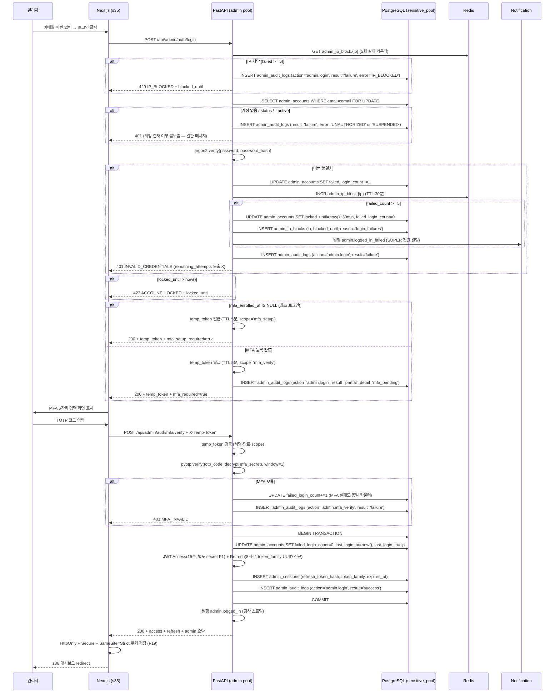
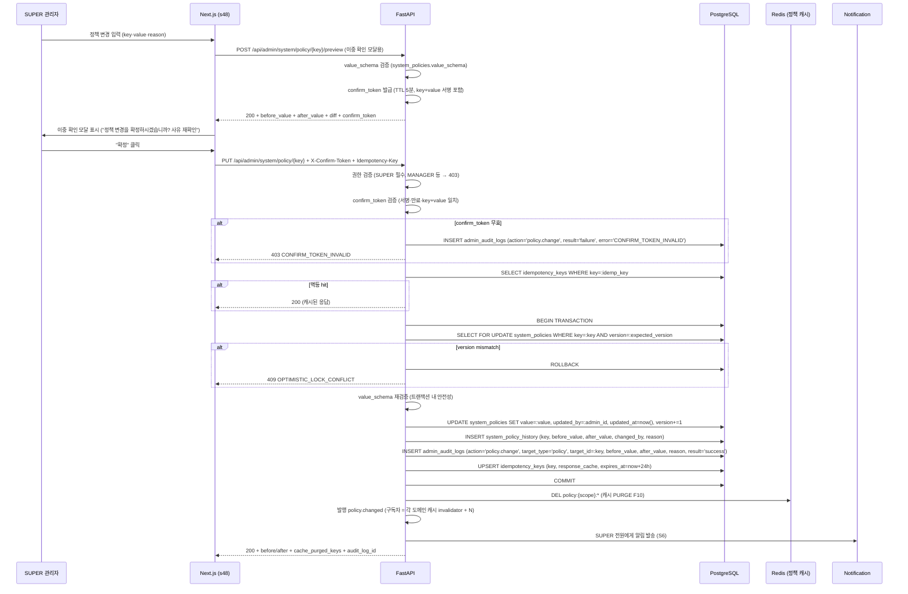
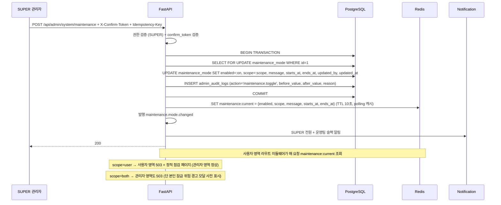

# f20 — 관리자 운영 기능정의서 (★ 보안 강화 영역)

- **박제일**: 2026-05-22
- **갱신**: 2026-05-22~23 (QA v4 §11 ⚙️ Admin 전용 직접 비교 후 prefix·합계 전면 정정)
- **단계**: S0 / Track 1 / Phase 4 / f20
- **상위 문서**: `00_index.md`
- **짝 도메인**: `../05_도메인정의서/d21_관리자.md` (admin_accounts·admin_sessions·admin_audit_logs·system_policies·system_policy_history·system_health·maintenance_mode·admin_ip_blocks)
- **짝 화면**: s35(관리자 로그인) · s36(대시보드) · s48(시스템 정책) · s49(관리자 계정·감사 로그·시스템 헬스 통합)
- **QA 소스**: `쇼핑몰_전용_QA_v4.md §11 ⚙️ Admin 전용` (ADM-D 5 + ADM-N 5 + ADM-F 5 + ADM-B 7 + ADM-M 12 + ADM-P 8 + ADM-R 10 + ADM-S 11 = 57건) + `공통_인프라_보안_QA.md §A-1 / §A-2 / §A-7 / §A-8 / §A-COMP / §B-9 / §B-11`

> **2026-05-22~23 갱신 메모 (★ 중대 정정 — d21 짝 정의서 동시 정정)**:
> - **prefix 전면 정정**: v0.1 박제 시 사용한 ADM-A-* / AUD-A-* / SYS-A-* 가상 prefix는 v4 §11에 존재하지 않음. v4 실제 prefix = ADM-D / ADM-N / ADM-F / ADM-B / ADM-M / ADM-P / ADM-R / ADM-S 8종(57건). §4.2 검증 룰 근거·§8.4 QA 추적·§9 미결 QA 컬럼 전구간 v4 실 prefix로 재정정.
> - **ADM-S-005 오인용 정정**: f20 v0.1 §4.2/§8.4에서 "ADM-S-005 = SUPER 최소 1명 유지"로 인용했으나 **실제 ADM-S-005 = 약관 관리(이용약관·개인정보처리방침·마케팅 동의 텍스트 수정)** 시나리오. SUPER 최소 1명 유지 룰은 v4 §11에 직접 박제 없음 → f20 신규 강화 룰(F11)로 박제 보존.
> - **역할 enum 불일치**: f20 §1/§4.3 = SUPER/MANAGER/CS/MARKETER 4-role. v4 ADM-R-007 = SUPER/OPERATION/CS 3-role 박제. → d21 미결 Q7 / f20 미결 f20-Q11 신규 박제.
> - **v4 신규 항목 = f20 §3.7 ★ NEW Tier 4 강제 조치 매트릭스에 일부 흡수 박제됨**(블랙리스트·정지·약관·캐시 등) — 추가 흡수 보강은 §4.2 / §8.4 에 한정 박제.

---

## 1. 개요

- **기능명**: 관리자 로그인(MFA TOTP) · 세션 관리(Access 15분 / Refresh 8시간) · IP 차단(5회 실패 30분) · 모든 write 액션의 AuditLog 자동 박제 · 시스템 정책 변경(SUPER 권한 + 이중 확인 + 사유 + 캐시 PURGE) · 시스템 헬스 모니터링(5초 polling) · 점검모드 ON/OFF (Q-11 미결 박제) · 관리자 계정 CRUD (SUPER 전용, MFA secret 재발급 포함)
- **비즈니스 목적**: **Backstage 횡단 도메인** — 모든 도메인의 정책 변경 1차 진입점, 모든 운영 행위의 감사 증적, 시스템 가용성 모니터링의 단일 통제실. d21 도메인(admin)이 제공하는 인프라(시크릿 분리·DB pool 분리·MFA·AuditLog schema) 위에 본 기능정의서가 11개 사용자 도메인(d11~d20)의 **정책·감사·헬스·점검** 통제 흐름을 구현. 보안 사고(관리자 계정 탈취 / 정책 무단 변경 / 감사 로그 변조)는 전 도메인 신뢰 붕괴 직결.
- **트리거**: 관리자 로그인(s35), MFA 코드 입력, 정책 변경 PUT 요청, 헬스 체크 polling 만료(30초), 헬스 status=down/degraded 전이, 점검모드 토글, 관리자 계정 CRUD, IP 차단 자동·수동 등록, 감사 로그 조회·익스포트
- **액터**: 관리자(SUPER / MANAGER / CS / MARKETER 4 role), 시스템(헬스 polling·IP 차단 자동·캐시 PURGE·AuditLog 자동 박제 미들웨어), 외부 PG·Mail·SMS·카카오·CDN·Storage(헬스 체크 대상)
- **관련 화면**: s35(로그인) → s36(대시보드) → s48(시스템 정책 통합 진입점) / s49(관리자 계정·감사 로그·시스템 헬스 통합 — I-01 확정)
- **관련 도메인**: d21 관리자(본 기능의 책임 도메인), d11~d20 (모든 사용자 도메인 — 본 기능을 통해 정책·감사 통제)

---

## 2. 입력·출력

### 2.1 관리자 로그인 1차 (POST `/api/admin/auth/login`)

**Request 헤더**: `Content-Type: application/json`. 인증 헤더 없음(public admin endpoint).

**Request Body**:
```json
{
  "email": "admin@example.com",
  "password": "..."
}
```

| 필드 | 타입 | 필수 | 검증 |
|---|---|---|---|
| email | string | Y | RFC 5322 + 소문자 정규화 |
| password | string | Y | 12자↑ + 영문대/소/숫자/특수문자 모두 (F17, A-AUTH-001) |

**Response 200**:
```json
{
  "mfa_required": true,
  "temp_token": "...",
  "temp_token_expires_in": 300
}
```

**Response 423**: `{"error": "ACCOUNT_LOCKED", "locked_until": "2026-05-22T15:30:00Z"}`
**Response 429**: `{"error": "IP_BLOCKED", "blocked_until": "..."}` (5회 실패 30분, P4)

### 2.2 MFA TOTP 검증 (POST `/api/admin/auth/mfa/verify`)

**Request 헤더**: `X-Temp-Token: {temp_token}` (1차 로그인 응답값, 5분 유효)

**Request Body**:
```json
{"totp_code": "123456"}
```

**Response 200**:
```json
{
  "access_token": "...",
  "refresh_token": "...",
  "access_expires_in": 900,
  "refresh_expires_in": 28800,
  "admin": {
    "id": "uuid",
    "name": "운영자A",
    "role": "MANAGER",
    "last_login_at": "2026-05-22T15:23:00Z",
    "last_login_ip": "203.0.113.5"
  }
}
```

**Response 401**: `{"error": "MFA_INVALID", "remaining_attempts": 2}`

### 2.3 MFA 최초 등록 (POST `/api/admin/auth/mfa/setup` → enroll)

**Setup Response 200**:
```json
{
  "secret": "JBSWY3DPEHPK3PXP",
  "qr_code_url": "otpauth://totp/shop:admin@example.com?secret=...&issuer=shop",
  "backup_codes": ["A1B2-C3D4", "...(10개)"]
}
```

**Enroll Body**: `{"totp_code": "123456"}` → 200 (mfa_enrolled_at SET)

### 2.4 시스템 정책 변경 (PUT `/api/admin/system/policy/{key}`)

**Request 헤더**:
- `Authorization: Bearer {access_token}` (SUPER 필수)
- `X-Confirm-Token: {confirm_token}` (이중 확인 — 변경 미리보기 응답값, 5분 유효)
- `Idempotency-Key: {uuid}` (필수, F-PAY-04 동등 룰 적용)

**Request Body**:
```json
{
  "value": {"threshold": 50},
  "reason": "VIP 등급 기준 상향 — 2026 Q3 마케팅 정책 변경 (사장님 승인 #2026-0419)",
  "expected_version": 7
}
```

| 필드 | 타입 | 필수 | 검증 |
|---|---|---|---|
| value | json | Y | system_policies.value_schema 통과 |
| reason | string | Y | 10자↑ (F9 사유 필수) |
| expected_version | int | Y | system_policies.version 일치 (낙관락) |

**Response 200**:
```json
{
  "key": "member.signup.bonus_points",
  "before_value": 3000,
  "after_value": 5000,
  "version": 8,
  "cache_purged_keys": ["policy:member:*"],
  "audit_log_id": "uuid"
}
```

### 2.5 시스템 헬스 조회 (GET `/api/admin/system/health`)

**Response 200**:
```json
{
  "fetched_at": "2026-05-22T15:23:05Z",
  "components": [
    {"component": "db_primary", "status": "healthy", "latency_ms": 12, "last_check_at": "..."},
    {"component": "redis", "status": "healthy", "latency_ms": 1, "last_check_at": "..."},
    {"component": "pg_toss", "status": "degraded", "latency_ms": 4200, "message": "p95 임계 초과"},
    {"component": "mail", "status": "healthy", "latency_ms": 230, "last_check_at": "..."}
  ]
}
```

> 본 응답은 클라이언트가 5초 polling(s49 시스템 헬스 카드). 서버 측 실제 체크는 30초 주기 백그라운드 잡(F15) — 폴링은 캐시 응답 반환.

### 2.6 점검모드 ON/OFF (POST `/api/admin/system/maintenance`)

**Request 헤더**: `Authorization: Bearer ...` (SUPER) + `X-Confirm-Token` + `Idempotency-Key`.

**Body**:
```json
{
  "enabled": true,
  "scope": "user",
  "message": "정기 점검 진행 중입니다. 04:00 KST 종료 예정.",
  "starts_at": "2026-05-23T02:00:00Z",
  "ends_at": "2026-05-23T04:00:00Z",
  "reason": "Q3 인덱스 재구성 + 정책 캐시 PURGE"
}
```

**Response 200**: `{"enabled": true, "scope": "user", "audit_log_id": "uuid"}` + `maintenance.mode.changed` 이벤트 발행.

### 2.7 관리자 계정 신규 생성 (POST `/api/admin/admins`)

**Request 헤더**: SUPER 권한 필수.

**Body**:
```json
{
  "email": "new-admin@example.com",
  "name": "운영자B",
  "role": "MANAGER",
  "reason": "CS 팀 확충 — 2026 신규 채용 #HR-2026-035"
}
```

**Response 201**:
```json
{
  "admin_id": "uuid",
  "temp_password": "...",
  "password_reset_link": "https://admin.shop/setup?token=...",
  "mfa_required_on_first_login": true,
  "audit_log_id": "uuid"
}
```

> 임시 비번 + 비번 재설정 링크는 응답 1회만 노출 (DB 평문 저장 금지, S1).

### 2.8 관리자 계정 권한 변경 / 정지 / 삭제 (PATCH/POST/DELETE)

| Method | Path | Body 필수 | 검증 |
|---|---|---|---|
| PATCH | `/api/admin/admins/{id}/role` | `{role, reason}` | SUPER 최소 1명 유지 (F11) |
| POST | `/api/admin/admins/{id}/suspend` | `{reason, until?}` | 본인 정지 차단 (F12), SUPER 최소 1명 유지 |
| POST | `/api/admin/admins/{id}/release` | `{reason}` | — |
| DELETE | `/api/admin/admins/{id}` | `{reason}` (query 또는 body) | 본인 삭제 차단, SUPER 최소 1명 유지 |
| POST | `/api/admin/admins/{id}/mfa-reset` | `{reason}` (SUPER 전용) | 본인 MFA 재발급은 별 경로 (백업 코드 사용) |

### 2.9 AuditLog 조회·익스포트 (GET `/api/admin/audit-logs`, `/audit-logs/export`)

**Query**: `admin_id, action, target_type, target_id, result, from, to, page, size`

**Response 200**: `{total, page, items: [...]}` (PII 마스킹된 형태).

**Export Response 200**: `Content-Type: text/csv; charset=utf-8` + `Content-Disposition: attachment; filename="audit_YYYYMMDD.csv"`. 본 익스포트 호출 자체도 `admin_audit_logs` INSERT (action=`audit_log.export`, target_type=`audit_log`, target_id=`{from}_{to}`).

---

## 3. 처리 흐름

### 3.1 관리자 로그인 (1차 → MFA → 세션 발급)



### 3.2 시스템 정책 변경 (SUPER + 이중 확인 + 사유 + 캐시 PURGE)



### 3.3 AuditLog 자동 박제 (모든 write 액션 미들웨어)

```python
# FastAPI middleware (모든 /api/admin/* 라우트 대상)
@app.middleware("http")
async def admin_audit_middleware(request, call_next):
    if request.method in ("GET", "HEAD", "OPTIONS"):
        return await call_next(request)
    if not request.url.path.startswith("/api/admin/"):
        return await call_next(request)
    
    # before_value 캡처 (PATCH/PUT/DELETE 시 — 해당 리소스 SELECT)
    before_value = await capture_before_value(request)  # action별 핸들러
    admin = get_current_admin(request)  # JWT에서
    ip, ua = request.client.host, request.headers.get("user-agent")
    
    try:
        response = await call_next(request)
        result = "success" if 200 <= response.status_code < 300 else "failure"
        after_value = await capture_after_value(request, response)
        error_message = None if result == "success" else await extract_error(response)
    except Exception as e:
        result = "failure"
        after_value = None
        error_message = str(e)
        raise
    finally:
        # 단일 INSERT (트랜잭션 외부 — 본 INSERT 실패가 본 요청을 막지 않음)
        async with admin_audit_pool.acquire() as conn:
            await conn.execute("""
                INSERT INTO admin_audit_logs 
                (admin_id, action, target_type, target_id, before_value, after_value, 
                 reason, ip, user_agent, result, error_message, created_at)
                VALUES ($1, $2, $3, $4, $5, $6, $7, $8, $9, $10, $11, now())
            """, admin.id, derive_action(request), derive_target_type(request),
                derive_target_id(request), pii_mask(before_value), pii_mask(after_value),
                request.json().get("reason"), ip, ua, result, error_message)
    return response
```

**룰**:
- action 명명 규칙 = `{target_type}.{verb}` (예: `member.suspend`, `policy.change`, `admin.create`)
- PII 마스킹 = 비번·카드번호·CVC·토큰·MFA secret·백업 코드 평문 차단 (F8, A-LOG-003/011)
- 본 미들웨어 실패 = 별도 에러 큐 + Sentry 알람 (감사 누락이 본 요청을 막으면 가용성 침해)
- failure / partial 결과도 박제 의무 (F6) — 보안 상관 분석 (AUD-A-005) 의 입력

### 3.4 시스템 헬스 모니터링 (30초 백그라운드 + 5초 클라이언트 polling)

```python
# 30초 주기 백그라운드 잡 (Celery beat 또는 BullMQ scheduler)
COMPONENTS = ["db_primary", "db_replica", "redis", "pg_toss", "mail", "sms", "kakao", "cdn", "storage"]

async def health_check_job():
    snapshots = []
    for component in COMPONENTS:
        try:
            start = time.monotonic()
            await ping_component(component, timeout=5)
            latency_ms = int((time.monotonic() - start) * 1000)
            status = classify_status(component, latency_ms)  # 임계 Q6 미결 — 컴포넌트별
            snapshots.append((component, status, latency_ms, None))
        except Exception as e:
            snapshots.append((component, "down", None, str(e)))
    
    async with transaction():
        for component, status, latency_ms, message in snapshots:
            old = await SELECT_system_health(component)
            await UPSERT_system_health(component, status, latency_ms, message, last_check_at=now())
            await INSERT_system_health_history(component, status, latency_ms, message)
            if old.status != status and status in ("degraded", "down"):
                publish_event("system.health.alert", {
                    "component": component, "status": status, 
                    "latency_ms": latency_ms, "message": message
                })  # → notification 슬랙·이메일 (F16, 5분 이내)
```

**클라이언트 polling (s49 시스템 헬스 카드)**: 5초마다 `GET /api/admin/system/health` → 서버는 system_health 테이블의 최신 snapshot 반환 (실제 ping은 30초 주기, 폴링은 캐시 응답).

**status 전이 감지**: 전회 status != 금회 status 이고 금회 status ∈ {degraded, down} → 알람 발행. 회복(→healthy) 시에도 별도 이벤트 발행 (운영 가시성).

### 3.5 점검모드 ON/OFF 흐름



**Q-11 미결 박제**: scope 정책 = `user` 권장(d21 F13). `both` 선택 시 관리자 본인까지 잠기는 위험 → UI에서 명시 경고 모달 + 텍스트 입력으로 "관리자 영역 잠금에 동의합니다" 타이핑 요구 (f20-Q01).

### 3.6 관리자 계정 CRUD 흐름

| 동작 | 흐름 요약 | SUPER 최소 1명 유지 검증 |
|---|---|---|
| 신규 생성 | SUPER → admin_accounts INSERT (mfa_enrolled_at=NULL) + 임시 비번 메일 → 최초 로그인 시 MFA setup 강제 (s35) | (해당 없음) |
| 권한 변경 | PATCH /role + 사유 → COUNT(SUPER WHERE status=active) >= 1 검증 (대상이 마지막 SUPER 면 차단) | 예 (F11) |
| 정지 | POST /suspend + 사유 → active 세션 즉시 revoke (admin_sessions UPDATE revoked_at=now()) + 이벤트 발행 | 예 + 본인 정지 차단 (F12) |
| 정지 해제 | POST /release + 사유 → status=active 환원 | (해당 없음) |
| 소프트 삭제 | DELETE + 사유 → status=locked + 세션 revoke (실 DELETE는 90일 후 cron) | 예 + 본인 삭제 차단 |
| MFA 재발급 | POST /mfa-reset + 사유 (SUPER 전용) → mfa_secret 재생성 + 백업 코드 신규 10개 (이전 모두 invalidate) → 대상자 이메일 임시 setup 링크 | 본인은 백업 코드로 직접 재발급 |

### 3.7 강제 조치 통합 매트릭스 (★ NEW — Tier 4 §3.1)

본 매트릭스는 도메인별 산발(f16 §2.6 강제 취소·f14 §6 강제 환불·d11 정지·d19 블라인드·d21 카드 차단 등) 강제 조치의 **횡단 표준**.

| 강제 조치 | 권한 | 사유 필수 | 이중 확인 | 사용자 통보 | 롤백 가능 |
|---|---|---|---|---|---|
| 강제 전체 취소 | MANAGER+ | ★ (10자+) | △ (금액 5만↑) | O (이메일+SMS) | O (status 복구) |
| 강제 부분 취소 | MANAGER+ | ★ | △ (금액 5만↑) | O | O |
| 강제 환불 (PG 호출) | MANAGER+ | ★ (15자+) | ★ | O | △ (PG 정책) |
| 일괄 강제 취소 (N건) | MANAGER+ | ★ (20자+) | ★ + dry-run | O (각 회원) | △ (각 건 독립) |
| 회원 정지 (7일/30일/영구) | MANAGER+ | ★ | ★ | O (이메일) | O (release) |
| 회원 블랙리스트 | SUPER | ★ (30자+) | ★ | O | O (release) |
| 리뷰 블라인드 | CS+ | ★ | X | O (작성자) | O |
| 문의 강제 종료 | CS+ | ★ | X | O | X |
| 카드 차단 | SUPER | ★ (20자+) | ★ | (해당 카드 사용 시점) | O |
| 정책 변경 | SUPER | ★ (10자+) | ★ | (전 SUPER 알림) | △ (history) |
| 점검모드 ON/OFF | SUPER | ★ | ★★ (scope=both 시) | O (사용자) | O |
| 관리자 계정 생성 | SUPER | ★ | X | O (대상자) | O (삭제) |
| 관리자 권한 변경 | SUPER | ★ | ★ | O (대상자) | O |
| 관리자 MFA 재발급 | SUPER | ★ | ★ | O (대상자 + 전 SUPER) | X |

### 3.8 일괄 처리 보호 표준 (★ NEW — Tier 4 §3.3)

```text
일괄 처리 표준 워크플로 (5단계)

1. 업로드 / 대상 선택
   - CSV 업로드 또는 필터 선택
   - 최대 10,000건 (단일 작업, T4-Q02 권장)
   - 초과 시 분할 권장

2. Dry-run (미리보기)
   - 각 건 검증 (유효성·권한·전제 조건)
   - 결과 미리보기 표 (success / fail 예상 건수)
   - dry_run_id 발급 (TTL 30분)

3. 이중 확인 (Tier 3)
   - 사유 입력 (20자+)
   - 텍스트 타이핑 ("{N}건 처리에 동의합니다")
   - dry_run_id 검증 (변경 차단)

4. 실제 처리 (비동기 job)
   - job_id 발급
   - 각 건 독립 트랜잭션 (1건 실패 무영향)
   - rate limit = 10건/초 (PG 부하 보호)
   - 진행률 폴링 (GET /api/admin/jobs/{job_id}/progress)
   - SSE 또는 5초 폴링

5. 결과 리포트
   - success: N건 / fail: M건
   - 실패 건 CSV 다운로드 (재시도용)
   - 감사 로그: 일괄 작업 1건 + 각 건 individual 박제
```

**API 표준 예 — 일괄 강제 취소**:
```text
POST /api/admin/orders/bulk-cancel/preview      → dry_run_id 발급
POST /api/admin/orders/bulk-cancel              → job_id 발급 (X-Confirm-Token + Idempotency-Key)
GET  /api/admin/jobs/{job_id}/progress          → 진행률 폴링
```

**룰** (Tier 4 §3.3):

| # | 룰 | 적용 |
|---|---|---|
| F-BULK-01 | dry-run 의무 (실 처리 전 미리보기) | 일괄 처리 |
| F-BULK-02 | 최대 10,000건 (초과 시 분할) | 안전 |
| F-BULK-03 | 각 건 독립 트랜잭션 (1건 실패 무영향) | 정합성 |
| F-BULK-04 | rate limit 10건/초 (PG 부하 보호) | 외부 보호 |
| F-BULK-05 | 진행률 폴링 + ETA 표시 | UX |
| F-BULK-06 | 실패 건 CSV 다운로드 (재시도용) | 운영 |
| F-BULK-07 | 일괄 작업 + 각 건 모두 감사 박제 | 감사 |

### 3.9 권한 회복 절차 (★ NEW — Tier 4 §3.8)

| 분실 | 회복 절차 | SLA |
|---|---|---|
| 사용자 비번 분실 | 셀프 재설정 (이메일 토큰 30분) | (자동) |
| 사용자 이메일 분실 | CS 본인 인증 (휴대폰·실명·생년월일) | 1d |
| 관리자 비번 분실 | SUPER 비번 초기화 + 임시 비번 메일 | 4h |
| 관리자 MFA 분실 (백업 코드 있음) | 백업 코드 입력 + 신규 MFA setup | (자동) |
| 관리자 MFA 분실 (백업 코드 분실) | SUPER MFA 재발급 + 본인 인증 (이메일 OTP) | 8h |
| SUPER 본인 MFA 분실 + 백업 코드 분실 | 다른 SUPER MFA 재발급 (마지막 SUPER 시 ★ 위험) | 24h |
| 모든 SUPER MFA 분실 | DB 직접 접근 (DBA + 사장님 승인) + 감사 박제 | 즉시 |

**관리자 비번·MFA 재발급 시 본인 인증 4단계 (T4-Q05 권장)**:
1. 등록된 이메일로 OTP 발송 (10분 유효)
2. OTP 입력
3. 추가 SUPER 1명 승인 (Slack 또는 인앱)
4. 재발급 + 감사 박제 (재발급 사유 + 처리한 SUPER + 본인 인증 단계)

**룰**:

| # | 룰 | 적용 |
|---|---|---|
| F-RECOVER-01 | 사용자 비번 = 셀프 재설정 (이메일 토큰) | user |
| F-RECOVER-02 | 관리자 MFA = 백업 코드 우선 | admin |
| F-RECOVER-03 | 관리자 MFA 재발급 = SUPER + 본인 인증 4단계 | admin |
| F-RECOVER-04 | 모든 SUPER MFA 분실 = DBA + 사장님 승인 + 박제 | 극단 |

### 3.10 점검모드 운영 표준 (★ NEW 보강 — Tier 4 §3.7)

```text
점검모드 운영 절차

1. 사전 공지 (1주일 전 — T4-Q04 권장)
   - 푸터·로그인 페이지·이메일 발송 (마케팅 동의와 무관 — 거래성)
   - 점검 일시·예상 종료·영향 범위 명시

2. 점검 시작
   - SUPER 관리자 POST /api/admin/system/maintenance
   - scope=user 권장 (관리자 영역 정상 — 모니터링 가능)
   - 사용자 영역 503 + 정적 점검 페이지 (ends_at 카운트다운)
   - 사용자 영역 PG webhook = 큐잉 (Q-11 = 사장님 결정 필요)

3. 점검 중
   - 관리자 영역 모니터링 (s49 헬스 대시보드)
   - 외부 PG·택배사 webhook = 큐 적재 (점검 종료 후 일괄 처리)
   - 진행 중 사용자 결제 = 30분 자동 취소 배치로 정리

4. 점검 종료
   - POST /api/admin/system/maintenance {enabled: false}
   - 큐 처리 (PG webhook 일괄 dispatch)
   - 사용자 영역 정상 복귀
   - 종료 알림 (사용자·SUPER)

5. 사후 보고
   - 점검 결과 보고서 (조치 내용·실행 시간·이슈)
   - 다음 점검 일정 (있다면)
```

**룰**:

| # | 룰 | 적용 |
|---|---|---|
| F-MAINT-01 | scope=user 권장 (관리자 영역 정상) | Q-11 |
| F-MAINT-02 | scope=both = Tier 3 이중 확인 (관리자 잠금 위험) | f20-Q01 |
| F-MAINT-03 | 사전 공지 1주일 전 (정기 점검) | 운영 |
| F-MAINT-04 | 점검 중 PG webhook = 큐 적재 | Q-11 |
| F-MAINT-05 | 점검 종료 후 사후 보고 | 운영 |

### 3.11 데이터 보정 SOP (★ NEW — Tier 4 §3.10)

```text
데이터 보정 표준 절차 (audit 불일치 발견 시)

1. 발견 (Tier 2 §3.9 일관성 audit 배치)
   - Slack #ops 알람
   - audit_results 테이블 INSERT (불일치 상세)

2. 분류
   - Class A (즉시 보정 필요): 환불 audit·잔액 음수
   - Class B (사용자 영향 ↓ 보정): 포인트 audit·쿠폰 audit
   - Class C (참고): outbox 누락·trace 누락

3. 조사
   - SUPER + 개발 검토 회의 (Class A 즉시 / B 24h / C 주간, T4-Q07 권장 = 24h)
   - root cause 분석
   - 영향 회원·주문·결제 식별

4. 보정 작업
   - SQL 스크립트 작성 (read-only review 먼저)
   - dry-run (실행 전 영향 시뮬레이션)
   - SUPER 승인
   - 트랜잭션 내 실행 + 감사 박제
   - 보정 결과 audit_results UPDATE (resolved=true)

5. 재발 방지 (§V0 원칙)
   - Tier 2~3 표준 보강
   - 코드 patch
   - 테스트 케이스 추가
   - 다음 audit 결과 확인 (재발 0건)

6. 사후 보고
   - 사용자 통보 (영향 있는 경우)
   - SUPER 보고서 (root cause + patch + 재발 방지)
   - audit_postmortem 박제
```

**룰**:

| # | 룰 | 적용 |
|---|---|---|
| F-CORRECT-01 | audit 불일치 = Class A/B/C 분류 | 보정 |
| F-CORRECT-02 | Class A = 즉시 SUPER 검토 | 시급 |
| F-CORRECT-03 | 모든 보정 = dry-run + SUPER 승인 + 감사 | 안전 |
| F-CORRECT-04 | 재발 방지 patch + postmortem 박제 | §V0 |

---

## 4. 검증 룰

### 4.1 입력 검증

| 필드 | 룰 | 위반 코드 |
|---|---|---|
| email | RFC 5322 + 소문자 정규화 + admin_accounts.email UNIQUE | 422 / 409 |
| password (생성·변경) | 12자↑ + 영문대/소/숫자/특수 모두 | 422 PASSWORD_RULE |
| role | ENUM {SUPER, MANAGER, CS, MARKETER} | 422 |
| reason | 10자↑ NOT NULL (모든 write 액션) | 422 REASON_REQUIRED |
| Idempotency-Key | UUID v4 (write API 전체) | 400 MISSING_IDEMPOTENCY_KEY |
| X-Confirm-Token | 서명 유효 + 5분 미만 + payload(key·value) 일치 | 403 CONFIRM_TOKEN_INVALID |
| expected_version | system_policies.version 일치 | 409 OPTIMISTIC_LOCK_CONFLICT |
| value (정책) | system_policies.value_schema 통과 | 422 SCHEMA_INVALID |
| totp_code | 6자리 숫자 + window=1 (RFC 6238) | 401 MFA_INVALID |

### 4.2 비즈니스 룰 (d21 F1~F23 인용) — ★ 2026-05-22~23 prefix 정정

> 근거 컬럼의 SYS-A-* / ADM-A-* 가상 prefix → v4 §11 실제 prefix(ADM-R-* / ADM-S-* / ADM-P-* 등)로 정정. ADM-S-005 = 약관 관리(SUPER 최소 1명 유지 아님) 오인용 정정.

| 룰 | 적용 | 근거 (v4 정정) |
|---|---|---|
| 관리자 JWT Secret = 사용자와 별도 키 | 전 admin endpoint | d21 F1, A-AUTH-017, ADM-R-001 |
| 관리자 DB pool = sensitive_pool (사용자와 분리) | 전 admin endpoint | d21 F2, A-DB-013 |
| Access 15분 / Refresh 8시간 (사용자보다 짧음) | 토큰 발급 | d21 F3, ADM-R-002 |
| MFA TOTP 필수 (mfa_enrolled_at NULL이면 진입 차단) | 로그인 | d21 F4 (v4 §11 미박제 — 신규 강화 룰, 미결 f20-Q03) |
| 동일 IP 5회 실패 → 30분 IP 차단 + 계정 30분 잠금 | 로그인 | d21 F5, ADM-R-006 (관리자 5회 실패 잠금), A-AUTH-007 |
| 모든 write 액션 = admin_audit_logs INSERT 의무 (failure도 박제) | 미들웨어 | d21 F6, ADM-R-010, A-LOG-002 |
| 감사 로그 = INSERT only / UPDATE·DELETE 금지 / 5년 보관 | DB 권한 | d21 F7, ADM-P-002, A-LOG-002 |
| 감사 로그 PII 마스킹 (비번·카드·토큰·MFA secret 평문 금지) | 미들웨어 | d21 F8, A-LOG-003/011 |
| 시스템 정책 변경 = SUPER 권한 + 이중 확인 헤더 + 사유 필수 | 정책 변경 | d21 F9, ADM-R-009 (SUPER 단독 권한) |
| 시스템 정책 변경 시 즉시 캐시 PURGE + system_policy_history INSERT | 정책 변경 | d21 F10, ADM-S-003 / ADM-S-004 (캐시 초기화 후 최신 반영) |
| SUPER 최소 1명 유지 (마지막 SUPER 권한 변경·정지·삭제 차단) — ★ v4 §11 직접 박제 없음, d21·f20 신규 강화 룰 (ADM-S-005 약관 관리와 무관 — v0.1 오인용 정정) | 계정 CRUD | d21 F11 (신규 강화), ADM-R-009 (SUPER 단독 권한 의미상 보강) |
| 본인 정지·본인 권한 강등·본인 삭제 차단 | 계정 CRUD | d21 F12, ADM-P-007 (관리자가 자기 자신을 차단/정지 시도 → 차단) |
| 점검모드 enabled + scope=user → 사용자 영역 503 + 정적 페이지 (관리자 영역 유지) | 점검모드 | d21 F13, ADM-S-007, **Q-11** |
| 관리자 로그인 = AuditLog (success/failure) 의무 | 로그인 | d21 F14, ADM-R-010, A-AUTH-007, A-LOG-001 |
| 헬스 체크 = 30초 주기 백그라운드 (DB/Redis/PG/Mail/SMS/카카오/CDN/Storage) | polling | d21 F15, ADM-S-001 / ADM-S-002 |
| 헬스 status=down/degraded → 슬랙·이메일 알람 (5분 이내) | 헬스 전이 | d21 F16 (v4 §11 알람 정책 미박제 — 신규 강화 룰, 미결 f20-Q04) |
| 관리자 비밀번호 = 12자↑ + 영문대/소/숫자/특수 모두 (사용자보다 강화) | 생성·변경 | d21 F17, A-AUTH-001 |
| 관리자 비번 90일 만료 → 변경 강제 | 로그인 | d21 F18, A-AUTH-008 |
| 관리자 쿠키 = HttpOnly + Secure + SameSite=Strict (사용자 Lax보다 강화) | 토큰 발급 | d21 F19, A-AUTH-015 |
| 관리자 URL `robots.txt` 차단 | 배포 | d21 F20, A-COMP-006, ADM-R-005 (robots.txt `/admin` 크롤링 차단) |
| **(★ NEW v4)** 배너 SVG 업로드 시 악성 스크립트 검증 | 배너·팝업 (s37 운영) | d21 F21, ADM-B-006 |
| **(★ NEW v4)** 마케팅 이메일 = 광고 prefix("[광고]") + List-Unsubscribe + 야간 차단 + 마케팅 동의자만 + 수신거부 스킵 | 마케팅 발송 | d21 F22, ADM-M-001/003/004/005/008 (f21 마케팅 도메인 분리 권장) |
| **(★ NEW v4)** 약관 수정 후 회원가입 동의 화면 즉시 반영 (캐시 PURGE) | 약관 관리 | d21 F23, **ADM-S-005 / ADM-S-006** (정상 인용) |
| MFA secret = AES-256 암호화 저장 / 백업 코드 = bcrypt 해시 (10개 1회용) | 등록·재발급 | d21 S2/S3, A-CRYPT-002/003 |
| 감사 로그 → SIEM 연동 (실시간 스트림) | 미들웨어 | d21 S4, A-LOG-012 |
| **모든 강제 조치 = 사유 NOT NULL (10자+)** (NEW Tier 4 §3.1) | 모든 강제 조치 | F-ADMIN-01 |
| **환불 5만원+ / 일괄 처리 / 정지 / 블랙리스트 / 정책 변경 = 이중 확인 의무** (NEW Tier 4 §3.1) | 위험 작업 | F-ADMIN-02 |
| **강제 조치 = 사용자 통보 의무 (이메일 + 채널 정책)** (NEW Tier 4 §3.1) | 사용자 영향 | F-ADMIN-03 |
| **강제 조치 = admin_audit_logs (before·after·reason·IP·UA) 박제** (NEW Tier 4 §3.1) | 감사 | F-ADMIN-04 |
| **환불·정책 변경 = SUPER 알림 (Slack #ops)** (NEW Tier 4 §3.1) | 감시 | F-ADMIN-05 |
| **본인 정지·강등·삭제 차단 (SELF_ACTION_FORBIDDEN)** (NEW Tier 4 §3.1) | 안전 | F-ADMIN-06 |
| **마지막 SUPER 변경 차단 (LAST_SUPER_VIOLATION)** (NEW Tier 4 §3.1) | 안전 | F-ADMIN-07 |
| **강제 조치 = 트랜잭션 무결성 (재고·쿠폰·포인트 원자 복구)** | 트랜잭션 | F-ADMIN-08, Tier 1·2 연계 |
| **이중 확인 4단계** (Tier 1 단순 / Tier 2 강 (사유 재입력) / Tier 3 극강 (텍스트 타이핑) / Tier 4 외부 승인) (NEW Tier 4 §3.2) | 위험 분류 | F-CONFIRM-01 |
| **confirm_token = HMAC + TTL 5분 + 1회용** (NEW Tier 4 §3.2) | 토큰 | F-CONFIRM-02 |
| **Tier 3 극강 확인 = 텍스트 타이핑** ("관리자 영역 잠금에 동의합니다" 등) | UI | F-CONFIRM-03 |
| **Tier 4 외부 승인 = Slack 워크플로 (Phase 2+)** (T4-Q01 권장 = Phase 2) | 미래 | F-CONFIRM-04 |

### 4.3 권한 매트릭스 (4 role × 행위)

| 행위 | SUPER | MANAGER | CS | MARKETER |
|---|---|---|---|---|
| 시스템 정책 변경 (PUT /policy) | O | X | X | X |
| 정책 변경 이력 조회 | O | O | O | O |
| 시스템 헬스 조회 | O | O | O | O |
| 점검모드 ON/OFF | O | X | X | X |
| 관리자 계정 CRUD | O | X | X | X |
| 관리자 MFA 재발급 (타인) | O | X | X | X |
| 감사 로그 조회 | O | O | O | O |
| 감사 로그 익스포트 | O | O | X | X |
| 보안 상관 조회 (AUD-A-005) | O | O | X | X |
| IP 차단 등록·해제 | O | O | X | X |
| 회원 관리 (d11) | O | O | O | X |
| 주문·결제·환불 (d16·d17) | O | O | O | X |
| 마케팅 세그먼트·발송 (f21) | O | O | X | O |

> Q3(d21 §8.2): 일부 비민감 정책(헬스 알람 채널 등)을 MANAGER 허용 여부 — 본 기능정의서 기본 = SUPER 전용 (f20-Q02 박제).

---

## 5. 트랜잭션·동시성

### 5.1 정책 변경 트랜잭션 (낙관락 + 멱등 + 캐시 PURGE)

```python
async def update_policy(key, value, reason, expected_version, idempotency_key, admin):
    # 권한 검증
    if admin.role != "SUPER":
        raise Forbidden("SUPER_REQUIRED")
    
    # 멱등 검증
    cached = await idempotency_keys.get(idempotency_key)
    if cached: return cached.response
    
    # value_schema 사전 검증 (트랜잭션 외부, 빠른 실패)
    policy_meta = await SELECT_system_policy_meta(key)
    validate_schema(value, policy_meta.value_schema)
    
    async with transaction(isolation=READ_COMMITTED):
        # 낙관락
        policy = await db.fetchrow(
            "SELECT * FROM system_policies WHERE key=$1 AND version=$2 FOR UPDATE",
            key, expected_version
        )
        if not policy:
            raise OptimisticLockConflict()
        
        # 트랜잭션 내 재검증 (schema)
        validate_schema(value, policy.value_schema)
        
        # 변경
        await db.execute("""
            UPDATE system_policies 
            SET value=$1, updated_by=$2, updated_at=now(), version=version+1 
            WHERE key=$3
        """, value, admin.id, key)
        
        # 이력
        await db.execute("""
            INSERT INTO system_policy_history (key, before_value, after_value, changed_by, reason)
            VALUES ($1, $2, $3, $4, $5)
        """, key, policy.value, value, admin.id, reason)
        
        # 감사 로그 (별도 미들웨어가 처리하므로 본 트랜잭션 내 명시 INSERT 생략 가능)
        # 단, before_value/after_value 캡처 보장을 위해 명시 INSERT 권장:
        await db.execute("""
            INSERT INTO admin_audit_logs (admin_id, action, target_type, target_id, 
                before_value, after_value, reason, ip, user_agent, result)
            VALUES ($1, 'policy.change', 'policy', $2, $3, $4, $5, $6, $7, 'success')
        """, admin.id, key, policy.value, value, reason, admin.request_ip, admin.request_ua)
        
        # 멱등 캐시
        await db.execute("""
            INSERT INTO idempotency_keys (key, response_cache, expires_at)
            VALUES ($1, $2, now() + interval '24 hours')
        """, idempotency_key, response_json)
    
    # 트랜잭션 외부 (COMMIT 후)
    await redis.delete_pattern(f"policy:{policy_meta.scope.lower()}:*")  # 캐시 PURGE
    publish_outbox("policy.changed", {
        "key": key, "before_value": policy.value, "after_value": value,
        "changed_by": admin.id, "scope": policy_meta.scope
    })
    await notify_super_admins(...)  # S6
```

### 5.2 동시성 시나리오

| 시나리오 | 메커니즘 |
|---|---|
| SUPER 2명 동시 같은 정책 key 변경 | system_policies.version 낙관락 → 1건 성공, 1건 409 OPTIMISTIC_LOCK_CONFLICT |
| 정책 변경 중복 클릭 (동일 Idempotency-Key) | idempotency_keys.PK 캐시 → 첫 결과 반환 |
| SUPER 마지막 1명을 2명이 동시에 강등 | admin_accounts SELECT FOR UPDATE + COUNT(SUPER active) 재검증 → 1건만 성공, 다른 건 409 LAST_SUPER_VIOLATION |
| 본인 정지 시도와 타 SUPER 정지 동시 | 본인 정지는 사전 검증(admin.id == target_id 차단), 타 SUPER 정지는 정상 처리 |
| 헬스 체크 잡 + 클라이언트 polling 동시 | system_health 는 UPSERT (UNIQUE component) + 클라이언트는 READ — 락 불필요 (5초 폴링은 30초 잡 결과를 캐시 응답) |
| 점검모드 ON 트랜잭션 중 사용자 요청 | maintenance_mode SELECT FOR UPDATE → 트랜잭션 COMMIT 후 Redis maintenance:current 갱신 → TTL 10초 내 모든 노드 자동 반영 |
| 동일 관리자 다중 디바이스 로그인 | admin_sessions 다중 row 허용 (token_family 별), 단 "전 기기 로그아웃" 시 한 번에 revoke |
| 5회 실패 직후 6회째 시도 (잠금 직전 동시 6요청) | failed_login_count UPDATE 의 row lock + locked_until 사전 검증 → 1건만 잠금 트리거 |
| AuditLog INSERT 실패 (DB 일시 장애) | 본 INSERT는 트랜잭션 외부 → 에러 큐 적재 + Sentry 알람 + 본 요청은 정상 응답 (감사 누락이 본 요청을 막으면 가용성 침해) |

---

## 6. 에러 처리

| HTTP | 도메인 코드 | 시나리오 | 사용자 메시지 |
|---|---|---|---|
| 400 | MISSING_IDEMPOTENCY_KEY | 헤더 누락 | (개발자 메시지) |
| 401 | INVALID_CREDENTIALS | 이메일·비번 불일치 | "로그인 정보를 다시 확인해주세요." (계정 존재 여부 불노출) |
| 401 | MFA_INVALID | TOTP 오류 | "MFA 코드가 일치하지 않습니다." |
| 401 | MFA_SETUP_REQUIRED | mfa_enrolled_at NULL | (최초 로그인 setup 강제 흐름) |
| 401 | TEMP_TOKEN_EXPIRED | 1차 로그인 후 5분 경과 | "다시 로그인해주세요." |
| 401 | TOKEN_EXPIRED | Access 만료 | (Refresh로 자동 재발급) |
| 403 | FORBIDDEN | role 부족 | "권한이 없습니다." |
| 403 | SUPER_REQUIRED | SUPER 전용 동작 | "SUPER 권한이 필요합니다." |
| 403 | CONFIRM_TOKEN_INVALID | 이중 확인 미통과 또는 변조 | "변경 확인이 만료되었습니다. 다시 시도해주세요." |
| 403 | REASON_REQUIRED | reason 미입력 | "변경 사유를 입력해주세요." |
| 403 | SELF_ACTION_FORBIDDEN | 본인 정지·강등·삭제 시도 | "본인 계정은 변경할 수 없습니다." |
| 409 | LAST_SUPER_VIOLATION | 마지막 SUPER 변경·정지·삭제 | "최소 1명의 SUPER 관리자가 필요합니다." |
| 409 | OPTIMISTIC_LOCK_CONFLICT | version mismatch | "다른 관리자가 변경 중입니다. 새로고침 후 다시 시도해주세요." |
| 409 | DUPLICATE_EMAIL | 관리자 이메일 중복 | "이미 등록된 이메일입니다." |
| 422 | PASSWORD_RULE | 비번 룰 위반 | "12자 이상 + 영문대문자/소문자/숫자/특수문자 모두 포함" |
| 422 | SCHEMA_INVALID | 정책 value_schema 위반 | "값 형식이 올바르지 않습니다." (필드별 사유 분기) |
| 423 | ACCOUNT_LOCKED | locked_until > now | "계정이 잠겼습니다. {locked_until} 이후 다시 시도해주세요." |
| 429 | IP_BLOCKED | 5회 실패 IP 차단 | "잠시 후 다시 시도해주세요." (blocked_until 정확 시각 비노출) |
| 503 | MAINTENANCE_MODE | 점검모드 enabled + scope 매칭 | (정적 점검 페이지 + ends_at 카운트다운, Q-11) |

---

## 7. 성능·캐시

| 지표 | 목표 |
|---|---|
| 로그인 1차 P95 | < 800ms (argon2 verify 포함) |
| MFA verify P95 | < 200ms |
| 정책 조회 (캐시 hit) P95 | < 50ms |
| 정책 변경 P95 | < 1.5s (낙관락 + history + audit + PURGE) |
| 헬스 조회 (캐시 hit) P95 | < 50ms |
| 헬스 백그라운드 잡 P95 | < 10s (9 컴포넌트 병렬 ping) |
| AuditLog INSERT P95 | < 100ms (트랜잭션 외부, async) |
| 감사 로그 조회 P95 | < 1s (날짜 인덱스 활용) |
| 감사 로그 익스포트 (1만 건) | < 30s (streaming CSV) |
| 관리자 API 전체 P95 (d21 §SLA 일반 API) | < 1s |

**캐시 전략**:

| 키 | TTL | 무효화 |
|---|---|---|
| `policy:{scope}:{key}` | 5분 | 정책 변경 시 PURGE (3.2) |
| `policy:{scope}:*` (wildcard) | — | 정책 변경 시 패턴 DEL |
| `system_health:current` | 10초 | 백그라운드 잡 UPSERT 시 갱신 |
| `maintenance:current` | 10초 | 점검모드 변경 시 갱신 (10초 내 전 노드 반영) |
| `admin_ip_block:{ip}` | 30분 | TTL 자연 만료 또는 수동 해제 |
| `admin_session:{token_hash}` | 15분 (Access TTL) | 로그아웃·정지 시 DEL |
| `temp_token:{token}` | 5분 | MFA 완료 시 DEL |
| `confirm_token:{token}` | 5분 | 사용 후 DEL (1회용) |
| `idempotency:{key}` | 24시간 | 자연 만료 |

**인덱스**:
- `admin_accounts.idx_email`, `idx_role_status`, `idx_locked_until`
- `admin_sessions.idx_admin_id`, `idx_token_family`, `idx_expires_at`
- `admin_audit_logs.idx_admin_id_created_at`, `idx_action_created_at`, `idx_target_type_target_id`, `idx_created_at`
- `system_policies.PK(key)`, `idx_scope`, `idx_updated_at`
- `system_policy_history.idx_key_created_at`
- `admin_ip_blocks.PK(ip)`, `idx_blocked_until`

**아카이브**: admin_audit_logs 5년 보관 (전자상거래법) — 6개월 경과 row 는 파티션 분리 + 콜드 스토리지 이행 (성능 보존). 인덱스는 핫 파티션만 활성.

---

## 8. 테스트 케이스

### 8.1 유닛

- argon2.verify 비번 검증 (정상/위조/타이밍 공격 방어 — constant-time)
- pyotp.verify TOTP (정상/window±1/window±2 거부)
- temp_token / confirm_token / idempotency_key 서명 검증 (HMAC-SHA256)
- PII 마스킹 함수 (비번·카드·CVC·토큰·MFA secret 평문 제거)
- value_schema 검증 (모든 system_policies key의 JSON schema 통과 케이스 + 위반 케이스)
- SUPER 최소 1명 유지 검증 함수 (대상이 마지막 SUPER → 차단, 본인 자신 → 차단)
- 권한 매트릭스 검증 함수 (4 role × 행위 = 13×4 = 52 케이스)
- action 명명 규칙 자동 도출 (request.method + path → action)

### 8.2 통합

- 로그인 5회 실패 → 6회째 IP 차단 + 계정 잠금 + AuditLog 5건 박제 (ADM-A-002, A-AUTH-007)
- MFA 미등록 관리자 최초 로그인 → setup 강제 → enroll 완료 → 정상 진입 (ADM-A-006)
- SUPER 정책 변경 (이중 확인 통과) → system_policies UPDATE + history INSERT + cache PURGE + audit INSERT + policy.changed 이벤트 발행 (SYS-A-002, F10)
- SUPER 2명 동시 같은 정책 변경 → 1건 성공, 1건 409 (낙관락)
- MANAGER가 정책 변경 시도 → 403 SUPER_REQUIRED + AuditLog (result=failure) 박제
- 마지막 SUPER 강등·정지·삭제 시도 → 409 LAST_SUPER_VIOLATION (F11, ADM-A-011~013, ADM-S-005)
- 본인 정지·강등·삭제 시도 → 403 SELF_ACTION_FORBIDDEN (F12, ADM-A-012)
- 정책 변경 멱등 (동일 Idempotency-Key 재요청) → 첫 응답 캐시 반환
- 점검모드 ON (scope=user) → 사용자 영역 503 + 관리자 영역 정상 (Q-11, SYS-A-010)
- 점검모드 ON (scope=both) → 본인 잠금 위험 경고 모달 + 동의 타이핑 후 진행 (f20-Q01)
- 헬스 체크 잡 → pg_toss 응답 4.2s (degraded 임계 초과) → status=degraded UPSERT + system.health.alert 이벤트 + 슬랙 발송 (5분 이내, F16)
- 헬스 status 회복 (degraded → healthy) → 회복 이벤트 발행 + 슬랙 안내
- AuditLog INSERT 실패 (DB 일시 장애) → 에러 큐 적재 + Sentry 알람 + 본 요청은 정상 응답
- 관리자 계정 신규 생성 → 임시 비번 메일 + 최초 로그인 시 MFA setup 강제 (ADM-A-008, ADM-A-006)
- 관리자 MFA 재발급 (SUPER 권한) → 이전 secret invalidate + 이전 백업 코드 10개 invalidate + 신규 setup 링크 메일
- 정지 처리 → 대상자 active 세션 즉시 revoke + 관리자 영역 진입 차단 (ADM-A-012)
- 보안 상관 조회 (단시간 다중 실패 로그인 + 정책 변경) → 의심 패턴 시각화 (AUD-A-005)
- 감사 로그 익스포트 → CSV streaming + 본 익스포트도 audit_log.export 박제 (AUD-A-004)
- IP 차단 자동 (5회 실패) → admin_ip_blocks INSERT + 30분 후 자동 해제

### 8.3 E2E (Playwright)

- 관리자 로그인 → MFA 입력 → s36 대시보드 진입 (정상 흐름)
- 비번 5회 오류 → 6회째 423 ACCOUNT_LOCKED 페이지 표시
- 정책 변경 (s48) → 이중 확인 모달 → 사유 입력 → 변경 완료 토스트 + 이력 row 즉시 갱신
- 정책 변경 MANAGER 시도 → 403 페이지 또는 비활성 버튼 표시
- 마지막 SUPER 강등 시도 → 409 모달 "최소 1명의 SUPER 관리자가 필요합니다"
- 본인 정지 시도 → 비활성 버튼 + tooltip "본인 계정은 변경 불가"
- 점검모드 ON (scope=user) → 사용자 영역 신규 탭 503 페이지 + ends_at 카운트다운
- 점검모드 ON (scope=both) → 경고 모달 + "관리자 영역 잠금에 동의합니다" 타이핑 필수
- s49 시스템 헬스 카드 → 5초 polling → pg_toss degraded 색상 변경
- 관리자 신규 생성 → 임시 비번 + setup 링크 응답 + 화면 1회 노출 + 메일 발송 표시
- 감사 로그 (s49) → 필터(action·target_type·날짜) → 결과 표 + PII 마스킹 확인
- 감사 로그 CSV 익스포트 → 파일 다운로드 + 익스포트 행위 자체도 감사 로그에 추가 행 확인

### 8.4 QA 추적 — ★ 2026-05-22~23 v4 §11 실제 prefix로 전면 정정

> v0.1 박제 ADM-A-* / AUD-A-* / SYS-A-* 가상 prefix는 v4 §11에 존재하지 않음. v4 §11 실제 prefix 8종 = ADM-D / N / F / B / M / P / R / S (총 57건).
> ADM-S-005 = 약관 관리(NOT SUPER 최소 1명 유지) 오인용 정정.

- `쇼핑몰_전용_QA_v4.md §11 [관리자] 대시보드`: ADM-D-001 ~ ADM-D-005 (5건) — 대시보드 카드·그래프·실시간 알림
- `쇼핑몰_전용_QA_v4.md §11 [관리자] 공지사항 관리`: ADM-N-001 ~ ADM-N-005 (5건) — d21 SYSTEM scope 위탁
- `쇼핑몰_전용_QA_v4.md §11 [관리자] FAQ 관리`: ADM-F-001 ~ ADM-F-005 (5건) — d21 SYSTEM scope 위탁
- `쇼핑몰_전용_QA_v4.md §11 [관리자] 배너·팝업 관리`: ADM-B-001 ~ ADM-B-007 (7건) — F21 SVG 검증 룰 포함
- `쇼핑몰_전용_QA_v4.md §11 [관리자] 마케팅 이메일`: ADM-M-001 ~ ADM-M-012 (12건) — F22 룰 + f21 마케팅 도메인 분리 권장
- `쇼핑몰_전용_QA_v4.md §11 [관리자] 회원 제재 관리`: ADM-P-001 ~ ADM-P-008 (8건) — d11 회원 도메인 짝 매핑 + F12 본인 차단 차단(ADM-P-007)
- `쇼핑몰_전용_QA_v4.md §11 [관리자] 관리자 계정·권한`: ADM-R-001 ~ ADM-R-010 (10건) — 본 f20 기능정의서 핵심 시나리오 (F1~F20 근거)
- `쇼핑몰_전용_QA_v4.md §11 [관리자] 시스템 설정`: ADM-S-001 ~ ADM-S-011 (11건) — F23 약관(ADM-S-005/006) + 헬스(ADM-S-001/002) + 캐시(ADM-S-003/004) + 점검(ADM-S-007) + 출석(ADM-S-008/009) + 매출 리포트(ADM-S-010) + CS 통합 이력(ADM-S-011)
- **v4 §11 소계**: 57건
- ~~`쇼핑몰_전용_QA_v4.md §11 강화`: **ADM-S-005** (SUPER 최소 1명 유지)~~ → **폐기·정정**: ADM-S-005 = 약관 관리. SUPER 최소 1명 유지 룰은 v4 §11에 직접 박제 없음 → d21·f20 신규 강화 룰(F11)로 박제 보존
- `공통_인프라_보안_QA.md §A-1`: A-AUTH-001 / 007 / 008 / 015 / 017 (관리자 강화 룰)
- `공통_인프라_보안_QA.md §A-2`: A-AUTHZ-001 ~ A-AUTHZ-010 (권한 매트릭스 검증)
- `공통_인프라_보안_QA.md §A-7`: A-CRYPT-002 / 003 (MFA secret·백업 코드 암호화)
- `공통_인프라_보안_QA.md §A-8`: A-LOG-001 ~ A-LOG-012 (감사 로그 12건 전체)
- `공통_인프라_보안_QA.md §A-COMP`: A-COMP-006 (관리자 robots.txt 차단) — ADM-R-005 짝 매핑
- `공통_인프라_보안_QA.md §B-9`: B-CS-001 ~ B-CS-003 (CS·운영 보안)
- `공통_인프라_보안_QA.md §B-11`: 점검모드·헬스·IP 차단 관련 인프라
- **합계**: v4 §11 57 + 비기능 약 33 = **약 90건** (v0.1 30건 → v4 실 prefix 57건 확장)

---

## 9. 미결

| ID | 항목 | 미결 사유 |
|---|---|---|
| f20-Q01 | 점검모드 scope=both 선택 시 본인 잠금 위험 — 경고 모달 + 동의 타이핑 요구 vs 차단 vs 별도 deploy_admin_pool 우회 | Q-11 결정 + 사장님 verbatim 의존 |
| f20-Q02 | 일부 비민감 정책(헬스 알람 채널·세션 TTL 등) MANAGER 권한 허용 여부 | d21 Q3 사장님 결정 |
| f20-Q03 | MFA 백업 코드 분실 시 본인 재발급 가능 여부 + 본인 인증 절차 (이메일 OTP + SUPER 승인 등) | d21 Q5 결정 |
| f20-Q04 | 헬스 알람 임계 (degraded 진입 latency_ms 기준 — 컴포넌트별 별도 정의) | d21 Q6 결정 — 권장 = DB 500ms / Redis 100ms / PG 2s / Mail 5s / SMS 3s |
| f20-Q05 | 감사 로그 외부 SIEM 위탁 vs 자체 보관 (5년 보관 비용·검색 성능) | d21 Q4 결정 |
| f20-Q06 | 감사 로그 6개월 경과 후 콜드 스토리지 이행 정책 (파티션·읽기 성능 영향) | 운영 정책 |
| f20-Q07 | 관리자 권한 변경·정지 시 대상자 통보 채널 (이메일만 vs +SMS) | d21 S6 확장 |
| f20-Q08 | Confirm Token 5분 vs 10분 — UX vs 보안 트레이드오프 | 운영 결정 |
| f20-Q09 | AuditLog 미들웨어 실패 시 본 요청 처리 정책 (현 권장 = 본 요청은 통과 + 에러 큐 적재 → 사장님 verbatim 검토 필요) | 가용성 vs 감사 무결성 |
| f20-Q10 | 관리자 비번 90일 만료 시 강제 변경 UX (강제 모달 vs 7일 사전 안내 + 마지막 7일 강제) | F18 디테일 |
| f20-Q11 (★ NEW 2026-05-22~23) | 관리자 역할 enum 결정 — f20 §1/§4.3 = SUPER/MANAGER/CS/MARKETER 4-role vs v4 ADM-R-007 = SUPER/OPERATION/CS 3-role 박제 충돌 → 사장님 결정 필요 (OPERATION = MANAGER 명명 차이 / MARKETER 분리는 마케팅 격리 의도) | d21 Q7 동일 |
| f20-Q12 (★ NEW 2026-05-22~23) | v4 §11 미박제 항목(MFA TOTP 자체 시나리오·정책 통합 진입점·헬스 알람 정책·정책 변경 이력 조회·IP 차단 수동 등록) = v5 QA 보강 시 정식 시나리오 박제 필요 | v4 §11 vs d21·f20 신규 강화 룰 갭 |

> 본 미결은 `../_미결사항_통합관리.md §3`에 append.
