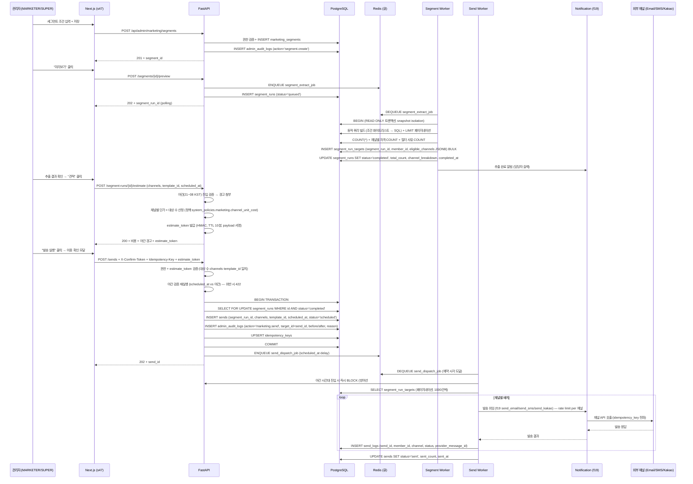
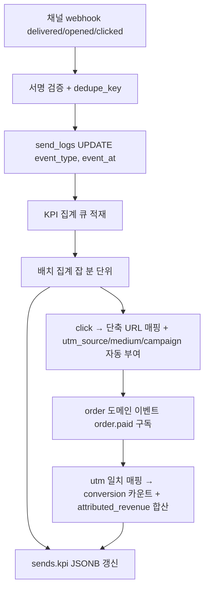

# f21 — 마케팅 세그먼트 기능정의서

- **박제일**: 2026-05-22 (v0.1) · 2026-05-23 갱신 (v0.2 — QA v4 prefix 통합 + 마케팅 자동 트리거·세그먼트 발송 정책 + 공통 보안 QA 매핑 보강)
- **단계**: S0 / Track 1 / Phase 4 / f21
- **상위 문서**: `00_index.md`
- **짝 도메인**: `../05_도메인정의서/d11_회원.md` (members·member_consent·member_notification_settings) · `d20_쿠폰_포인트.md` (coupon_issues·points·coupons) · `d21_관리자.md` (admin_audit_logs·system_policies)
- **짝 기능**: `f19_알림.md` (이메일·SMS·카카오 알림톡 발송 모듈 — 본 기능은 발송 모듈을 위임 호출)
- **짝 화면**: s47 마케팅 (세그먼트 작성·발송 실행·KPI 대시보드)
- **QA 소스** (v4 통합 prefix — v3의 MKT-A-* 권장 매핑은 v4 에서 §11 ADM-M-* / §1 MEM-A-034/035 / §10 CPN-A-008 등으로 분산 박제):
  - 관리자 마케팅 발송: `쇼핑몰_전용_QA_v4.md §11` ADM-M-001 (마케팅 동의 회원만 필터) · ADM-M-002 (예약 발송) · ADM-M-003 (야간 차단 게이트) · ADM-M-004 ([광고] prefix) · ADM-M-005 (List-Unsubscribe) · ADM-M-006 (발송 결과 통계) · ADM-M-007 (템플릿 미리보기) · ADM-M-008 (수신거부 스킵) · ADM-M-009~012 (SMS·카카오 알림톡 설정·결과)
  - 회원 동의·채널: `쇼핑몰_전용_QA_v4.md §1` MEM-U-026 (마케팅 동의) · MEM-U-055 (채널별 ON/OFF) · MEM-A-034 (글로벌 채널) · MEM-A-035 (회원별 채널 현황) · MEM-A-012 (회원 동의 이력 조회)
  - 쿠폰 일괄 발급 (세그먼트 결합): `쇼핑몰_전용_QA_v4.md §10` CPN-A-008 (전체 회원 대량 발급) · CPN-A-009 (등급별 발급) · CPN-A-007 (개별 회원 수동 발급)
  - 공통 보안: `공통_인프라_보안_QA.md §B-5` B-MKTG-001~010 (마케팅 동의·야간 21~08 차단·[광고] prefix·List-Unsubscribe·수신거부·예약·재발송·통계·장바구니 이탈 리마인더·세그먼트 발송) · `§A-7` A-MAIL-001~010 (거래성 발송 의무·재시도·SPF/DKIM 등) · `§A-8` A-LOG-002/011 (관리자 감사·PII 마스킹) · `§A-10` A-COMP-004/005/008/009 (개인정보 수집 동의·만 14세·탈퇴 후 파기·쿠키 동의)
  - 비기능: `99_비기능.md §5.3 §5.4` (표시광고법·정보통신망법 §50/§50의5·전기통신사업법) · `§4.6 §4.7` (PII 영향평가·민감정보 3등급) · `§4.10` (rate limit) · `§4.12` (webhook 5중 검증)

---

## 1. 개요

- **기능명**: 회원 세그먼트 정의·추출(비동기) · 발송 채널 동의·수신거부·블랙리스트 자동 필터 · 야간(21~08) 자동 차단 · 채널별 비용 사전 견적 · 일괄 발송(배치 + rate limit per 채널) · 멱등 보장(segment_run_id) · 광고성 정보 의무 표기("[광고] ... 무료수신거부 080-...") · 발송 이력·KPI 박제·추적(도달·오픈·클릭·전환·매출 기여)
- **비즈니스 목적**: Stage 1·5 (유입·재구매) 마케팅 자동화 — 세그먼트 기반 타겟팅으로 발송 비용 최적화 + 광고성 정보 규제(`정보통신망법`·`표시광고법`·`전기통신사업법`) 준수 + 어뷰징·스팸 차단으로 사용자 신뢰 보존. 마케팅 KPI(도달률·오픈율·클릭률·전환율·매출 기여)를 데이터로 닫는 단일 통제실.
- **트리거**: 관리자(MARKETER/SUPER) 세그먼트 생성·발송 예약·즉시 발송 실행, 야간 차단 시간대 진입(21:00 KST), 발송 큐 워커 polling, 채널 webhook 콜백(도달·오픈·클릭), 주문 완료 이벤트(전환 매핑)
- **액터**: 관리자(MARKETER / SUPER), 시스템(세그먼트 추출 워커·발송 배치 워커·KPI 집계·webhook 핸들러), 외부 채널(SendGrid 이메일 / NHN Toast SMS / 카카오 비즈메시지 — f19 모듈 위임)
- **관련 화면**: s47 마케팅 (세그먼트 빌더 → 미리보기 → 견적 → 발송 → KPI 대시보드)
- **관련 도메인**: d11 회원(세그먼트 추출 대상 + 동의 검증), d20 쿠폰·포인트(세그먼트 조건 — 누적 구매·VIP 등급 + 발송과 연계된 쿠폰 발급), d19 알림(채널 발송 모듈), d21 관리자(권한·AuditLog·정책)

---

## 2. 입력·출력

### 2.1 세그먼트 정의 생성 (POST `/api/admin/marketing/segments`)

**Request 헤더**: `Authorization: Bearer ...` (MARKETER / SUPER), `Idempotency-Key: {uuid}`

**Request Body**:
```json
{
  "name": "VIP_재구매_30일_미접속",
  "description": "VIP 등급 + 마지막 구매 30~90일 + 마케팅 동의 보유",
  "conditions": {
    "logic": "AND",
    "rules": [
      {"field": "membership_grade", "op": "IN", "value": ["VIP", "골드"]},
      {"field": "last_purchase_at", "op": "BETWEEN_DAYS_AGO", "value": [30, 90]},
      {"field": "marketing_consent", "op": "=", "value": true},
      {"field": "lifetime_purchase_amount", "op": ">=", "value": 500000}
    ]
  }
}
```

| 필드 | 타입 | 필수 | 검증 |
|---|---|---|---|
| name | string | Y | 1~80자, 관리자 내 UNIQUE |
| conditions | json | Y | 허용 field 화이트리스트 (§4.1), op 화이트리스트, 중첩 logic (AND/OR) 깊이 ≤ 3 |
| description | string | N | 1~500자 |

**허용 조건 필드 (화이트리스트)**:

| field | 타입 | op |
|---|---|---|
| membership_grade | enum | =, !=, IN, NOT IN |
| signup_days_ago | int | >=, <=, BETWEEN |
| last_purchase_at | timestamp | BETWEEN_DAYS_AGO, IS_NULL |
| purchase_count | int | >=, <=, = |
| lifetime_purchase_amount | int | >=, <=, BETWEEN |
| recent_purchase_count_90d | int | >=, <= |
| dormant_days | int | >= (90일 이상 = 휴면 보호 필터 별도) |
| birthday_month | int | IN |
| birthday_today | bool | = |
| coupon_held_count | int | >=, <= |
| points_balance | int | >=, <= |
| marketing_consent | bool | = (true 강제, 본 룰은 시스템 고정) |
| channel_email_consent | bool | = |
| channel_sms_consent | bool | = |
| channel_kakao_consent | bool | = |

**Response 201**:
```json
{
  "segment_id": "uuid",
  "name": "VIP_재구매_30일_미접속",
  "created_at": "2026-05-22T15:23:00Z",
  "estimated_size": null,
  "estimated_size_at": null
}
```

> 생성 직후 size 는 NULL — 별도 미리보기(2.2) 호출 시 추출 큐에 적재되어 비동기 산정.

### 2.2 세그먼트 추출 / 미리보기 (POST `/api/admin/marketing/segments/{id}/preview`)

**Response 202**:
```json
{
  "segment_run_id": "uuid",
  "status": "queued",
  "queued_at": "2026-05-22T15:23:05Z",
  "expected_completion_at": "2026-05-22T15:25:00Z"
}
```

> 비동기 큐 (BullMQ / Redis) — 대용량 회원 추출은 동기 차단 금지 (f21-Q01 권장 = 비동기 + 큐 우선순위 정책).

### 2.3 추출 결과 조회 (GET `/api/admin/marketing/segment-runs/{id}`)

**Response 200**:
```json
{
  "segment_run_id": "uuid",
  "segment_id": "uuid",
  "status": "completed",
  "total_count": 2845,
  "channel_breakdown": {
    "email_eligible": 2802,
    "sms_eligible": 1944,
    "kakao_eligible": 2510
  },
  "filtered_out": {
    "marketing_consent_off": 380,
    "channel_consent_off_email": 43,
    "channel_consent_off_sms": 901,
    "channel_consent_off_kakao": 335,
    "blacklisted": 12,
    "dormant_protected": 8,
    "withdrawn": 21
  },
  "sample_members": [{"id": "...", "name_masked": "김*수", "email_masked": "k***@naver.com"}],
  "completed_at": "2026-05-22T15:24:38Z"
}
```

### 2.4 발송 비용 사전 견적 (POST `/api/admin/marketing/segment-runs/{id}/estimate`)

**Body**:
```json
{
  "channels": ["email", "sms", "kakao"],
  "template_id": "uuid",
  "scheduled_at": "2026-05-22T20:30:00Z"
}
```

**Response 200**:
```json
{
  "estimate": {
    "email": {"count": 2802, "cost_krw": 0, "provider": "SendGrid"},
    "sms": {"count": 1944, "cost_krw": 41868, "unit_cost": 21.54, "provider": "NHN Toast"},
    "kakao": {"count": 2510, "cost_krw": 21335, "unit_cost": 8.5, "provider": "Kakao BizMessage"}
  },
  "total_cost_krw": 63203,
  "night_window_warning": null,
  "estimate_token": "...",
  "estimate_expires_in": 600
}
```

**Night window 경고**: `scheduled_at` 또는 즉시 발송이 야간(21~08 KST)에 진입할 경우:
```json
"night_window_warning": "발송 예약 시각이 야간 차단 시간대(21:00~08:00 KST)에 포함됩니다. 광고성 메시지는 야간 발송이 금지됩니다 (정보통신망법). 발송이 자동 차단됩니다."
```

### 2.5 발송 실행 (POST `/api/admin/marketing/sends`)

**Headers**: `X-Confirm-Token: {confirm_token}` (이중 확인, 발송 영향 큼) + `Idempotency-Key: {uuid}` 필수 (멱등 segment_run_id로도 별도 보장).

**Body**:
```json
{
  "segment_run_id": "uuid",
  "estimate_token": "...",
  "channels": ["email", "sms", "kakao"],
  "template_id": "uuid",
  "scheduled_at": "2026-05-23T10:30:00Z",
  "campaign_id": "uuid",
  "reason": "VIP 재구매 유도 5월 정기 캠페인 #2026-05-VIP"
}
```

**Response 202**:
```json
{
  "send_id": "uuid",
  "segment_run_id": "uuid",
  "status": "scheduled",
  "scheduled_at": "2026-05-23T10:30:00Z",
  "total_targets": 2802,
  "audit_log_id": "uuid"
}
```

### 2.6 발송 이력·KPI 조회 (GET `/api/admin/marketing/sends/{id}/kpi`)

**Response 200**:
```json
{
  "send_id": "uuid",
  "segment_name": "VIP_재구매_30일_미접속",
  "channels": ["email", "sms", "kakao"],
  "sent_at": "2026-05-23T10:30:12Z",
  "stats": {
    "email": {"sent": 2802, "delivered": 2745, "opened": 1234, "clicked": 412, "bounced": 18, "complaint": 3},
    "sms": {"sent": 1944, "delivered": 1922, "failed": 22, "clicked": 256},
    "kakao": {"sent": 2510, "delivered": 2480, "read": 1340, "clicked": 580}
  },
  "kpi": {
    "delivery_rate": 0.9879,
    "open_rate": 0.4498,
    "click_rate": 0.1742,
    "conversion_count": 87,
    "conversion_rate": 0.0117,
    "attributed_revenue_krw": 12450000,
    "cost_krw": 63203,
    "roi": 196.0
  }
}
```

### 2.7 webhook 콜백 (POST `/api/marketing/webhook/{provider}`)

**Headers**: provider별 서명 (SendGrid `X-Twilio-Email-Event-Webhook-Signature`, NHN Toast `X-Toast-Signature`, Kakao `X-Kakao-Signature`).

**처리**:
1. 서명 검증 — 실패 시 401 + 감사 로그
2. `dedupe_key = provider + event_id` UNIQUE → 멱등 (중복 200)
3. event_type별 분기 (delivered / opened / clicked / bounced / complaint / read)
4. send_logs UPDATE + KPI 집계 큐 적재
5. 항상 200 응답 (재시도 방지)

---

## 3. 처리 흐름

### 3.1 세그먼트 정의 → 추출 → 견적 → 발송 (메인 시퀀스)



### 3.2 발송 차단 다중 방어선 (수신거부·블랙리스트·야간·휴면·동의 OFF)

| 방어선 | 검증 위치 | 차단 사유 |
|---|---|---|
| #1 | 세그먼트 추출 (3.1) | marketing_consent=false 자동 제외 |
| #2 | 세그먼트 추출 | 채널별 channel_*_consent=false 자동 제외 (eligible_channels에서 해당 채널 제거) |
| #3 | 세그먼트 추출 | member_blacklist 매칭 자동 제외 |
| #4 | 세그먼트 추출 | status ∈ {suspended, withdrawn, banned} 자동 제외 |
| #5 | 세그먼트 추출 | dormant_days >= 90 자동 제외 (휴면 보호 — 별도 휴면 해제 동의 필요) |
| #6 | 견적 단계 | 야간(21~08 KST) 진입 사전 경고 |
| #7 | 발송 실행 (BE) | scheduled_at 야간 검증 — 위반 시 422 (방어선 #6와 중복) |
| #8 | 발송 워커 실행 시점 | 워커 시작 시각 야간 진입 → 즉시 BLOCK + 다음 08:00 KST로 자동 연기 또는 취소 (f21-Q02) |
| #9 | 발송 워커 | 발송 직전 동의 재조회 (consent_changed_at > segment_run_completed_at 이면 해당 채널 skip) |
| #10 | f19 알림 모듈 | 채널별 글로벌 ON/OFF 정책 (MEM-A-034) 시스템 차원 차단 |
| #11 | 외부 채널 | 사용자가 1회 회신("거부")한 번호·이메일은 외부 채널 자체 차단 + 본 시스템 동기화 |

> 방어선은 다중 — 어느 한 곳이라도 차단 시 발송 안 함. AuditLog는 발송 시도 및 차단 사유 모두 박제.

### 3.3 광고성 정보 의무 표기 (정보통신망법 §50)

모든 마케팅 발송 메시지는 다음 형식 의무 (시스템 강제 + template 검증):

| 채널 | 표기 형식 |
|---|---|
| 이메일 | 제목 prefix "(광고)" + 본문 푸터에 발신자명·연락처·수신거부 링크 |
| SMS | 본문 prefix "[광고]" + 발신번호 070-XXXX-XXXX + 본문 끝 "무료수신거부 080-XXX-XXXX" |
| 카카오 알림톡 | 카카오 정책상 광고는 별도 "친구톡" 채널 + 비즈 인증 발신자 + 채널 자체 수신거부 1회 클릭 |

**시스템 강제**:
- 발송 워커가 메시지 빌드 시 자동 prepend / append (관리자 template 누락 방지)
- template 등록 시 광고성 표기 누락 시 422 TEMPLATE_INVALID (저장 차단)
- 수신거부 회신 ("거부" 1자) → 자동 channel_*_consent=false UPDATE + member_consent INSERT (이력 보존)

### 3.4 KPI 추적 (webhook → 집계 → 매출 기여)



**전환 매핑 룰**:
- 발송 시 단축 URL 자동 생성 (`/r/{send_id}/{member_id}/{hash}` → 실 URL + utm 자동 부여)
- click 발생 시 → `marketing:attribution:{member_id}` Redis 7일 TTL set (last-touch attribution)
- order.paid 이벤트 구독 → member_id 매칭 시 conversion 카운트 + payment_amount 합산
- 멀티 캠페인 last-touch — 가장 최근 click 1건만 attribution (f21-Q03 권장)

### 3.5 발송 실패·재시도 정책

| 시나리오 | 처리 |
|---|---|
| 외부 채널 일시 5xx | 워커 재시도 (지수 백오프 3회, 총 5분 이내) |
| 외부 채널 4xx (잘못된 번호·이메일 등) | 재시도 X + send_logs status=failed + 사유 박제 |
| webhook 콜백 유실 (외부 채널 장애) | dedupe 멱등 + 일 1회 정합 조회 (외부 채널 statistics API) |
| 발송 중 컨테이너 재시작 | send_logs.status='sent' 이미 박제분은 재발송 X (멱등 = send_id + member_id + channel UNIQUE) |
| 워커 동시 다중 인스턴스 | send_dispatch_job 큐 SELECT FOR UPDATE SKIP LOCKED + send_id 분산 |
| 야간 진입 발송 일부 진행 중 | 21:00 KST 도달 시 워커 즉시 STOP + 미발송 분 다음 08:00 KST로 자동 연기 (f21-Q02) |

---

## 4. 검증 룰

### 4.1 입력 검증

| 필드 | 룰 | 위반 코드 |
|---|---|---|
| segment.name | 1~80자, 관리자 내 UNIQUE | 422 / 409 |
| conditions.rules[].field | 화이트리스트 (§2.1 표) | 422 INVALID_FIELD |
| conditions.rules[].op | 화이트리스트 (=, !=, IN, NOT IN, >=, <=, BETWEEN, BETWEEN_DAYS_AGO, IS_NULL) | 422 INVALID_OP |
| conditions.logic 깊이 | ≤ 3 (성능·가독성) | 422 NESTING_TOO_DEEP |
| template_id | 광고성 표기 검증 통과 (§3.3) | 422 TEMPLATE_INVALID |
| scheduled_at | now ≤ scheduled_at ≤ now+90일 | 422 |
| channels | ∈ {email, sms, kakao} subset | 422 |
| Idempotency-Key | UUID v4 | 400 |
| X-Confirm-Token | 서명 + 5분 + payload(send_id·channels·targets_hash) 일치 | 403 |
| estimate_token | 서명 + 10분 + payload(segment_run_id·channels·template_id) 일치 | 403 |
| reason | 10자↑ (발송은 큰 영향) | 422 REASON_REQUIRED |

### 4.2 비즈니스 룰

| 룰 | 적용 | 근거 |
|---|---|---|
| 세그먼트 추출 = 비동기 큐 (동기 차단 금지) | 추출 | f21-Q01 권장 |
| 발송 = 배치 + rate limit per 채널 (Email 100/s / SMS 50/s / Kakao 30/s 권장) | 발송 워커 | f21-Q04, F-RATE-03 |
| 멱등 = segment_run_id + send_id + Idempotency-Key 3중 보장 | 발송 | F-PAY-04 동등 룰, A-API-011 |
| 광고성 정보 의무 표기 — "(광고)" / "[광고]" + 수신거부 안내 | template + 발송 | 정보통신망법 §50, A-COMP, `99_비기능 §5.3`, B-MKTG-003/004, ADM-M-004 |
| 야간(21~08 KST) 광고성 발송 금지 | 견적·발송·워커 다중 검증 | 정보통신망법 §50의5, `99_비기능 §5.4 Q-NF05`, B-MKTG-002, ADM-M-003 |
| **마케팅 동의 회원만 발송 대상** = 마케팅 OFF 회원 자동 제외 (방어선 #1) | 추출 | d11 member_consent type='marketing', B-MKTG-001, ADM-M-001 |
| 채널별 동의 false 자동 제외 (이메일·SMS·카카오 각각) | 추출 + 발송 직전 재조회 | d11 member_notification_settings, MEM-U-026~028/055, MEM-A-035 |
| 블랙리스트·정지·탈퇴 회원 자동 제외 | 추출 | d11 member_blacklist / status, MEM-A-002~006 |
| 휴면 회원 (90일↑) 발송 차단 (별도 휴면 해제 동의 필요) | 추출 | 정보통신망법 휴면 보호 |
| 채널별 글로벌 ON/OFF (MEM-A-034) — 글로벌 OFF 시 사용자 설정 무관 미발송 | 발송 | d11 MEM-A-034 |
| 모든 마케팅 발송 = admin_audit_logs INSERT (대상 수·채널·사유·견적) | 발송 | d21 F6, A-LOG-002 |
| 발송 = MARKETER 또는 SUPER 권한 + 이중 확인 + 사유 | 발송 | f20 §4.3 권한 매트릭스, A-API-003 |
| 견적 vs 발송 대상 수 일치 (estimate_token 변조 차단) | 발송 | 보안 |
| 일일 발송 한도 (총 1회 발송당 ≤ 100,000건 권장, 일일 ≤ 500,000건) | 발송 | 비용·DoS 방어 (f21-Q05) |
| 단축 URL = HMAC 서명 + 만료 90일 + click 후에도 URL 보존 (KPI 추적) | 발송·KPI | f21-Q03 |
| webhook 콜백 서명 검증 (provider별) — 실패 시 401 + 감사 | webhook | F-PAY-03 / F-WEBHOOK-02 동등 룰, B-PAY-003/006 |
| **webhook 5중 검증** (IP whitelist · HMAC 서명 · 타임스탬프 ±5분 · dedupe · payload 일치) | webhook | F-WEBHOOK-01~05, 99_비기능 §4.12 |
| dedupe_key (provider + event_id) UNIQUE — 중복 콜백 200 멱등 | webhook | F-PAY-05 동등 룰, A-API-011 |
| 1회 발송 캠페인 = 1 campaign_id 추적 (A/B 테스트 시 별도 campaign_id) | 발송·KPI | (마케팅 정책) |
| 수신거부 회신 → 자동 channel_consent=false + member_consent INSERT (이력 보존) | webhook (SMS/카카오 회신) | 정보통신망법 §50④, B-MKTG-005, ADM-M-008 |
| **수신거부 1클릭 + 즉시 처리 + 다음 발송부터 자동 차단** | 옵트아웃 | F-MARKETING-03, B-MKTG-004/005 |
| **List-Unsubscribe 헤더 의무** (이메일) | 옵트아웃 | B-MKTG-004, ADM-M-005 |
| **[광고] prefix 의무 (이메일·SMS·카카오)** (NEW Tier 5 §3.4 룰 매핑) | 광고성 | F-MARKETING-01, B-MKTG-003, ADM-M-004 |
| **야간 21~08 자동 차단** (Q-NF05 권장) | 시간 | F-MARKETING-02, B-MKTG-002, ADM-M-003 |
| **만 14세 미만 마케팅 차단** | 청소년 | F-MARKETING-04, 99_비기능 §5.4, A-COMP-005 |
| **동의 이력 2년 보관 (정보통신망법)** | 보존 | F-MARKETING-05, 99_비기능 §4.6, A-COMP-004 |
| **마케팅 수신 거부 vs 거래성 메일 분리** = 마케팅 OFF 회원도 인증·비밀번호 재설정·주문/배송 안내는 계속 수신 | 분리 | F-MARKETING-06, A-MAIL-001 |
| **거래성 알림 수신거부 불가 (법정 의무)** | 거래성 | F-MARKETING-06, A-MAIL-001 |
| **마케팅 자동 발송 트리거** (이벤트 → 세그먼트 → 발송): | 자동 | B-MKTG-009, f19 §3.7 |
| ㄴ 장바구니 이탈 리마인더 = N시간 미구매 회원 → 구매 완료 시 발송 취소 | 자동 트리거 | B-MKTG-009 |
| ㄴ 쿠폰 만료 D-3 알림 = 쿠폰 보유 + 만료 임박 회원 자동 발송 | 자동 트리거 | CPN-U-015, MEM-U-044 |
| ㄴ 포인트 소멸 D-30 알림 = 소멸 예정 포인트 보유 회원 자동 발송 | 자동 트리거 | CPN-U-027, CPN-A-022 |
| ㄴ 생일 쿠폰·이벤트 = 생일 당일 배치 발급 + 알림 (생년월일 미등록 회원 제외) | 자동 트리거 | MEM-U-045/046 |
| ㄴ 등급 전환 알림 = 등급 상승/하락 시 자동 발송 | 자동 트리거 | MEM-U-033 |
| **회원 등급·태그 세그먼트 발송** = 조건 외 회원 미발송 (방어선 #2~#5 다중 검증) | 세그먼트 | B-MKTG-010 |
| **세그먼트 + 쿠폰 일괄 발급 결합** = 세그먼트 추출 후 CPN-A-008/009 일괄 발급 + 알림 동시 발송 | 결합 | CPN-A-008/009, B-MKTG-010 |
| **마케팅 대량 발송 예약** (날짜·시간 설정) → 예약 시각 발송 + 야간 진입 시 자동 reschedule | 예약 | B-MKTG-006, ADM-M-002 |
| **대량 발송 중 장애** = 발송된 건·미발송 건 구분 + 재발송 가능 (멱등 보장) | 일괄 | B-MKTG-007 |
| **발송 결과 통계 조회** (발송 수·수신 성공·실패·수신거부 수 + KPI 도달율·오픈율·클릭율·전환·매출) | 통계 | B-MKTG-008, ADM-M-006/010/012 |
| **PII 마스킹 표준** (이메일·휴대폰·이름 등 발송 외 노출 시 마스킹) | PII | 99_비기능 §4.6, A-LOG-011 |
| **rate limit** = 발송 실행 API · 세그먼트 추출 API · webhook 각각 표준 적용 | 보안 | F-RATE-01~06, A-API-004 |
| **개인정보 수집·이용 동의 = 회원가입 시점 + 마케팅 별도 동의** + 동의 이력 (member_consent) | 동의 | A-COMP-004, F-PII-04, MEM-A-012 |
| **탈퇴 회원 30일 후 마케팅 대상 자동 제거** + PII 마스킹 | 탈퇴 | A-COMP-008, MEM-U-040, F-RETAIN-02 |
| **영업양도·합병 시 개인정보 이전 = 30일 전 사전 통보 + 이전 거부 권리(탈퇴) 안내** (NEW Tier 5 §3.11) | 양도·합병 | 개인정보보호법 §27 |

### 4.3 권한 매트릭스 (f20 §4.3 인용)

| 행위 | SUPER | MARKETER | MANAGER | CS |
|---|---|---|---|---|
| 세그먼트 생성·수정·삭제 | O | O | X | X |
| 세그먼트 추출(미리보기) | O | O | O (조회용) | X |
| 견적 산출 | O | O | X | X |
| 발송 실행 (즉시·예약) | O | O | X | X |
| 발송 취소 (scheduled → cancelled) | O | O | X | X |
| KPI 조회 | O | O | O | X |
| template 등록·수정 | O | O | X | X |
| 마케팅 정책 변경 (단가·rate limit 등) | O | X | X | X |

---

## 5. 트랜잭션·동시성

### 5.1 세그먼트 추출 잡 (READ-ONLY snapshot + bulk INSERT)

```python
async def segment_extract_job(segment_run_id):
    seg_run = await SELECT_segment_run(segment_run_id)
    segment = await SELECT_segment(seg_run.segment_id)
    
    # 동적 쿼리 (화이트리스트 기반 안전 빌드 — 어떤 사용자 입력도 raw SQL로 들어가지 않음)
    sql, params = build_query_safe(segment.conditions)
    
    # 베이스 필터 (시스템 고정 — 항상 적용)
    sql += " AND m.status = 'active'"
    sql += " AND m.id NOT IN (SELECT member_id FROM member_blacklist WHERE released_at IS NULL)"
    sql += " AND COALESCE(EXTRACT(EPOCH FROM (now() - m.last_login_at))/86400, 0) < 90"  # 휴면 보호
    sql += " AND EXISTS (SELECT 1 FROM member_consent WHERE member_id=m.id AND type='marketing' AND agreed=true)"
    
    # 페이지네이션 추출 (대용량 — 1만 건씩 chunks)
    offset = 0
    total = 0
    channel_breakdown = {"email_eligible": 0, "sms_eligible": 0, "kakao_eligible": 0}
    filtered = {"channel_consent_off_email": 0, "channel_consent_off_sms": 0, "channel_consent_off_kakao": 0}
    
    async with transaction(isolation=REPEATABLE_READ):  # snapshot
        while True:
            members = await db.fetch(sql + f" LIMIT 10000 OFFSET {offset}", *params)
            if not members: break
            
            rows = []
            for m in members:
                # 채널 자격 (member_notification_settings 조회 — 일괄 SQL JOIN으로 최적화 가능)
                channels = await fetch_eligible_channels(m.id)
                for ch in ("email", "sms", "kakao"):
                    if ch in channels:
                        channel_breakdown[f"{ch}_eligible"] += 1
                    else:
                        filtered[f"channel_consent_off_{ch}"] += 1
                
                rows.append((segment_run_id, m.id, json.dumps(channels)))
                total += 1
            
            # BULK INSERT
            await db.executemany(
                "INSERT INTO segment_run_targets (segment_run_id, member_id, eligible_channels) VALUES ($1, $2, $3)",
                rows
            )
            offset += 10000
        
        await db.execute("""
            UPDATE segment_runs 
            SET status='completed', total_count=$1, channel_breakdown=$2, filtered_out=$3, completed_at=now()
            WHERE id=$4
        """, total, json.dumps(channel_breakdown), json.dumps(filtered), segment_run_id)
```

### 5.2 발송 잡 (배치 + 멱등 + rate limit)

```python
async def send_dispatch_job(send_id):
    # 야간 검증 (방어선 #8)
    if is_night_window_kst(now()):
        await reschedule_to_next_morning(send_id)
        return
    
    send = await SELECT_send(send_id)
    if send.status != "scheduled": return  # 멱등 — 이미 다른 워커가 처리 중
    
    # 워커 락 획득
    locked = await db.execute("""
        UPDATE sends SET status='sending', worker_id=$1, started_at=now()
        WHERE id=$2 AND status='scheduled'
    """, worker_id, send_id)
    if locked == 0: return  # 다른 워커 선점
    
    # rate limiter (channel별)
    limiter = ChannelRateLimiter(email=100, sms=50, kakao=30)
    
    offset = 0
    while True:
        targets = await db.fetch("""
            SELECT t.member_id, t.eligible_channels, m.email, m.phone, m.name
            FROM segment_run_targets t
            JOIN members m ON m.id = t.member_id
            WHERE t.segment_run_id=$1
            ORDER BY t.member_id
            LIMIT 1000 OFFSET $2
        """, send.segment_run_id, offset)
        if not targets: break
        
        for tgt in targets:
            # 발송 직전 동의 재조회 (방어선 #9)
            consents = await fetch_current_channel_consents(tgt.member_id)
            
            for channel in send.channels:
                if channel not in tgt.eligible_channels: continue
                if not consents[channel]: continue  # 발송 직전 동의 OFF
                
                # 멱등 키 (send_id + member_id + channel)
                idem = f"{send_id}:{tgt.member_id}:{channel}"
                
                # 야간 재검증 (워커 진행 중 21:00 도달 차단)
                if is_night_window_kst(now()):
                    await mark_send_paused(send_id, offset)
                    return
                
                await limiter.acquire(channel)
                try:
                    result = await dispatch_via_f19(
                        channel=channel, to=tgt, template=send.template_id,
                        idempotency_key=idem
                    )
                    await INSERT_send_log(send_id, tgt.member_id, channel, "sent", result.provider_message_id)
                except RateLimitExceeded:
                    await asyncio.sleep(1)  # 자동 백오프
                except ChannelPermanentError as e:
                    await INSERT_send_log(send_id, tgt.member_id, channel, "failed", error=str(e))
        offset += 1000
    
    await db.execute("UPDATE sends SET status='sent', sent_at=now() WHERE id=$1", send_id)
```

### 5.3 동시성 시나리오

| 시나리오 | 메커니즘 |
|---|---|
| 같은 segment에 대해 동시 발송 2건 | sends INSERT 별 row + Idempotency-Key 분리 → 각각 처리 (운영자 의도 가능) |
| 동일 캠페인 발송 중복 (동일 Idempotency-Key) | idempotency_keys.PK 캐시 → 첫 응답 반환 |
| 워커 다중 인스턴스 같은 send_dispatch_job 픽업 | sends UPDATE WHERE status='scheduled' (원자) → 1건만 sending 전이 |
| 발송 중 컨테이너 재시작 | send_logs UNIQUE(send_id, member_id, channel) → 재시작 시 이미 sent 행은 skip |
| 발송 중 사용자가 마케팅 동의 OFF | 발송 직전 fetch_current_channel_consents → skip (방어선 #9) |
| 발송 중 21:00 KST 도달 | 워커 매 1000건마다 시간 재검증 → 즉시 STOP + status='paused' + 익일 08:00 재개 |
| webhook 중복 콜백 | dedupe_key UNIQUE → 1건만 처리 |
| 큰 세그먼트(50만 건) 추출 중 다른 추출 잡 동시 | 큐 우선순위 정책 (FIFO + 큰 잡 별도 큐 분리 권장) — f21-Q06 |
| sends.status='scheduled' 인데 발송 취소 요청 | sends UPDATE SET status='cancelled' WHERE status='scheduled' (원자) → 워커 픽업 차단 |
| 견적 산정 vs 발송 사이 대상 수 변경 (회원 동의 OFF 다수 발생) | estimate_token에 targets_hash 포함 → 실제 발송 시 hash 재계산 + 임계(5% 이상 변경) 시 422 ESTIMATE_STALE → 견적 재산정 요구 |

---

## 6. 에러 처리

| HTTP | 도메인 코드 | 시나리오 | 사용자 메시지 |
|---|---|---|---|
| 400 | MISSING_IDEMPOTENCY_KEY | 헤더 누락 | (개발자) |
| 401 | UNAUTHORIZED | 미인증 | (관리자 로그인 모달) |
| 401 | INVALID_WEBHOOK_SIGNATURE | webhook 서명 실패 | (감사 로그) |
| 403 | FORBIDDEN | role 부족 | "권한이 없습니다." |
| 403 | CONFIRM_TOKEN_INVALID | 이중 확인 미통과 | "발송 확인이 만료되었습니다. 다시 시도해주세요." |
| 403 | ESTIMATE_TOKEN_INVALID | estimate_token 변조 / 만료 | "견적이 만료되었습니다. 다시 산정해주세요." |
| 409 | DUPLICATE_SEGMENT_NAME | 세그먼트명 중복 | "동일한 이름의 세그먼트가 존재합니다." |
| 409 | SEND_ALREADY_PROCESSING | 동일 send 동시 처리 시도 | "이미 발송 중입니다." |
| 422 | INVALID_FIELD / INVALID_OP | 화이트리스트 위반 | "사용할 수 없는 조건입니다." |
| 422 | NESTING_TOO_DEEP | 조건 깊이 > 3 | "조건이 너무 복잡합니다 (최대 3단계)." |
| 422 | TEMPLATE_INVALID | 광고성 표기 누락 | "광고성 정보 표기가 필요합니다." |
| 422 | NIGHT_WINDOW_VIOLATION | 야간 발송 시도 | "광고성 메시지는 21:00~08:00 KST 발송이 금지됩니다." |
| 422 | DAILY_LIMIT_EXCEEDED | 일일 발송 한도 초과 | "일일 발송 한도를 초과했습니다." (운영자 알람 자동) |
| 422 | ESTIMATE_STALE | 견적과 실제 대상 수 5% 이상 차이 | "발송 대상에 변동이 있습니다. 견적을 재산정해주세요." |
| 422 | SEGMENT_RUN_NOT_COMPLETED | status != completed 에서 발송 시도 | "세그먼트 추출이 완료되지 않았습니다." |
| 500 | CHANNEL_TIMEOUT | 외부 채널 응답 없음 | (큐 재시도, 운영자 알람) |
| 503 | MAINTENANCE_MODE | 점검모드 | (점검 페이지) |
| 200 | (webhook) | webhook은 항상 200 (재시도 방지) | — |

---

## 7. 성능·캐시

| 지표 | 목표 |
|---|---|
| 세그먼트 정의 저장 P95 | < 500ms |
| 세그먼트 추출 (10만 회원) | < 3분 (비동기, 큐) |
| 세그먼트 추출 (50만 회원) | < 15분 (큐 우선순위 분리, f21-Q06) |
| 견적 산정 P95 | < 1s (DB COUNT + 단가 곱셈) |
| 발송 실행 API P95 | < 800ms (sends INSERT + 큐 적재) |
| 발송 처리량 (총) | 1,000건/초 (channel 합산) |
| 채널별 rate limit | Email 100/s · SMS 50/s · Kakao 30/s (f21-Q04) |
| webhook 처리 P95 | < 200ms (dedupe + UPDATE) |
| KPI 집계 잡 주기 | 1분 (분 단위 sends.kpi 갱신) |
| KPI 조회 P95 | < 500ms (sends.kpi JSONB 캐시 + utm 매핑) |
| 단축 URL redirect P95 | < 100ms (Redis 캐시) |

**캐시 전략**:

| 키 | TTL | 무효화 |
|---|---|---|
| `segment_run:{id}` | 24h | 추출 완료 시 갱신 |
| `marketing:channel_unit_cost` | 5분 | 정책 변경 시 PURGE (system_policies) |
| `marketing:rate_limit:{channel}` | 1분 (sliding window) | — |
| `marketing:night_window` | 영구 (system_policies 정책) | 정책 변경 시 PURGE |
| `marketing:attribution:{member_id}` | 7일 | 새 click 시 갱신 (last-touch) |
| `short_url:{hash}` | 90일 | 캠페인 종료 시 만료 |
| `idempotency:{key}` | 24시간 | 자연 만료 |

**인덱스**:
- `marketing_segments.idx_created_by_created_at`, `UNIQUE(created_by, name)`
- `segment_runs.idx_segment_id_created_at`, `idx_status`
- `segment_run_targets.PK(segment_run_id, member_id)`, `idx_member_id`
- `sends.idx_status_scheduled_at` (워커 polling), `idx_campaign_id`, `idx_created_at`
- `send_logs.UNIQUE(send_id, member_id, channel)` (멱등), `idx_send_id_status`, `idx_member_id_event_at`, `idx_provider_message_id`
- `webhook_events.UNIQUE(dedupe_key)`, `idx_received_at`

**대용량 처리**: segment_run_targets 는 50만 건+ 가능 → 파티션 (segment_run_id hash) + 90일 경과 행 archive.

---

## 8. 테스트 케이스

### 8.1 유닛

- 화이트리스트 기반 동적 쿼리 빌더 (모든 field × op 조합 + SQL injection 방어 검증)
- 야간 시간대 판정 함수 (21:00~08:00 KST + 일자 경계 케이스 + DST 없음 확인)
- 광고성 표기 검증 (이메일 제목 "(광고)" / SMS 본문 "[광고]" / 수신거부 안내 필수)
- estimate_token 서명 검증 (정상 / 변조 / 만료 / payload 불일치)
- 채널별 rate limiter (token bucket, 100/50/30 RPS 정확)
- last-touch attribution 매핑 (최근 click 1건만 conversion 매핑)
- 단축 URL 생성·복호화 (HMAC 서명, 90일 만료)
- targets_hash 안정성 (동일 segment_run_id + channels → 동일 hash)

### 8.2 통합

- 세그먼트 생성 → 추출 (10만 회원) → 채널별 자격 + 필터 사유 정확 (방어선 #1~#5)
- 추출 중 마케팅 동의 OFF 회원 자동 제외 (filtered_out.marketing_consent_off 카운트)
- 블랙리스트 회원 자동 제외 + 휴면 회원(90일+) 자동 제외
- 견적 산정 → 야간 진입 경고 첨부 → 발송 실행 → 422 NIGHT_WINDOW_VIOLATION
- 즉시 발송 실행 → 발송 중 21:00 KST 도달 → 워커 STOP + status='paused' + 익일 08:00 자동 재개
- 발송 중복 (동일 Idempotency-Key) → 첫 응답 캐시 반환
- 발송 중 컨테이너 재시작 → 이미 sent 행은 send_logs UNIQUE로 skip + 미발송 분만 재시도
- 발송 직전 동의 OFF 변경 → 해당 채널 skip (방어선 #9)
- 광고성 표기 누락 template 저장 시도 → 422 TEMPLATE_INVALID
- estimate vs 실제 대상 수 5% 이상 차이 → 422 ESTIMATE_STALE
- 일일 발송 한도 초과 시도 → 422 DAILY_LIMIT_EXCEEDED + 운영자 알람
- webhook 중복 콜백 (delivered 2회) → dedupe_key UNIQUE 멱등
- webhook 서명 위조 → 401 + admin_audit_logs INSERT (action='marketing.webhook', result='failure')
- click 발생 → utm 매핑 → 7일 내 order.paid → conversion + attributed_revenue 정확 합산
- 수신거부 회신 ("거부" SMS) → channel_sms_consent=false 자동 UPDATE + member_consent INSERT 이력
- MARKETER가 발송 실행 → 정상 / MANAGER가 발송 실행 → 403 + 감사 로그 박제
- 마케팅 정책 변경 (단가) → MARKETER 시도 → 403 (SUPER 전용) / SUPER → 정책 변경 + 캐시 PURGE (f20 §3.2)
- 모든 마케팅 발송 → admin_audit_logs INSERT (대상 수·채널·견적·사유) 박제

### 8.3 E2E (Playwright)

- s47 세그먼트 빌더 → 조건 입력 (등급=VIP + 마지막 구매 30~90일 전) → 저장
- 미리보기 → 비동기 추출 → 진행률 표시 → 완료 후 결과 카드 (총 수·채널별·필터 사유)
- 견적 → 채널별 비용 + 야간 경고 (있을 때) 표시
- 발송 실행 → 이중 확인 모달 → 사유 입력 → 발송 시작 → 진행률 폴링 → 완료 알림
- 야간 시간대(21~08) 즉시 발송 시도 → 422 + UI 경고 + 다음 08:00 예약 옵션 제시
- 발송 후 KPI 대시보드 → 도달·오픈·클릭·전환·매출 실시간 갱신 (1분 polling)
- 발송 취소 (scheduled → cancelled) → 워커 픽업 차단 + 감사 로그
- template 등록 시 광고성 표기 누락 → 저장 버튼 비활성 + 사유 표시
- MARKETER 권한으로 정책 변경 시도 → 비활성 버튼 또는 403 페이지
- 단축 URL click → 외부 redirect + utm 자동 부여 + Redis attribution 저장 확인 (개발 도구)
- 수신거부 회신 시뮬레이션 (SMS "거부") → 회원 channel_sms_consent 즉시 OFF + 다음 발송 자동 제외 확인

### 8.4 QA 추적 (v4 통합 prefix — v3 MKT-A-* 권장 매핑은 v4 에서 ADM-M-* 등으로 분산 박제)

- `쇼핑몰_전용_QA_v4.md §11` (관리자 마케팅 이메일·SMS·카카오):
  - ADM-M-001 (마케팅 동의 회원만 필터)
  - ADM-M-002 (예약 발송)
  - ADM-M-003 (야간 차단 게이트)
  - ADM-M-004 ([광고] prefix)
  - ADM-M-005 (List-Unsubscribe 헤더)
  - ADM-M-006 (발송 결과 통계 — 발송/수신/수신거부)
  - ADM-M-007 (템플릿 8종 미리보기)
  - ADM-M-008 (수신거부 회원 스킵)
  - ADM-M-009/010 (SMS 발송 설정·결과)
  - ADM-M-011/012 (카카오 알림톡 발송 설정·결과)
- `쇼핑몰_전용_QA_v4.md §1` (회원 알림 동의·채널):
  - MEM-U-026 (마케팅 수신 동의 ON/OFF)
  - MEM-U-027/028 (알림 설정 개별 ON/OFF + OFF 회원 미발송)
  - MEM-U-053~055 (SMS·카카오·채널별 ON/OFF)
  - MEM-U-044~046 (쿠폰 만료/생일 쿠폰 자동 발급·알림)
  - MEM-A-012 (회원 동의 이력 조회)
  - MEM-A-028 (알림 발송 이력 회원별 조회)
  - MEM-A-034 (글로벌 채널 ON/OFF)
  - MEM-A-035 (회원별 채널 현황)
- `쇼핑몰_전용_QA_v4.md §10` (쿠폰·포인트 — 세그먼트 결합):
  - CPN-A-007 (개별 회원 수동 발급)
  - CPN-A-008 (전체 회원 대량 발급 — 비동기)
  - CPN-A-009 (등급별 발급)
  - CPN-A-029 (연속 출석 N일 추가 쿠폰)
  - CPN-A-038/039 (친구 추천 보상 정책·이력)
  - CPN-A-040 (쿠폰 수량 소진 자동 마감)
  - CPN-U-015 (쿠폰 만료 D-3 알림)
  - CPN-U-027 (포인트 소멸 D-30 알림)
- `쇼핑몰_전용_QA_v4.md §11` (관리자 권한·감사 — f20 §4.3 인용):
  - ADM-R-003 (일반 사용자 토큰으로 Admin API 호출 차단)
  - ADM-R-004 (CS 권한자 상품 CRUD 차단)
  - ADM-R-009 (SUPER만 관리자 계정 생성·권한 변경)
  - ADM-R-010 (관리자 전체 활동 감사 로그)
- `공통_인프라_보안_QA.md §B-5` (마케팅·대량 알림): B-MKTG-001~010 전수 매핑 (동의 회원만 발송 / 야간 21~08 차단 / [광고] prefix / List-Unsubscribe / 수신거부 즉시 미발송 / 예약 발송 / 장애 시 재발송 / 발송 통계 / 장바구니 이탈 리마인더 / 세그먼트 조건)
- `공통_인프라_보안_QA.md §A-7` (트랜잭션 vs 마케팅 분리): A-MAIL-001 (거래성 발송 의무) · A-MAIL-002/006 (재시도·큐) · A-MAIL-005 (XSS) · A-MAIL-007 (OFF 회원 미발송) · A-MAIL-010 (발송 이력)
- `공통_인프라_보안_QA.md §A-8`: A-LOG-002 (마케팅 발송 감사 박제) · A-LOG-003 (민감정보 미기록) · A-LOG-011 (PII 마스킹)
- `공통_인프라_보안_QA.md §A-2`: A-API-002 (IDOR) · A-API-003 (관리자 API 권한) · A-API-004 (rate limit) · A-API-011 (멱등성)
- `공통_인프라_보안_QA.md §A-10`: A-COMP-004 (개인정보 수집 동의) · A-COMP-005 (만 14세 미만) · A-COMP-008 (탈퇴 후 파기) · A-COMP-009 (쿠키 동의)
- `공통_인프라_보안_QA.md §B-1`: B-PAY-003/006 (PG·가상계좌 webhook 위변조 — 마케팅 webhook도 동일 5중 검증 패턴 적용)
- `99_비기능.md §5.3 §5.4`: 표시광고법 / 전기통신사업법 / Q-NF05 야간 차단
- `99_비기능.md §4.6 §4.7`: PII 영향평가 + Level S/A/B/C 분류 (마케팅 발송 시 이메일·휴대폰·이름 처리)
- `99_비기능.md §4.10`: F-RATE-01~06 (rate limit 표준)
- `99_비기능.md §4.12`: F-WEBHOOK-01~05 (webhook 5중 검증)
- `99_비기능.md §9.1`: 광고성 정보 처리 동의 2년 보관 (정보통신망법)

> **v3 → v4 prefix 정정**: 본 문서 v0.1 의 `MKT-A-*` 권장 매핑은 v4 에서 단독 카탈로그로 박제되지 않고, §11 ADM-M-001~012 (관리자 마케팅) + §1 MEM-A-034/035 (채널 정책) + §10 CPN-A-008/009 (대량 발급) + §B-5 B-MKTG-001~010 (공통 보안) 으로 분산 박제됨.

---

## 9. 미결

| ID | 항목 | 미결 사유 |
|---|---|---|
| f21-Q01 | 세그먼트 추출 = 비동기 큐 단일 vs 동기 fallback (소규모 1만 미만 동기 허용) | 운영 UX (권장 = 항상 비동기) |
| f21-Q02 | 야간(21:00) 도달 시 진행 중 발송 처리 정책 — (a) 즉시 STOP + 익일 08:00 재개 (b) 즉시 취소 (c) 사용자가 사전 선택 | 권장 = (a) 자동 재개, `99_비기능 Q-NF05` 연계 |
| f21-Q03 | KPI attribution 정책 — last-touch vs first-touch vs linear 분배 | 권장 = last-touch + 7일 윈도우 |
| f21-Q04 | 채널별 rate limit 정확 수치 — Email 100/s · SMS 50/s · Kakao 30/s 권장 (외부 채널 계약 확인 필요) | 외부 채널 공식 한도 확인 |
| f21-Q05 | 일일 발송 한도 — 1회 ≤ 100,000건 / 일 ≤ 500,000건 권장 | 비용·법적 검토 |
| f21-Q06 | 대용량 세그먼트 추출(50만+) 큐 우선순위 — FIFO vs 작은 잡 우선 vs 별도 큐 분리 | 권장 = 별도 큐 분리 (LARGE_SEGMENT) |
| f21-Q07 | A/B 테스트 지원 범위 — MVP 포함 vs 후속 phase | 운영 우선순위 |
| f21-Q08 | 회원이 본인 발송 이력 조회 가능 여부 (마이페이지) | 투명성 정책 |
| f21-Q09 | 매출 기여 attribution 윈도우 — 7일 vs 14일 vs 30일 | 권장 = 7일 (개별 조정 가능) |
| f21-Q10 | 휴면 회원(90일+) 발송 차단 — 휴면 해제 동의 별도 UX 필요 여부 | 정보통신망법 휴면 보호 디테일 |
| f21-Q11 | 수신거부 회신 자동 해석 ("거부" / "수신거부" / "STOP" 등) 표준 사전 | 외부 채널 정책 + 운영 검토 |
| f21-Q12 | 카카오 친구톡(광고)과 알림톡(거래성) 채널 명확 분리 — 마케팅 발송은 친구톡 전용 | 카카오 정책 의존 |
| f21-Q13 | 광고성 푸시·웹푸시 도입 여부 — Q-03 미결 연계 | Q-03 사장님 결정 |

> 본 미결은 `../_미결사항_통합관리.md §3`에 append.

---

## 10. 변경 이력

| 버전 | 일자 | 변경 |
|---|---|---|
| v0.1 | 2026-05-22 | 최초 박제 (S0 / Phase 4) |
| v0.2 | 2026-05-23 | QA v4 통합 prefix 정정 (v3 MKT-A-* 권장 매핑 폐기 → v4 ADM-M-001~012 / MEM-A-034/035 / CPN-A-008/009 분산 박제). 마케팅 자동 발송 트리거 (장바구니 이탈·쿠폰 만료·포인트 소멸·생일·등급 전환) 5종 신설. 세그먼트+쿠폰 결합 룰. B-MKTG-001~010 / A-MAIL-001~010 / A-COMP-004/005/008/009 / B-PAY-003/006 / 99_비기능 §4.6/4.10/4.12 매핑 전면 보강 |
