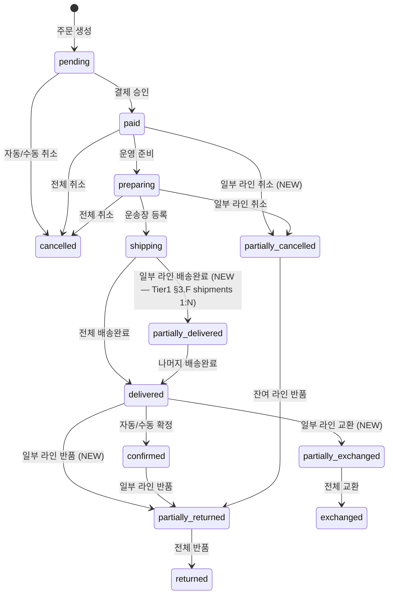

# d16 — 주문 (Order) 도메인 정의서

- **박제일**: 2026-05-21
- **단계**: S0 / Track 2 / d16
- **상위 문서**: `00_index.md`
- **짝 트랙**: `../04_기능정의서/` (예정)
- **QA 소스**: `쇼핑몰_전용_QA_v4.md §6` (사용자 약 42 + 관리자 39 = 약 81건, 비회원 4건 제외) + `공통_인프라_보안_QA.md §B-2 / §A-2 일부 / §A-6 일부`

---

## 1. 도메인 개요·책임 범위

- **1줄 책임**: 주문 생성·조회·취소·부분취소·구매확정·정산.
- **포지션**: payment·delivery와 **강결합**. 결제 흐름의 **트랜잭션 경계**를 책임짐. 동시성·원자성·멱등성이 가장 중요한 도메인.
- **회원 전용 정책**: 비회원 주문 불가 (`00_개요.md §2 #8`). QA의 ORD-U-013~016 (비회원 주문 4건) Out-of-scope.
- **결제수단 정책**: 카드 단일 (토스 MCP). 무통장·가상계좌·에스크로 미적용 (`00_개요.md §2 #1/#2`).
- **책임 경계 (out)**: 결제 승인·환불 PG 호출 자체는 payment 도메인 (본 도메인은 트리거 + 트랜잭션 경계만). 재고 차감/복구 실행은 product 도메인 (본 도메인은 이벤트 발행). 배송지·운송장·반품·교환 라이프사이클은 delivery 도메인 (본 도메인은 주문 상태 전이만).

---

## 2. 핵심 엔티티

### 2.1 orders (주문 본체)

| 필드 | 타입 | 제약 | 비고 |
|---|---|---|---|
| id | UUID | PK | |
| order_no | VARCHAR(20) | UNIQUE NOT NULL | `ORD-YYYYMMDD-XXXXXX` (ORD-U-004) |
| member_id | UUID | FK → members.id NOT NULL | 비회원 NULL 불가 (회원 전용) |
| status | ENUM | NOT NULL DEFAULT 'pending' | pending / paid / preparing / shipping / partially_delivered / delivered / confirmed / cancelled / partially_cancelled / partially_returned / partially_exchanged (Tier1 §3.M 신규 4종 추가) |
| total_amount | DECIMAL(12,0) | NOT NULL | 상품 합계 + 배송비 |
| product_amount | DECIMAL(12,0) | NOT NULL | 상품 합계 (할인 전) |
| shipping_fee | DECIMAL(10,0) | NOT NULL DEFAULT 0 | |
| coupon_discount | DECIMAL(10,0) | NOT NULL DEFAULT 0 | |
| point_used | DECIMAL(10,0) | NOT NULL DEFAULT 0 | |
| payment_amount | DECIMAL(12,0) | NOT NULL | total - coupon - point (최종 결제액) |
| payment_method | ENUM | NOT NULL DEFAULT 'card' | card 단일 (정책상 고정) |
| coupon_id | UUID | NULL FK → coupons.id | 적용 쿠폰 1건 |
| address_snapshot | JSONB | NOT NULL | 주문 시점 배송지 스냅샷 (이후 회원 주소 변경과 무관) |
| gift_option | JSONB | NULL | 선물 포장 옵션 (S-Q01 미결 — 추가 금액 정책 Phase 4) |
| idempotency_key | VARCHAR(64) | UNIQUE NULL | POST `/api/orders` 중복 방지 |
| version | INTEGER | NOT NULL DEFAULT 0 | 낙관락 (동시 취소 경합 보호) |
| created_at | TIMESTAMPTZ | NOT NULL | |
| paid_at | TIMESTAMPTZ | NULL | 결제 승인 시각 |
| confirmed_at | TIMESTAMPTZ | NULL | 구매확정 시각 |
| cancelled_at | TIMESTAMPTZ | NULL | 전체 취소 시각 |
| cancellation_reason | TEXT | NULL | |

**인덱스**: `idx_order_no`, `idx_member_id`, `idx_status`, `idx_created_at`, `idx_paid_at`, `idx_status_created_at` (관리자 필터 복합).

### 2.2 order_items (주문 라인)

| 필드 | 타입 | 제약 |
|---|---|---|
| id | UUID | PK |
| order_id | UUID | FK → orders.id NOT NULL |
| product_id | UUID | FK → products.id NOT NULL |
| sku_id | UUID | FK → product_skus.id NOT NULL (옵션 SKU) |
| name_snapshot | VARCHAR(200) | NOT NULL (주문 시점 상품명) |
| price_snapshot | DECIMAL(10,0) | NOT NULL (주문 시점 단가, 세일가 포함) |
| option_snapshot | JSONB | NULL (색상·사이즈 등 옵션 스냅샷) |
| quantity | INTEGER | NOT NULL CHECK > 0 |
| subtotal | DECIMAL(12,0) | NOT NULL (price_snapshot × quantity) |
| status | ENUM | NOT NULL DEFAULT 'active' | active / cancelled / returned / exchanged |
| line_status | ENUM | NOT NULL DEFAULT 'active' | active / cancelled / returning / returned / exchanging / exchanged (Tier1 §3.M — 라인 액션 진행 상태 추적) |
| cancelled_at | TIMESTAMPTZ | NULL | 라인 단위 부분취소 시점 |

**인덱스**: `idx_order_id`, `idx_sku_id`, `idx_status`, `idx_line_status`.

**라인 단위 락 제약 (Tier1 §3.D)**: `UNIQUE(order_item_id, action_type) WHERE status IN ('requested', 'approved', 'processing')` — 동일 라인 반품·교환 동시 신청 차단 (action_type ∈ return / exchange / partial_cancel). 위반 시 409 `LINE_ALREADY_IN_PROCESS`.

### 2.3 order_status_history (상태 변경 이력)

| 필드 | 타입 | 제약 |
|---|---|---|
| id | UUID | PK |
| order_id | UUID | FK NOT NULL |
| from_status | ENUM | NOT NULL |
| to_status | ENUM | NOT NULL |
| changed_by | VARCHAR(20) | NOT NULL (member / admin / system / batch) |
| changed_by_id | UUID | NULL (member_id or admin_id, system/batch는 NULL) |
| reason | TEXT | NULL |
| created_at | TIMESTAMPTZ | NOT NULL |

**룰**: UPDATE 금지 — INSERT 전용 (상태 전이 이력 보존).

### 2.4 order_cancellations (취소 이력)

| 필드 | 타입 | 제약 |
|---|---|---|
| id | UUID | PK |
| order_id | UUID | FK NOT NULL |
| type | ENUM | NOT NULL (full / partial) |
| reason | TEXT | NOT NULL |
| refund_amount | DECIMAL(12,0) | NOT NULL |
| restored_points | DECIMAL(10,0) | NOT NULL DEFAULT 0 |
| restored_coupon | BOOLEAN | NOT NULL DEFAULT FALSE |
| cancelled_items | JSONB | NOT NULL (취소 라인 ID 배열 + 수량) |
| processed_by | VARCHAR(20) | NOT NULL (member / admin / system) |
| processed_by_id | UUID | NULL |
| created_at | TIMESTAMPTZ | NOT NULL |

### 2.5 idempotency_keys (중복 요청 방지)

| 필드 | 타입 | 제약 |
|---|---|---|
| key | VARCHAR(64) | PK |
| scope | ENUM | NOT NULL (order_create / order_cancel / refund) |
| request_hash | VARCHAR(64) | NOT NULL (요청 body SHA256) |
| response | JSONB | NULL (최초 응답 캐시 — 동일 키 재요청 시 동일 응답) |
| created_at | TIMESTAMPTZ | NOT NULL |
| expires_at | TIMESTAMPTZ | NOT NULL (created_at + 24h) |

**인덱스**: `idx_expires_at` (만료 정리 배치).

### 2.6A exchange_groups (다건 교환 그룹 — Tier1 §3.A 신규)

> 기존 f16 교환 API는 단일 item_id만 지원 → 다건 동시 교환 시 N회 별도 신청 필요. exchange_groups 신규로 그룹 단위 일괄 처리·1회 회수 운송장·차액 합산 결제 지원.

| 필드 | 타입 | 제약 | 비고 |
|---|---|---|---|
| id | UUID | PK | exchange_group_id |
| order_id | UUID | FK → orders.id NOT NULL | |
| status | ENUM | NOT NULL DEFAULT 'requested' | requested / approved / pickup_scheduled / inspecting / completed / partial_rejected / rejected |
| total_price_diff | DECIMAL(10,0) | NOT NULL DEFAULT 0 | 그룹 내 라인별 price_diff 합산 (+/- 부호) |
| diff_action | ENUM | NULL | ADDITIONAL_CHARGE / REFUND / NONE (총 차액 부호별 분기) |
| pickup_fee_total | DECIMAL(10,0) | NOT NULL DEFAULT 0 | 그룹 1회 회수 배송비 |
| pickup_tracking_no | VARCHAR(30) | NULL | 그룹 회수 운송장 (단일) |
| idempotency_key | VARCHAR(64) | UNIQUE NOT NULL | `{order_id}:exchange_group:{nonce}` |
| version | INTEGER | NOT NULL DEFAULT 0 | 낙관락 |
| requested_at | TIMESTAMPTZ | NOT NULL | |
| approved_at | TIMESTAMPTZ | NULL | |
| completed_at | TIMESTAMPTZ | NULL | |
| processed_by | UUID | NULL FK → admin_accounts.id | |

**인덱스**: `idx_order_id`, `idx_status`, `idx_requested_at`.

**연계**: d18 `exchanges` 테이블에 `group_id` FK 추가 (exchanges.group_id → exchange_groups.id) — 그룹 내 라인 N건이 exchanges N row로 매핑됨.

### 2.7 settlement_daily (일별 정산)

| 필드 | 타입 | 제약 |
|---|---|---|
| date | DATE | PK |
| sales_amount | DECIMAL(14,0) | NOT NULL (매출 합) |
| refund_amount | DECIMAL(14,0) | NOT NULL (환불 합) |
| pg_fee | DECIMAL(12,0) | NOT NULL (PG 수수료 합) |
| net_settlement | DECIMAL(14,0) | NOT NULL (sales - refund - pg_fee) |
| held_amount | DECIMAL(12,0) | NOT NULL DEFAULT 0 (정산 보류 합) |
| batch_status | ENUM | NOT NULL (pending / completed / failed) |
| executed_at | TIMESTAMPTZ | NULL |

---

## 3. UseCase 목록

> 액터·전제·본문·예외 4분할. 사용자 액터 = U, 관리자 액터 = A, 배치 = B.

### 3.1 사용자 UseCase

| UC ID | 액터 | 전제 | 본문 | 예외 | QA |
|---|---|---|---|---|---|
| UC-ORD-U-01 | U | 로그인 + 장바구니 비어있지 않음 | 주문서 진입 게이트 통과 → 배송지·쿠폰·포인트·결제수단(카드 고정) 선택 | 비로그인 → 401 / 회원전용 게이트로 리다이렉트 | ORD-U-001~002 |
| UC-ORD-U-02 | U | 주문서 완성 + Idempotency-Key | **원자 트랜잭션**: 재고 차감 + 쿠폰 차감 + 포인트 차감 + orders INSERT + payment 트리거 | 최소금액 미만 / 재고 0 / 쿠폰 만료·중복 / 포인트 잔액 부족 / 멱등키 중복 | ORD-U-001/003/008/008B/008C/037/038, B-ORD-001/002 |
| UC-ORD-U-03 | (시스템) | 주문 INSERT 성공 | 주문번호 `ORD-YYYYMMDD-XXXXXX` 생성 + 주문완료 이메일 발행 (notification) + 쿠폰 사용됨 전환 | (해당 없음) | ORD-U-004/005/007 |
| UC-ORD-U-04 | U | 로그인 + 본인 | 마이페이지 주문 내역 조회 (기간 필터 1/3/6/전체) + 상태별 표시 + 실시간 미리보기 (쿠폰·포인트) | 타인 주문 직접 호출 → 403 / 비로그인 → 401 | ORD-U-009~013B, B-ORD-009 |
| UC-ORD-U-05 | U | 본인 주문 + 배송 전 상태 | 전체 취소 → 환불 PG 호출 + 재고 복구 + 쿠폰·포인트 복원 (원자) | 이미 취소 / 배송 시작 후 / 동시 취소 경합 (낙관락) | ORD-U-017/017B/018/041, B-ORD-003 |
| UC-ORD-U-06 | U | 본인 주문 + 배송 전 + 일부 라인 active | 부분취소 (item_ids) → 비례 배분 환불 (쿠폰·포인트·배송비) + 해당 SKU 재고 복구 | 이미 부분취소 / 잔여 5만원 미만 → 배송비 추가 청구 트랜잭션 / 동시 부분취소 경합 | ORD-U-019~026/036/043, B-DEL-012, B-ORD-004 |
| UC-ORD-U-07 | U | 배송완료 상태 | 수동 구매확정 → confirmed_at 기록 + 포인트 즉시 적립 이벤트 발행 + 등급 집계 트리거 | 이미 확정 / 배송완료 아님 | ORD-U-029/029B/034 |
| UC-ORD-U-08 | U | 본인 과거 주문 | 재구매 버튼 → 장바구니 일괄 담기 (품절·단종 제외 + 안내) | 모든 상품 품절 → 빈 장바구니 | ORD-U-039/039B |
| UC-ORD-U-09 | (배치 B) | pending 30분 경과 | 자동 취소 → 재고 복구 + 쿠폰 복원 + 포인트 복원 + 취소 안내 이메일 | 자동취소 배치 중 사용자 동시 취소 (멱등) | ORD-U-027/027B/046, B-ORD-007 |
| UC-ORD-U-10 | (배치 B) | 배송완료 + 7일 경과 | 자동 구매확정 → confirmed 전환 + 포인트 적립 이벤트 | 이미 수동 확정 (멱등) | ORD-U-030/031, B-ORD-008 |

### 3.2 관리자 UseCase

| UC ID | 액터 | 전제 | 본문 | 예외 | QA |
|---|---|---|---|---|---|
| UC-ORD-A-01 | A | admin 권한 | 주문 목록 (날짜·상태·결제수단·회원명 복합 필터) + 상세 통합 조회 (상품·금액·결제·배송·취소/환불·재고 변동·내부 메모) | (해당 없음) | ORD-A-001/002/027/029/032 |
| UC-ORD-A-02 | A | admin 권한 | 주문 상태 수동 변경 (paid→preparing→shipping→delivered) → 사용자 마이페이지 즉시 동기화 | 역순 전환 / 두 관리자 동시 변경 (낙관락) | ORD-A-003/004/008/037, B-ORD-005/006 |
| UC-ORD-A-03 | A | admin 권한 + 사유 | 강제 전체 취소 → 쿠폰·포인트·재고 자동 복구 + 환불 PG + 고객 알림 | 환불 PG 실패 → 전체 롤백 (재고 재차감 등) + 관리자 알림 | ORD-A-005/005B/006/038, B-ORD-003 |
| UC-ORD-A-04 | A | admin 권한 + 사유 | 강제 부분취소 → 비례 배분 + 사용자/관리자 동기화 | (UC-ORD-U-06 동일 예외) | ORD-A-007/019B |
| UC-ORD-A-05 | A | admin 권한 + 동일 상태 묶음 | 일괄 상태 변경 / 일괄 강제취소 (각 주문 독립 트랜잭션) | 일부 실패 — 다른 주문 영향 없음 | ORD-A-009/039 |
| UC-ORD-A-06 | A | admin 권한 | 주문 목록 엑셀 다운로드 (1,000건↑ 페이징 처리) | (해당 없음) | ORD-A-010 |
| UC-ORD-A-07 | A | (시스템) | 블랙리스트 계정 주문 생성 차단 / 블랙리스트 등록 즉시 진행 중 주문 처리 정책 | (member 도메인 트리거) | ORD-A-011/012 |
| UC-ORD-A-08 | A | admin 권한 | 자동 취소된 주문 목록 / 자동 취소 배치 결과 (성공·실패) 모니터링 | (해당 없음) | ORD-A-028/031/035/036 |
| UC-ORD-A-09 | (배치 B) | 매일 새벽 3시 | 일별 정산 배치 (sales - refund - pg_fee = net) + 월 마감 배치 + 날짜 경계 (paid_at 기준) | DB 트랜잭션 오류 → 롤백 + 재실행 (멱등) | ORD-A-013~018, B-PAY-014 |
| UC-ORD-A-10 | A | admin 권한 | 정산 보류 처리 (분쟁/사기 의심) + 엑셀 다운로드 + 대시보드 (오늘 매출·주문수·신규회원·일/주/월 그래프) | (해당 없음) | ORD-A-014/017/019/020 |
| UC-ORD-A-11 | A | admin 권한 | 정책 변경 (최소금액·자동취소시간·반품기간·구매확정기간·비회원조회잠금·알림ON/OFF) | 권한 부족 차단 | ORD-A-021~026 |
| UC-ORD-A-12 | A | admin 권한 | 배송 지연 안내 일괄 발송 (배송중 N일 초과 선택 → 이메일·SMS + 마이페이지 노출) | (해당 없음) | ORD-A-033/034 |

---

## 4. 사용자 ↔ 관리자 매핑표 (양방향 매핑 의무)

> `00_개요.md §2 #3` 양방향 매핑 룰 — 사용자 노출 기능은 모두 관리자에서 통제 가능해야 합니다.

| # | 사용자 기능 ID | 사용자 시나리오 | 관리자 통제 ID | 관리자 통제 내용 |
|---|---|---|---|---|
| 1 | ORD-U-001 | 정상 주문 플로우 | ORD-A-001~002 | 주문 목록·상세 조회 |
| 2 | ORD-U-003 | 최소 주문금액 10,000원 차단 | ORD-A-021 | 최소 주문금액 정책 |
| 3 | ORD-U-004 | 주문번호 포맷 | (시스템 고정) | 포맷 변경 시 코드 배포 |
| 4 | ORD-U-005 | 쿠폰 사용 → 사용됨 전환 | ORD-A-002, d20 admin | 쿠폰 사용 현황 반영 |
| 5 | ORD-U-006 | 구매확정 시 포인트 적립 | d20 admin | 적립률 정책 (등급별) |
| 6 | ORD-U-007 | 주문 완료 이메일 | ORD-A-026 | 알림 ON/OFF |
| 7 | ORD-U-008/008B/008C | 동시 주문/재고 3단계 검증/중복 콜백 | ORD-A-038/039 | 강제취소 롤백 / 일괄취소 독립 트랜잭션 |
| 8 | ORD-U-009/010 | 타인/비로그인 차단 | (시스템 고정) | API 권한 검증 |
| 9 | ORD-U-011~013B | 마이페이지 주문 내역·상태·미리보기 | ORD-A-003 | 상태 변경 시 사용자 동기화 |
| 10 | ORD-U-012B | 관리자 상태 변경 → 사용자 즉시 동기화 | ORD-A-003 | (동일) |
| 11 | ORD-U-017/017B/018 | 사용자 전체 취소 | ORD-A-005/005B | 강제취소 + 사용자 마이페이지 즉시 반영 |
| 12 | ORD-U-019~026 | 부분취소 비례 배분 | ORD-A-007/019B | 강제 부분취소 + 항목 구분 표시 |
| 13 | ORD-U-022 | 잔여 5만원 미만 배송비 추가 청구 | (시스템 고정) | 무료배송 정책 변경 시 d18 admin |
| 14 | ORD-U-024/041/043/046 | 동시 취소·부분취소 경합 | ORD-A-006/037 | 관리자 동시 강제취소 충돌 처리 |
| 15 | ORD-U-027/027B | 미결제 자동 취소 + 안내 이메일 | ORD-A-022, ORD-A-028/031 | 자동취소 시간 정책 + 자동취소 결과 모니터링 |
| 16 | ORD-U-028 | 상태 불법 전환 차단 | ORD-A-004 | 역순 전환 차단 |
| 17 | ORD-U-029/029B | 수동 구매확정 + 정산 집계 | ORD-A-013 | 일별/월별 정산 |
| 18 | ORD-U-030/031 | 자동 구매확정 7일 | ORD-A-024 | 자동 구매확정 기간 정책 |
| 19 | ORD-U-032/034 | 구매확정 후 포인트 회수 / 확정 전 사용 불가 | d20 admin | 포인트 정책 |
| 20 | ORD-U-033 | 반품 후 재주문 리뷰 재작성 | d19 admin | 리뷰 정책 |
| 21 | ORD-U-035 | 취소 후 품절 해제 | (시스템 고정) | 재고 0 → 품절 자동 전환 |
| 22 | ORD-U-036 | 옵션 SKU별 재고 복구 | (시스템 고정) | sku_id 단위 처리 |
| 23 | ORD-U-037/038 | 재고/쿠폰 차감 실패 → 결제 자동 취소 | ORD-A-038 | 강제취소 롤백 (동일 메커니즘) |
| 24 | ORD-U-039/039B | 재구매 버튼 + 장바구니 통계 반영 | d21 admin (장바구니 통계) | 통계 조회 |
| 25 | ORD-U-040 | 선물 포장 옵션 | (미결 §8 S-Q01) | 추가 금액 정책 Phase 4 |
| 26 | ORD-U-042 | 취소 중 결제 웹훅 중복 보호 | (시스템 고정) | 멱등성 키 |
| 27 | ORD-U-044/045 | 취소-재고복구-재주문 일관성 | (시스템 고정) | DB 트랜잭션 |
| 28 | (없음) | (없음) | ORD-A-010 | 엑셀 다운로드 (운영 전용) |
| 29 | (없음) | (없음) | ORD-A-011/012 | 블랙리스트 주문 차단 (d11 member 연계) |
| 30 | (없음) | (없음) | ORD-A-014~018 | 정산 엑셀·날짜경계·보류·월마감 (운영 전용) |
| 31 | (없음) | (없음) | ORD-A-019/020 | 대시보드 (운영 전용) |
| 32 | (없음) | (없음) | ORD-A-023 | 반품 기간 정책 (d18 delivery 연계) |
| 33 | (없음) | (없음) | ORD-A-025 | 비회원 조회 잠금 (현 정책상 비회원 OFF — 미적용) |
| 34 | (없음) | (없음) | ORD-A-027/029/032 | 재고 변동 이력 / 결제·환불·포인트·쿠폰 통합 / 내부 메모 (운영 전용) |
| 35 | (없음) | (없음) | ORD-A-030 | 매출 즉시 차감 정합 (운영 전용) |
| 36 | (없음) | (없음) | ORD-A-033/034 | 배송 지연 안내 일괄 발송 + 마이페이지 노출 (관리자 트리거) |

---

## 5. API 면 (가설)

### 5.1 사용자 API (`/api/orders`)

| Method | Path | 권한 | 요청 (요약) | 응답 (요약) | 주요 에러 |
|---|---|---|---|---|---|
| POST | `/api/orders` | bearer + `Idempotency-Key` | items[{sku_id, qty}], address_id|address, coupon_id?, point_used?, gift_option? | 201 + { order_no, payment_init_url } | 401 / 403 (블랙) / 409 (중복 키·재고 0·쿠폰 만료) / 422 (최소금액·옵션 무효) |
| GET | `/api/orders` | bearer | period (1m/3m/6m/all), status? | 200 + 목록 | 401 |
| GET | `/api/orders/{id}` | bearer (본인) | — | 200 + 상세 | 401 / 403 (타인) / 404 |
| POST | `/api/orders/{id}/cancel` | bearer + `Idempotency-Key` | reason | 200 + cancellation_id | 401 / 403 / 409 (이미 취소·배송 시작·낙관락 충돌) |
| POST | `/api/orders/{id}/cancel-items` | bearer + `Idempotency-Key` | item_ids[], reason | 200 + cancellation_id + 비례 배분 내역 | 401 / 403 / 409 |
| POST | `/api/orders/{id}/confirm` | bearer | — | 200 + confirmed_at | 401 / 409 (이미 확정·배송완료 아님) |
| POST | `/api/orders/{id}/reorder` | bearer | — | 200 + { added_items[], skipped_items[] } | 401 / 404 |

### 5.2 관리자 API (`/api/admin/orders`, `/api/admin/settlement`, `/api/admin/policies/order`)

| Method | Path | 권한 | 비고 |
|---|---|---|---|
| GET | `/api/admin/orders` | admin | 복합 필터 (날짜·상태·결제수단·회원명) + 페이지네이션 |
| GET | `/api/admin/orders/{id}` | admin | 통합 상세 (상품·결제·배송·취소/환불·재고변동·내부메모) |
| PATCH | `/api/admin/orders/{id}/status` | admin + version | 단방향 전이 검증 + 낙관락 |
| POST | `/api/admin/orders/{id}/force-cancel` | admin + reason | 강제 전체취소 (쿠폰·포인트·재고 복구 + 환불 PG) |
| POST | `/api/admin/orders/{id}/force-cancel-items` | admin + reason | 강제 부분취소 |
| POST | `/api/admin/orders/bulk-status` | admin | 동일 상태 묶음 일괄 변경 |
| POST | `/api/admin/orders/bulk-cancel` | admin | 일괄 강제취소 (각 주문 독립 트랜잭션) |
| GET | `/api/admin/orders/auto-cancelled` | admin | 자동취소 배치 결과 |
| POST | `/api/admin/orders/{id}/memo` | admin | 내부 메모 CRUD |
| POST | `/api/admin/orders/shipping-delay-notify` | admin | 배송 지연 안내 일괄 발송 |
| GET | `/api/admin/orders/export` | admin | 엑셀 다운로드 (1,000건↑ 페이징) |
| GET | `/api/admin/settlement/daily` | admin | 일별 정산 |
| GET | `/api/admin/settlement/monthly` | admin | 월별 정산 |
| GET | `/api/admin/settlement/export` | admin | 정산 엑셀 |
| POST | `/api/admin/settlement/{date}/hold` | admin | 정산 보류 처리 |
| GET | `/api/admin/dashboard` | admin | 오늘 매출·주문수·신규회원·그래프 |
| GET/PUT | `/api/admin/policies/order` | admin | 글로벌 정책 (최소금액·자동취소·반품기간·구매확정·알림) |

**공통 에러**: 401 / 403 / 404 / 409 (낙관락·중복 키·상태 충돌) / 422.

### 5.3 배치 / 웹훅 (내부)

| Trigger | 동작 | 멱등성 |
|---|---|---|
| pending 자동취소 (30분 경과 polling) | 재고·쿠폰·포인트 복구 + 안내 이메일 | order_id + version |
| 자동 구매확정 (배송완료 7일 polling) | confirmed 전환 + 포인트 적립 이벤트 | order_id + status |
| 일별 정산 (매일 03:00) | settlement_daily UPSERT (paid_at 기준 날짜 귀속) | date PK |
| 월 마감 정산 (매월 1일 04:00) | 전월 합계 확정 | month PK |

---

## 6. 도메인 룰·정책

### 6.1 시스템 고정 룰 (변경 시 코드 배포 필요)

| # | 룰 | 근거 |
|---|---|---|
| F1 | 주문 생성 = **원자적 트랜잭션** (재고 차감 + 쿠폰 차감 + 포인트 차감 + orders INSERT) — 하나 실패 시 전체 롤백 + 결제 자동 취소·환불 | ORD-U-037/038, PAY-U-036, B-ORD-002 |
| F2 | `Idempotency-Key` 필수 (주문 생성·취소·환불) — 동일 키 1건만 처리, 응답 캐시 24h | ORD-U-008, A-API-011 |
| F3 | 주문 상태 단방향 전이 (역순 차단): pending → paid → preparing → shipping → delivered → confirmed / cancelled / partial_cancelled | ORD-U-028, ORD-A-004, B-ORD-006 |
| F4 | 동시 취소 경합 = DB 낙관락 (orders.version) + 1건만 처리, 나머지 "이미 취소됨" 응답 | ORD-U-041, B-ORD-005 |
| F5 | PG 결제 콜백 중복 보호 (멱등성 키 + 서명 검증은 d17) | ORD-U-008C/042 |
| F6 | 부분취소 비례 배분 (쿠폰·포인트·배송비) 1원 단위 처리 (반올림 정책 통일) | B-DEL-012, PAY-U-023, ORD-U-020/021/025 |
| F7 | 부분취소로 잔여 < 무료배송 임계 (5만원) → 배송비 추가 청구 트랜잭션 | ORD-U-022, B-DEL-005, DEL-U-011 |
| F8 | 타인 주문 API 직접 호출 차단 (IDOR) — 본인 또는 admin 권한만 | ORD-U-009, B-ORD-009, A-API-002 |
| F9 | 블랙리스트/정지 계정 주문 생성 차단 | ORD-A-011, B-ORD-010 |
| F10 | 자동취소 배치 멱등 — 같은 주문 중복 실행 시 1건만 처리 | ORD-A-035, B-ORD-007 |
| F11 | 자동 구매확정 배치 멱등 — 이미 수동 확정 주문 skip | ORD-U-031, B-ORD-008 |
| F12 | 강제 취소 트랜잭션 — 환불 PG 실패 시 전체 롤백 (재고 재차감 등) + 관리자 알림 | ORD-A-038, B-PAY-011 |
| F13 | 일괄 강제취소 = 각 주문 독립 트랜잭션 (1건 실패가 다른 건에 영향 없음) | ORD-A-039 |
| F14 | 두 관리자 동시 상태 변경 = 낙관락 충돌 처리 (version mismatch 409) | ORD-A-008/037, B-ORD-005 |
| F15 | 옵션 SKU 단위 재고 복구 (color/size 분리) | ORD-U-036 |
| F16 | 주문 시점 가격·옵션·배송지·상품명 스냅샷 보존 (이후 변경과 무관) | ORD-U-026 (세일가 기준 환불) |
| F17 | 정산 귀속일 = `paid_at` 기준 (날짜 경계 23:59→00:01) | ORD-A-015 |
| F18 | 정산 배치 트랜잭션 오류 → 롤백 후 재실행 (중복 정산 방지, 멱등) | B-PAY-014 |
| F19 | 강제취소/상태변경/정책변경 = 사유 필수 | ORD-A-005, A-LOG-002 |
| F20 | 주문번호 포맷 = `ORD-YYYYMMDD-XXXXXX` (XXXXXX = 일별 시퀀스 6자리) | ORD-U-004 |

### 6.2 정책 변경 가능 룰 (관리자 설정)

| # | 룰 | 기본값 | 관리자 ID |
|---|---|---|---|
| P1 | 최소 주문금액 | 10,000원 | ORD-A-021 |
| P2 | 미결제 자동 취소 시간 | 30분 | ORD-A-022 |
| P3 | 반품 신청 가능 기간 | 배송완료 후 7일 | ORD-A-023 |
| P4 | 자동 구매확정 기간 | 배송완료 후 7일 | ORD-A-024 |
| P5 | 비회원 주문 조회 잠금 임계 | 5회 | ORD-A-025 (현 정책상 비회원 OFF — 미적용) |
| P6 | 주문 상태 변경 알림 이메일 ON/OFF (상태별 개별) | 모두 ON | ORD-A-026 |

### 6.3 데이터 보안·감사

| # | 룰 | 근거 |
|---|---|---|
| S1 | 관리자 작업 감사 로그: 강제취소·상태변경·정책변경·정산보류 (IP·시각·대상·사유) | A-LOG-002, ORD-A-005 |
| S2 | order_status_history / order_cancellations / settlement_daily UPDATE 금지 (INSERT/UPSERT only) | (이력 보존) |
| S3 | 주문 상세 로그에 카드·CVC·토큰 미기록 (d17 책임) | A-LOG-003 |
| S4 | idempotency_keys 만료 정리 배치 (24h 경과 row 삭제) | (저장공간 관리) |

### 6.4 다건 처리 상태 머신 확장 (Tier1 §3.M — partially_* 4종 신규)

> 기존 status enum (pending → paid → preparing → shipping → delivered → confirmed / cancelled / partial_cancelled) 에 부분 처리 상태 4종 추가. 1주문 N라인 부분 처리 시점에 본 상태 자동 전이.

| # | 룰 | 적용 |
|---|---|---|
| F-PARTIAL-01 | `orders.status = partially_cancelled` | 일부 `order_items.cancelled_at IS NOT NULL` 일 때 |
| F-PARTIAL-02 | `orders.status = partially_delivered` | 일부 shipments delivered, 잔여 shipping (d18 §F 결합) |
| F-PARTIAL-03 | `orders.status = partially_returned / partially_exchanged` | 일부 라인 반품·교환 진행 중 |
| F-PARTIAL-04 | 잔여 라인 전체 처리 완료 시 final status 전이 (returned / exchanged) | 라이프사이클 |
| F-PARTIAL-05 | `order_items.line_status` 컬럼으로 라인 단위 진행 상태 추적 (active / cancelled / returning / returned / exchanging / exchanged) | line-level state |

### 6.5 다건 처리 동시성 시나리오 (Tier1 §3.D — 라인 단위 락)

> 본 도메인 트랜잭션에서 발생하는 동시성 시나리오 8종. 라인 단위 분산 락(d12 §6.4 Layer 2) + DB UNIQUE 제약(§2.2 라인 단위 락 제약)으로 차단.

| # | 시나리오 | 메커니즘 |
|---|---|---|
| 1 | 동일 라인에 반품 + 교환 동시 신청 | 라인 분산 락 `line_action_lock:{order_item_id}` + `UNIQUE(order_item_id, action_type) WHERE status IN (requested, approved, processing)` → 1건만 성공 / 409 `LINE_ALREADY_IN_PROCESS` |
| 2 | 부분반품 진행 중 다른 라인 부분교환 신청 | 라인 ID 분리 → 둘 다 허용 |
| 3 | 다건 교환 그룹 처리 중 그룹 내 1라인 신옵션 재고 소진 | 검수 시점 `SELECT FOR UPDATE on product_skus` → 0이면 그룹 `partial_rejected` + 해당 라인 환불 전환 옵션 제안 |
| 4 | 부분 환불 진행 중 webhook 환불 콜백 동시 도달 | `refunds.idempotency_sub_key` UNIQUE + `payments.version` 낙관락 (d17) → 1건만 처리 |
| 5 | 동일 주문에 사용자 부분취소 + 관리자 강제 부분취소 동시 | `orders.version` 낙관락 + 라인 단위 `UNIQUE(order_item_id, cancelled_at)` → 1건만 처리 |
| 6 | 다건 부분반품 검수 중 일부 라인 사용자 추가 반품 신청 | 같은 라인 차단 (#1과 동일), 신규 라인은 허용 |
| 7 | 부분교환 신청 후 잔여 라인 사용자 전체 취소 시도 | 잔여 라인만 취소 허용 (교환 진행 중 라인 제외) → `partial_cancel` 모드 자동 활성 |
| 8 | 자동취소 배치 + 사용자 부분취소 동시 | `WHERE status IN (paid, preparing)` 조건 + 라인 단위 `SELECT FOR UPDATE` → 멱등 처리 |

#### 6.5.1 에러 코드 (Tier1 §3.D)

| HTTP | 도메인 코드 | 시나리오 |
|---|---|---|
| 409 | LINE_ALREADY_IN_PROCESS | 동일 라인 반품·교환 중복 신청 |
| 409 | EXCHANGE_GROUP_PARTIAL_REJECT | 다건 교환 그룹의 일부 신옵션 품절 |
| 422 | EXCHANGE_GROUP_EMPTY | 교환 라인 배열 빈 값 |
| 409 | REFUND_AMOUNT_RACE | N회 부분 환불 동시 도달 (누적 검증 race, 자동 재시도) |

#### 6.5.2 멱등성 키 계층 (Tier2 §3.5)

| API | Level | 키 패턴 | DB 위치 |
|---|---|---|---|
| `POST /api/orders` | 1 | `{client_uuid}` | `orders.idempotency_key` UNIQUE |
| `POST /api/orders/{id}/cancel` | 1 | `{client_uuid}` | `idempotency_keys (scope=order_cancel)` |
| `POST /api/orders/{id}/cancel-items` (부분취소) | 2 | `{order_id}:partial_cancel:{nonce}` | `refunds.idempotency_sub_key` UNIQUE (d17) |
| `POST /api/orders/{id}/return` | 2 | `{order_id}:return:{nonce}` | `returns.idempotency_key` UNIQUE (d18) |
| `POST /api/orders/{id}/exchange` (다건) | 2 | `{order_id}:exchange_group:{nonce}` | `exchange_groups.idempotency_key` UNIQUE (§2.6A) |

| # | 룰 | 적용 |
|---|---|---|
| F-IDEM-01 | 모든 write API = Idempotency-Key 헤더 필수 (없으면 400) | 결제·환불·취소·반품·교환 |
| F-IDEM-02 | Level 1 (주문 생성·전체 취소) = client UUID, Level 2 (부분 처리) = `{order_id}:{action}:{nonce}` | API 종류별 |
| F-IDEM-04 | 캐시 응답 = 24h TTL (`idempotency_keys.expires_at`) | Level 1 |
| F-IDEM-05 | 캐시 hit = 동일 응답 (status·body 모두) | 모든 멱등 API |
| F-IDEM-06 | 같은 key 다른 body = 409 DUPLICATE_IDEMPOTENCY_KEY (request_hash 비교) | 클라이언트 버그 차단 |

### 6.6 낙관락 충돌 재시도 표준 (Tier2 §3.2 — F4 보강)

> 기존 F4 (orders.version 낙관락 → 409)에 자동 재시도 분류 추가. 시스템 race는 자동 재시도, 사용자 의도 충돌은 즉시 409.

| # | 룰 | 적용 |
|---|---|---|
| F-OPTLOCK-01 | 낙관락 = `orders.version` 필드 (UPDATE 시 +1) | 트랜잭션 |
| F-OPTLOCK-02 | 충돌 시 분류 1 (사용자 의도) vs 2 (시스템 race) 판정 — `changed_by_id` 비교 | 모든 충돌 |
| F-OPTLOCK-03 | 분류 2 (배치·webhook·시스템) = 50ms × 2회 자동 재시도 | 자동 |
| F-OPTLOCK-04 | 분류 1 (사용자 + 관리자 동시 / 사용자 본인 재시도) = 즉시 409 (재시도 X) | 사용자 의도 충돌 |
| F-OPTLOCK-05 | 멱등키 일치 = 캐시 응답 (재시도 0회) | Idempotency-Key 보유 |

### 6.7 트랜잭션 격리 수준 (Tier2 §3.3)

| 트랜잭션 | 격리 수준 | 사유 |
|---|---|---|
| 주문 생성 (UC-ORD-U-02) | SERIALIZABLE | 4-way 검증 + 재고·쿠폰·포인트 동시 차감 정합 |
| 사용자 전체 취소 (UC-ORD-U-05) | SERIALIZABLE | 재고·쿠폰·포인트 원자 복구 |
| 부분 취소 (UC-ORD-U-06) | SERIALIZABLE | refunds 누적 검증 race 차단 (d17 §F-PAY-11 결합) |
| 자동취소 배치 (UC-ORD-U-09) | SERIALIZABLE | 사용자 수동 취소 race 차단 |
| 일별 정산 배치 (UC-ORD-A-09) | REPEATABLE READ | 집계 일관성 |
| 검수·반품 라이프사이클 (d18) | READ COMMITTED + 비관락 | status 전이만 (UPDATE WHERE status=...) |

| # | 룰 | 적용 |
|---|---|---|
| F-ISO-01 | 결제·환불·취소 = SERIALIZABLE (필수) | 트랜잭션 무결성 |
| F-ISO-05 | SERIALIZABLE serialization_failure (40001) → 자동 재시도 50ms × 2회 | PostgreSQL 안전망 |

---

## 7. 다른 도메인 의존 / 이벤트

### 7.1 의존 도메인

| 의존 | 사유 |
|---|---|
| member | 인증·정지·블랙리스트 (주문 생성 게이트) |
| cart | 주문서 진입 (장바구니 → 주문서 전환) |
| product | 재고 차감/복구 (sku_id 단위) |
| payment | 결제 승인·환불 (트랜잭션 짝) |
| delivery | 배송지·운송장·반품·교환 (상태 전이 연동) |
| coupon_point | 쿠폰 차감/복원 + 포인트 차감/적립/회수 |
| notification | 주문 완료·취소·자동취소·지연 안내 이메일·SMS |

### 7.2 발행 이벤트 (order → 외부)

| 이벤트 | 페이로드 | 구독자 | 트리거 |
|---|---|---|---|
| `order.created` | { order_id, order_no, member_id, items[], payment_amount } | payment / notification | POST `/api/orders` 성공 (트랜잭션 commit 후) |
| `order.paid` | { order_id, paid_at } | delivery (배송 준비 트리거) / notification | payment.approved 수신 |
| `order.cancelled` | { order_id, type:'full', items[], refund_amount } | product (재고 복구) / coupon_point (복원) / payment (환불 트리거) / notification | 사용자/관리자 전체취소 또는 자동취소 |
| `order.partial_cancelled` | { order_id, type:'partial', items[], refund_amount, restored_points, restored_coupon } | product / coupon_point / payment / notification | 부분취소 |
| `order.confirmed` | { order_id, member_id, payment_amount } | coupon_point (포인트 적립) / member (연 구매액 갱신 → 등급 전환 평가) | 수동/자동 구매확정 |
| `order.status_changed` | { order_id, from, to, changed_by } | notification (채널별 ON/OFF 적용) | 관리자/시스템 상태 전이 |
| `order.auto_cancelled` | { order_id } | notification (취소 안내 이메일) | pending 자동취소 배치 |
| `order.shipping_delayed` | { order_id, member_id } | notification (이메일·SMS + 마이페이지 노출) | 관리자 일괄 발송 (ORD-A-033) |

### 7.3 구독 이벤트 (외부 → order)

| 이벤트 | 발행자 | order 처리 |
|---|---|---|
| `payment.approved` | payment | orders.status pending → paid, paid_at SET, `order.paid` 발행 |
| `payment.failed` | payment | orders.status pending 유지 → 30분 후 자동취소 대상 |
| `payment.refunded` | payment | (이미 cancelled/partial_cancelled 상태) 정산 차감 트리거 |
| `member.suspended` / `member.blacklisted` | member | 진행 중 주문 처리 정책 적용 (ORD-A-012) |
| `delivery.return_completed` | delivery | order_items.status returned 갱신 + 환불 트리거 |
| `delivery.exchange_completed` | delivery | order_items.status exchanged 갱신 |

---

## 8. Out-of-scope / 미결

### 8.1 본 MVP 범위 외 (확정)

| # | 항목 | 사유 |
|---|---|---|
| O1 | 비회원 주문 | `00_개요.md §2 #8` — QA의 ORD-U-013~016, ORD-A-025 비활성 |
| O2 | 무통장입금 / 가상계좌 / 에스크로 결제 | `00_개요.md §2 #1` 카드 단일 |
| O3 | 다중 결제수단 (한 주문 여러 수단 분할) | 카드 단일 정책 |
| O4 | 정기 결제 / 구독 주문 | (MVP 외) |
| O5 | 주문 분할 (한 결제 → 여러 주문 분리) | (MVP 외) |
| O6 | 묶음 배송비 정책 (다중 주문 합배송) | 현재 단일 주문 단일 배송 |
| O7 | 다국가 / 다국어 주문 | `00_개요.md §2 #7` 한국어 단일 |

### 8.2 사장님 결정 필요 (미결)

| # | 항목 | 미결 사유 | QA |
|---|---|---|---|
| S-Q01 | 선물 포장 옵션 추가 금액 정책 | 옵션 자체는 입력 받으나 추가 금액 부과·정합 검증 정책 미확정 — Phase 4 결정 | ORD-U-040 |
| Q2 | 정산 보류 해제 정책 (자동/수동) | 분쟁/사기 의심 보류 후 해제 워크플로 미정 | ORD-A-017 |
| Q3 | 배송 지연 N일 기준 (관리자 일괄 발송 임계) | "배송중 N일 초과" N 값 정책 미정 (정책 변경 가능 항목 추가 여부) | ORD-A-033 |
| Q4 | 부분취소 비례 배분 반올림 정책 (절상/절사/은행원) | 1원 단위 오차 처리 방식 표준화 필요 | PAY-U-023, B-DEL-012 |
| Q5 | 블랙리스트 등록 시 진행 중 주문 (paid/preparing) 처리 정책 | 강제취소·환불 자동 vs 운영 결정 | ORD-A-012 |

---

## 9. QA 추적

### 9.1 사용자 시나리오 (`쇼핑몰_전용_QA_v4.md §6` 사용자)

- **주문 생성·조회**: ORD-U-001 ~ 008C / 009 / 010 / 011 / 012 / 012B / 013A / 013B (15건)
- **비회원 주문**: ORD-U-013 ~ 016 (4건) — **Out-of-scope** (회원 전용)
- **주문 취소·부분취소**: ORD-U-017 ~ 028 / 035 ~ 046 / 039 / 039B / 040 (약 27건)
- **구매확정·재구매**: ORD-U-029 ~ 034 (7건)
- **합계 (in scope)**: 약 **42건**

### 9.2 관리자 시나리오 (`쇼핑몰_전용_QA_v4.md §6` 관리자)

- **주문 관리**: ORD-A-001 ~ 012 / 027 ~ 039 / 032 ~ 034 (26건)
- **정산**: ORD-A-013 ~ 020 (8건)
- **주문 글로벌 정책**: ORD-A-021 ~ 026 (6건)
- **합계**: 약 **39건** (ORD-A-025 비회원 정책은 현 정책상 미적용 상태로 유지)

### 9.3 비기능 인용 (`공통_인프라_보안_QA.md`)

- **B-2 주문·재고 동시성**: B-ORD-001 ~ 013 (13건 전체)
- **B-1 결제·PG 보안 (주문 트랜잭션 관련)**: B-PAY-014 (정산 트랜잭션, 1건)
- **B-4 배송·반품·환불 무결성**: B-DEL-005 (부분취소 배송비), B-DEL-012 (비례 배분 1원 단위) (2건)
- **A-2 API 보안**: A-API-002 (IDOR), A-API-011 (멱등성) (2건)
- **A-6 DB·캐시**: A-DB-001/002 (트랜잭션·데드락) (2건)
- **A-8 로그·감사**: A-LOG-002 (관리자 감사) (1건)

### 9.4 합계

사용자 42 + 관리자 39 + 비기능 21 = **약 102건** QA 추적.

---

## 10. 변경 이력

| 일자 | 버전 | 변경 |
|---|---|---|
| 2026-05-21 | v0.1 | 최초 박제 — 엔티티 6개 / UseCase 22개 / 매핑 36행 / API 28개 / 룰 30개 / 이벤트 14개 / QA 약 102건 |
| 2026-05-22~23 | v0.2 | QA v4 §6 직접 비교 후 정정: 사용자 ORD-U-* 60건 + 관리자 ORD-A-* 51건 = 111건 본문 박제 (§9 합계 "약 102건"은 in-scope 차감 후 추적값). Tier1 §3.M `partially_*` 4종 상태 분기 박제 / Tier1 §3.D 라인 단위 락 박제 / 다건 교환 그룹 §2.6A 박제 / §6.4 상태 머신 / §6.5 동시성 / §6.6 멱등성 계층 / §6.7 격리수준 / §6.8 낙관락 = v0.2 보강 박제. Sub-A1 외부 검수 (2026-05-23) 에서 본 행 누락 적출 → 본 patch 로 정합. |
