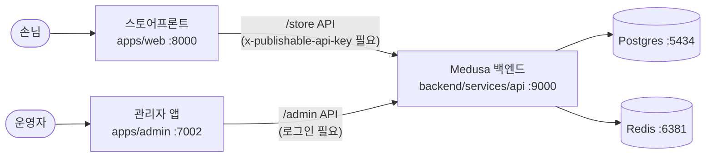

# 01. 프로젝트 이해 (오리엔테이션)

## 1. 이 문서는

이 프로젝트를 **처음 보는 분**을 위한 오리엔테이션입니다. "무엇을 만드는지", "시스템이 어떻게 생겼는지", "어떤 개념을 알아야 하는지"를 빠르게 잡고 가시는 게 목표입니다.

---

## 2. 무엇을 만드나

- 우리는 **고객용 스토어프론트(`apps/web`)** 를 개발합니다. 손님이 들어와서 상품을 보고, 장바구니에 담고, 결제하는 그 화면이에요.
- 한국 시장용 **한국형(KRW) 쇼핑몰**입니다. 기본 통화는 원화(KRW), 기본 진입 경로는 `/kr` 입니다.
- 백엔드(커머스 서버)와 관리자 앱은 **이미 만들어져 있습니다.** 우리가 새로 짜는 건 손님이 보는 화면이에요.
- 대부분의 화면 개발은 **AI 어시스턴트의 도움**을 받아 진행합니다. 그래서 "어디에 무엇이 있는지" 구조를 이해하는 게 코딩 실력보다 중요합니다.

> 즉, **백엔드는 그대로 두고 `apps/web`만 개발**한다고 생각하시면 됩니다.

---

## 3. 시스템 3구성

이 프로젝트는 크게 **백엔드 / 관리자 앱 / 스토어프론트** 세 덩어리 + **인프라**로 이루어집니다.

| 구성 | 위치 | 주소 | 역할 | 우리가 손대나? |
|------|------|------|------|----------------|
| 백엔드 Medusa | `backend/services/api` | http://localhost:9000 | 커머스 API 서버 (화면 없음). 고객용 `/store` API + 관리자용 `/admin` API 둘 다 제공 | ❌ (그대로 사용) |
| 관리자 앱 | `apps/admin` | http://localhost:7002 | 운영자(사장님)용 화면. 자체 Next.js 앱이 `/admin` API 호출 | ❌ (참고만) |
| **스토어프론트** | **`apps/web`** | **http://localhost:8000** | **손님용 화면. `/store` API만 호출. ← 우리가 개발** | ✅ |
| 인프라 | Docker | Postgres `:5434`, Redis `:6381` | 데이터 저장소 / 캐시 | ❌ (띄우기만) |

> 참고: Medusa에 **내장된 admin 화면은 꺼져 있습니다.** 관리자 화면은 별도 Next.js 앱(`apps/admin`)이 따로 떠서 `/admin` API를 호출합니다.

Medusa 버전은 **v2.15.3** 입니다. (문서/검색 시 v2 기준으로 보세요. v1과 구조가 많이 다릅니다.)

---

## 4. 데이터는 어디서 오나

- 스토어프론트는 데이터를 **직접 만들지 않습니다.** 화면에 보이는 상품/가격/재고/카테고리/컬렉션은 전부 백엔드에 있는 데이터예요.
- 이 데이터는 **관리자 앱에서 등록**하거나 **시드(seed) 스크립트로 미리 넣어둔 것**입니다. 백엔드에 데이터가 없으면 스토어 API로도 아무것도 안 나옵니다.
- 그래서 "상품이 안 보여요" 문제는 보통 **프런트 버그가 아니라 데이터/키 문제**인 경우가 많습니다.
- ⚠️ **퍼블리셔블 키나 region ID, product ID 등은 DB마다 값이 다릅니다. 절대 하드코딩하지 마세요.** (자세한 이유는 5번 참고)

---

## 5. 꼭 아는 핵심 개념 (쉽게)

처음 보면 단어가 많지만, 한 줄씩만 잡고 가시면 됩니다.

- **region(리전)**: 통화·국가 묶음. 우리는 **한국(kr) / KRW(원화)** 를 씁니다. 가격은 리전에 따라 달라집니다.
- **sales channel(판매 채널) + publishable key**: "이 손님은 어느 매장에서 왔나"를 구분하는 장치. 스토어 API를 부를 때 **`x-publishable-api-key` 헤더가 반드시** 들어가야 합니다. 없으면 **401 에러 또는 상품이 아예 안 보입니다.**
- **product / variant / option / price**: 상품(product)은 여러 **옵션(option, 예: 색상·사이즈)** 조합인 **variant(실제 판매 단위)** 를 가집니다. 가격(price)은 variant + 리전에 붙습니다.
- **inventory(재고)**: 재고 항목(item)과 위치별 수량(level), 그리고 주문 시 잡아두는 **예약(reservation)** 으로 관리됩니다.
- **cart → order 흐름**: 장바구니(cart)에 담고 → 배송지/결제 정보를 채우고 → 주문(order)으로 확정합니다.
- **payment / fulfillment**: payment는 결제, fulfillment는 배송 처리(상품 보내기)를 뜻합니다.
- **promotion(프로모션/쿠폰)**: 할인 코드·자동 할인 규칙입니다.
- **ISR / revalidate**: Next.js 캐싱 개념. 관리자에서 상품을 바꾸면 프런트 캐시를 무효화(revalidate)해서 새 데이터를 보여줍니다.

---

## 6. 데이터는 어디서 오나 — 현재 연동 상태

> 📌 **초기 계획은 "한국형 기능은 mock 으로 먼저"** 였지만, 2026-06~07 에 **대부분 실제 `/store` API 로 교체 완료**되었습니다.

| 구분 | 내용 | 현재 상태 |
|------|------|-------------|
| 🟢 표준 Medusa | 상품·카테고리·카트·주문·결제·프로모션 | `/store` API 직접 연동 |
| 🟢 한국형 커스텀 | 리뷰·상품문의·포인트·회원등급·쿠폰함·위시리스트·약관/동의·상품정보고시·타임세일·재입고알림·비회원 주문조회·고객센터 | **커스텀 `/store` 라우트 구현 완료 → 실연동** |
| 🔴 아직 mock | **본인인증(PASS/NICE)·소셜로그인(카카오/네이버)** | 외부 계약·비용 필요 → 데모 동작 |
| 🟡 수동 운영 | 결제(무통장/수기) | PG 계약 시 실연동 |

- 모든 백엔드 호출은 `apps/web/src/lib/data/*` 를 경유합니다. **실연동 여부가 궁금하면 그 파일이 fetch 를 하는지 보면 됩니다.**
- 상세 필드·관계는 [`05_데이터모델_ERD.md`](./05_데이터모델_ERD.md), 화면별 상태는 [`07_화면별_백로그.md`](./07_화면별_백로그.md) 참고.

---

## 7. 기술 스택 (고정)

아래 스택은 정해져 있습니다. 임의로 다른 라이브러리를 끌어오지 마세요.

- **TypeScript**
- **Next.js 15** (App Router)
- **React 19**
- **TailwindCSS** + **@medusajs/ui-preset**
- **@medusajs/js-sdk** (백엔드 호출용 SDK)

> 규칙: **모든 백엔드 호출은 `lib/data/*`를 경유**합니다. 컴포넌트에서 직접 `fetch`로 백엔드를 때리지 마세요. (테스트·캐싱·키 주입을 한곳에서 관리하기 위함)

---

## 8. 용어집

| 용어 | 한 줄 설명 |
|------|------------|
| region | 통화·국가 묶음 (우리는 한국/KRW) |
| sales channel | 판매 채널. 어느 매장에서 온 손님인지 구분 |
| publishable key | 스토어 API 호출 시 `x-publishable-api-key` 헤더로 넣는 공개 키 |
| variant | 실제 판매 단위 (옵션 조합, 예: "블랙 / L") |
| SKU | 재고 관리용 고유 코드 (variant에 붙음) |
| inventory level | 특정 위치(창고)의 재고 수량 |
| reservation | 주문 진행 중 임시로 잡아두는 재고 예약 |
| fulfillment | 배송 처리 (상품을 손님에게 보내는 과정) |
| promotion | 할인/쿠폰 규칙 |
| ISR / revalidate | Next.js 캐시 갱신 (관리자 변경 → 프런트 캐시 무효화) |
| lib/data | 스토어프론트의 백엔드 호출 전용 레이어 |
| App Router | Next.js의 `app/` 디렉터리 기반 라우팅 방식 |
| store API | 고객용 `/store` 엔드포인트 |
| mock 계약 | 아직 API가 없는 기능을 위한 가짜 데이터/타입 약속 |

---

## 9. 다음 문서

아래 순서로 읽으시길 권장합니다.

1. [`02_개발환경_구축.md`](./02_개발환경_구축.md) — 로컬에서 환경(인프라+앱) 띄우기
2. [`03_접속정보_계정.md`](./03_접속정보_계정.md) — 계정/포트 정보 (예: 관리자 로그인 `admin@shop.local` / `admin1234!` — **로컬 전용**)
3. [`04_관리자_기능_이해.md`](./04_관리자_기능_이해.md) — 도메인(커머스 운영) 이해
4. [`05_데이터모델_ERD.md`](./05_데이터모델_ERD.md) — 데이터 구조/관계
5. [`09_AI개발_가이드.md`](./09_AI개발_가이드.md) — AI로 스토어프론트 개발하기

전체 문서 순서와 목차는 [`README.md`](../04_점검기록/통합테스트/README.md)에서 확인하세요.
