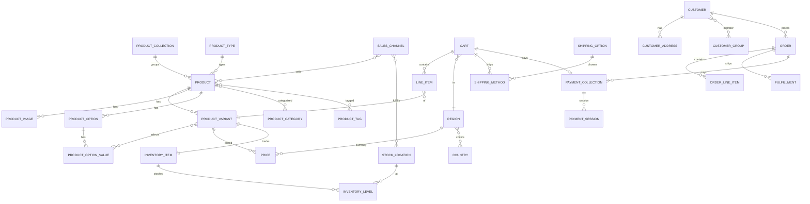

# AI_51 · 데이터 모델 레퍼런스 (스토어프론트 자급식 사전)

> **이 문서의 목적**: 이 문서를 읽는 AI는 레포 접근이 없습니다. `AI_5x` 문서만 보고
> 스토어프론트(`apps/web`) 화면을 **정확한 데이터 형태(data shape)** 에 맞춰 구현해야 합니다.
> 따라서 이 문서는 **자급식(self-contained)** 입니다 — 모든 엔티티/필드/enum/관계/스토어 API
> 엔드포인트/화면↔데이터 매핑을 이 안에 그대로 담았습니다. "X 참조"로 생략하지 않습니다.
>
> 기준: Medusa v2.15.3 표준 + 커스텀 KR 모듈. 백엔드 포트 **9000**. 통화 **KRW(원 단위 정수)**.
> 실데이터 규모(시드 실행 후 기준): 상품 19 / 변형 65 / 재고 9,545 / 주문 38 / 회원 29 / 쿠폰 2 / 캠페인 2 /
> 리뷰 15 / 문의 6 / 약관 4 / 컬렉션 2 / 카테고리 11 / 분야 2·분류 7.
> (이 수치는 환경 시드 실행 후 기준 — 시드 스크립트 순서는 **AI_50 §9-1** 참조. 비어 있으면 시드를 다시 실행.)

---

## 0. 원칙 (가장 먼저 — 3가지)

1. **표준 Medusa 엔티티 = `/store` API로 직접 연동** 🟢
   상품·변형·가격·재고·옵션·카테고리·컬렉션·카트·배송·결제·주문·고객 등.
   `apps/web/src/lib/data/*.ts`의 server action에서 `sdk.client.fetch("/store/...")`로 호출.
   백엔드 포트 9000, 타입은 `@medusajs/types`의 `HttpTypes.Store*`.

2. **커스텀 KR 모듈 = `/store` 라우트 없음 → 전부 admin 전용 → 프런트는 mock으로 개발** 🔴
   리뷰·문의·적립금·등급·동의·약관·고시/분류체계·위시·인기검색·금칙어·타임세일·제재·반품정책 등.
   `lib/data/<도메인>.ts`에 **아래 실제 모델의 필드명/enum 그대로** 타입을 정의하고
   **결정적(deterministic) mock**을 반환. 백엔드 store 라우트가 생기면 fetch만 교체.

3. **링크는 FK가 아니라 text id 느슨연결**
   커스텀 모듈 ↔ Medusa 코어 사이엔 DB 조인 보장이 없습니다.
   `customer_id` / `product_id` / `order_id` **문자열**로 매칭합니다. mock 설계도 이 id 기준.

> **범례**: 🟢 store API 직접 연동 · 🟡 computed(요청 파라미터 전달 시 계산) · 🔴 admin-only → **프런트 mock 필요**

### 표기/금액 규칙 (반드시 준수)
- KRW 금액은 **원 단위 정수**(소수점 없음). 현실적 가격대 **₩15,000 ~ ₩40,000**.
- 화면 표기는 `convertToLocale(amount, currency_code)` (ko-KR) 사용. **₩ 하드코딩 금지.**
- 가격은 항상 `currency_code`와 함께 다룬다(`"krw"` / `"eur"`).

---

## 1. ERD — 핵심 커머스 관계 (표준 Medusa, 프런트 직접 연동)



### 흐름 요약
- **진열**: `COLLECTION` / `CATEGORY` → `PRODUCT` → `VARIANT` → `calculated_price`(🟡) + `inventory_quantity`(🟡).
- **구매**: `CART` → `LINE_ITEM`(variant 참조) → `SHIPPING_METHOD`(shipping_option 선택) → `PAYMENT_COLLECTION` → 주문완료 시 `ORDER`.
- **회원**: `CUSTOMER` → `CUSTOMER_ADDRESS`, `CUSTOMER_GROUP`, `ORDER`.

---

## 2. 표준 엔티티 사전 (🟢 store API 직접 연동)

> 모든 표준 엔티티는 `id`(string)와 `created_at`/`updated_at`(ISO 8601 string)을 기본 보유.
> 필드 타입의 `?`는 nullable/optional. 가격/재고 계산 필드는 🟡(요청 파라미터 필요).

### 2.1 PRODUCT 🟢 — `GET /store/products`, `GET /store/products/{id}`
조회 시 `region_id`와 `fields`를 함께 전달(가격/재고 계산을 위해).
실사용 fields 예: `*variants.calculated_price,+variants.inventory_quantity,*variants.images,+metadata,+tags`

| 필드 | 타입 | 설명 |
|---|---|---|
| id | string | 상품 id (`prod_...`) |
| handle | string | URL 슬러그 → `/products/{handle}` |
| title | string | 상품명 |
| subtitle | string? | 부제 |
| description | string? | 상세 설명(긴 텍스트) |
| thumbnail | string? | 대표 이미지 URL |
| status | enum | `draft` \| `proposed` \| `published` \| `rejected` (스토어 노출은 published) |
| collection_id | string? | 소속 컬렉션 |
| type_id | string? | 표준 상품유형 id |
| material | string? | 소재(상품정보고시) |
| origin_country | string? | 원산지(상품정보고시) |
| weight / length / width / height | number? | 배송·고시용 치수(weight는 g 권장) |
| metadata | object? | 추가 키-값(고시 확장 등) |
| variants | PRODUCT_VARIANT[] | 변형 목록 |
| images | PRODUCT_IMAGE[] | 이미지 목록 |
| options | PRODUCT_OPTION[] | 옵션 정의 |
| categories | PRODUCT_CATEGORY[] | 소속 카테고리(다대다) |
| collection | PRODUCT_COLLECTION? | 소속 컬렉션 객체 |
| tags | PRODUCT_TAG[] | 태그 |
| type | PRODUCT_TYPE? | 표준 상품유형 객체 |

### 2.2 PRODUCT_VARIANT 🟢 — `product.variants[]`
| 필드 | 타입 | 설명 |
|---|---|---|
| id | string | 변형 id (`variant_...`) |
| title | string | 변형명(예: "S / 블랙") |
| sku | string? | 재고관리코드 |
| manage_inventory | boolean | 재고 추적 여부(현재 전 변형 true) |
| allow_backorder | boolean | 품절 주문 허용 |
| product_id | string | 소속 상품 |
| options | PRODUCT_OPTION_VALUE[] | 선택된 옵션값 |
| **calculated_price** 🟡 | object? | 아래 PRICE. `region_id` 전달 시 채워짐 |
| **inventory_quantity** 🟡 | number? | 가용 재고. `+variants.inventory_quantity` fields 요청 시 채워짐 |

### 2.3 PRICE (calculated_price) 🟢🟡 — `variant.calculated_price`
`region_id`(또는 country) 전달 시 계산되어 변형에 내려옴.

| 필드 | 타입 | 설명 |
|---|---|---|
| calculated_amount | number | 최종가(KRW 원 단위 정수) |
| original_amount | number | 할인 전 원가 |
| currency_code | string | `"krw"` \| `"eur"` |
| price_type | string | `"default"` \| `"sale"` 등 |
| calculated_price.price_list_type | string? | 세일 적용 여부 판별용 |

> 프런트 가공 타입(참고, `types/global.ts`의 `VariantPrice`):
> `calculated_price_number`, `calculated_price`(표기문자열), `original_price_number`,
> `original_price`, `currency_code`, `price_type`, `percentage_diff`.

### 2.4 PRODUCT_OPTION / PRODUCT_OPTION_VALUE 🟢 — `product.options[]`
| 엔티티 | 필드 | 타입 | 설명 |
|---|---|---|---|
| PRODUCT_OPTION | id / title | string | 옵션명(예: "사이즈", "색상") |
| PRODUCT_OPTION | product_id | string | 소속 상품 |
| PRODUCT_OPTION | values | PRODUCT_OPTION_VALUE[] | 가능한 값 목록 |
| PRODUCT_OPTION_VALUE | id / value | string | 값(예: "S", "블랙") |
| PRODUCT_OPTION_VALUE | option_id | string | 소속 옵션 |

> ⚠️ 상품 "옵션"(사이즈/색상)은 **표준 PRODUCT_OPTION**. 반면 상품 "분류 체계"(분야/분류)는
> **커스텀 product-type 모듈**(§3.7)이다. 이름이 비슷하니 절대 혼동 말 것.

### 2.5 PRODUCT_CATEGORY 🟢 — `GET /store/product-categories`
| 필드 | 타입 | 설명 |
|---|---|---|
| id / name / handle | string | 카테고리 식별·URL |
| parent_category_id | string? | 트리 부모(null=루트) |
| category_children | PRODUCT_CATEGORY[] | 하위 카테고리 |
| rank | number | 정렬 순서 |
| is_active | boolean | 노출 여부 |
| is_internal | boolean | 내부용 숨김 |
| description | string? | 설명 |

(현재 카테고리 11개, 트리 구조)

### 2.6 PRODUCT_COLLECTION 🟢 — `GET /store/collections`, `GET /store/collections/{id}`
| 필드 | 타입 | 설명 |
|---|---|---|
| id / title / handle | string | 식별·URL |
| metadata | object? | 추가 |
| products | PRODUCT[] | 소속 상품 |

(현재 컬렉션 2개 — 예: 신상품 / 베스트. 홈 진열에 사용)

### 2.7 PRODUCT_TYPE (표준) 🟢 — `product.type`
| 필드 | 타입 | 설명 |
|---|---|---|
| id / value | string | 표준 상품유형 값 |

> 표준 type은 단순 라벨. 한국형 분야/분류 체계는 커스텀 모듈(§3.7) 사용.

### 2.8 PRODUCT_TAG 🟢 — `product.tags[]`
| 필드 | 타입 | 설명 |
|---|---|---|
| id / value | string | 태그 값 |

### 2.9 PRODUCT_IMAGE 🟢 — `product.images[]`
| 필드 | 타입 | 설명 |
|---|---|---|
| id / url | string | 이미지 URL |
| rank | number? | 순서 |

### 2.10 REGION 🟢 — `GET /store/regions`, `GET /store/regions/{id}`
| 필드 | 타입 | 설명 |
|---|---|---|
| id | string | region id (`reg_...`) |
| name | string | 지역명 |
| currency_code | string | `"krw"` / `"eur"` |
| countries | array | `[{ iso_2, display_name }]` |

(현재: 한국/krw[kr], Europe/eur. countryCode → region 매핑은 `lib/data/regions.ts`)

### 2.11 SALES_CHANNEL 🟢 (간접)
| 필드 | 타입 | 설명 |
|---|---|---|
| id / name | string | 판매 채널 |

> 스토어 publishable key가 SC를 결정. 프런트는 직접 SC를 다루지 않고, SC↔재고위치 연결이
> `variant.inventory_quantity` 계산의 전제일 뿐. (UI 직접 노출 없음)

### 2.12 CART 🟢 — `POST /store/carts`(생성), `GET /store/carts/{id}`, `POST /store/carts/{id}`(수정)
조회 fields 예: `*items, *region, *items.product, *items.variant, *items.thumbnail, +items.total, *promotions, +shipping_methods.name`

| 필드 | 타입 | 설명 |
|---|---|---|
| id | string | cart id (`cart_...`) |
| region_id | string | 지역 |
| currency_code | string | 통화 |
| email | string? | 게스트 결제용 |
| customer_id | string? | 로그인 시 연결 |
| items | LINE_ITEM[] | 담긴 상품 |
| shipping_address | ADDRESS? | 배송지 |
| billing_address | ADDRESS? | 청구지 |
| shipping_methods | SHIPPING_METHOD[] | 선택 배송수단 |
| promotions | array? | 적용 프로모션(쿠폰) |
| item_subtotal | number | 상품 소계 |
| shipping_total | number | 배송비 합 |
| tax_total | number | 세금 |
| discount_total | number | 할인 합 |
| total | number | 결제 예정 총액 |

### 2.13 LINE_ITEM 🟢 — `cart.items[]` / `order.items[]`
| 필드 | 타입 | 설명 |
|---|---|---|
| id | string | 라인 id |
| variant_id | string | 변형 |
| product_id | string | 상품 |
| title | string | 표시명 |
| thumbnail | string? | 썸네일 |
| quantity | number | 수량 |
| unit_price | number | 단가 |
| subtotal | number | 소계 |
| total | number | 합계(할인/세 반영) |

### 2.14 SHIPPING_OPTION 🟢 — `GET /store/shipping-options?cart_id={cartId}`
운임 계산: `POST /store/shipping-options/{optionId}/calculate` (body `{ cart_id, data }`)

| 필드 | 타입 | 설명 |
|---|---|---|
| id / name | string | 예: "기본 배송(국내)" |
| amount | number | 운임(예: 3000) |
| price_type | string | `flat_rate` \| `calculated` |
| service_zone_id | string | 서비스 존 |

### 2.15 SHIPPING_METHOD 🟢 — `cart.shipping_methods[]`
| 필드 | 타입 | 설명 |
|---|---|---|
| id | string | 메서드 id |
| shipping_option_id | string | 선택한 옵션 |
| name | string | 표시명 |
| amount | number | 운임 |

### 2.16 PAYMENT_COLLECTION / PAYMENT_SESSION 🟢 — `cart.payment_collection`
| 엔티티 | 필드 | 타입 | 설명 |
|---|---|---|---|
| PAYMENT_COLLECTION | id / amount / currency_code | - | 결제 묶음 |
| PAYMENT_COLLECTION | status | enum | `not_paid` \| `authorized` \| `captured` 등 |
| PAYMENT_COLLECTION | payment_sessions | PAYMENT_SESSION[] | 세션들 |
| PAYMENT_SESSION | id / provider_id | string | PG/수단 식별 |
| PAYMENT_SESSION | status | enum | `pending` \| `authorized` 등 |
| PAYMENT_SESSION | data | object | provider별 데이터 |

> 실 PG 연동은 mock 가능(🔴). 결제수단 목록/세션 생성은 `lib/data/payment.ts` 패턴.

### 2.17 ORDER 🟢 — `GET /store/orders`, `GET /store/orders/{id}` (인증 필요)
| 필드 | 타입 | 설명 |
|---|---|---|
| id | string | order id (`order_...`) |
| display_id | number | 사람이 보는 주문번호 |
| status | enum | `pending` \| `completed` \| `canceled` 등 |
| payment_status | enum | `not_paid` \| `captured` \| `refunded` 등 |
| fulfillment_status | enum | `not_fulfilled` \| `shipped` \| `delivered` 등 |
| email | string | 주문 이메일 |
| customer_id | string? | 회원 주문이면 연결 |
| items | LINE_ITEM[] | 주문 상품 |
| shipping_address / billing_address | ADDRESS | 주소 |
| currency_code | string | 통화 |
| item_total / shipping_total / tax_total / total | number | 합계 |
| created_at | string | 주문일 |

(현재 주문 38건)

### 2.18 CUSTOMER 🟢 — `GET /store/customers/me` (인증), `POST /store/customers`(가입)
조회 fields 예: `*orders`

| 필드 | 타입 | 설명 |
|---|---|---|
| id | string | customer id (`cus_...`) |
| email | string | 이메일 |
| first_name / last_name | string? | 이름 |
| phone | string? | 연락처 |
| has_account | boolean | true=가입회원 / false=게스트 |
| addresses | CUSTOMER_ADDRESS[] | 주소록 |
| groups | CUSTOMER_GROUP[] | 소속 그룹 |
| orders | ORDER[]? | fields로 요청 시 |

(현재 회원 29명)

### 2.19 CUSTOMER_ADDRESS 🟢 — `customer.addresses[]`, `POST /store/customers/me/addresses`
| 필드 | 타입 | 설명 |
|---|---|---|
| id | string | 주소 id |
| first_name / last_name | string? | 수령인 |
| address_1 / address_2 | string? | 주소 |
| city / province | string? | 시/도 |
| postal_code | string? | 우편번호 |
| country_code | string? | 국가(`kr`) |
| phone | string? | 연락처 |
| is_default_shipping / is_default_billing | boolean | 기본 배송/청구지 |
| company | string? | 회사 |

### 2.20 CUSTOMER_GROUP 🟢 — `customer.groups[]`
| 필드 | 타입 | 설명 |
|---|---|---|
| id / name | string | 그룹명 |

> ⚠️ 표준 customer_group은 한국형 "회원 등급"이 아니다. 등급은 커스텀 membership 모듈(§3.3).

### 2.21 INVENTORY (INVENTORY_ITEM / INVENTORY_LEVEL / STOCK_LOCATION) 🟢🟡
프런트는 보통 `variant.inventory_quantity`(가용수량)로만 소비. 상세 분해는 아래.

| 엔티티 | 필드 | 타입 | 설명 |
|---|---|---|---|
| INVENTORY_ITEM | id / sku | string | 재고 아이템 |
| INVENTORY_LEVEL | stocked_quantity | number | 입고 수량 |
| INVENTORY_LEVEL | reserved_quantity | number | 예약(주문 점유) |
| INVENTORY_LEVEL | available_quantity | number | 가용 = stocked − reserved |
| INVENTORY_LEVEL | location_id | string | 재고 위치 |
| STOCK_LOCATION | id / name | string | 예: "국내 물류창고" |
| STOCK_LOCATION | address | object | 위치 주소 |

(현재 재고 총합 9,545)

---

## 3. 커스텀 KR 모듈 사전 (🔴 admin 전용 → **프런트 mock 필요**)

> **이 절의 모든 모델은 store 라우트가 없다 → 프런트는 반드시 mock으로 개발.**
> mock 타입은 아래 **실제 모델 필드명/enum 그대로** 정의한다(백엔드 store API 생기면 fetch만 교체).
> 모든 모델은 `id` + `created_at` / `updated_at` / `deleted_at` 기본 보유.
> **링크는 text id 느슨연결**(`customer_id` / `product_id` / `order_id`).

### 3.1 review (`review`) — 리뷰 & 문의 (하나의 모델로 둘 다)
| 필드 | 타입/enum | 설명 |
|---|---|---|
| id | string | |
| type | `review` \| `inquiry` | 리뷰 vs 문의 구분 |
| product_id | string? | 있으면 상품Q&A/상품리뷰, 없으면 1:1문의 |
| product_title | string? | 표시용 캐시 |
| customer_id | string? | 작성 회원(느슨연결) |
| author_name | string? | 마스킹 표기(예: 김**) |
| author_email | string? | 마스킹 저장 |
| rating | 1~5 number? | 리뷰만(문의는 null) |
| title | string? | 제목 |
| content | string | 본문(필수) |
| status | `pending` \| `published` \| `hidden` \| `answered` | 노출/처리 상태 |
| reply | string? | 운영자 답변 |
| replied_at | string? | 답변 시각(ISO) |
| has_photo | boolean? | 포토리뷰 |
| created_at | string | 작성일 |

> 화면: 상품상세 리뷰탭(**이미 mock 구현됨 → `lib/data/reviews.ts`**), 마이-내리뷰, CS-상품Q&A/1:1문의.
> (현재 리뷰 15, 문의 6)

### 3.2 customer-point (`customerPoint`) — 적립금
**point_ledger** (append-only, 잔액=합산):
| 필드 | 타입/enum | 설명 |
|---|---|---|
| id | string | |
| customer_id | string | 느슨연결 |
| entry_type | `earn` \| `redeem` \| `expire` | 적립/사용/만료 |
| amount | number(부호) | earn +, redeem/expire − |
| reason | string? | 사유 |
| order_id | string? | 관련 주문 |
| expires_at | string? | 만료 예정 |
| created_at | string | |

**point_accrual_log** (멱등 보장): `order_id + reason` UNIQUE · `points_earned`(number).

> **잔액 = ledger의 amount 합산.** mock도 합산식으로 잔액을 계산해야 함.
> 화면: 마이-적립금(잔액 + 내역 리스트).

### 3.3 membership (`membership`) — 회원 등급
**customer_membership** (고객당 1개):
| 필드 | 타입/enum | 설명 |
|---|---|---|
| id | string | |
| customer_id | string UNIQUE | 1:1 |
| accrued_amount | number | 누적 구매액(원) |
| current_tier | `일반` \| `실버` \| `골드` \| `VIP` | 현재 등급 |
| last_change_reason | `accrual` \| `refund` \| `manual` | 마지막 변경 사유 |

> 등급 구간/적립률 자체는 별도 policy 모듈(`membership.tiers`)에 있음(여기 아님).
> 화면: 마이-등급/혜택. mock에선 등급 기준표도 상수로 같이 둔다.

### 3.4 customer-consent (`customerConsent`) — 동의 이력
**consent_log** (append-only, 채널별 최신 레코드 = 현재 상태):
| 필드 | 타입/enum | 설명 |
|---|---|---|
| id | string | |
| customer_id | string | |
| channel | `marketing` \| `terms` \| `privacy` \| `sms` \| `email` | 동의 채널 |
| agreed | boolean | 동의/철회 |
| recorded_at | string | 기록 시각 |

> 화면: 마이-동의관리(채널별 on/off 토글 + 이력). "현재 상태"는 채널별 가장 최신 레코드.

### 3.5 legal-doc (`legalDoc`, dir `legal-kr`) — 약관/방침
**legal_doc**:
| 필드 | 타입/enum | 설명 |
|---|---|---|
| id | string | |
| type | `terms_of_service` \| `privacy_policy` \| `marketing_consent` \| `third_party_consent` | 문서 종류 |
| version | string | 버전(예: "1.2") |
| title | string | 제목 |
| body | string | 본문(긴 텍스트/HTML) |
| effective_at | string | 시행일 |
| status | `draft` \| `published` \| `archived` | 게시 상태 |
| requires_consent | boolean | 가입 시 필수 동의 여부 |

(부속: `legal-kr/withdrawal-7day` 청약철회 7일 — order 연결)
(현재 약관 4개)

> 화면: 약관/개인정보처리방침 페이지(푸터 링크), 가입 동의 화면. **published 최신 version** 노출.

### 3.6 product-curation (`productCuration`) — 위시/조회수/인기검색/금칙어
| 모델 | 필드 | 설명 |
|---|---|---|
| **product_wishlist** | customer_id · product_id | (customer_id, product_id) 쌍 UNIQUE |
| **product_view_count** | product_id · count · last_viewed_at | 조회수 |
| **popular_search_term** | term(UNIQUE) · count · last_searched_at · is_banned | 인기검색어 |
| **banned_word** | word(UNIQUE) · scope | scope: `all` \| `search` \| `product_name` \| `review` |

> 화면: 위시리스트(마이/상품 하트), 인기검색어(검색바 드롭다운), 검색 입력 금칙어 필터.

### 3.7 product-type (`productType`) — 상품 분류 체계(분야/분류) + 고시
| 모델 | 필드 | 설명 |
|---|---|---|
| **product_type_template** (자기참조 트리) | id · parent_id · name · disclosure_code · rank | `parent_id=null` → **분야**, 값 있으면 **분류** |
| **product_type_option_template** | type_template_id · option_title · option_values(json string[]) · rank | 옵션 템플릿(예: 사이즈/색상) |
| **product_type_disclosure_field** | type_template_id · field_key · label · required(bool) · input_type · sort_order | 고시 항목. input_type: `text` \| `textarea` |

(현재 분야 2 · 분류 7)

> 화면: 상품정보고시 항목 구성 참조(상세 고시탭). ※ 실제 상품 옵션 자체는 표준 PRODUCT_OPTION(§2.4) 사용.

### 3.8 time-sale (`timeSale`) — 타임세일
**time_sale**:
| 필드 | 타입/enum | 설명 |
|---|---|---|
| id | string | |
| product_id | string | 대상 상품(느슨연결) |
| title | string | 세일명 |
| discount_type | `percent` \| `fixed` | 할인 방식 |
| discount_value | number | percent면 %, fixed면 원 |
| original_price | number | 원가(원) |
| starts_at | string | 시작 |
| ends_at | string | 종료 |
| status | `scheduled` \| `active` \| `ended` | 상태 |

> 화면: 타임세일 진열/카운트다운. **카운트다운은 클라이언트에서만**(mock 데이터에 현재시각 넣지 말 것).

### 3.9 customer-sanction (`customerSanction`) — 제재
| 필드 | 타입/enum | 설명 |
|---|---|---|
| id | string | |
| customer_id | string | 대상 |
| level | `warn` \| `seven_days` \| `thirty_days` \| `permanent` | 제재 수위 |
| reason | string | 사유 |
| until_at | string? | 해제 예정(permanent면 null) |
| active | boolean | 활성 여부 |

> 화면: 주로 운영. 프런트는 로그인 차단/제재 안내 표시 정도.

### 3.10 rma-extension (`rmaExtension`) — 반품/교환 정책 (order_return에 defineLink)
| 모델 | 필드 | 설명 |
|---|---|---|
| **ReturnsPolicy** | window_days(예: 7) · restocking_fee_pct · shipping_fee_payer | 반품 가능 기간/수수료/배송비 부담 |
| **ReturnInspection** | condition(`A`~`C` \| `DISPOSE`) · note | 반품 검수 등급 |
| **ReimbursementMethod** | method · status | method: `REFUND` \| `STORE_CREDIT` \| `EXCHANGE` \| `REPLACEMENT` |
| **ReturnShippingFeePolicy** | reason · payer | 반품 배송비 정책 |

부속 **order-ops-kr**: `order_admin_memo` · `order_cancellation` · `refund_idempotency`.

> 화면: 구매확정 / 반품·교환 신청 UI(백엔드 RMA 연동 전 mock). 링크는 `order_id` text.

### 3.11 운영 전용(프런트 무관, 참고만)
`rbac`(권한) · `audit`(감사로그) · `settlement-payout`(정산) · `ops/maintenance`(점검모드) · `tax-invoice`(세금계산서) · `policy`(정책 저장소). → 스토어프론트에서 다루지 않음.

---

## 4. 화면 ↔ 데이터 ↔ 소스 매핑표 (스토어프론트 기준)

| 스토어프론트 화면 | 핵심 엔티티 | 소스 | lib/data 모듈 |
|---|---|---|---|
| 홈 | COLLECTION · PRODUCT | 🟢 store | `collections`, `products` |
| 상품목록/카테고리 | PRODUCT · CATEGORY | 🟢 store | `products`, `categories` |
| 검색 | PRODUCT + popular_search_term/banned_word | 🟢 store + 🔴 mock | `products` + (search mock) |
| 상품상세 | PRODUCT · VARIANT · PRICE · INVENTORY · OPTION | 🟢 store | `products`, `variants` |
| 상품상세-리뷰탭 | review | 🔴 mock | **`reviews`(구현완료)** |
| 상품상세-Q&A | review(type=inquiry, product_id 有) | 🔴 mock | (cs/qna mock) |
| 상품상세-고시탭 | PRODUCT(material 등) + product_type_disclosure_field | 🟢 + 🔴 | `products` + (disclosure mock) |
| 위시(하트) | product_wishlist | 🔴 mock | (wishlist mock) |
| 타임세일 | time_sale | 🔴 mock | (time-sale mock) |
| 장바구니 | CART · LINE_ITEM | 🟢 store | `cart` |
| 체크아웃-배송 | SHIPPING_OPTION · ADDRESS · REGION | 🟢 store | `fulfillment`, `cart`, `regions` |
| 체크아웃-결제 | PAYMENT_COLLECTION · PAYMENT_SESSION | 🟢 (+실 PG는 🔴 mock) | `payment`, `cart` |
| 주문완료/주문내역 | ORDER | 🟢 store(인증) | `orders` |
| 회원가입/로그인 | CUSTOMER + legal_doc(동의) | 🟢 store + 🔴 mock | `customer` + (legal mock) |
| 마이-기본정보/주소 | CUSTOMER · CUSTOMER_ADDRESS | 🟢 store(인증) | `customer` |
| 마이-적립금 | point_ledger | 🔴 mock | (points mock) |
| 마이-등급/혜택 | customer_membership | 🔴 mock | (membership mock) |
| 마이-쿠폰함 | promotion(고객) | 🔴 mock | (coupons mock) |
| 마이-위시리스트 | product_wishlist | 🔴 mock | (wishlist mock) |
| 마이-동의관리 | consent_log | 🔴 mock | (consents mock) |
| 마이-내리뷰 | review(type=review, customer_id) | 🔴 mock | `reviews` 확장 |
| CS-1:1문의 | review(type=inquiry, product_id=null) | 🔴 mock | (cs mock) |
| 약관/개인정보처리방침 | legal_doc | 🔴 mock | (legal mock) |
| 반품·교환 신청 | ReturnsPolicy / ReimbursementMethod | 🔴 mock | (rma mock) |

---

## 5. mock 계약 설계 규칙 (🔴 도메인 구현 시 필수 준수)

1. **위치/구조**: `apps/web/src/lib/data/<도메인>.ts`. server action(`"use server"`)로 작성.
   `export type ...`로 **§3의 모델 필드명/enum을 그대로** 타입 정의 → 백엔드 store API 생기면 교체가 매끄럽다.

2. **결정적(deterministic) mock**: `Math.random()` / `Date.now()` / `new Date()` **금지**.
   날짜·금액·id는 모두 하드코딩 상수. (SSR 스냅샷 안정성. `reviews.ts` 참고)

3. **교체 지점 표시**: 실제 fetch로 바꿀 자리에 반드시 `// TODO(backend):` 주석 + 예상 엔드포인트 한 줄.
   ```ts
   // TODO(backend): store API 준비 시 mock 교체
   //   const { points } = await sdk.client.fetch(`/store/customers/me/points`, {
   //     headers: { ...(await getAuthHeaders()) },
   //   })
   ```

4. **링크는 text id**: `customer_id` / `product_id` / `order_id` 문자열로 매칭(FK·join 아님).
   함수 시그니처도 이 id를 인자로 받는다(예: `listPoints(customerId: string)`).

5. **파생값은 코드로 계산**: 적립금 잔액은 `point_ledger.amount` 합산, 리뷰 요약은 rating 집계 등
   — mock 데이터엔 원시 레코드만 두고 잔액/평균은 함수에서 계산(실 백엔드 동작과 일치).

6. **금액/통화**: KRW 원 단위 정수, `₩15,000~₩40,000` 대. 표기는 `convertToLocale` 사용(₩ 하드코딩 금지).

7. **enum 값 정확히**: §3의 enum 문자열을 오타 없이 그대로(예: review.status `answered`,
   reimbursement `STORE_CREDIT`, sanction `seven_days`). 백엔드 교체 시 호환을 위해 동일해야 함.
