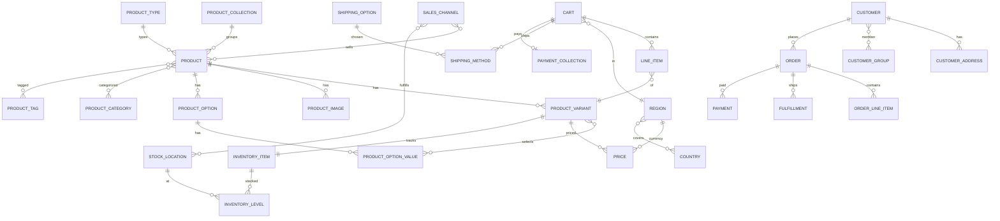

# 05. 데이터모델·ERD (데이터 사전)

> 📄 **문서 #05** · 엔티티·필드·관계, 🟢직접연동 vs 🔴mock, 화면↔데이터 매핑. 👉 다음: [06. 업무분담·IA](./06_업무분담_IA.md)

> **목적**: 스토어프론트(`apps/web`) 개발자가 참조하는 **데이터 모델 사전 + 관계도(ERD)**.
> 어떤 화면이 어떤 엔티티/필드를 쓰고, 어디(store API/mock)서 오는지 한눈에.
> 소스 기준: Medusa v2.15.3 표준 + 커스텀 KR 모듈(`backend/services/api/src/modules`).

## 0. 가장 먼저 알 것 (3가지 원칙)

1. **표준 Medusa 엔티티 = `/store` API로 직접 연동** (상품·가격·재고·카트·주문·고객 등).
2. **커스텀 KR 모듈 = `/store` 라우트 없음 → 전부 admin 전용 → 프런트는 `lib/data/*` mock으로 개발** (리뷰·포인트·등급·쿠폰함·위시·동의·약관·고시·타임세일 등). 백엔드 store 라우트가 생기면 mock만 교체.
3. **링크는 대부분 FK가 아니라 text id 느슨연결** (`customer_id`/`product_id`/`order_id` 문자열). 커스텀 모듈↔Medusa 코어는 join 보장 없음 — mock 설계 시 이 id로 매칭.

> 범례: 🟢 store API 직접 연동 · 🟡 computed(요청 시 계산) · 🔴 admin-only → **프런트 mock 필요**

---

## 1. ERD — 핵심 커머스(표준 Medusa, 프런트 직접 연동)

> 🖼 **모형도를 그림으로 보기**:
> - **이미지 파일**: [`ERD_스토어프론트.png`](./ERD_스토어프론트.png) (더블클릭) · [`ERD_스토어프론트.svg`](./ERD_스토어프론트.svg) (확대해도 깨짐 없음) · 브라우저 뷰어 [`ERD_스토어프론트.html`](./ERD_스토어프론트.html)
> - **소스**: [`ERD_스토어프론트.mmd`](./ERD_스토어프론트.mmd) — 수정 후 `npx -y @mermaid-js/mermaid-cli -i ERD_스토어프론트.mmd -o ERD_스토어프론트.svg` 로 재생성
> - **자동 렌더**: GitHub에서 이 문서를 열면 아래 mermaid가 다이어그램으로 표시됩니다. VS Code는 "Markdown Preview Mermaid Support" 확장 설치 시 미리보기에서 렌더.

---

## 2. 표준 엔티티 사전 (🟢 store API 직접 연동)

> 필드는 store API 응답 기준 핵심만. 전체는 Medusa 문서/응답 참조.

### PRODUCT 🟢 `GET /store/products`
| 필드 | 타입 | 설명 |
|---|---|---|
| id / handle | string | id, URL 슬러그(`/products/{handle}`) |
| title / subtitle / description | string | 표시 텍스트 |
| thumbnail | string | 대표 이미지 URL |
| status | enum | published 등 |
| collection_id / type_id | string | 컬렉션/유형 |
| material / origin_country | string | 상품정보고시(소재/원산지) |
| weight,length,width,height | number | 배송/고시 |
| variants / images / options / categories / tags | relation | 하위 |

### PRODUCT_VARIANT 🟢 (product.variants)
| 필드 | 타입 | 설명 |
|---|---|---|
| id / title / sku | string | 변형 식별 |
| manage_inventory | bool | 재고 추적 여부(현재 전 변형 true) |
| allow_backorder | bool | 품절 주문 허용 |
| **calculated_price** 🟡 | object | `{ calculated_amount, currency_code }` — region_id 전달 시 계산 |
| **inventory_quantity** 🟡 | number | 가용 재고 — SC↔재고위치 연결 기준 계산 |

### PRICE 🟢🟡 (variant.calculated_price)
- `calculated_amount`(숫자, KRW는 원 단위) · `currency_code`("krw"/"eur"). **표기는 `convertToLocale`(ko-KR)**, 하드코딩 금지.

### PRODUCT_CATEGORY 🟢 `GET /store/product-categories`
- id · name · handle · parent_category_id(트리) · rank · is_active · category_children[]

### PRODUCT_COLLECTION 🟢 `GET /store/collections`
- id · title · handle · products[] (현재: 신상품/베스트 상품 — 홈 진열)

### PRODUCT_TYPE / PRODUCT_TAG 🟢
- 표준 Medusa: `value`만. ⚠️ **상품 "분류 체계"(분야/분류) 화면은 이게 아니라 커스텀 `product-type` 모듈**(§3) — 혼동 주의.

### REGION 🟢 `GET /store/regions`
- id · name · currency_code · countries[{iso_2}] (현재: 한국/krw[kr], Europe/eur)

### CART 🟢 `POST /store/carts`, `/store/carts/{id}`
| 필드 | 설명 |
|---|---|
| id · region_id · currency_code · email · customer_id | 기본 |
| items[] (LINE_ITEM) | 담긴 상품 |
| shipping_address / billing_address | 주소 |
| shipping_methods[] | 선택 배송 |
| item_subtotal / shipping_total / tax_total / total | 합계(계산) |

### LINE_ITEM 🟢 (cart.items / order.items)
- id · variant_id · product_id · title · quantity · unit_price · subtotal

### SHIPPING_OPTION 🟢 `GET /store/shipping-options?cart_id=`
- id · name("기본 배송(국내)") · amount(3000) · price_type · service_zone_id

### ORDER 🟢 `GET /store/orders`(인증)
- id · display_id · status · payment_status · fulfillment_status · items[] · total · customer_id

### CUSTOMER 🟢 `/store/customers/me`(인증)
- id · email · first_name · last_name · phone · has_account(true=가입회원/false=게스트) · addresses[] · groups[]

### INVENTORY 🟢🟡 (가용수량은 variant.inventory_quantity로 소비)
- INVENTORY_ITEM(id·sku) → INVENTORY_LEVEL(stocked_quantity·reserved_quantity·available·location_id) → STOCK_LOCATION(name "국내 물류창고"·address)

---

## 3. 커스텀 KR 모듈 사전 (🔴 admin 전용 → **프런트 mock 필요**)

> store 라우트가 없으므로 프런트는 `lib/data/<도메인>.ts` mock으로 개발.
> **mock 타입은 아래 실제 모델 필드에 맞추세요** — 백엔드 store API 생기면 교체가 매끄럽습니다.
> (모든 모델은 `id` + `created_at/updated_at/deleted_at` 기본 보유. 링크는 text id 느슨연결.)

### review (`review`) — 리뷰 & 문의
| 필드 | 타입/enum | 설명 |
|---|---|---|
| type | review \| inquiry | 리뷰 vs 문의 |
| product_id / product_title | string null | 있으면 상품Q&A, 없으면 1:1문의 |
| author_name / author_email | string null | email은 마스킹 저장 |
| rating | 1~5 null | 리뷰만 |
| title / content | string | content 필수 |
| status | pending\|published\|hidden\|answered | |
| reply / replied_at | string/date null | 운영자 답변 |
> 프런트 화면: 상품상세 리뷰탭(이미 mock 구현 `lib/data/reviews.ts`), 마이-내리뷰, CS-상품Q&A/1:1문의.

### customer-point (`customerPoint`) — 적립금
- **point_ledger**(append): customer_id · entry_type(earn\|redeem\|expire) · amount(부호) · reason · expires_at — **잔액=합산**
- **point_accrual_log**: order_id+reason UNIQUE(멱등) · points_earned
> 프런트: 마이-적립금(잔액+내역). mock 잔액은 ledger 합으로 계산하는 형태로.

### membership (`membership`) — 회원 등급
- **customer_membership**(1/고객): customer_id UNIQUE · accrued_amount(누적구매 원) · current_tier(일반/실버/골드/VIP) · last_change_reason(accrual\|refund\|manual)
- 등급 구간/적립률은 `policy` 모듈(`membership.tiers`)에 저장(여기 아님).
> 프런트: 마이-등급/혜택.

### customer-consent (`customerConsent`) — 동의 이력
- **consent_log**(append, 최신=현재): customer_id · channel(marketing\|terms\|privacy\|sms\|email) · agreed(bool) · recorded_at
> 프런트: 마이-동의관리(채널별 on/off + 이력).

### legal-doc (`legalDoc`, dir legal-kr) — 약관
- **legal_doc**: type(terms_of_service\|privacy_policy\|marketing_consent\|third_party_consent) · version · body · effective_at · status(draft\|published\|archived) · requires_consent
- (legal-kr/withdrawal-7day: 청약철회 7일 — order 연결)
> 프런트: 약관/개인정보처리방침 페이지(푸터 링크), 가입 동의.

### product-type (`productType`) — 상품 분류 체계(분야/분류) + 고시
- **product_type_template**(자기참조 트리): parent_id(null=분야, 값=분류) · name · disclosure_code · rank
- **product_type_option_template**: type_template_id · option_title(사이즈/색상) · option_values(json string[]) · rank
- **product_type_disclosure_field**: type_template_id · field_key · label · required · input_type(text\|textarea) · sort_order
> 프런트: 상품정보고시 항목 구성 참조(상세 고시탭). ※ 상품 옵션 자체는 표준 PRODUCT_OPTION 사용.

### product-curation (`productCuration`) — 위시/조회수/인기검색/금칙어
- **product_wishlist**: customer_id · product_id (쌍 unique)
- **product_view_count**: product_id · count · last_viewed_at
- **popular_search_term**: term(unique) · count · last_searched_at · is_banned
- **banned_word**: word(unique) · scope(all\|search\|product_name\|review)
> 프런트: 위시리스트(마이/상품), 인기검색어(검색바), 검색.

### time-sale (`timeSale`) — 타임세일
- time_sale: product_id · title · discount_type(percent\|fixed) · discount_value · original_price · starts_at · ends_at · status(scheduled\|active\|ended)
> 프런트: 타임세일 노출/카운트다운.

### customer-sanction (`customerSanction`) — 제재 (주로 운영, 프런트는 로그인 차단 표시 정도)
- customer_id · level(warn\|seven_days\|thirty_days\|permanent) · reason · until_at · active

### 주문 부가(KR) — 프런트 주문상세/반품에 영향
- **rma-extension**(`rmaExtension`, order_return에 defineLink): ReturnsPolicy(window_days 7·restocking_fee_pct·shipping_fee_payer) · ReturnInspection(condition A~C/DISPOSE) · ReimbursementMethod(REFUND\|STORE_CREDIT\|EXCHANGE\|REPLACEMENT, status) · ReturnShippingFeePolicy(reason·payer)
- **order-ops-kr**: order_admin_memo · order_cancellation · refund_idempotency
> 프런트: 구매확정/반품·교환 신청 UI(백엔드 RMA 연동 전 mock).

### 운영 전용(프런트 무관, 참고): rbac(권한)·audit(감사로그)·settlement-payout(정산)·ops/maintenance(점검모드)·tax-invoice·policy.

---

## 4. 화면 ↔ 데이터 ↔ 소스 매핑 (프런트 기준)

| 스토어프론트 화면 | 핵심 엔티티 | 소스 | lib/data |
|---|---|---|---|
| 홈 | collection·product | 🟢 store | collections, products |
| 상품목록/검색 | product·category | 🟢 store / 검색은 🔴mock | products, (search mock) |
| 상품상세 | product·variant·price·inventory | 🟢 store | products |
| 상품상세-리뷰탭 | review | 🔴 mock | **reviews(완료)** |
| 상품상세-고시탭 | product(material 등)+분류고시 | 🟢/🔴 | products(+disclosure mock) |
| 장바구니 | cart·line_item | 🟢 store | cart |
| 체크아웃-배송 | shipping_option·address | 🟢 store | cart, regions |
| 체크아웃-결제 | payment_collection | 🟢(+PG는🔴mock) | cart, (payment mock) |
| 주문완료/내역 | order | 🟢 store(인증) | orders |
| 회원/마이 | customer·address·group | 🟢 store(인증) | customer |
| 마이-적립금 | point_ledger | 🔴 mock | points(mock) |
| 마이-등급 | customer_membership | 🔴 mock | membership(mock) |
| 마이-쿠폰함 | promotion(고객) | 🔴 mock | coupons(mock) |
| 마이-위시 | product_wishlist | 🔴 mock | wishlist(mock) |
| 마이-동의 | consent_log | 🔴 mock | consents(mock) |
| CS-문의/Q&A | review(inquiry) | 🔴 mock | cs(mock) |
| 약관 페이지 | legal_doc | 🔴 mock | legal(mock) |
| 타임세일 | time_sale | 🔴 mock | time-sale(mock) |

---

## 5. mock 계약 설계 가이드 (요약)
- `lib/data/<도메인>.ts`에 **위 모델 필드명/enum 그대로** 타입 정의(백엔드 교체 매끄럽게).
- 링크는 `customer_id`/`product_id`/`order_id` text로 매칭(FK 아님).
- 표준 패턴(계약→mock→화면→교체)은 [진행현황·인수인계 §2](./11_진행현황_인수인계.md) + `lib/data/reviews.ts` 예시.
